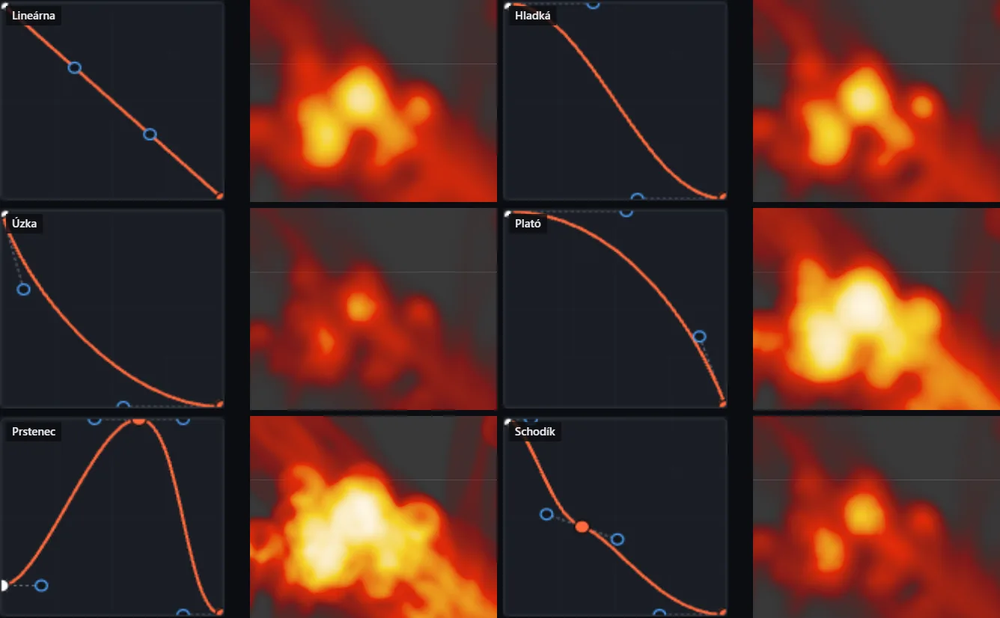

# Tvar spritu

Každý riadok sa kreslí ako okrúhly sprite, ktorý je vždy otočený ku kamere. Jeho veľkosť a profil od stredu k okraju – **priebeh** – rozhodujú, či horúci bod vyzerá ako ostrá bodka, mäkký oblak, kotúč alebo prstenec. Tieto ovládacie prvky sú v sekciách **Tvar tepla** a **Obmedzenia pixelov spritu** na bočnom paneli a platia pre [Teplo](heat.md), [Rozdiel](difference.md), [Teplo tímov](team-heat.md) a ako polovičná šírka čiary pre [Teplo z čiar](line-heat.md).

Zmena ktoréhokoľvek z nich reštartuje nahromadenie (pole sa musí prekresliť s novým tvarom).

Predstavte si každú bodku ako mäkkú škvrnu svetla. Malá škvrna ukazuje jednotlivé miesta; veľká škvrna spája susedov do oblaku. Tvar rozhoduje, aký mäkký je okraj.



## Polomer spritu {#sprite-radius}

Polomer spritu v **jednotkách sveta** (označených ako metre). Predvolene 6 a pri každom načítaní vodorovný rozsah dát / 120 – dosť veľký na to, aby sa susedné vzorky pozdĺž dráhy spojili do pásu a nevyzerali ako vlások. Logaritmický posuvník 0,05 až 2000, úchyt sa dá ťahať až do 50 000.


Veci vzdialené vyzerajú menšie, takže sprite sa na obrazovke s vzdialenosťou zmenšuje. Pri paralelnej projekcii je rovnaký všade, a to je jeden z dôvodov, prečo je paralelný pohľad správny na porovnávanie horúcich bodov ([Kamera](camera.md#projection)).

## Obmedzenia pixelov {#pixel-clamps}

**Obmedzenia pixelov spritu** (predvolene zatvorené) ohraničia polomer na obrazovke po vyššie uvedenom prevode.

| Ovládací prvok | Predvolené | Rozsah (posuv) | Prečo |
|---|---|---|---|
| **Min. polomer v pixeloch** | 1 px | 0-16 (512) | Nedovolí, aby vzdialené dáta zmizli pod jeden pixel. |
| **Max. polomer v pixeloch** | 96 px | 2-1024, logaritmicky (8192) | Ochrana pred prekreslením. Sprite pokrývajúci N pixelov stojí N operácií miešania, takže neobmedzený polomer blízko kamery je to, čo mení rýchly snímok na pomalý. Nad výškou výrezu už nič neobmedzuje. |

**Rovnaká hustota pri každom priblížení** (v sekcii Tvar tepla, predvolene zapnuté) spolupracuje s obmedzeniami. Sprite, ktorý obmedzenie zväčší (vzdialený) alebo zmenší (zblízka), zachová teplo, ktoré by pridal pri svojej skutočnej veľkosti, takže farba znamená ten istý počet riadkov na plochu terénu pri akomkoľvek priblížení. Keď je to vypnuté, obmedzený sprite pridá svoju plnú váhu pri obmedzenej veľkosti a obraz sa mení, ako priletíte bližšie.

## Intenzita v strede a na okraji {#centre-and-edge-intensity}

Teplo, ktoré sprite pridá presne v strede (**Intenzita v strede**, predvolene 1, 0-10, posuv 1000), a na okraji (**Intenzita na okraji**, predvolene 0, -2-10, posuv 1000). Hodnota priebehu *t* (1 v strede, 0 na okraji, tvarovaná útlmom alebo krivkou nižšie) medzi nimi prelína (vzorec je v časti [Pre vývojárov](#for-developers)).

**Záporná intenzita na okraji** spôsobí, že okraj odčíta, čo vyrezáva chladné halo okolo každého horúceho bodu a ostrí zhluky voči sebe. Viditeľnosť zahŕňa [zakrytie](depth-and-culling.md) a [rez](slice.md); doznievanie je [doznievanie Životnosti](timeline.md#history); znamienko je ±1 v [Rozdieli](difference.md).

## Tvar priebehu: Útlm alebo Krivka {#ramp-shape-falloff-or-curve}

**Tvar priebehu** prepína medzi dvoma spôsobmi tvarovania *t* cez sprite. S *d* ako vzdialenosťou od stredu (0) po okraj (1):

### Útlm {#falloff}

Zobrazí sa, keď je vybraný *Útlm* (predvolene).

- **Útlm** (predvolene 1,6, 0,1-8, posuv 64): `t = (1 - d) ^ falloff`. 1 je rovný lineárny priebeh; vyššie hodnoty ťahajú teplo k stredu a sprísňujú horúci bod; pod 1 ho sploštia na kotúč.
- **Hladký priebeh** (predvolene zapnuté): na *t* aplikuje S-krivku smoothstep, takže sprite na okraji doznieva namiesto toho, aby končil viditeľnou hranou.

### Editor krivky {#the-curve-editor}

Zobrazí sa, keď je vybraná *Krivka*. Doslovný prierez spritom: vzdialenosť od stredu cez (*stred* vľavo, *okraj* vpravo), teplo hore. Krivka je po častiach kubická Bézierova krivka cez riadiace body, každý s dvoma úchytmi.

| Akcia | Účinok |
|---|---|
| Dvojklik na graf | Pridá bod v tej vzdialenosti (udržané medzi 0,02 a 0,98), na krivke a so sklonom krivky v tom mieste, takže pridanie nič nezmení, kým ho neťaháte. |
| Ťahanie bodu | Presunie ho. Výšky sa držia medzi 0 a 1. |
| Ťahanie malého krúžku | Ohne úsek vedľa neho (presunie tento úchyt). |
| Alt-klik alebo pravý klik na bod | Odstráni ho. Dva koncové body sa odstrániť nedajú. |
| Tlačidlo predvoľby | Nahradí krivku predvoľbou. |

Koncové body sú pevné v strede a na okraji; ich výška je stále vaša.

**Predvoľby** ([`curve.ts`](https://github.com/Holdi601/3DHeat/blob/main/src/state/curve.ts)):

| Predvoľba | Tvar | Použitie |
|---|---|---|
| **Lineárna** | Rovno od 1 k 0 | Rovnaké ako *Útlm* 1 s vypnutým *Hladkým priebehom*. |
| **Hladká** | S-krivka | Predvolená krivka; to, čo *Hladký priebeh* dá pri útlme 1. |
| **Úzka** | Strmé jadro, dlhý slabý lem | Riedke dáta. |
| **Plató** | Plochá, potom rýchly pokles | Pôsobí ako kotúč, nie škvrna. |
| **Prstenec** | 0,15 v strede, 1 pri 62 % polomeru, 0 na okraji | Dutý sprite: ukazuje, kde cesty prechádzajú, nie kde sa zastavujú. |
| **Schodík** | Dvojstupňový útlm, 0,45 pri 35 % | Oddelí husté jadro od okolia. |

## Sploštiť na rovinu terénu {#flatten-onto-ground-plane}

**Sploštiť na rovinu terénu** (predvolene vypnuté) ignoruje výšku každého riadku a kreslí všetko teplo v jednej výške – najnižšej Y v datasete – klasickú 2D teplotnú mapu. Keď je zapnuté, zakrytie hĺbkou a *Skryť za terénom* sú vypnuté (každý bod by ležal presne na povrchu, voči ktorému sa testuje), a sekcia Hĺbka to hovorí.

## Pre vývojárov {#for-developers}

### Vzorce {#formulas}

Polomer na obrazovke v pixeloch: `radius × P[1][1] / w × výška výrezu / 2`, kde `P` je projekčná matica a `w` je hĺbka bodu v pohľade.

Teplo, ktoré sprite pridá:

```
heat added = mix(edge, centre, t) × sample weight × sign × fade × visibility
```

### Krivka {#the-curve}

Úchyty sú vodorovne ohraničené vlastným úsekom, takže krivka je vždy funkciou vzdialenosti: keď ťaháte úchyt ďaleko za ďalší bod, sploští sa oproti nemu, namiesto aby krivku zložil späť, čo by spôsobilo, že výsledok závisí od toho, ktorý koreň riešiteľ náhodou nájde.

### Ako sa krivka kreslí {#how-the-curve-is-drawn}

Krivka sa pri každej zmene zapečie do tabuľky s 256 položkami, nahrá sa ako textúra s 16-bitovými pohyblivými desatinnými číslami a vzorkuje sa na každý fragment lineárnym filtrovaním s polovičným posunom texelu, aby obe konce zostali presné. Riešenie Bézierovej krivky pre x vyžaduje iteráciu, čo nemá miesto v najrýchlejšom shaderi programu, a vyhľadanie v tabuľke je tiež lacnejšie než `pow()`, ktoré používa útlm. 16-bitové namiesto 8-bitových, lebo 8 bitov ukáže pásy, keď sa sčíta tisíce spritov; 16-bitový half float je filtrovateľný v základnom WebGL2, kde 32-bit potrebuje rozšírenie.
