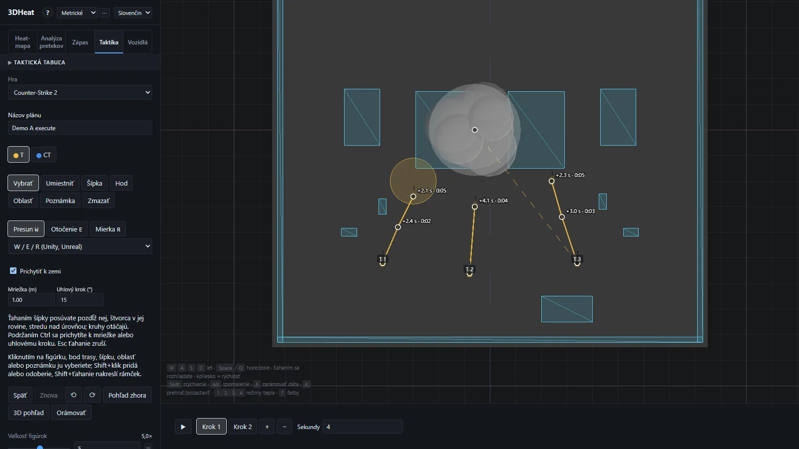

# Taktická tabuľa

Karta **Taktika** je kresliaca tabuľa pre tímový plán: na mapu kladiete malé figúrky, kreslíte šípky
pre to, kam majú ísť, a stlačením prehrávania sledujete, ako sa to odohrá. Použite ju na
naplánovanie kola alebo útoku pred hraním. Zdieľa plátno, kameru a [level](levels.md) s ostatnými
kartami a nič iné; plán nie sú dáta a nekreslí žiadne teplo.

## Váš prvý plán {#your-first-plan}

1. Otvorte kartu **Taktika**. Vyberte **Hru** (napríklad Counter-Strike 2) a pri Valorante stlačte
   **Načítať mapy Valorantu** a vyberte **Mapu**. Alebo najprv načítajte [level](levels.md).
2. Vyberte **Stranu** (určuje farbu) a stlačte **Pohľad zhora**.
3. Zvoľte **Miesto**, vyberte figúrku v **Figúrkach** (na nájdenie použite **Hľadať figúrky**)
   a kliknite na mapu. Umiestnite dve alebo tri.
4. Zvoľte **Šípka**, kliknite na figúrku, kliknite pozdĺž cesty, ktorou má ísť, a stlačte **Enter**,
   aby šípka skončila.
5. Stlačte **+** pod pohľadom, aby ste pridali krok 2. Každá figúrka začína tam, kde skončila jej šípka.
   Nakreslite tam ďalšie šípky.
6. Stlačte **▶** (alebo `K`), aby sa plán prehral od zobrazeného kroku až do konca.
7. Pomenujte plán v **Názov plánu** a stlačte **Uložiť**.

## Začatie plánu {#starting-a-plan}

| Ovládací prvok | Čo robí |
|---|---|
| **Hra** | Vyberie strany a figúrky, ktoré paleta ponúka: Counter-Strike 2 (T, CT; hráči a pomôcky), Valorant (Útok, Obrana; hráči a všeobecné schopnosti), Battlefield, Squad, Arma (pechota, pozemné vozidlá, lietadlá, lode), DCS / War Thunder / IL-2 (prúdové lietadlá, vrtuľové lietadlá, vrtuľníky, protivzdušná obrana, pozemné, lode, zbrane) a Iné. Plán, ktorý už má figúrky, si pri zmene hry ponechá svoje strany. |
| **Názov plánu** | Názov, pod ktorým sa plán uloží. |
| **Mapa**, **Načítať mapy Valorantu** | Pri zvolenom Valorante: **Načítať mapy Valorantu** získa zoznam máp z [valorant-api.com](https://valorant-api.com); **Mapa** potom položí minimapu zvolenej mapy ako level, zarámovanú zhora. Obrázok sa stiahne pri výbere a nikdy sa neposiela spolu s aplikáciou. Oznámenie Riotu sa zobrazuje, kým je na obrazovke (pozri nižšie). |
| **Strana** | Strana, ku ktorej patrí ďalšia figúrka, šípka alebo oblasť; prevezme farbu strany. |

Bez levelu je tabuľa rovná zemská rovina. Načítajte level v **Level**, ak chcete plánovať na skutočnej
mape: mapu CS2 exportovanú nástrojom CS2, level z knižnice alebo obrázok mapy.

## Nástroje {#tools}

| Nástroj | Kliknutie | Poznámky |
|---|---|---|
| **Vybrať** | Figúrka, bod trasy, šípka, oblasť alebo poznámka sa vyberie. | Shift+klik pridá alebo odoberie; Shift+ťahanie nakreslí obdĺžnik okolo toho, čo sa má pridať. Výber dostane transformačný gizmo (pozri nižšie); `Delete` alebo `Backspace` ho odstráni. `M` posunie vybranú figúrku na ďalšie kliknutie. |
| **Miesto** | Položí zvolenú figúrku. | Figúrka sa vyberá v palete **Figúrky** (s **Hľadať figúrky**). Keď nič nie je vybrané, `R` otočí ďalšiu figúrku o 15° pred jej položením (`Shift+R` opačným smerom). |
| **Šípka** | Každé kliknutie pridá bod; Enter, dvojklik alebo pravý klik šípku ukončí, Esc ju zahodí. | **Posunúť**, **Útok** (širšia hlava) alebo **Sledovanie** (tenká čiara vo výške očí). Šípka začatá na figúrke je trasa tej figúrky v tomto kroku: pri prehrávaní ju figúrka prejde a ďalší krok začína tam, kde skončila. |
| **Hod** | Hádzajúci, potom kam pristane. | Prerušovaný oblúk medzi nimi a zvolená pomôcka (dymovnica, záblesk, molotov, ...) sa objaví tam, kde pristane, a zostane od tohto kroku ďalej. |
| **Oblasť** | Stred, potom okraj. | Kruh vo farbe strany. |
| **Poznámka** | Kam poznámka patrí; pýta sa jej text. | Zobrazí sa ako špendlík a jej text nad ním. |
| **Zmazať** | Figúrku, šípku, oblasť alebo poznámku. | Odstráni ju od tohto kroku ďalej; v jej prvom kroku ju odstráni úplne. |

**Späť** a **Znova** (`Ctrl+Z`; `Ctrl+Y` alebo `Ctrl+Shift+Z`) prechádzajú každou zmenou. Čiara pod plánom
ukazuje, koľko figúrok, šípok a krokov má. **Pohľad zhora** sa díva priamo nadol (ortogonálne), **3D pohľad**
sa vráti na perspektívu, **Snímka** zarámuje plán, alebo level, keď je plán prázdny.

**Veľkosť figúrok** mení mierku všetkých figúrok na tabuli; 1× je skutočná veľkosť, čo je z veľkej výšky
niekoľko pixelov pre človeka.

## Posúvanie, otáčanie a mierka {#moving-turning-and-scaling}

Všetko na tabuli sa dá posúvať ako v 3D editore: figúrky, pomôcky, značky, jednotlivé body trasy a celé šípky,
oblasti a poznámky. Výber dostane gizmo v strede:

| Režim | Klávesy | Úchyty |
|---|---|---|
| **Posunúť** | W (alebo G) | Šípka na každú os (X červená, Y zelená a nahor, Z modrá) sa pohybuje po nej; štvorec sa pohybuje cez svoju rovinu; stred sa pohybuje po leveli pod kurzorom. |
| **Otočenie** | E (alebo R) | Prsteň na každú os sa otáča okolo nej. Prstence jednej figúrky sú jej vlastné natočenie, sklon a náklon; skupina sa otáča okolo osí sveta okolo svojho stredu. |
| **Mierka** | R (alebo S) | Rozťahuje alebo zhŕňa výber zo svojho stredu pozdĺž osi alebo všetkými smermi; polomer oblasti rastie s ním. |

**Kľúče** prepínajú medzi W / E / R (Unity, Unreal) a G / R / S (Blender); klávesy vyberajú režim len vtedy,
keď je niečo vybrané, inak lietajú kamerou. Takže `R` znamená **Mierka** pri kľúčoch W / E / R a **Otočenie**
pri kľúčoch G / R / S, keď je niečo vybrané, a otočí ďalšiu figúrku na položenie, keď nič nie je vybrané.
Všetky klávesy tabule sú v [referencii klávesnice](keyboard-reference.md#tactics-board). Podržte **Ctrl**
pri ťahaní, aby sa posun prichytil k **Mriežke** (metre) alebo otočenie k **Kroku uhla**. **Prichytiť k zemi**
(štandardne zapnuté) položí posunuté osoby, vozidlá, značky, body trasy a oblasti na povrch levelu; lietadlá
a vrtuľníky si zachovajú výšku a ťahanie pozdĺž šípky Y sa nikdy neprichytáva. Ťahanie úchytu nikdy nepohne
kamerou. **Esc** zruší ťahanie a každá zmena je jeden krok Späť.

Body trasy sa zobrazujú ako bodky na šípkach zobrazeného kroku: kliknutím ich vyberiete, ťahaním
posuniete, Delete ich odstráni. Sekcia **Vybrané** ukazuje miesto výberu v metroch, natočenie, sklon
a náklon figúrky v stupňoch a polomer oblasti, každé na zadanie.

## Časovanie {#timing}

Trasa figúrky je časovaná: každý úsek trvá tak dlho, aká je jeho dĺžka po leveli - vzorkovaná na povrchu
každé pár metrov, takže kopec alebo schody medzi dvoma bodmi sa počítajú - pri rýchlosti jej **režimu**
pohybu pre túto figúrku v tejto hre, plus akékoľvek **čakanie** pri bode trasy. Pechota sa plazí, drepí,
ide (potichu), beží alebo sprintuje; vozidlá a lode sa plazia, idú opatrne, normálne alebo sa ponáhľajú;
lietadlá a vrtuľníky lietajú pomaly, cestovnou rýchlosťou, bojovou rýchlosťou alebo maximálnou.
Režim, ktorý hra nemá (CS2 nemá sprint), vezme najbližší, ktorý má. Ako svah spomaľuje, závisí od hry: v CS2
a Valorante sa počíta len vodorovná vzdialenosť, ako v hrách; mil-sim spomaľuje pechotu do kopca (Toblerova
funkcia turistiky) a vozidlá podľa sklonu.

Rýchlosti pochádzajú z tabuliek pre jednotlivé hry s ich zdrojmi (pozri [Rýchlosti pohybu](tactics-speeds.md)):
CS2 podľa držanej zbrane, z herných definícií zbraní; Valorant podľa zbrane; Battlefield, Squad, Arma
a letecké hry podľa typu a triedy vozidla. **Pohybuje sa ako** vyberie profil figúrky (zbraň, typ vozidla);
**Vlastná (m/s)** prepíše ľubovoľný režim pre túto figúrku. Režimy sa pomenúvajú tak, ako ich tabuľa zobrazuje:
*Plazenie*, *Drepnutie*, *Chôdza (potichu)*, *Beh*, *Šprint*; *Opatrne*, *Normálne*, *Ponáhľať sa*;
*Pomaly*, *Cestovná*, *Bojová*, *Maximálna*.

Každý bod trasy ukazuje čas od posledného a čas od začiatku plánu ("+3,9 s · 0:12"). Trasa vybranej figúrky
vypíše každý úsek s jeho režimom, dĺžkou a časom, čakanie a príchod. **Príchody** pod **Časovanie** položia
každú figúrku s trasou na jednu časovú os, prvý príchod hore. S **Prehrávať v reálnom čase** (štandardne zapnuté)
krok trvá, kým nepríde jeho najpomalšia trasa, a každá figúrka sa pohybuje svojou rýchlosťou; **Sekundy** sú potom
najkratšou dĺžkou kroku. **Jednotiek úrovne na meter** hovorí, čím level je: 39,37 pre mapy CS2 (herné jednotky),
1 pre mapy v metroch.

## Porovnanie s dátami zápasov {#compare-with-match-data}

**Načítať súbory zápasov…** načíta tabuľky zápasov CS2 pre mapu (súbory Parquet nástroja CS2, koľko len chcete;
iba potrebné stĺpce, na pozadí); **Použiť načítané dáta** použije dáta načítané v prehliadači. Potom:

- **Najskorší príchod na mape** vyfarbí mapu podľa času od začiatku kola, kedy hráč prvýkrát dosiahol každé
  miesto - tlačidlo **Najrýchlejší** ukáže najrýchlejší zo všetkých kôl, **Typický (medián)** stredné kolo -
  zelená skoro až červená neskoro, pre jednu stranu alebo obe. Ukazuje, čo je možné, kedy.
- Vybraná trasa sa porovnáva s tým, čo hráči dosiahli od jej začiatku (alebo od začiatku kola) do jej konca,
  každý koniec ako kruh so zadaným polomerom: "Najrýchlejšie pozorované 14,2 s, p10 15,0 s, medián 18,3 s
  z 41 behov; váš plán 15,1 s".
- Rýchlosti, ktorými sa hráči naozaj pohybovali - beh, chôdza, drep, zo stĺpcov chôdze a drepu v tabuľkách -
  v m/s.

## Kroky {#steps}

Lišta pod pohľadom obsahuje kroky. Plán začína jedným; **+** pridá ďalší, a každá figúrka v ňom začína tam,
kde skončila jej trasa v poslednom kroku; **−** odstráni ten zobrazený. **Sekundy** sú, ako dlho zobrazený krok
trvá pri prehrávaní. **▶** (K) prehrá od zobrazeného kroku až do konca: figúrky s trasou ju prejdú, figúrky
presunuté na nové miesto v ďalšom kroku sa tam presunú, ostatné stoja. Keď je krok zobrazený, miesto každej
figúrky v ďalšom kroku sa kreslí ako bledý obrys a šípky posledného kroku sa slabo kreslia pod šípkami tohto.

## Ukladanie {#saving}

Sekcia **Súbor** obsahuje **Uložiť**, **Otvoriť** a **Vymazať**. **Uložiť** zapíše plán ako `<name>.h3dplan.json`
(čistý JSON: strany, kroky, figúrky s miestom v každom kroku, šípky, oblasti, poznámky); **Otvoriť** ho načíta späť.
Súbor inej verzie alebo súbor, ktorý nie je plánom, sa odmietne s dôvodom. **Vymazať** vyprázdni plán; Späť ho vráti.

## Figúrky {#figures}

Každú figúrku stavia samotný prehliadač: jednoduché tvary v zverejnenej veľkosti typu, s prvkami, ktoré ju odlišujú
od susedov - pásy kolies a veža tanku, delá, rakety a radary protivzdušného vozidla, pôdorys krídla lietadla, chvost
a motory, rotory a krátke krídla vrtuľníka. Nič sa neberie z hry. Dizajn, ktorý si hra vymyslela, sa zobrazí ako
všeobecná figúrka svojej triedy. Pozri [Figúrky](figures.md#which-figure-a-unit-gets), ako dáta nájdu svoju figúrku.

## Oznámenie Riotu {#riots-notice}

Mapy Valorantu sa zobrazujú podľa pravidiel Riot Games "Legal Jibber Jabber", ktoré umožňujú bezplatným komunitným
projektom ich používať a žiadajú toto oznámenie tam, kde sa objavia: *3DHeat bol vytvorený podľa pravidiel Riot Games
"Legal Jibber Jabber" s použitím aktív vlastnených spoločnosťou Riot Games. Riot Games tento projekt neschvaľuje ani
nesponzoruje.* Schopnosti na tabuli sú všeobecné tvary, nie umenie Riotu.
