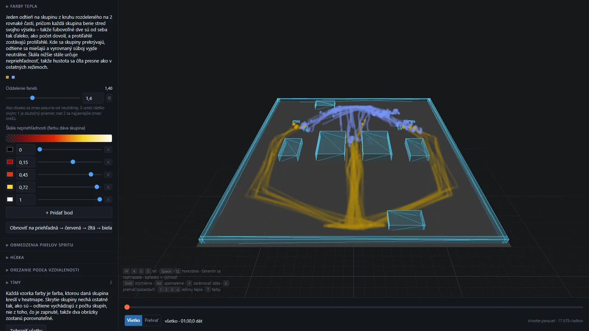

# Teplo tímov

Teplo tímov ukazuje, kde bol každý tím, a každý tím má vlastnú farbu. Tam, kde sa tímy prekrývajú, sa farby miešajú.

**Teplo tímov** (klávesa 3) je hustotné pole [Tepla](heat.md), v ktorom každá [skupina](glossary.md) dostane vlastný odtieň. Tam, kde sa skupiny prekrývajú, sa ich odtiene miešajú; vyrovnaný súboj vyjde neutrálne. Nepriehľadnosť stále nesie hustotu presne ako v ostatných režimoch, takže obrázok odpovedá naraz na otázku *koľko* a *čí*. Potrebuje stĺpec skupiny.

Nie je to [prekrytie figúrok](box-replay.md): to kreslí jednu figúrku na osobu; toto je hustotné pole sfarbené tým istým stĺpcom.

## Ako to použiť {#how-to-use-it}

1. Stlačte `3` (alebo vyberte **Teplo tímov** na lište režimov).
2. Otvorte **Farby tepla**. Vzorky ukazujú farbu každej skupiny; po najazdení na vzorku uvidíte názov tímu.
3. Ak je všetko sivé, zvýšte **Oddelenie farieb**.
4. Odškrtnutím skupiny v paneli [Tímy](teams-list.md) ju z obrazu vyradíte; ostatné farby zostanú, kde boli.

## Ovládanie {#controls}

V sekcii **Farby tepla**:

| Ovládač | Predvolená hodnota | Význam |
|---|---|---|
| Vzorky | | Farba každej skupiny, pre prvých 12 skupín, potom *+N ďalších*. Po najazdení uvidíte názov skupiny a farbu. |
| **Oddelenie farieb** | 1,4 | Ako ďaleko sa zmes odtláča od neutrálnej, 0-4. 0 všetko zošedí; 1 je skutočný priemer; nad asi 2 najjasnejšie zmesi opúšťajú zobraziteľný rozsah a na každom kanáli sa orežú, čo posunie ich odtieň. |
| **Škála nepriehľadnosti (farbu dáva skupina)** | predvolená škála tepla | Používa sa tu len **alfa** škály: priehľadná tam, kde nič nie je, nepriehľadná hore. Jej farby sa ignorujú. |

Všetky ostatné ovládače tepla - tvar, nasýtenie, odozva, minimálne teplo, hĺbka, orezanie - fungujú ako v [Teple](heat.md).

Panel [Tímy](teams-list.md) ukazuje v tomto režime farbu každej skupiny ako jej vzorku. Skrytie skupiny nechá farby všetkých ostatných skupín tam, kde boli: odtiene sa berú z celkového počtu skupín, nie z toho, čo je zapnuté, takže dva obrázky zostanú porovnateľné.

## Paleta {#the-palette}

Z [`colors.ts`](https://github.com/Holdi601/3DHeat/blob/main/src/render/colors.ts):

- Farby žijú v rovine **Oklab** pri pevnej svetlosti (0,7) a chróme (0,115), takže každá skupina je rovnako jasná a červená skupina nepôsobí horúcejšie než modrá.
- Pri *n* skupinách sa kruh odtieňov rozdelí na *n* rovnakých častí a skupina *i* dostane **stred** svojej časti, `(i + 0,5) / n` otáčky. Ľubovoľné dve skupiny sú od seba tak ďaleko, ako počet dovolí, a protiľahlé zostávajú protiľahlé bez ohľadu na počet.
- Používa sa najviac **16** rozdielnych odtieňov. Pri väčšom počte sa id umiestnia postupným delením na polovice (id v obrátenom binárnom poradí: 0, ½, ¼, ¾, ⅛, …), aby susedné id nezdieľali odtieň; skupiny nad 16 nevyhnutne zdieľajú.
- Skupina, ktorej označenie znamená „žiadna skupina“ - `0`, prázdne, `none`, `unknown`, `null` alebo `-1`, bez ohľadu na veľkosť písmen - sa kreslí **neutrálnou sivou** namiesto výseku kruhu. Takto sa zaobchádza len s prvým takým označením v zozname skupín.

Predvolené oddelenie je 1,4, nie 1, lebo pri 1 je zmes piatich rovnomerne rozložených odtieňov *presne* sivá: správne, ale nečitateľné. O niečo viac než 1 drží remízy férové a zároveň robí rozdelenie 60/40 viditeľným.

## Ako to funguje {#how-it-works}

Cieľ tepla má v tomto režime štyri kanály. Každý sprite pridá svoju hustotu *v* do prvého kanála a *v* × Oklab súradnice *a* a *b* skupiny do druhého a tretieho. Pri skladaní je zmes pixelu vážený priemer podľa hustoty: *a* = G / R, *b* = B / R, škálované oddelením farieb a prevedené do sRGB pri svetlosti palety. Delenie nahromadenou hustotou robí odtieň nezávislým od množstva dát a práve preto každý ovládač hustoty ďalej pôsobí len na nepriehľadnosť.

Cieľ so štyrmi kanálmi stojí štvornásobok pamäte GPU oproti cieľu tepla s jedným kanálom pri rovnakom rozlíšení.
