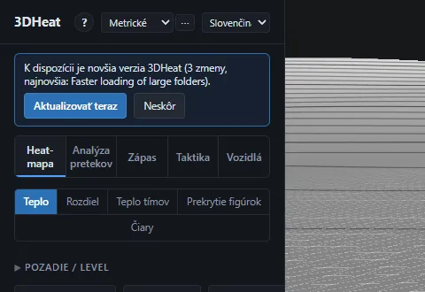

# Aktualizácie

Prehliadač vám povie, keď existuje novšia verzia, a aktualizuje sa sám, len keď poviete áno. Na vašom počítači sa nič nezmení bez vašej odpovede.

## Aktualizácia prehliadača {#update-the-viewer}

1. **Na stránke.** Keď existuje novšia verzia, pod názvom hore v bočnom paneli sa objaví okienko: "Je dostupná novšia verzia 3DHeat". Kliknite na **Aktualizovať teraz**. Stránka sa po dokončení sama znova načíta. **Neskôr** okienko skryje, kým stránku znova neobnovíte.
2. **Ak sa zobrazí, že treba spustiť restart.bat**, zatvorte okno servera (čierne okno, ktoré otvoril `start.bat`) a dvakrát kliknite na `restart.bat`.
3. **Pri spustení prehliadača.** `start.bat` tiež kontroluje. Ak existuje novšia verzia, spýta sa **Aktualizovať teraz? [Y/N]**. Stlačte `Y` na aktualizáciu. Stlačte `N` alebo počkajte 60 sekúnd bez odpovede, a spustí sa verzia, ktorú máte.



Kópia s vašimi vlastnými zmenami sa nikdy neaktualizuje za vás; okienko len hovorí, že čaká aktualizácia, a odporúča zapísať alebo odložiť vaše zmeny a spustiť `git pull`. Kópia, ktorá nebola nainštalovaná cez git (napríklad súbor zip), nezobrazí nič.

Ako kontrola funguje, krok za krokom:

```
stránka ---(po 4 s, potom každých 6 h)---> vývojový server ---> git fetch
   za?  nie -> nič sa nezobrazí
        áno -> vaše vlastné zmeny alebo commity?  áno -> len vám to povie
                                                 nie -> [Aktualizovať teraz] -> git pull
                                                        -> obnoviť, alebo "spustite restart.bat"
```

## Bezpečnostné pravidlá {#the-safety-rules}

- **Iba rýchly posun vpred** (`git pull --ff-only`): aktualizácia nikdy nič nespája,
  nepreskladá ani neprepíše.
- **Žiadne lokálne zmeny**: kópia s nezapísanými zmenami v sledovaných súboroch
  (`git status --porcelain --untracked-files=no` nie je prázdne) sa nikdy automaticky
  neaktualizuje - cudziu prácu nemá aktualizácia prepísať. Len sa jej povie, že čaká aktualizácia. Nesledované súbory (dáta, exporty)
  sa za zmeny nepočítajú.
- **Žiadne lokálne commity**: kópia s commitmi, ktoré nadradená vetva nemá ("rozišla sa"), sa neaktualizuje - rýchly posun ju nemôže
  dostať hore a zlúčenie patrí na `git pull` ručne. Stránka aj `start.bat` to hovoria rovnakými slovami a `start.bat` spustí verziu, ktorá tam je.
- **Len zo samotnej stránky**: žiadosť o aktualizáciu na vývojovom serveri musí niesť vlastnú hlavičku a, keď prehliadač pošle `Origin`,
  musí prísť z vlastného hostiteľa servera (nižšie).
- Aktualizuje sa len kópia gitu s nadradenou vetvou; všetko ostatné
  (kópia bez `.git`, bez nainštalovaného gitu, statický build) sa nechá tak a nič nehovorí.

## Čo robí start.bat {#what-startbat-does}

`start.bat` (dvakrát kliknite; okno je server) robí, v tomto poradí:

1. Nájde Node.js - v `PATH`, inak v `%ProgramFiles%\nodejs`,
   `%ProgramFiles(x86)%\nodejs` alebo `%LOCALAPPDATA%\Programs\nodejs` - a ak chýba, ponúkne
   jeho inštaláciu cez `winget install -e --id OpenJS.NodeJS.LTS` (opýta sa, Y/N; potom treba okno znova otvoriť, aby Windows načítali nový `PATH`).
2. **Aktualizácie**, keď je nainštalovaný git a priečinok má `.git`:
   - `git fetch --quiet` (bez siete alebo bez nadradenej vetvy: ticho preskočené);
   - spočíta `git rev-list --count HEAD..@{u}`; nič za: nič sa nehovorí;
   - lokálne zmeny: "Je dostupná novšia verzia 3DHeat (N zmien), ale táto kópia má lokálne zmeny, takže sa neaktualizuje. Zapíšte ich alebo odložte,
     potom spustite git pull." - a spustí verziu, ktorá tam je;
   - vlastné commity (`git rev-list --count @{u}..HEAD` nie 0): "Je dostupná novšia verzia 3DHeat (N zmien), ale táto kópia má vlastné commity,
     ktoré najnovšia verzia nemá, takže sa neaktualizuje. Aktualizujte ju cez git pull." - a spustí verziu, ktorá tam je;
   - inak "Je dostupná novšia verzia 3DHeat (N zmien)." a otázka **Aktualizovať teraz? [Y/N]**. `N`, alebo žiadna odpoveď 60 sekúnd, vypíše "Neaktualizované; spúšťam verziu, ktorú máte." a spustí verziu, ktorá tam je. Pri `Y`: "Aktualizujem...", oznámi, či sa menia `package.json` alebo `package-lock.json`,
     spustí `git pull --ff-only` (ak by to stále zlyhalo - napríklad sieťou:
     "Aktualizácia neprebehla; spúšťam verziu, ktorú máte."), potom `git submodule update --init`
     (pripnuté nástroje, pozri [Údržba dokumentácie](maintaining.md#the-tools-under-exporters)), potom `npm install`, keď sa súbory balíka zmenili
     a `node_modules` existuje, a "Aktualizované."
3. Odmietne spustiť druhý server: keď na porte **5273** už niečo počúva, povie to a odkáže na `restart.bat` / `stop.bat`.
4. Pri prvom spustení (bez `node_modules`) sa pred stiahnutím závislostí opýta (asi 300 MB do `node_modules\`, nič systémovo).
5. Spustí vývojový server na `127.0.0.1:5273` (`--strictPort`) a keď je pripravený, otvorí prehliadač.

`restart.bat` zastaví server (podľa portu) a spustí `start.bat` znova, takže sa opýta na to isté. `stop.bat` len zastaví.


## Pre vývojárov {#for-developers}

### Počas behu: trasa aktualizácie {#while-it-runs-the-update-route}

Vývojový server (plugin Vite `heat3d-self-update` v `vite.config.ts`) obsluhuje
`/__heat3d/update`. Existuje len na vývojovom serveri - nie v statickom builde
a nie vo `vite preview`.

**`GET /__heat3d/update`** odpovie, či kópia zaostáva:

```json
{ "checkout": true, "upstream": "origin/main", "behind": 3, "ahead": 0, "dirty": false, "latest": "the newest commit's subject" }
```

- `checkout: false`, keď priečinok nie je kópia gitu;
- spustí `git fetch --quiet` **najviac každých 30 minút** (žiadosti medzitým odpovedajú z naposledy stiahnutého);
- `behind` / `ahead` z `git rev-list --count HEAD..@{u}` / `@{u}..HEAD`,
  `dirty` z `git status --porcelain --untracked-files=no`, `latest` predmet najnovšieho commitu nadradenej vetvy;
- bez nadradenej vetvy `upstream: null` a `behind: 0`.

**`POST /__heat3d/update/apply`** dá kópiu do poriadku:

1. Odmietne sa s `403 { ok: false, reason: "forbidden" }`, pokiaľ žiadosť nemá
   hlavičku `X-Heat3d-Update: 1` a, keď nesie `Origin`, hostiteľ toho pôvodu nie je `Host` žiadosti. Formulár z inej stránky nemôže poslať
   vlastnú hlavičku bez CORS preflight, ktorý tento server nikdy neudelí.
2. Nič na spracovanie (nie kópia, bez nadradenej vetvy, nie za): `{ ok: true, updated: false }`.
3. Lokálne zmeny: `{ ok: false, reason: "dirty" }`; lokálne commity: `{ ok: false, reason: "diverged" }`.
4. Inak: zistí súbory, ktoré sa menia (`git diff --name-only HEAD @{u}`),
   `git pull --ff-only` (časový limit 2 min), `git submodule update --init`
   (zlyhanie ignorované), `npm install`, keď sa zmenil `package.json` alebo
   `package-lock.json` (časový limit 15 min), a odpovie
   `{ ok: true, updated: true, restart }` - `restart` hovorí, prečo bežiaci
   server aktualizáciu nemôže prevziať: `"dependencies"`, keď sa znova nainštalovali,
   `"config"`, keď sa zmenil len súbor `vite.config`, `false`, keď reštart netreba.
5. Zlyhávajúci príkaz git alebo npm odpovie `{ ok: false, reason: "<chyba,
   najviac 300 znakov>" }`.

Odpovede sú JSON s `Cache-Control: no-store`. Server počúva len na
`127.0.0.1`, takže trasa nie je dostupná zo siete.

### Oznámenie na stránke {#the-notice-in-the-page}

`UpdateBanner`, pod názvom hore v bočnom paneli:

- Pýta sa trasy **4 sekundy** po načítaní stránky (nie v prvých sekundách: stránka má dátovú sadu na načítanie a GPU na spustenie) a znova
  **každých 6 hodín**, kým stránka zostáva otvorená.
- Zobrazí **nič**, keď takáto trasa neexistuje (statický build), priečinok nie je kópia, alebo nič nie je novšie - oznámenie pri každom spustení je
  také, na ktoré si ľudia zvyknú nevšímať.
- Zaostáva, bez lokálnych zmien: "Je dostupná novšia verzia 3DHeat (N
  zmien, najnovšia: <predmet>)." s **Aktualizovať teraz** a **Neskôr**
  (*Neskôr* skryje, kým sa stránka neobnoví).
- Zaostáva, s lokálnymi zmenami: rovnaká veta a "Táto kópia má lokálne zmeny, takže sa neaktualizuje automaticky; zapíšte ich alebo odložte,
  potom spustite git pull." - bez tlačidla.
- **Aktualizovať teraz** odošle na `/apply` ("Aktualizujem..."). Potom:
  - "Aktualizované. Stránka sa znova načíta." - a znova sa načíta o 1,5 s neskôr (server už obsluhuje nové súbory);
  - keď sa závislosti znova nainštalovali: "Aktualizované. Jeho závislosti sa zmenili: zatvorte okno servera a na dokončenie spustite **restart.bat**.";
  - keď sa zmenili len nastavenia servera: "Aktualizované. Jeho nastavenia servera sa zmenili: zatvorte okno servera a na dokončenie spustite **restart.bat**.";
  - nič na prevzatie napokon (`updated: false` - kópiu medzitým dal do poriadku napríklad `start.bat`): "Nič na aktualizáciu: táto kópia je už najnovšia verzia." - a bez obnovenia;
  - odmietnutie: veta o *dirty*, alebo "Táto kópia má vlastné commity, ktoré najnovšia verzia nemá; aktualizujte ju cez git pull.", alebo "Aktualizácia neprebehla: <dôvod>".
