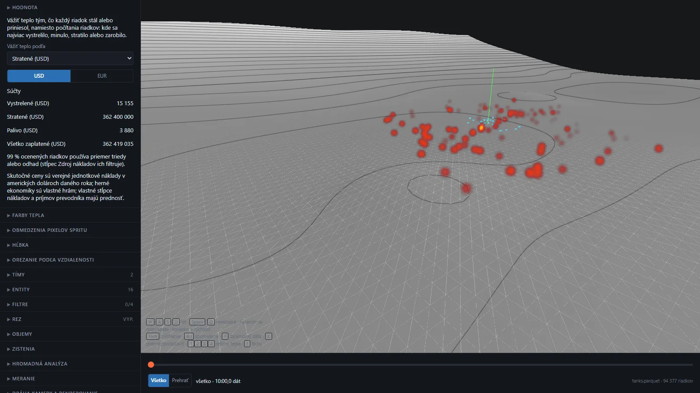

# Vážené hodnoty

Každý výstrel, munícia, stratené vozidlo a liter paliva má cenu. Prehliadač vypočíta, koľko každý riadok stál alebo priniesol, a teplo podľa toho môže vážiť, takže mapa ukazuje **kam išli peniaze**, namiesto toho, kde sú riadky.

## Ako to použiť {#how-to-use-it}

1. Načítajte údaje s udalosťami (výstrely, zabitia, smrti) a názvami vozidiel alebo zbraní.
2. Otvorte **Hodnota** na bočnom paneli Teplo.
3. Vyberte **Vážiť teplo podľa**, napríklad *Stratené (USD)*. Teplo teraz pripočíta cenu každého riadka namiesto 1.
4. Pozrite si **Súčty**: súčet každého stĺpca hodnôt pre to, čo je zobrazené (platia filtre a časové okno).
5. Ak sú ceny skutočné peniaze, objaví sa prepínač **USD / EUR**.

Prvá prázdna položka ponuky vráti počítanie riadkov.

## Čo sa dá vážiť {#what-can-be-weighed}

Stĺpce hodnôt sa pridajú pri načítaní, jeden pre každý druh a menu:

| Druh | Riadky, na ktoré dopadne | Ako sa oceňuje |
|---|---|---|
| **Vystrelené** | výstrely a odpaly | zbraň, inak priemer pre druh munície |
| **Minuté** | nákup, zrodenie | peňažné stĺpce hry (napríklad nákupné menu strieľačky) |
| **Stratené** | smrti, zničenia | vlastné vozidlo, inak priemer jeho triedy |
| **Zničený** | zabitia | cieľové vozidlo |
| **Spôsobené poškodenie** | zásahy | podiel hodnoty cieľa |
| **Palivo** | pozície | spotrebované palivo, zo stĺpca paliva alebo odhadnuté podľa triedy a času |
| **Všetko zaplatené** | | vystrelené + minuté + stratené + palivo |
| **Získané** | odmeny | vlastné odmenové stĺpce hry (`earn_…`) |
| **Čistý** | | získané mínus zaplatené; kreslí sa ako podpísané teplo (kladná škála tam, kde sa získalo viac, záporná tam, kde sa viac zaplatilo) |

Názvy stĺpcov sú `cost_<kind>_<currency>`, `earn_<currency>` a `net_<currency>`. Prevodník, ktorý pozná vlastnú menu hry (napríklad prevodník replayu zapisujúci herné kredity), má prednosť pred vstavanými cenníkmi.

## Cenníky {#the-price-tables}

| Tabuľka | Mena |
|---|---|
| Skutočná vojenská technika: rakety, bomby, náboje, protiopatrenia, lietadlá, vrtuľníky, pozemné vozidlá, lode, palivo | USD (EUR = USD × 0,92, pevná hodnota `EUR_PER_USD` v [`cost.ts`](https://github.com/Holdi601/3DHeat/blob/main/src/data/cost.ts); nie je to živý kurz) |
| Nákupné menu strieľačiek a odmeny za zabitia | kredity hry |
| Hry s tankami a loďami | kredity hry |
| Stratégie (viac zdrojov) | jeden stĺpec na zdroj plus jeden kombinovaný |
| Vojnové hry | body |

Hra sa rozpozná z názvov v údajoch. Skutočné ceny pochádzajú z verejných zdrojov (rozpočtové dokumenty, encyklopédie) alebo sú označené ako odhady; nie sú upravené o infláciu. Vygenerovaný zoznam tabuliek je na [Tabuľky hodnôt](ref-value-tables.md).

## Odhady {#estimates}

Dodatočný kategórijný stĺpec **Zdroj ceny** hovorí, ako sa každý riadok ocenil: `table`, `class average`, `estimate` alebo `none`. Sekcia Hodnota ukazuje, aký podiel ocenených riadkov sú priemery alebo odhady. Ak chcete nechať len presne ocenené riadky, odškrtnite *estimate* a *class average* pod **Zdroj ceny** vo [Filtroch](filters.md).

## Kde sa hodnota ešte ukazuje {#where-else-value-shows}

- [Postrehy](insights.md): nálezy *Nákladná zem* a *Zarábajúca zem*.
- [Rozdelenie](breakdown.md): Získané, Stratené a Čisté peniaze podľa tímu, hráča alebo zbrane.
- [Objemy](volumes.md): stĺpce hodnôt v štatistikách a porovnaní.
