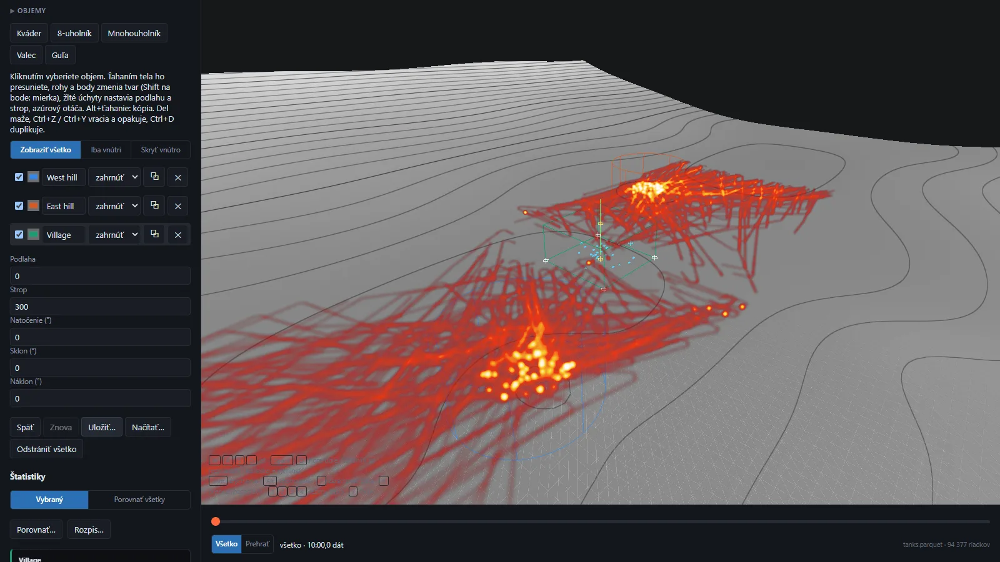
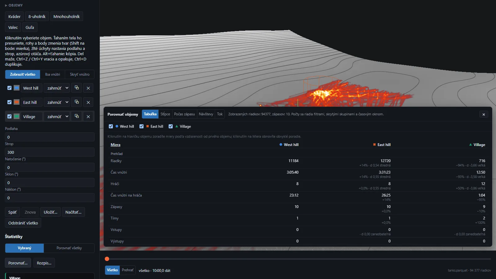
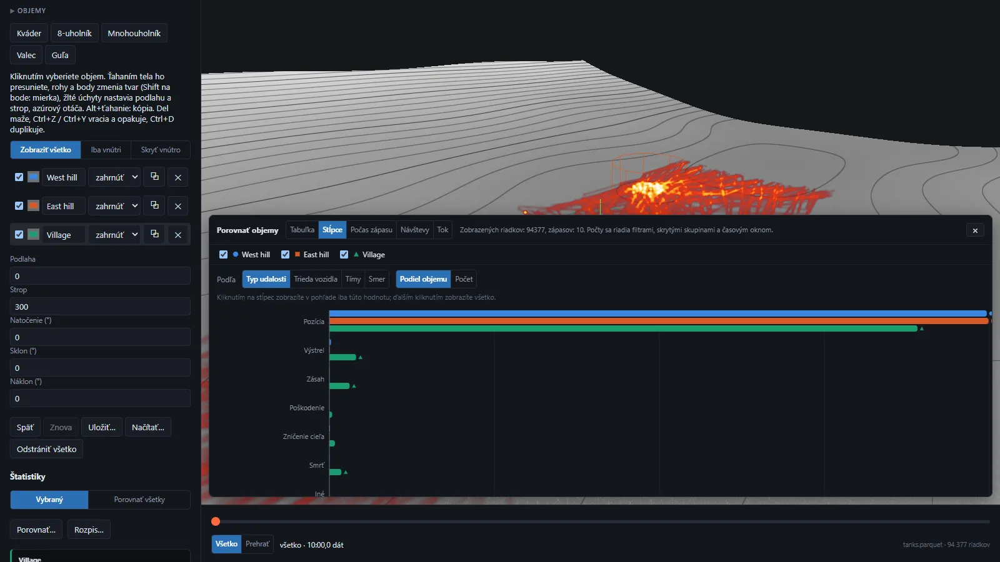

# Objemy a porovnanie

**Objem** je neviditeľný kváder (alebo valec, či guľa), ktorý nakreslíte okolo miesta, aby ste sa spýtali: čo sa tu stalo? Hodí sa na spočítanie zabití pri moste, porovnanie dvoch kopcov alebo zobrazenie len aktivity v jednej oblasti.

```
 pohľad zhora              Nakreslíte tvar ->  prehliadač spočíta
 +------------+            čo je vnútri:
 |   ( A )    |             riadky, hráči, zostrely, čas ...
 |        [B] |            Porovnajte A s B, vedľa seba.
 +------------+
```



Objemy merajú, čo sa deje vnútri nich, filtrujú pohľad na ne, exportujú ich riadky a dajú sa porovnávať vedľa seba. Pojmy riadok, osoba a zápas nájdete v [slovníku](glossary.md).

## Nakreslite objem {#draw-a-volume}

1. Na bočnom paneli otvorte **Objemy**.
2. Vyberte nástroj a kreslite v 3D pohľade alebo na 2D mape. Podlaha a strop sa berú z dát pod ním. Esc zruší.
3. Kliknutím na objem ho vyberte; objavia sa jeho **Štatistiky**.

| Nástroj | Ako kresliť |
|---|---|
| **Kváder** | Ťahajte obdĺžnik (Shift: štvorec). Kliknutie umiestni predvolený kváder. |
| **n-uholník** | Ťahajte od stredu (Shift ho drží pravidelný). *Rohy* nastaví n od 3 do 64 (predvolene 8, takže tlačidlo ukazuje **8-uholník**). |
| **Mnohouholník** | Klikajte rohy; uzavriete dvojklikom, Enterom alebo kliknutím na prvý roh. Backspace odstráni posledný roh. |
| **Valec** | Ťahajte polomer. |
| **Guľa** | Ťahajte polomer; spočíva na zemi. |

## Úprava {#edit}

- Kliknutím na objem ho vyberte. Ťahajte za jeho telo, aby ste ho presunuli, a za rohy, aby ste ho tvarovali (Shift na rohu mení mierku).
- **Žlté** úchyty nastavujú podlahu a strop, **azúrový** úchyt ho otáča.
- Alt+ťahanie kopíruje, Del odstráni, Ctrl+Z / Ctrl+Y vrátia a zopakujú, Ctrl+D duplikuje. **Odstrániť všetko** zmaže každý objem.
- Presné hodnoty: Podlaha, Strop, Otočenie / Sklon / Náklon (kvádre), Polomer (gule, valce).

Každý riadok objemu má zaškrtávacie políčko zobrazenia, farbu, názov, **zahrnúť** alebo **vylúčiť**, duplikovať a odstrániť. Objemy sa ukladajú v prehliadači pre každú dátovú sadu a **Uložiť…** / **Načítať…** zapisujú a čítajú súbor `volumes.json`.

## Filtrovanie pohľadu {#filter-the-view}

| Filter | Účinok |
|---|---|
| **Zobraziť všetky** (predvolené) | Objemy len merajú. |
| **Iba vnútri** | Teplo, prehrávanie a [analýza zásahov](hit-analysis.md) kreslia len to, čo je vnútri zahrnutých objemov a mimo vylúčených. |
| **Skryť vnútro** | Opak. |

GPU filter berie najviac 8 objemov so 64 bodmi obrysu spolu; objem nad tento limit označí „!“. Štatistiky a export ho stále počítajú.

## Štatistiky {#statistics}

Oblasť **Štatistiky** sleduje filtre, časové okno a skryté skupiny. *Vybraný* ukazuje vybraný objem, *Porovnať všetky* dá každý objem vedľa seba. Zobrazuje:

- **Riadky vnútri (zobrazené)** a **Riadky vnútri (všetky dáta)**, **Hráči**, **Tímy**, **Zápasy**, **Čas vnútri**, **Vstupy / výstupy**, **Špičkové teplo**, **Stredné teplo**, **Objem / pôdorys** a histogram **Kedy**;
- pre každý stĺpec: kategórie s **Pomer podielov** (podiel vnútri delený podielom vo všetkých zobrazených dátach) a čísla s rozsahom, mediánom a 5.-95. percentilom.

**Štatistiky ako CSV / JSON** ich uložia. **Exportovať dáta vnútri** zapíše riadky vnútri ako CSV alebo Parquet (predvolene zapnuté *Iba zobrazené riadky*), jeden objem alebo všetky, so stĺpcom, ktorý hovorí, v ktorom objeme je každý riadok.

## Porovnanie objemov {#compare-volumes}

Pri dvoch alebo viacerých viditeľných objemoch stlačte **Porovnať…**.

1. Nakreslite tri objemy, napríklad Západný kopec, Východný kopec a Dedina.
2. Stlačte **Porovnať…** pod Štatistikami.
3. V **Tabuľka** čítajte rozdiel každej hodnoty od prvého objemu.
4. Prepnite na **Stĺpce**, aby ste podiely videli ako stĺpce.



| Pohľad | Zobrazuje |
|---|---|
| **Tabuľka** | Riadky, čas vnútri, hráči, zápasy, tímy, vstupy, výstupy, návštevy, dĺžka návštevy, zabitia, smrti, zabitia na smrť, zabitia za minútu, čas na hráča, stĺpce hodnôt; zoskupené podľa udalostí, triedy vozidla, hráča alebo AI, tímu a smeru. Každá hodnota ukazuje svoj rozdiel od prvého objemu a veľkosť efektu (zanedbateľný, malý, stredný, veľký). Kliknutím na nadpis objemu zoradíte podľa vzdialenosti od prvého. |
| **Stĺpce** | Počty alebo podiely podľa udalosti, triedy, aktéra, tímu alebo smeru. Kliknutím na stĺpec filtrujete pohľad na neho. |
| **Počas zápasu** | Jeden graf na objem v priebehu minút zápasu: prítomnosť, riadky alebo zabitia. Kliknutím tam skočíte. |
| **Návštevy** | Krabicové a husľové grafy toho, ako dlho návštevy trvajú (logaritmická škála). |
| **Tok** | Kam smerujú stopy po opustení každého objemu: matica prechodov alebo toky. |



## Tipy {#tips}

- Začnite od zistenia: v [Zisteniach](insights.md) **Objem tu** pridá valec okolo miesta zistenia.
- **Rozpis…** otvorí [Rozpis](breakdown.md) pre vybraný objem: kto a čo si v ňom vedie najlepšie.
- [Smerové teplo](directional-heat.md) vie vykresliť smery vnútri vybraného objemu.
- [Karta Vozidlá](hit-analysis.md#restrict-to-an-area) používa tie isté objemy ako svoj filter oblasti.
