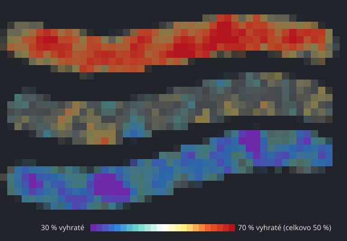

# Podiel výhier: ako často vyhráva miesto, trasa alebo akcia

Kde hráč stojí, ktorým smerom ide, kam hádže granáty a iné pomôcky - a ako často potom jeho strana vyhrá kolo. **Mapa podielu výhier** zafarbí každé miesto podľa podielu riadkov, ktoré patria ku kolám, ktoré strana riadku vyhrala, oproti podielu vo všetkom zobrazenom: teplo tam, kde je vyšší, chladno tam, kde je nižší, nič tam, kde je rovnaký.

*Obrázok ukazuje vymyslené dáta: tri trasy na prázdnej úrovni, 68 %, 50 % a 33 % ich riadkov vo vyhratých kolách.*

Potrebuje dáta, ktoré hovoria, kto vyhral: [stĺpce výsledku](data-formats.md#outcome-columns) (`won`, `matchWon`, `roundEndReason`). Zapisujú ich konvertory CS2 a War Thunder; môže ich mať ktorýkoľvek súbor.

## Vyskúšajte to {#try-it}

1. Načítajte zápasy so stĺpcom výsledku a stlačte `2` (**Rozdiel**).
2. V paneli **Rozdelenie rozdielu** stlačte **Podiel vyhratých kôl** (alebo **Podiel vyhratých zápasov**). Dá vyhraté kolá na **+** a prehraté na **−** a prepne panel na **Podiel +**.
3. Čítajte farby. Panel uvádza celkový podiel: *Celkovo je 52,0 % z 1 200 000 riadkov na +.*
4. Zúžte to pomocou [filtrov](filters.md): jedna strana (T alebo CT), jeden typ udalosti (*Pozícia* pre miesta, kde ľudia stáli, *Výstrel* alebo *Odpálenie (raketa, strela, bomba)* pre miesta, odkiaľ strieľali alebo hádzali), jeden nákup, jedna mapa.

Miesto, ktoré je teplé s riadkami *Pozícia*, je miesto, ktorého držitelia kolo väčšinou vyhrali. S riadkami *Zničenie cieľa* je to miesto, kde zabitia, ktoré tam padli, viedli k vyhratým kolám.

## Nastavenia {#the-settings}

| Nastavenie | Čo robí | Predvolené |
|---|---|---|
| **Rozdiel** / **Podiel +** | samotný rozdiel, alebo podiel strany + na riadkoch oboch strán | Rozdiel |
| **Plná farba pri** | o koľko nad alebo pod celkovým podielom sa miesto ukáže v plnej farbe, v percentuálnych bodoch | ± 20 bodov |
| **Najmenej riadkov na zafarbenie miesta** | miesto s menším počtom riadkov sa nezafarbí; objavuje sa postupne od polovice tejto hodnoty | 12 |
| **Ťah k celkovému podielu (riadky)** | každé miesto začína s týmto počtom riadkov na celkovom podiele, takže miesto s 3 riadkami, všetkými vyhratými, sa neukáže ako 100 % | 12 |

Všetky tri pôsobia na hotový obrázok: ich posúvanie nikdy nespustí zhromažďovanie odznova.

Podiel môže patriť ľubovoľnému rozdeleniu, nielen výhram: *Podiel +* s rozdelením podľa strany ukazuje, kde Ts tvorili väčšiu časť prítomnosti, a s rozdelením podľa súborov dvoch máp, kde riadky jedného súboru prevažujú nad riadkami druhého.

## Riadky, nie kolá {#rows-not-rounds}

Mapa počíta riadky. Hráč, ktorý stojí na jednom mieste dvadsať sekúnd, pridá riadok pri každej vzorke, všetky z jedného kola, takže dôkaz na mieste tvoria riadky blízko neho, nie kolá. Preto sú minimum aj ťah v riadkoch a preto sú väčšie ako to, čo dá jedno kolo.

Pre samotné kolá:

- **[Rozpis](breakdown.md)** na mieste, pohľade alebo objeme: *Výhry %* počíta kolo každého hráča raz, s rovnakým ťahom k celkovému podielu miesta (4 kolá).
- Štatistiky **[Objemov](volumes.md)**: *Podiel výhier* - kolá s hráčom vnútri objemu, každé raz, s ťahom k podielu vo všetkom zobrazenom, spolu s počtami.

## Filtre výsledku {#outcome-filters}

Panel [Filtre](filters.md) uvádza stĺpce výsledku hneď po vlastných stĺpcoch prehliadača: **Výsledok kola** a **Výsledok zápasu** (*Ľubovoľný*, *Vyhraté*, *Prehraté*) a **Ako sa kolo skončilo** (Eliminácia, Bomba vybuchla, Bomba zneškodnená, Vypršal čas, Kapitulácia, Remíza, Cieľ, Držané zóny, Stratené tikety, Stratené všetky vozidlá), v jazyku prehliadača.

## Pre vývojárov {#for-developers}

Prechod tepla zapisuje tri súčty do štvorkanálového cieľa, ktorý používa teplo tímov: teplo `R = Σ|v|`, teplo strany + `P` a `S = Σ v²/w`, kde `w` je váha prechodu (váha vzorkovania krát zisk snímky). Skladanie číta podiel `P/R` (priemer vážený jadrom) a počet riadkov, na ktorých stojí, `n = R²/S` (Kishova efektívna veľkosť vzorky), ťahá podiel k celkovému, `p = (n·P/R + m·r0)/(n + m)`, a farbí `p - r0` cez rozpätie na rampách rozdielu.

`n` vykráti každý faktor spoločný riadkom v pixeli - zisk snímky, váhu vzorkovania, váhu plochy orezaného sprite-u - takže obrázok je rovnaký pri každom priblížení a hustote vzorkovania a snímky z každého k-teho riadku sa spoja do celku bez skokov vo farbách. Celkový podiel pochádza z počtov strán na CPU, držaný na desatiny percenta; z GPU sa nič nečíta späť. Výpočet a jeho kontroly: [`render/rateMap.ts`](https://github.com/Holdi601/3DHeat/blob/main/src/render/rateMap.ts) a jeho test.

Stojí to toľko, čo teplo tímov: štvorkanálový cieľ zoštvornásobí šírku pásma miešania pri prechode tepla, len kým je zapnutý *Podiel +*.
