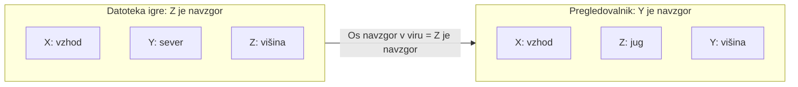

# Osi, enote in čas

Igre in zemljevidi se ne strinjajo, katera smer je navzgor, kako dolga je enota in kako je zapisan čas. Ta stran opisuje tri nastavitve, ki poskrbijo, da vaši podatki stojijo, imajo pravo merilo in se predvajajo v pravilni smeri.

Če vaš zemljevid stoji kot zid namesto da leži kot tla, preklopite **Os navzgor v viru**.

Pri napačni **Osi navzgor v viru** zemljevid stoji kot zid; pri pravilni leži kot tla.

## Svet, v katerem pregledovalnik riše {#the-world-the-viewer-draws-in}

Svet pregledovalnika je **Y navzgor**: X in Z sta ravnina tal, Y je višina. Večina igralnih pogonov je **Z navzgor**: zanje sta X in Y tla, Z pa je višina. Nekateri pogoni so tudi zrcalni (levosučni). Preslikava pove, kako pretvoriti osi datoteke v osi pregledovalnika. (Tehnično je pregledovalnik desnosučni, kot je navada v three.js.)

### Os navzgor {#up-axis}

**Os navzgor v viru** v [Preslikavi stolpcev](column-mapping.md):

| Nastavitev | Datoteka (x, y, z) postane svet (X, Y, Z) |
|---|---|
| *Z je navzgor (večina igralnih pogonov)* – privzeto | (x, **z**, **y**): Z datoteke postane višina, Y datoteke pa postane Z sveta |
| *Y je navzgor (grafična konvencija)* | (x, y, z) nespremenjeno |

Za podatke z Z navzgor se tri polja preimenujejo namesto kopiranja ([`remapAxesInPlace`](https://github.com/Holdi601/3DHeat/blob/main/src/data/ingest.ts)), kar pri velikih nalaganjih prihrani stotine megabajtov. Ugib se naredi iz vzorca: kateri od stolpcev Y in Z ima manjši razpon, ta je navzgor.

### Obrati {#flips}

**Obrni X**, **Obrni Y** in **Obrni Z** zanikajo *datotečno* os z imenom, pred preimenovanjem – zato pri Z navzgor *Obrni Y* zanika tisto, kar konča kot Z sveta. Obrat spremeni naložene podatke: koordinate, ki jih prikažeta [ravnilo](measure.md) in rezina ter položaj kamere, so obrnjene.

Za pravilno prikaz zrcalnega sveta **brez** spreminjanja podatkov uporabite raje **Kamera in prizor → Obrni os sveta** ([Kamera](camera.md#invert-world-axis)). To je boljša izbira za igre, katerih svet je levosučen, ker ostanejo vse koordinate, ki jih orodja prikazujejo, last igre.

### Merilo enot {#unit-scale}

**Merilo enot** pomnoži vsak položaj. *1 (m)* nastavi 1, *0,01 (cm→m)* nastavi 0,01 (enote Unreal Engine so centimetri, zato uporabite 0,01; enote motorja Source so palci, zato uporabite 0,0254; nobena ni metri), polje pa sprejme poljubno vrednost. Vpisana 0 ali vrednost, ki ni število, se nadomesti z 1.

Pregledovalnik označuje razdalje v metrih (polmer sprajta, meje izločanja, ravnilo, hitrost letenja), kar drži le, kadar je pomnožena enota sveta meter. Nič se ne pokvari, kadar ni; oznake samo berejo »m« za vsako enoto.

## Čas {#time}

### Časovne enote {#time-units}

Pravilo za hiter pregled: vrednosti kot 17000000000 (deset ali več števk) so časovni žig Unix; vrednosti kot 0, 0,25, 0,5 so sekunde od začetka.

| Časovna enota (oznaka v meniju) | Prebere se kot | Prikazana stenska ura |
|---|---|---|
| *Sekunde (relativno)* | vrednost × 1 s | ne |
| *Milisekunde (relativno)* | vrednost × 0,001 s | ne |
| *Mikrosekunde (relativno)* | vrednost × 10^-6 s | ne |
| *Nanosekunde (relativno)* | vrednost × 10^-9 s | ne |
| *Časovni žig Unix (s)* | sekunde od 1970-01-01 UTC | da |
| *Časovni žig Unix (ms)* | milisekunde od 1970-01-01 UTC | da |
| *Niz datuma ISO-8601* | besedilo, kot je `2026-03-14T18:02:11.250Z`, razčlenjeno z `Date.parse` brskalnika | da |

Pri absolutni enoti (zadnje tri) nabor ohrani trenutek stenske ure svoje najzgodnejše vrstice, časovnica pa poleg glave predvajanja prikazuje trenutni čas dneva UTC (`HH:MM:SSZ`).

**Stolpci `TIMESTAMP` in `DATE` v Parquetu** se dekodirajo v prave trenutke, zato se njihova nastavitev enote prezre, plošča pa to pove. Stolpec `DATE` je cel dan: vse vrstice dneva si delijo en trenutek, predvajanje pa skoči po dan, na kar plošča opozori.

**Nizi ISO-8601 delujejo tako v CSV kot v Parquetu.** Besedilni časovni stolpec z enoto ISO se razčleni enkrat za vsak različni niz; če se noben ne razčleni, nalaganje pade z *No parseable ISO-8601 timestamps in the mapped time column.* – preslikava pa se že sama ustavi, kadar se nobena vzorčena vrednost ne razčleni. Stolpec `TIMESTAMP` v Parquetu se prebere kot časovni žig ne glede na nastavljeno enoto, številski stolpec Parquet z enoto ISO pa se prebere kot milisekunde Unix. Besedilni časovni stolpec s številsko enoto se zavrne pred nalaganjem: vsaka vrednost bi se prebrala kot NaN.

### Kako je čas shranjen {#how-time-is-stored}

Med združevanjem datotek so časi 64-bitne sekunde, zato absolutna epoha ohrani podsekundne podrobnosti. Ko so vse datoteke v pomnilniku, postane najzgodnejši čas celotnega izbora 0 in vsaka vrstica shrani 32-bitne sekunde od njega. 32-bitna plavajoča vejica ima 24 bitov mantise: razponi do približno pol dneva se razločijo bolje kot na 1/100 s, razponi pol leta pa na približno sekundo. Vrstica, katere čas manjka ali ni število, se postavi na 0, na začetek.

Vrstice se nato uredijo po času, kar naredi časovnico poceni: časovno okno se najde z dvema binarnima iskanjema (glejte [Vzorčenje in proračuni](sampling-and-budgets.md)).

### Pretečeni čas v primerjavi s stensko uro {#elapsed-time-versus-wall-clock}

Časovni stolpec, kot sta `match_time` ali `round_time`, šteje od začetka vsake tekme. Če ga izberete, postavi vsako tekmo na skupno os – dobro za primerjavo tega, kaj se dogaja v 3. minuti vsake tekme – plošča pa na to opozori. Stolpec s stensko uro prikaže tekme v vrstnem redu, v katerem so se res zgodile, in se prekriva tam, kjer so se.

## Smer pogleda {#look-direction}

Smer pogleda uporablja samo [predvajanje škatel](box-replay.md) (žarki iz vsake škatle). Shranjena je kot dva kota, zasuk in naklon, v radianih.

- **Stolpca zasuk / naklon** se prebereta, kot sta, pretvorjena iz stopinj, če je izbrano *Stopinje*. Ne prilagajata se osi navzgor ali obratom.
- **Stolpci smernega vektorja** gredo skozi isto preimenovanje in obrate kot položaji, nato pa postanejo zasuk = atan2(x, -z) in naklon = atan2(y, √(x² + z²)) v osi sveta, tako da žarek kaže, kamor gleda škatla, tudi v svetu z zrcalnim virom.

Če stolpca zasuk/naklon po obratu, smernem vektorju ali prilagojenih kotih kažeta v napačno smer, je popravek ta.
