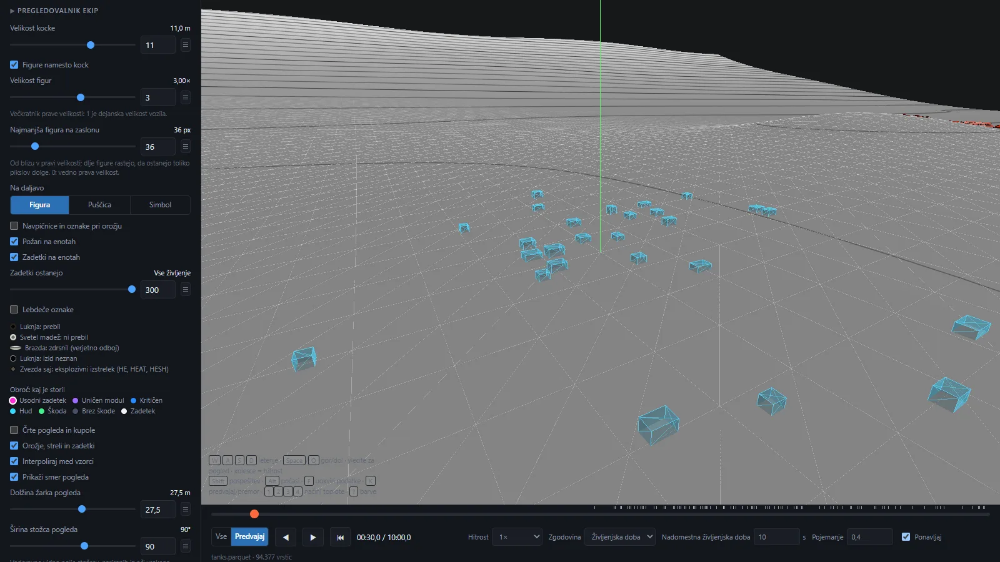

# Prekrivanje figur (predvajanje škatel)

Majhen film: ena figura za vsako osebo, ki se premika, ko čas teče, za njo pa sled.

Način se v vrstici načinov imenuje **Prekrivanje figur**. Ta stran se je prej imenovala »predvajanje škatel«, ker je bila pred figurami vsaka oseba škatla; »predvajanje figur« in »predvajanje škatel« pomenita isto. **Prekrivanje figur** nima številske tipke: izberite ga v vrstici načinov. Nariše po eno figuro (ali škatlo) za vsako [osebo](glossary.md), ki se premika vzdolž [časovnice](timeline.md), z neobveznimi žarki pogleda in sledmi. Gre za predvajanje, ne za gostoto: *kdo je bil kje, kdaj*. Potrebuje stolpec osebe; brez stolpca časa se vsak vzorec nariše naenkrat.

## Kako uporabljati {#how-to-use-it}

1. Naložite podatke s stolpcem osebe in stolpcem časa.
2. V vrstici načinov izberite **Prekrivanje figur**.
3. Preklopite časovnico na **Predvajaj** in pritisnite predvajanje (`K`).
4. Odprite **Pregledovalnik ekip**, da spremenite **Dolžino sledi**, velikost figur ali žarke pogleda.

V tem načinu se toplota ne riše, prilagodljivi proračun sprajtov pa miruje.

Privzeto je vsaka oseba narisana kot figura tega, kar je, ne kot škatla – glejte [Figure](figures.md), katero figuro dobi katera enota, in [Predvajanje tekme](match-replay.md) za oznake, kamero, ki sledi, merjenje med dvema enotama in seznam dogodkov.

## Plošča Pregledovalnik ekip {#the-team-viewer-panel}

V tem načinu je prikazana namesto plošč toplote.

| Nastavitev | Privzeto | Obseg (skok) | Pomen |
|---|---|---|---|
| **Figure namesto kock** | vklopljeno | | Vsaka oseba kot figura tega, kar je: vojak na nogah, tank ali letalo, ki ga navaja podatek. Kar podatek ne pove, ostane škatla. |
| **Velikost figur** | 1× | | 1× je prava velikost. |
| **Najmanjša figura na zaslonu** | 36 px | 0 = vedno prava velikost | Prava velikost od blizu; dlje figure rastejo, da ostanejo toliko slikovnih pik dolge. |
| **Orožje, streli in zadetki** | vklopljeno | | Orožje v letu z dimom, sledilni streli, zadetki, pogodki in ubitja. Sledilni streli, sklepani iz zadetka, so črtkani. |
| **Velikost kocke** | velikost entitete, ali razpon / 500, ob nalaganju | 0,05–200 m, logaritemsko (5000) | Dolžina roba vsake škatle. Glejte [velikost entitete](sessions-persons-groups.md#entity-size). |
| **Interpoliraj med vzorci** | vklopljeno | | Med dvema vzorcema iste osebe v isti seji postavi škatlo sorazmerno med njiju. Nikoli čez mejo seje. |
| **Prikaži smer pogleda** | vklopljeno | | Žarek iz vsake škatle v smeri pogleda osebe (potrebuje [stolpce pogleda](axes-units-and-time.md#look-direction)). |
| **Dolžina žarka pogleda** | velikost entitete × 4, ali razpon / 200, ob nalaganju | 0,5–500 m, logaritemsko (20.000) | Prikazano, kadar je smer pogleda vklopljena. |
| **Dolžina sledi** | 8 s | 0–300 s (86.400); 0 = izklopljeno | Sekunde zgodovine, narisane za vsako osebo. |
| **Nariši vse surove vzorce** | izklopljeno | | Ena škatla za vsak shranjen vzorec v oknu namesto ene interpolirane škatle na osebo. Podvzorčeno, da ostane odzivno. |

Namigi v plošči pojasnjujejo, da interpolacija in sledi povezujejo vzorce samo znotraj ene seje, in, kadar nalaganje vsebuje [skupna imena](sessions-persons-groups.md#names-worn-by-several-things-at-once), koliko imen je narisanih kot posamezni vzorci.

## Predvajana seja {#the-session-being-played}

S stolpcem seje izbirnik **Seja** na vrhu stranske vrstice ([Seje](sessions-persons-groups.md#the-session-picker)) določi, katera tekma se predvaja. Ob nalaganju se izbere najbolj zaposlena. V škatle in sledi se spremenijo samo vrstice te seje, časovnica pa teče čez razpon te seje in ne čez celoten nabor podatkov. *Vse seje* predvaja vse seje naenkrat, še vedno pa nikoli ne povezuje vzorcev čez meje sej.

## Kaj je narisano kdaj {#what-is-drawn-when}

Iz [`TrackCursor`](https://github.com/Holdi601/3DHeat/blob/main/src/data/tracks.ts):

**Žive škatle** (način Predvajaj, surovi vzorci izklopljeni). Za vsako vidno osebo njen zadnji vzorec na glavi predvajanja ali pred njo:

- Če ima oseba naslednji vzorec, je ta v isti seji in ime ni skupno, se škatla postavi med oba vzorca sorazmerno s časom; zasuk se interpolira po krajši poti, naklon pa linearno (kadar je *Interpoliraj* vklopljeno).
- Sicer škatla ostane pri zadnjem vzorcu za **Nadomestno življenjsko dobo** časovnice (privzeto 10 s) in nato izgine, da izločeni igralci ne ostajajo.

**Način Vse** prezre glavo predvajanja in nariše vsak vzorec v razponu kot škatlo.

**Surovi vzorci** nariše škatlo za vsak shranjen vzorec v oknu: *Razpon* z zgodovino *Okno*, sicer vse do glave predvajanja. Največ 65.536 škatel; če je vzorcev več, se nariše vsak *k*-ti.

**Sledi** (kadar je dolžina sledi nad 0 in surovi vzorci niso narisani): črta med vsakim parom zaporednih vzorcev osebe v zadnjih *dolžina sledi* sekundah do glave predvajanja, z zbledenjem od 80 % neprosojnosti do prozornosti s starostjo. Sled se ustavi ob spremembi seje in se ne riše za skupna imena. Največ 131.072 oglišč; če jih je več, se vrstice preskakujejo enakomerno.

**Kdo je viden:** oseba je skrita, kadar je njena skupina odkljukana v seznamu [Ekipe](teams-list.md) (skupina je tista od njene prve vrstice), kadar filter skupine to izključi, ali kadar ima plošča [Entitete](entities.md) izbor, ki je ne vključuje. [Filtri](filters.md) stolpcev ne veljajo za škatle.

## Barve {#colours}

Ena družina odtenkov na skupino in en odtenek za vsakega člana, tako da en pogled pove, na kateri strani je kdo ([`teamMemberColor`](https://github.com/Holdi601/3DHeat/blob/main/src/render/colors.ts)). Odtenki skupin se vrstijo po fiksnem seznamu desetih – modra, rdeča, zelena, jantarna, vijolična, cian, magenta, limeta, oranžna, indigo – člani skupine pa so razporejeni po svetlosti 42–76 % in nasičenju 90–65 %.

## Opombe {#notes}

- Prekrivanje figur ponovno zgradi svoje figure samo, kadar se kaj spremeni; mirujoča sličica ponovno nariše zadnje.
- Vrstica *Kocke* v [prekrivanju statistike](performance-and-stats.md) šteje škatle na zaslonu.
- Prekrivanje figur riše v istem prizoru kot raven, zato [globinska ostrina](camera.md#depth-of-field) zamegli škatle, nikoli pa toplote.
