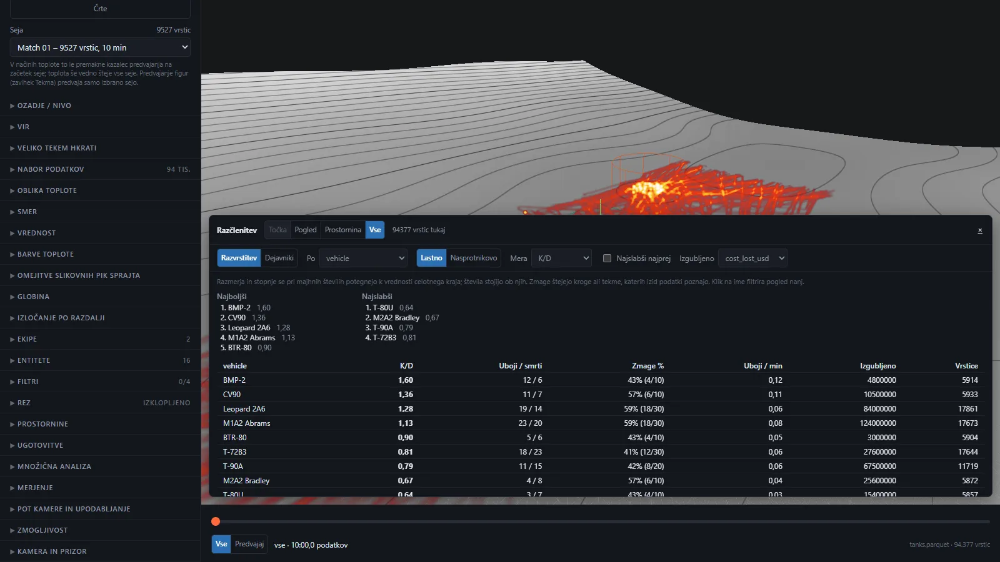
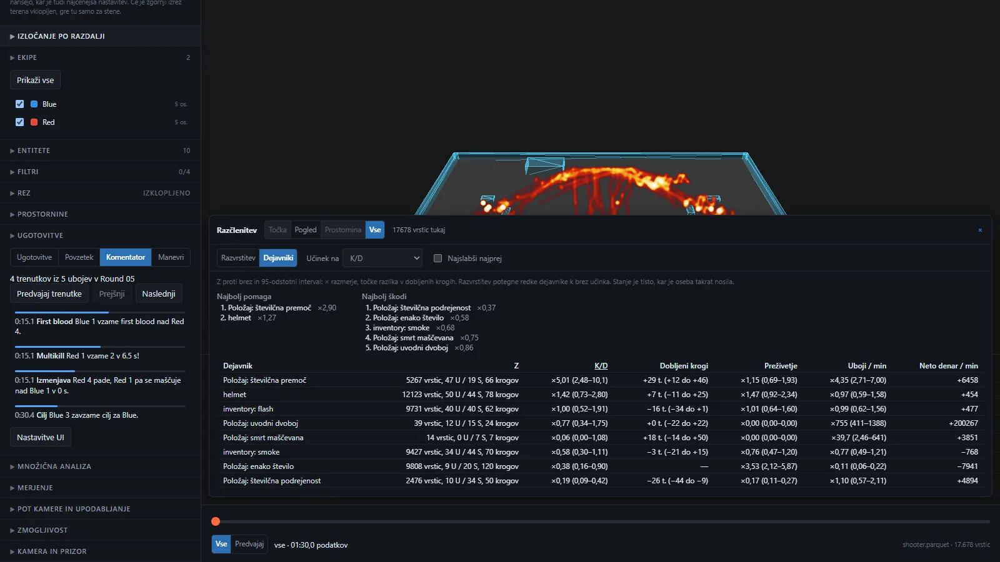

# Razčlenitev: kdo in kaj je najboljši kje

**Razčlenitev** odgovori na eno vprašanje: na tem mestu, katero vozilo, igralec ali orožje je najboljše? Uporabite jo, da najdete tank, ki zmaga pri mostu, ali da preverite, ali čelada res pomaga.

Razvrsti, kar se zgodi na enem mestu (izbrana točka, pogled, prostornina ali vse prikazano), po poljubni kategoriji, in meri vsak dejavnik stanja s in brez.

## Preizkusite {#try-it}

1. Naložite tekmo z ubitji in smrtmi ter odprite **Prostornine**.
2. Narišite prostornino okoli mesta, ki vas zanima, in jo izberite.
3. Pod Statistika pritisnite **Razčlenitev…**.
4. Pod **Po** izberite *Vozilo* in merilo *K/D* (ubitja na smrt).
5. Preberite seznam, najboljši najprej. Pritisnite **Najslabši najprej**, da ga obrnete. Kliknite ime, da filtrirate pogled nanj; kliknite znova, da ga spustite.

## Odprite jo {#open-it}

| Od kod | Območje, s katerim začne |
| --- | --- |
| **Razčlenitev…** v [Prostornine](volumes.md) (Statistika) | izbrana prostornina |
| **Razčlenitev tukaj** na kartici izbire, potem ko kliknete točko | krogla okoli te točke (**Polmer**, privzeto 3 % velikosti podatkov) |
| razdelna plošča **Razlika** | pogled |

Glava preklaplja območje: **Točka**, **Pogled** (kar je kamera videla ob zadnjem štetju; po premiku **Preštej znova**), **Prostornina** (izberete eno) ali **Vse**. Šteje v ozadju; vrstica stanja pove, koliko vrstic je v območju.

## Razvrstitev {#ranking}

Izberite, po čem razvrščate, in merilo:

| Merilo | Kaj je |
| --- | --- |
| A, B | vrstice na vsaki strani zemljevida razlike, razdeljene, kot jih deli toplota |
| A / B, A - B, A / (A + B) | obe plasti druga proti drugi |
| K/D | ubitja proti smrtim |
| Zmage % | odigrane zmage (ali tekme), kjer podatki povedo, kdo je zmagal |
| Ubitja / min | prisotna ubitja na minuto (vrzeli med vzorci gibanja) |
| Zaslužek, Izguba, Neto denar | vsote stolpcev `earn_*` in `cost_*`; izbirnik izbere valuto |

Ubitja, smrti, prisotnost, zmage in denar štejejo vsako vrstico, ki jo pogled prikazuje na mestu, na kateri koli strani delitve ali nobeni.

Razmerja in stopnje se pri majhnih številih vlečejo proti vrednosti celotnega mesta, tako da 2 ubitja v enem življenju ne prideta na vrh seznama. Števila so prikazana poleg njih.

Razvrščate lahko po skupinah, igralcih in tekmah, po katerem koli stolpcu kategorije (vozilo, orožje, stran, vrsta nakupa, agent ali komplet), po katerem koli številskem stolpcu v razponih (oklep, vrednost opreme), po **razredu** stolpca orožja (puška, ostrostrelec, SMG, pištola ...) in po številu kosov **pripomočkov**, ki jih vsebuje seznamski stolpec, kot je `inventory`.

**Lastno** razvršča po lastni vrednosti vrstice. **Nasprotnikovo** razvršča po vrednosti druge strani: orožje žrtve pri ubitju, orožje ubijalca pri smrti (potrebuje stolpec `other` / `victim`, ki ju poimenuje).

## Stanje ob tistem času {#state-at-the-time}

Vrednost vrstice je njena lastna, razen če vrstica ne beleži ničesar (dogodkovna vrstica brez opreme) ali če gre za smrt (katere stolpec orožja lahko poimenuje orožje ubijalca); takrat je to, kar je imela ista oseba nazadnje pri sebi, prej v tekmi.

## Dejavniki: s proti brez {#factors-with-against-without}

Preklopite z **Razvrstitev** na **Dejavniki**, izberite **Učinek na** in preberite *Najbolj pomaga* in *Najbolj škodi*:

Učinek vsakega dejavnika na K/D, odigrane runde, preživetje (minute na smrt), ubitja na minuto in neto denar na minuto, z 95-odstotnim intervalom: razmerja kot x, odigrane runde kot razlika v točkah. Razvrstitev vleče vsako oceno proti nič učinka glede na njeno lastno negotovost, zato redek dejavnik za visoko uvrstitev potrebuje jasen učinek; prikazani interval je nevlečen.

Podatki z rundami dodajo **situacije** boja iz blizu ([Boj iz blizu in runde](close-quarters.md)), izračunane enkrat za nabor podatkov: *oslepljen* (stolpec `state_flashed` vrstice ali sovražnikov bliskavica v 15 m v zadnjih 3 s), *smrt zamenjana*, *uvodni dvoboj* ter *prednost v številu*, *enako število* ali *manjša številčnost* (živi igralci na strani vrstice proti sovražniku). Smrt šteje v situaciji, v kateri je bila njena žrtev tik pred njo.

V enem prehodu se izmeri največ 256 dejavnikov.

## Za razvijalce {#for-developers}

### Vlečenje majhnih vzorcev {#pulling-small-samples}

Vrednost za razvrstitev je `(n + m*r0) / (d + m)`: `n` in `d` sta števili, `r0` je razmerje celotnega mesta in `m` je teža tega predhodnega prepričanja.

### Za avtorje pretvornikov: poimenovanje stolpcev dejavnikov {#for-converter-authors-naming-factor-columns}

Pretvornik doda dejavnik tako, da poimenuje njegov stolpec:

| Stolpec | Dejavnik |
| --- | --- |
| `state_<ime>` število | vklopljeno, dokler ni nič |
| `state_<ime>` kategorija | en dejavnik na vrednost (`state_ammo` = AP, HE ...) |
| `active_<ime>` | enako, za nekaj vklopljenega ali nedavno uporabljenega: sposobnost, ultimat, pripomoček, okrepitev (`active_ult`, `active_stim`) |
| seznamski stolpec (`inventory`, `loadout`, `perks`, `abilities`, `attachments`, `modules`, `buffs`, `debuffs`, `upgrades`, ali ime `state_`/`active_`, ki se konča z `s`) | en dejavnik na predmet vrednosti `a\|b\|c` |
| zastavice opreme, ki so že pogoste (`helmet`, `defuser`, `armor`, `scoped`, `airborne`, `duck`, `flashed` ...) | vklopljeno, dokler ni nič |
| `ammoType`, `shellType`, `ammoName` | zadnji izstreljeni naboj |

Rezultati: stolpec `won` z 0/1 (stran vrstice je zmagala v rundi ali tekmi) in stolpec `round` - [stolpci izida](data-formats.md#outcome-columns); kjer ima datoteka `won` in `matchWon`, *Zmage %* šteje kroge. Denar: `earn_<valuta>` in `cost_<vrsta>_<valuta>`; prihodek po vrsti sam (`earn_round_cs2`, natančne nagrade za rundo iz pretvornika) nadomesti samo prihodek tega tipa v modelu stroškov (`round` zajema tudi postavitve in razminiranja), model pa še vedno oceni ostalo.

Preslikava naloži te stolpce sama poleg lastnega seznama datoteke: vsak `state_*`, `active_*`, `won`, `round` in seznamski stolpec, razen tistih, ki jih statistika datoteke Parquet pokaže kot enako vrednost skozi vse (vsak naložen stolpec je 4 bajte na vrstico).
