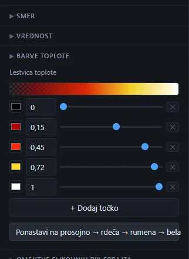

# Barva in osvetlitev

Te nastavitve določajo, kolikšna toplota dobi katero barvo. **Točka nasičenja** je toplota, ki šteje kot belo-vroča.

## Hitre rešitve {#quick-fixes}

- Vse je belo: povečajte **Točko nasičenja** ali pritisnite **Samodejna osvetlitev iz polja**.
- Nič ni vidnega: zmanjšajte **Točko nasičenja** ali pritisnite **Samodejna osvetlitev iz polja**.
- Vidnih je le nekaj posameznih pik: povečajte **Najmanjšo toploto**.

Vsaka nastavitev na tej strani začne veljati, ko se toplota pretvori v barvo. Če jo premaknete, se slika takoj prerisa, **kopičenje pa se nikoli ne začne znova**.

## Točka nasičenja {#saturation-point}

**Točka nasičenja** (razdelek Oblika toplote): nakopičena toplota, ki ustreza vrhu barvne lestvice (pri odzivu *Linearno*; za druge odzive glejte spodaj). Logaritemski drsnik sega od 0,1 do 4000, ročica pa do 10.000.000, ker nakopičena toplota raste s številom vrstic. Privzeta vrednost je 24; ob vsakem nalaganju se najprej vzame **analitična ocena**, nato se vrednost **izmeri** iz slike.

Napačna vrednost loči toplotno karto od prazne (ali bele) slike, in je ni mogoče zanesljivo izpeljati: telemetrija se tako močno gruči – pojav, vrata, ozko grlo – da se razmerje med največjo in povprečno gostoto med podatki in med koti kamere razlikuje za cel velikostni razred.

## Samodejna osvetlitev {#auto-exposure}

**Samodejna osvetlitev iz polja** izmeri polje, ki ga je senčilnik dejansko ustvaril. Prezre prazne slikovne pike, vzame 98. percentil osvetljenih pik in ga postavi na 85 % poti do točke nasičenja. Tako ostane vrh lestvice za prave vrhove.

Panel nato prikaže *izmerjeno X % okvirja; 98. percentil R postavljen blizu vrha lestvice*. Pri odzivu *Nasičen* vrednost na 85 % točke nasičenja pristane pri približno 57 % lestvice, ne pri 85 %.

Teče tudi **samodejno**:

- 8 upodobljenih sličic po nalaganju podatkov;
- 8 sličic po spremembi [filtrov](filters.md) (če filtriranje vsak položaj zmanjša na sto dogodkov, se gostota spremeni za več velikostnih razredov);
- 8 sličic po preklopu med točkovno toploto in [črtno toploto](line-heat.md) ali po spremembi, katere poti črtna toplota riše, ker črta odloži veliko manj toplote na vzorec kot sprajt.

Če ni osvetljeno nič, samodejni zagon pusti nasičenje pri miru. Gumb se vrne na analitično oceno in pove *nič osvetljenega za merjenje - uporabljena analitična ocena*.

### Sledi pogledu {#follow-the-view}

**Sledi pogledu** (razdelek Oblika toplote, privzeto vklopljeno) znova izmeri vsakič, ko kamera miruje. Tako območje, v katerega poletite, uporabi celotno barvno lestvico, ne merila, izmerjenega za ves zemljevid. Majhne spremembe se prezrejo, merilo pa se zgladi namesto da skoči. Deluje v štirih načinih toplote, ne pa v prekrivanju figur.

Izklopite, če želite zakleniti merilo in primerjati kraje na enakem merilu. Ročno vlečenje **Točke nasičenja** ga prav tako zaklene.

## Odziv gostote {#density-response}

**Odziv gostote** – kako se *k* (toplota / nasičenje) preslika na lestvico:

| Odziv | Formula | Uporaba |
|---|---|---|
| **Nasičen** (privzeto) | t = 1 - e^(-k) | Asimptotično se približa vrhu lestvice, kot to delajo zložene prosojne sprajte. Nič ne pade na ravno belo, zato je to varna privzeta izbira pri neznanih podatkih. |
| **Linearno** | t = k | Edina preslikava, kjer enaka barva pomeni enako število. Uporabite jo za primerjavo dveh naborov podatkov ali dveh časovnih oken. |
| **Logaritemski** | t = log₂(1 + 7k) / 3 | Stisne dolg rep, tako da ena skrajno vroča točka ne stisne vsega drugega na dno lestvice. Dvigne redke predele. |

## Najmanjša toplota {#minimum-heat}

**Najmanjša toplota** (privzeto izklopljeno, 0–100 %): vsaka slikovna pika, ki nosi kakršno koli toploto, se dvigne vsaj na to točko lestvice. Povečajte jo in zmanjšajte polmer sprajta, da vidite, *kje se je kaj sploh zgodilo* – posamezne podatkovne točke postanejo jasno vidne, namesto da bi komaj ležale nad prosojnim. Pustite izklopljeno, kadar presojate gostoto, ker zaradi take zasnove zravna dno lestvice. Prag (k > 0,0001) ohrani prave prazne slikovne pike prazne.

## Urejevalnik lestvice {#the-ramp-editor}

V razdelku **Barve toplote**. Njegova oznaka pove, za kaj je lestvica: *Toplotna lestvica* pri Toploti in Črtah, *Pozitivno (aditivne ekipe)* pri Razliki, *Lestvica neprosojnosti (barva pride iz skupine)* pri [Toploti ekip](team-heat.md), kjer se uporablja samo njena alfa vrednost.



Vrstica na vrhu prikazuje predogled lestvice. Pod njo je po ena vrstica za vsako točko:

| Del | Pomen |
|---|---|
| Barvni vzorec | Barva točke (barvni izbirnik brskalnika). |
| Številka | Položaj točke na lestvici, od 0 do 1 (0 = brez toplote). |
| Drsnik | Neprosojnost točke, 0–100 %. |
| ✕ | Odstrani točko; onemogočeno, ko sta ostali samo dve. |

**+ Dodaj točko** doda točko na pol poti med zadnjima dvema točkama, z barvo in neprosojnostjo zadnje točke. **Ponastavi na prosojno → rdeča → rumena → bela** vrne privzeto lestvico.

Točke so lahko podane v poljubnem vrstnem redu; ob gradnji lestvice se uredijo. **Alfa** je tisto, kar meša toploto s prizorom, zato je ničelni konec privzete lestvice popolnoma prosojen.

### Privzete lestvice {#the-default-ramps}

| Položaj | Pozitivna (Toplota, Črte, Razlika +) | Negativna (Razlika −) |
|---|---|---|
| 0,00 | črna, alfa 0 | črna, alfa 0 |
| 0,15 | rgb(180, 0, 0), alfa 0,55 | rgb(0, 170, 60), alfa 0,55 |
| 0,45 | rgb(255, 40, 0), alfa 0,85 | rgb(0, 190, 200), alfa 0,85 |
| 0,72 | rgb(255, 220, 40), alfa 0,95 | rgb(40, 80, 255), alfa 0,95 |
| 1,00 | bela, alfa 1 | rgb(170, 60, 255), alfa 1 |

## Med premikanjem kamere {#while-the-camera-moves}

Ko se kamera premika, se kopičenje ob vsaki sličici ponovno zažene. Z vklopljeno možnostjo **Nariši vse vrstice v vsaki sličici** (privzeto) je vsaka sličica med premikanjem še vedno točna. Če je izklopljena, premikajoča sličica pokaže en vzorčen oceno – svetlejše, z utežjo obarvane grude – ki se ob ustavitvi zbližajo v gladko pravo sliko. To je pričakovano; glejte [Kopičenje](accumulation.md).

## Za razvijalce {#for-developers}

### Sestavljeni prehod {#the-composite-pass}

Ko je toplota nakopičena, se vrednost vsake slikovne pike v enem sestavljenem prehodu ([`COMPOSITE_FS`](https://github.com/Holdi601/3DHeat/blob/main/src/render/webgl2/shaders.ts)) pretvori v barvo. Koraki so:

```
k = |toplota| / točka nasičenja
t = odziv(k)                            omejeno na 0..1
if najmanjša toplota > 0 and k > 0.0001:  t = najmanjša + (1 - najmanjša) × t
barva, alfa = lestvica(t)               (negativna lestvica, ko je toplota < 0, samo Razlika)
piksel = mix(prizor, barva, alfa)
```

### Analitična ocena {#the-analytic-estimate}

**Analitična ocena** ([`estimateSaturation`](https://github.com/Holdi601/3DHeat/blob/main/src/data/calibrate.ts)) predpostavi, da so vrstice razporejene po površini X-Z podatkov: povprečna toplota = vrstice × (π r² / površina območja) × 1/3 × središčna intenzivnost (1/3 je povprečje diska linearnega profila), pomnoženo z domnevnim razmerjem največje proti povprečni vrednosti 25 in omejeno na 0,1–1.000.000. Mora biti le znotraj enega velikostnega razreda pravilna.

### Merjenje {#metering}

[`exposure.ts`](https://github.com/Holdi601/3DHeat/blob/main/src/render/exposure.ts):

1. vrednost toplotne tarče se prebere nazaj z grafične kartice in podvzorči na največ 40.000 vrednosti;
2. prazne slikovne pike (toplota ≤ 0,0001) se zavržejo – večina toplotnega polja je prazna, in če bi jih upoštevali, bi bilo vse podosvetljeno, kot bi merilnik svetlobe, usmerjen v črno ozadje;
3. 98. percentil osvetljenih pik je referenca;
4. točka nasičenja postane referenca / 0,85, tako da referenca leži na 85 % poti do točke nasičenja in vrh lestvice ostane za prave vrhove.

### Tabela barv {#the-colour-table}

Lestvica se vpeče v tabelo RGBA velikosti 256 × 2 (pozitivna lestvica v prvi vrstici, negativna v drugi) ([`buildColorLut`](https://github.com/Holdi601/3DHeat/blob/main/src/render/colors.ts)). Barve se interpolirajo v linearni svetlobi in shranijo kot sRGB; neprosojnost se interpolira linearno.
