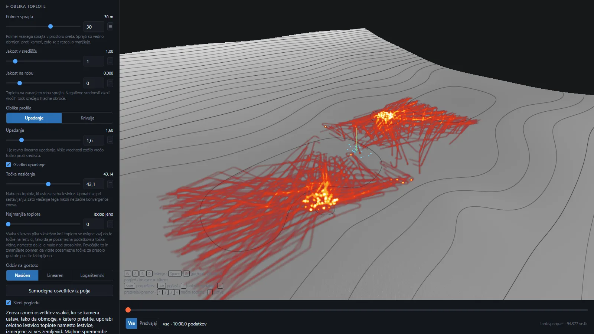
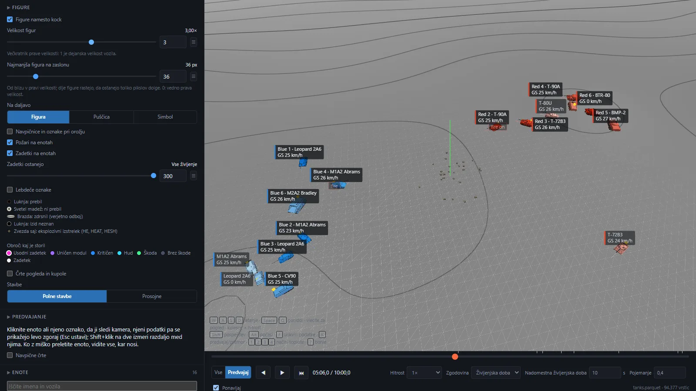

# Demo podatki: preizkusite pregledovalnik v petih minutah



Še nimate lastnih podatkov? Repozitorij jih naredi. Vse v njem je izmišljeno: dolina, dvorišče in tekme treh izmišljenih slogov igre z igralci z imeni *Blue 1* ali *Red 3*. Vse slike na tej strani so bile posnete z njimi.

## Naredite jih {#make-it}

```bash
node tools/demo-data.mjs
```

To zapiše v `tools/.shots/demo/`:

| Datoteka | Kaj je |
|---|---|
| `demo-valley.glb` | 12 km dolina z dvema hribema in vasjo, kot 3D raven |
| `demo-yard.glb` | 160 m dvorišče z zidom in stavbami, kot 3D raven |
| `tanks.parquet` | 10 tekem s tenki, 8 proti 8: gibanje, streli, zadetki s položajem na trupu, požari, uničenja, ostanki vozil, cilj kupole, zmagovalci |
| `tanks/match-NN.parquet` | iste tekme, vsaka v svoji datoteki, za [veliko tekem hkrati](many-matches.md) |
| `air.parquet` | zračni boj 4 proti 4 z raketami, vabami, uničenji in zgrešitvami |
| `shooter.parquet` | 12 krogov po 5 proti 5 peš: streli, uničenja, postavitev bombe, zasluženi in porabljeni krediti, čelade in pripomočki |
| `mass/` | mapa majhnih `.3dheat` tekem, za [množinsko analizo](mass-analysis.md) |
| nabor krogov dirke | dva kroga enega avtomobila na izmišljeni progi, za [Analizo dirke](race-analysis.md) |

Vsaka tabela navede svoje stolpce v nogi, zato se naloži brez kakršnekoli preslikave.

## Preizkusite {#try-it}

1. Zaženite pregledovalnik (`start.bat` v sistemu Windows ali `npm install` enkrat in nato `npm run dev` na katerem koli sistemu) in odprite `http://127.0.0.1:5273/`.
2. **Ozadje / nivo → 3D-model…** in izberite `demo-valley.glb`.
3. **Vir → Datoteke…** in izberite `tanks.parquet`.
4. Pritisnite `F`, da uokvirite podatke. Vidite [toploto](heat.md) desetih tekem.
5. Preizkusite vrstico načinov: **Razlika** (Blue proti Red), **Toplota ekip**, **Črte**.
6. Odprite **Ugotovitve** (v stranski vrstici Toplotni zemljevid): najde mesta, kjer je bilo veliko več streljanja, zadetkov in uničenj kot drugje - okoli obeh hribov.
7. Odprite zavihek **Tekma**; pod **Tekme v posnetku** izberite *Match 01*; pritisnite **Predvajaj** na časovnici: [predvajanje](match-replay.md).



Za streljanje naložite `demo-yard.glb` in `shooter.parquet`; za zračni boj `air.parquet` (figure so lažje vidne pri **Velikost figur** 4, drsnik v plošči **Pregledovalnik ekip** v stranski vrstici Toplotni zemljevid).

## Posnetki zaslona {#the-screenshots}

Slike na spletnem mestu z skriptom iz teh podatkov, v katerem koli jeziku pregledovalnika:

```bash
node tools/demo-data.mjs
HEAT3D_FIGURE_PACK=none npx vite --port 5321 --strictPort --host 127.0.0.1   # PowerShell: $env:HEAT3D_FIGURE_PACK="none"; npx vite ...
node tools/docs-shots.mjs --lang en
```

Strežnik za posnetke zaslona teče brez lokalnega paketa figur, zato je prikazan le javni katalog figur. Slike gredo v `docs/assets/img/<lang>/`. Glejte [Vzdrževanje dokumentacije](maintaining.md).
