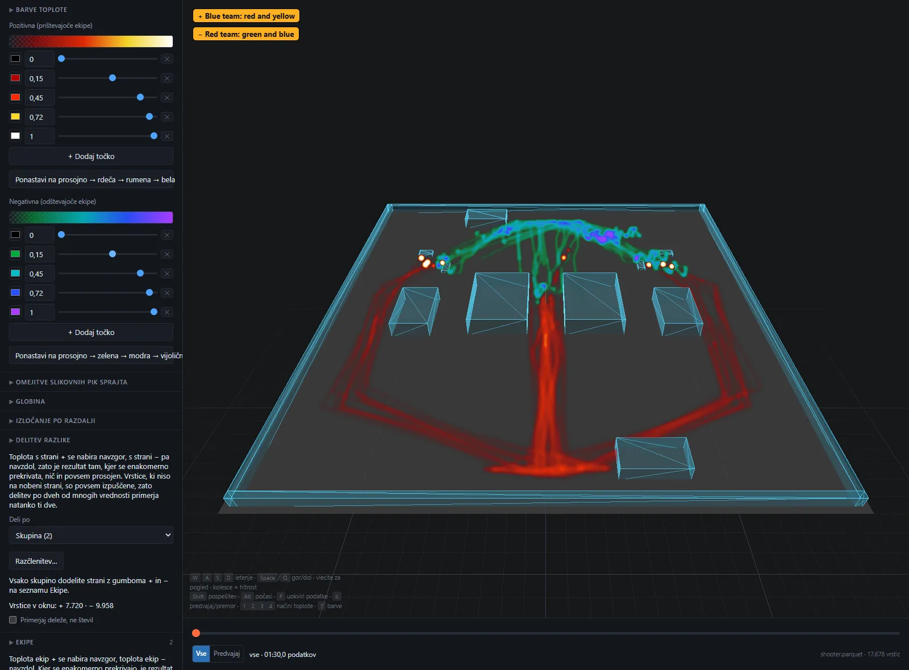

# Razlika

Rdeče tam, kjer je bila ekipa A bolj prisotna, zeleno-modro tam, kjer je bila ekipa B, nič tam, kjer sta bili enaki.

**Razlika** (tipka 2) je predznačena toplota. Vrstice ene populacije dodajajo toploto, vrstice druge jo odštevajo. Kjer se obe enakomerno prekrivata, je rezultat nič in popolnoma prosojen; kjer prevladuje ena, se pokaže v barvah te strani - privzeto toplih (prosojno → rdeče → rumeno → belo) za stran **+** in hladnih (prosojno → zeleno → modro → vijolično) za stran **−**.

## Kako uporabljati {#how-to-use-it}

1. Pritisnite `2` (ali izberite **Razlika** v vrstici načinov).
2. Odprite **Delitev razlike** v stranski vrstici.
3. Izberite, **Deli po** čem: običajno *Skupine*.
4. Eno skupino (ali vrednost) postavite na **+**, drugo na **−**.
5. Preberite barve: tople pomenijo stran +, hladne stran −. Plošča opozori, če ena stran nima vrstic (glejte [Sporočila, ki jih lahko vidite](#messages-you-may-see)).

*Kateri* dve populaciji sta to, je celotno vprašanje, zato je lahko delitev po poljubnem ohranjenem stolpcu, ne le po skupinah. Vrstice, ki ne padejo na **nobeno** stran, so **izpuščene**, ne štejejo se kot nič: zato delitev po dveh od mnogih vrednosti primerja natanko ti dve, in se sestavi z [filtri](filters.md) - filtrirajte na en zemljevid, nato to razdelite po različici.

Način potrebuje dve strani: stolpec skupine z vsaj dvema skupinama ali delitev po stolpcu, ohranjenem za filtriranje. Pri podatkih z manj kot dvema skupinama nalaganje začne z delitvijo po stolpcu - najprej stolpec *Izvorna datoteka* pri nalaganju več datotek, sicer prvi kategorijski stolpec z dvema vrednostma, sicer prvi številski stolpec z razponom - zato *primerjaj dve nalaganji* deluje tudi na podatkih brez skupin. Način je nedosegljiv le pri podatkih brez obojega; enako velja za delitev stolpca, pri kateri je ena stran prazna.

## Plošča Delitev razlike {#the-difference-split-panel}

Prikazana v načinu Razlika, pod ploščami toplote.

**Deli po** ponuja:

| Možnost | Prikazano kot | Pravilo delitve |
|---|---|---|
| Skupine | *Skupina (N)* (ko obstaja stolpec skupine) | Vsaka skupina na +, − ali nobeni, nastavljeno v [Ekipe](teams-list.md) |
| Kategorijski stolpec | *stolpec (N vrednosti)* | Vrednosti na +, − ali nobeni |
| Številski stolpec | *stolpec (številski)* | Obseg vrednosti za vsako stran |
| Izvorna datoteka | *Izvorna datoteka - primerjaj dve nalaganji* (ko je naloženih več datotek) | Datoteke na +, − ali nobeni |

Ponujeni so le stolpci, ohranjeni pod *Ohrani za filtriranje* ob nalaganju.

### Primerjaj deleže, ne števil {#compare-shares-not-counts}

**Primerjaj deleže, ne števil** (privzeto izklopljeno) utež vsake strani nastavi na ena deljeno s številom njenih vrstic, zato stran s petkrat več vrsticami ne zmaga samo zaradi števila. Barva nato pokaže, kje je vsaka stran sorazmerno pogostejša od druge. Uporabite, kadar imata obe strani zelo različne količine podatkov, na primer dve seji različne dolžine.

### Sporočila, ki jih lahko vidite {#messages-you-may-see}

Plošča opozori, kadar slika ni prava razlika:

| Sporočilo | Pomen |
|---|---|
| *N + / M −* (ali *N + / M − / K neuporabljenih*) | Koliko vrednosti je na vsaki strani (in koliko na nobeni). |
| V oknu ni nobene vrstice na strani **+** | Nariše se le stran **−**. Premaknite okno časovnice ali spremenite delitev. |
| V oknu ni nobene vrstice na strani **−** | Nariše se le stran **+**. |
| Nobena vrednost ni na nobeni strani | Razlika ne nariše ničesar. Postavite vsaj eno vrednost na **+** ali **−**. |
| *stolpec* na ta način ni mogoče razdeliti | Izbrani stolpec ne ustreza delitvi. Izberite stolpec znova. |
| Stolpec delitve ni ustrezal pomnilniku GPU za N od M kosov | Te vrstice niso narisane. Povečajte proračun GPU pod Zmogljivost → Proračuni virov ali naložite manj vrstic. |

### Po skupini {#by-group}

Plošča le kaže na [Ekipe](teams-list.md), kjer ima vsaka skupina gumba **+** in **−**. Ob vsakem nalaganju prva polovica skupin (zaokrožena navzgor) gre na +, ostale na −; **Razdeli enakomerno** v Seznamu ekip naredi isto še enkrat. Skupina na nobeni strani ali skrita s svojim potrditvenim poljem ne prispeva ničesar.

### Po vrednostih kategorij {#by-category-values}

| Del | Pomen |
|---|---|
| `a + / b − / c neuporabljenih` | Koliko vrednosti je na vsaki strani in koliko na nobeni. |
| **Počisti** | Vsako vrednost da na nobeno stran. |
| Seznam vrednosti | Vsaka vrednost z gumbom **+** in **−** (kliknite aktivnega znova, da ga odstranite s te strani). Prazna vrednost je navedena kot *(manjka)*. |
| Opomba o omejitvi | Navedenih je le prvih 200 vrednosti: *Prikazujem prvih 200 od N vrednosti. Tako širok stolpec je bolje najprej zožiti s filtrom ali razdeliti po obsegu, če so vrednosti urejene.* |

Ob izbiri stolpca njegova prva vrednost gre na + in druga na −. Kadar nobena stran nima vrednosti, se delitev vrne na skupine, namesto da bi pokazala prazen okvir. *Izvorna datoteka* deluje enako, ena vrednost na datoteko - tako primerjate dva izvoza, dva preizkusa ali dve različici.

### Po obsegu {#by-range}

| Del | Pomen |
|---|---|
| Namig | Najmanjša in največja vrednost stolpca. |
| **Pozitivni obseg (+)**, **od** / **do** | Vrstice z vrednostjo v tem obsegu, vključno z obema robovoma, prištevajo. |
| **Negativni obseg (−)**, **od** / **do** | Vrstice v tem obsegu odštevajo. |
| **Razdeli na sredini** | Nastavi + na [najmanjša, sredina] in − na [sredina, največja] - enako kot izbira stolpca. |

Vrednost v obeh obsegih šteje kot +. Obsegi ne rabijo pokriti stolpca; vrednosti na nobenem so izpuščene. *Prvi dve minuti proti zadnjima dvema* je delitev po obsegu na stolpcu, podobnem času.

## Barve {#colours}

Razdelek **Barve toplote** v tem načinu kaže dva urejevalnika lestvic: **Pozitivna (prištevajoče ekipe)** in **Negativna (odštevajoče ekipe)**, vsak s svojim gumbom za ponastavitev (*Ponastavi na prosojno → rdeča → rumena → bela*, *Ponastavi na prosojno → zelena → modra → vijolična*). Sestavljanje vzame absolutno vrednost neto toplote skozi [točko nasičenja in odziv](colour-and-exposure.md) ter izbere negativno lestvico tam, kjer je neto pod nič. Glejte [Barva in osvetlitev](colour-and-exposure.md#the-ramp-editor).

Uporabite odziv *Linearno*, kadar je pomembna velikost razlike: je edini odziv, pri katerem enaka barva pomeni enako število.

## Kako deluje {#how-it-works}

Vsaka vrstica dobi predznak +1, -1 ali 0 v senčilniku oglišč ([`POINT_HEAT_VS`](https://github.com/Holdi601/3DHeat/blob/main/src/render/webgl2/shaders.ts)); 0 zavrne vrstico, preden se nariše kateri koli fragment.

- Po skupini predznak pride iz tabele skupin s 4.096 vnosi, indeksirane z ID-jem skupine vrstice (ID skupine se nosi v četrtem kanalu teksla položaja vrstice).
- Po kategoriji predznak pride iz druge tabele s 4.096 vnosi, napolnjene za vsako vrednost kategorije, vrednost vrstice pa se prebere iz teksture filtra stolpca; vrednost za koncem tabele je zavrnjena na obeh zaledjih.
- Po obsegu vrednost vrstice primerjamo z obema obsegoma.

Sprememba delitve ponovno zažene kopičenje.

**Skrite skupine ostanejo skrite pri vsaki delitvi.** Pri delitvi po stolpcu tabela skupin ne nosi več predznakov; hrani 1 za prikazano skupino in 0 za skrito ([`frameSignTables`](https://github.com/Holdi601/3DHeat/blob/main/src/render/filterTables.ts)), obe tabeli pa dosežeta senčilnik skupaj - dve vrstici ene teksture predznakov na WebGL2, dve polovici enega pomnilniškega medpomnilnika na WebGPU. Vrstica se nariše le, če je njena skupina prikazana *in* je vrednost njenega stolpca na neki strani. Skupina, ki je odkljukana v [Seznamu ekip](teams-list.md) ali izpuščena s fokusom strani v zavihku Tekma, tako ne prispeva ničesar, ne glede na to, kako je razlika razdeljena.
