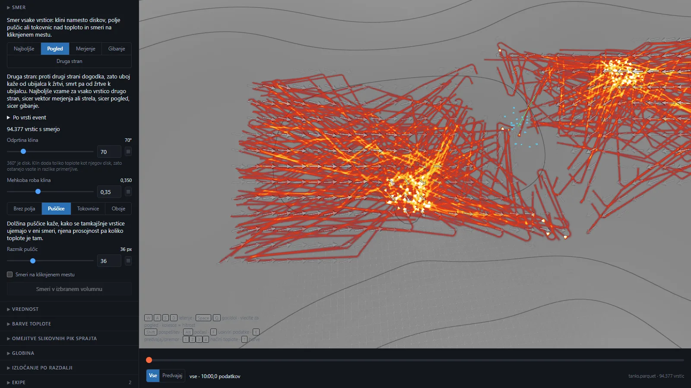

# Smerna toplota

Navadna toplota pove **kje** se stvari dogajajo. Smerna toplota pove tudi **v katero smer**: v katero smer so ljudje gledali, cilja li, se premikali ali kje je bila druga stran boja.

Navaden sprajt je poln disk (360 stopinj). Z **Odprtino klina** 70 stopinj postane isti sprajt ozek klin, ki kaže smer, v katero je bila vrstica obrnjena, in doda enako skupno toploto.

## Kako uporabljati {#how-to-use-it}

1. Naložite podatke, ki v sebi vsebujejo smer (glejte [Kaj da vrstici smer](#what-gives-a-row-a-direction)).
2. V vrstici načinov izberite **Toplota**, **Razlika** ali **Toplota ekip**.
3. Odprite razdelek **Smer** na stranski vrstici.
4. Izberite **vir** (katera smer naj se uporabi), nato vklopite risanje:
   - znižajte **Odprtino klina** pod 360°, da vsako vrstico nariše kot klin, ki kaže v njeno smer, namesto kot disk;
   - izberite **Polje**, da čez toploto narišete puščice ali tokovnice;
   - odkljukajte **Smeri na kliknjenem mestu** in kliknite na toploto, da dobite polarni grafikon tega mesta.

Vrstica stanja pove, koliko vrstic ima smer iz izbranega vira.

## Nastavitve {#settings}

| Nastavitev | Privzeto | Kaj naredi |
|---|---|---|
| Vir: **Najboljši**, **Pogled**, **Merjenje**, **Gibanje**, **Druga stran** | Najboljši | Katero smer dobi vsaka vrstica. *Najboljši* vzame za vsako vrstico drugo stran, sicer merjenje, sicer pogled, sicer gibanje. |
| **Po vrsti dogodka** | kot zgoraj | Drug vir za vsako vrsto dogodka, na primer *Druga stran* za ubitja in *Pogled* za položaje. Prikazano, kadar podatki vsebujejo stolpec dogodka z največ 40 vrednostmi. |
| **Odprtina klina** | 360° | 360° je navaden disk (izklopljeno). Manjše je ožji klin. Klin doda toliko toplote kot njegov disk, zato vsote in razlike ostanejo primerljive. |
| **Mehkoba roba klina** | 0,35 | 0 je klin z ostrim robom, 1 mehak lepezast. |
| **Polje**: Brez polja, Puščice, Tokovnice, Oboje | Brez polja | Puščice: dolžina puščice pove, kako se vrstice tam strinjajo v eni smeri, njena neprosojnost, koliko toplote je tam. Puščice so prikazane samo tam, kjer je toplota. |
| **Razmik puščic** | 28 px | Razdalja med puščicami na zaslonu. |
| **Animiraj tokovnice** | vklopljeno | Tokovnice tečejo, kadar so vklopljene. |
| **Smeri na kliknjenem mestu** | izklopljeno | Kliknite na toploto, da vidite smeri tam (spodaj). |
| **Smeri v izbranem volumnu** | | Isti grafikon za vse znotraj izbrane [prostornine](volumes.md). |

## Polarni grafikon na mestu {#the-polar-chart-at-a-spot}

Z vklopljeno možnostjo **Smeri na kliknjenem mestu** kliknite na toploto. Vrstice blizu te točke (znotraj 1,5 polmera sprajta) se zberejo v rožo 24 rezin po 15°:

- **oranžni** listi: odhodne smeri (kam vrstice kažejo);
- **modri** listi: dohodne smeri (od kod so prišle);
- **ploščina** lista raste s številom; puščica kaže glavno smer;
- črte pod grafikonom podajo glavni smerni kot, kako močno se vrstice strinjajo (R, od 0 do 1), razpršenost v stopinjah in število vrstic.

0° je na grafikonu navzgor, kar je svet −Z (sever za posnetke Tacview). Mesto je označeno tudi v 3D pogledu s puščico in obročem.

## Kaj da vrstici smer {#what-gives-a-row-a-direction}

| Vir | Potrebuje v podatkih |
|---|---|
| Pogled | stolpec zasuka (preslikan kot smer pogleda): `yaw`, `heading`, `azimuth`, `view_yaw`, `rot_z` |
| Merjenje | pari številk, kot so `aim_x`/`aim_y`, `shot_x`/`shot_y`, `fire_x`/`fire_y`, `hit_dir_x`/`hit_dir_y` (neobvezen `…_z`) |
| Gibanje | nič dodatnega: korak od prejšnjega vzorca iste osebe (največ 10 s prej, ista seja) |
| Druga stran | stolpec, ki poimenuje drugo stran dogodka (`other`, `victim`, `target`, `killer`, `attacker`, `shooter`, `other_player` ...), katerega vrednosti so imena oseb; ubitje kaže od morilca k žrtvi, smrt od žrtve k morilcu |

## Nasveti {#tips}

- Klini potrebujejo nekaj velikosti na zaslonu; pod nekaj slikovnimi pikami so spet narisani kot diski.
- Uporabite *Druga stran* pri vrsticah ubitij, da vidite **od kod** so boji dobljeni, in *Pogled* pri vrsticah položajev, da vidite **kje ljudje gledajo**.
- Pri **Razliki** klini obeh strani kažejo v svoje smeri, zato so sporni ognjeni kot jasno viden.
