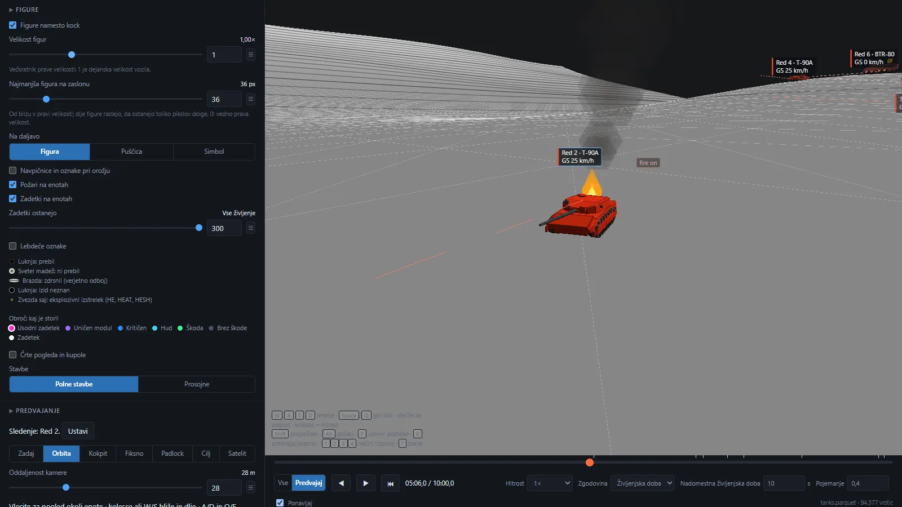

# Figure

**Figura** je majhen 3D model tega, kar enota resnično je: tank, reaktivno letalo, ladja, vojak. [Predvajanje](match-replay.md) nariše vsako enoto kot njeno figuro v pravi velikosti, namesto kot preprosto škatlo.

Je približno 2.000 imenovanih vozil, letal, ladij, orožij in vojakov, vse jih je zgradil sam pregledovalnik.

## Kaj je v katalogu {#what-is-in-the-catalogue}

| Območje | Primeri |
|---|---|
| Ljudje | vojak stoječ, počepnjen, ležeč; snajper, protitankovec, zdravnik, posadka |
| Kopno | tanki, bojna vozila pehote, protiletalska obramba, topništvo, tovornjaki in avtomobili, vlaki in tramvaji |
| Zrak | lovci, jurišniki, bombniki, transportna letala, helikopterji, od dvokrilnikov do sodobnih reaktivnih letal |
| Morje | bojne ladje po razredih, letalonosilke, podmornice, čolni, trgovske ladje |
| Orožje | rakete, raketni izstrelki, bombe, torpedi, bakle in plevni |
| Oznake | dimne, bliskovne in gorilne granate, nastavljene bombe, zastave, točke pojava, točke poti |

## Kako so figure narejene {#how-the-figures-are-made}

- **Zgrajene iz objavljenih mer.** Večino figur naredi graditelj figur pregledovalnika iz javnih številk: dolžina, širina, višina, cestna kolesa, stolp in top, krila in rep. Njihova oblika se nato uglasi po javnih fotografijah, risbah in objavljenih merah. Modeli nobene igre se ne uporabljajo.
- **Prosti modeli.** Nekatere figure uporabljajo proste 3D modele (CC0 ali CC BY), kjer so bolj resnični, včasih združeni z zgrajenim trupom. Avtorji del CC BY so navedeni na [Zasluge za figure](figure-credits.md); dela CC0 ne potrebujejo navedbe in tam niso navedena.
- Vsaka figura ima polno, grobo in oddaljeno različico (ravni podrobnosti, LOD), zato jih je lahko narisanih na tisoče hkrati.

## Katero figuro dobi enota {#which-figure-a-unit-gets}

Pregledovalnik pogleda stolpce samih podatkov:

1. **Imena** – stolpci, imenovani *Name*, *Vehicle*, *Unit*, *Unit type*, *Model*, *Aircraft*, *Plane*, *Tank*, *Ship*, *Craft*, *Loadout*, *Kit* ali *Figure* – se primerjajo s katalogom: natančno, prek približno 4.000 vzdevkov (id-ji enot več iger), po najdaljšem znanem začetku (`F-16C_50` je F-16C), ali po najkrajšem imenu figure, ki se začne tako.
2. Ime, katerega figura se ne ujema z **vrsto** enote, se ne uporabi (tovornjak z imenom *Typhoon* ni lovec).
3. **Vrste** – stolpci, imenovani *Type*, *Class*, *Kind*, *Category*, *Icon*, *Role* ali *Domain* – dajo razredno figuro: oznake Tacview (`Air+FixedWing`, `Ground+Heavy+Armor+Vehicle+Tank`, `Sea+Watercraft+Warship`, `Weapon+Missile`), ikone zemljevida ali navadne besede (tank, helikopter, pehota).
4. Podatki brez enega ali drugega so podatki o ljudeh: vsak je vojak.

Najlažji način, da dobite prave figure, je stolpec `vehicle` s pravimi imeni ali stolpec `type` z oznakami Tacview.

**Moja enota se prikaže kot škatla ali vojak.** Dodajte stolpec `vehicle` s pravim imenom ali stolpec `type` z oznako Tacview. Če se z miško ustavite nad enoto, vidite, katero ime se je ujemalo. Podatki, ki imajo take stolpce, a nič ne povedo o enoti, jo pustijo kot škatlo; podatki brez njih se narišejo kot vojaki.

## Nastavitve {#settings}

Razdelek **Figure** na stranski vrstici predvajanja nastavi velikost, najmanjšo velikost na zaslonu, kaj postanejo oddaljene enote (figura, puščica, simbol) in učinke, narisane nanje. Glejte [Predvajanje tekme](match-replay.md#figures). Dim, ogenj in drugi časovno omejeni učinki: [Figure v prekrivanju figur](figure-replay.md).

## Neobvezen lokalni paket figur {#an-optional-local-figure-pack}

Na svojem računalniku lahko hranite neobvezen paket lastnih figur. Njegove figure nadomestijo figure iz kataloga z enakimi imeni. Nikoli ni del repozitorija ali objavljene različice; brez njega se nič ne spremeni.
