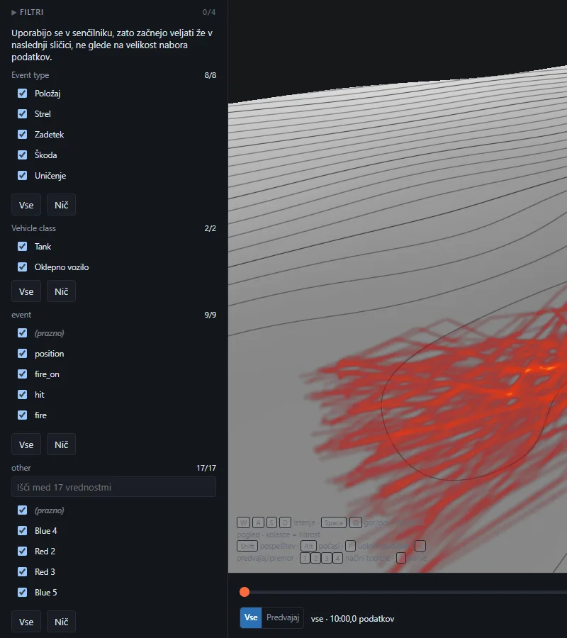
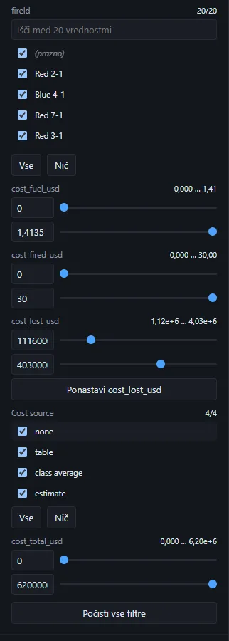

# Filtri

**Filtri** skrijejo vrstice, ki vas ne zanimajo, na primer en razred vozil ali eno vrsto dogodka, slika pa se takoj posodobi. Plošča našteje stolpce, ohranjene ob nalaganju pod *Ohrani za filtriranje* ([Preslikava stolpcev](column-mapping.md)), in *Izvorna datoteka*, kadar je naloženih več datotek.

## Preizkusite {#try-it}

1. Naložite nabor podatkov in v stranski vrstici odprite **Filtri**.
2. Pod **Razred vozila** odkljukajte *Tank*. Slika se takoj spremeni.
3. Pritisnite **Počisti vse filtre**, da razveljavite.

Prve vrstice so lastni stolpci pregledovalnika (spodaj). Vrstice za njimi prihajajo iz vaše datoteke.

## Stolpci, ki jih doda pregledovalnik {#columns-the-viewer-adds}

Ob nalaganju pregledovalnik sam ugotovi štiri stolpce in jih našteje **najprej**, z imeni in vrednostmi v vašem jeziku, zato isti filter deluje za vsako igro in vir podatkov:

| Stolpec | Vrednosti | Izračunano iz |
|---|---|---|
| **Vrsta dogodka** | 23 vrst: Položaj, Strel, Izstrelitev (raketa, izstrelek, bomba), Zadetek, Zgrešek (orožje se je končalo blizu nobene tarče), Eksplozija, Škoda, Uničenje, Smrt, Uničen, Strmoglavljenje, Katapultiranje / skok, Pojav, Izginotje, Vzlet, Pristanek, Stik s tlemi, Postanek na tleh, Ponovna oborožitev / točenje goriva, Zavzetje / cilj, Vaba, Sporočilo, Drugo | stolpec `event`, `events`, `event_type` ali `event_name`; besede vsake igre (`shot`, `burst`, `fired`, `struck`, `flare`, `plant` ...) so preslikane v te vrste. Celotna tabela: [Vrste in razredi dogodkov](ref-event-types.md). |
| **Igralec ali UI** | Igralec, UI | stolpec `ai`, `is_ai`, `bot` ali `actor`; sicer `is_player` / `human`; sicer ID računa (`user_id`, `steam_id`; prazno ali 0 je UI); pri posnetkih Tacview, ali ima objekt pilota |
| **Razred vozila** | 17 razredov: Lovec, Jurišnik, Bombnik, Drugo letalo, Helikopter, Tank, Oklepno vozilo, Protizračna obramba, Topništvo, Tovornjak / avto, Ladja, Podmornica, Pehota, Orožje, Vaba, Zgradba, Drugo | ime vozila ali enote (ujemanje s [katalogom figur](figures.md)) in stolpci tipa |
| **Razred cilja** | isti razredi | vozilo nasprotne strani (`other_vehicle`, `target_vehicle`, `victim_type` ...) |

Naštete so le vrste, ki se pojavijo. Stolpci vrednosti (`cost_*`, `earn_*`, `net_*` in *Vir cene*, glejte [Utežitev vrednosti](value-weighting.md)) se filtrirajo kot vsak številski stolpec: na primer odkljukajte *ocena* pod *Vir cene*, da ohranite le ovrednotene vrstice.

Seznam kategorij z več kot 12 vrednostmi dobi iskalno polje (*Išči n vrednosti*) in gumb **Samo ti**, ki dovoli natanko ujemajoče vrednosti.

Kateri stolpci se lahko filtrirajo, se odloči ob nalaganju, ker jih je treba takrat prebrati. Brez ohranjenega stolpca plošča to pove in napoti na *Ohrani za filtriranje*.

## Številski stolpci (razpon) {#numeric-columns-range}

| Del | Pomen |
|---|---|
| Ime in `min ... max` | Stolpec in trenutni razpon (celoten razpon stolpca, dokler filter ni nastavljen). |
| Prva vrstica: polje za število in drsnik | Spodnja meja. Če drsnik povlečete nad zgornjo mejo, ta gre z njim. |
| Druga vrstica: polje za število in drsnik | Zgornja meja. Če povlečete pod spodnjo, tudi ta gre z njo. |
| **Ponastavi *stolpec***  | Odstrani ta filter. |

Drsniki pokrivajo najmanjšo do največjo vrednost stolpca v 1.000 korakih; polja za števila sprejmejo katerokoli vrednost. Vrstica prestane, kadar je njena vrednost znotraj razpona, z obema robovoma vključenima. Velike vrednosti so prikazane v eksponentni obliki (`1,23e6`).

## Stolpci kategorij {#category-columns}

| Del | Pomen |
|---|---|
| Ime in `dovoljeno/skupaj` | Stolpec in koliko njegovih vrednosti je dovoljenih. |
| Seznam vrednosti | Potrditveno polje za vsako vrednost; prazna vrednost je prikazana kot *(prazno)*. |
| **Vse** / **Nič** | Dovoli vsako vrednost / nobene vrednosti. |

Dovoljenje vsake vrednosti odstrani filter.

## Pravila {#rules}

- **Štirje filtri hkrati.** Glava kaže `aktivno/4`. Peti filter se ne uporabi, plošča pa to pove. Izbira v [Entitetah](entities.md) (ali fokus igralca v zavihku Tekma) uporabi enega od štirih. Filter, ki pokriva celoten stolpec, ne porabi nobenega.
- **Stolpec kategorij ima največ 4.096 vrednosti**; širši ob nalaganju ni ohranjen.
- **Filtri se združujejo z IN** ter z vidnostjo ekip, delitvijo razlike, časovnim oknom, izrezovanjem razdalje in [rezom](slice.md).
- **Sprememba filtra ponovno zažene kopičenje in nekaj okvirjev kasneje ponovno izmeri osvetlitev**, ker lahko filtriranje močno spremeni gostoto ([Barva in osvetlitev](colour-and-exposure.md#auto-exposure)).
- **Počisti vse filtre** odstrani vse filtre stolpcev. Vidnost ekip in izbire igralcev, nastavljene drugje, ostanejo.
- Filtri stolpcev spremenijo načine toplote. Ne spremenijo figur [predvajanja figur](box-replay.md), ki sledijo vidnosti ekip in izbiri v Entitetah. Izbira v Entitetah spremeni oboje.
- V [črtni toploti](line-heat.md) se filter preizkusi na vrstici, na kateri se vsak odsek *konča*.
- Ob vsakem novem naboru podatkov so vsi filtri počiščeni.

## Za razvijalce {#for-developers}

**Reže.** Vsak aktivni filter zasede eno od štirih rež GPE ([`MAX_FILTER_SLOTS`](https://github.com/Holdi601/3DHeat/blob/main/src/render/types.ts)), teksturo s 4 bajti na vrstico. Reže se dodelijo filtrom v vrstnem redu, v katerem so se nazadnje spremenili ([`filterSlots`](https://github.com/Holdi601/3DHeat/blob/main/src/render/filterTables.ts), skupne senčilniku in obema ploščama). Če jih je več kot štiri, se prikaže napaka *Uporabljeni so le prvi 4 filtri. Odstranite enega - ostali se ne upoštevajo, niso pa tiho združeni*, imena dodatnih filtrov pa se glasijo *stolpec (ni uporabljeno)*. Filtri se izvajajo na vrstico v vertex shaderju, zato sprememba praga ne zahteva ponovnega razčlenjevanja ali ponovnega nalaganja.

**Filtri, ki jih plošča ne prikaže.** V stanju aplikacije obstajata še dve vrsti ([`FilterSpec`](https://github.com/Holdi601/3DHeat/blob/main/src/state/types.ts)):

- filter **skupin**, ki ga nastavi zavihek Tekma, ko se osredotoči na eno stran. Skrije druge skupine v vseh načinih, tudi [delitev razlike](difference.md) po stolpcu.
- filter **oseb**, ki ga nastavita plošča [Entitete](entities.md) in zavihek Tekma, ko se osredotoči na enega igralca. Omeji predvajanje figur in načine toplote. V toploti je to filter kategorij nad ID-ji oseb in zasede eno od štirih rež. Njena maska drži 65.536 ID-jev ([`FILTER_MASK_CAPACITY`](https://github.com/Holdi601/3DHeat/blob/main/src/render/types.ts)); oseba nad to mejo se v toploti med aktivnim filtrom ne riše, tudi če je izbrana. Predvajanje figur jo še vedno prikaže.
