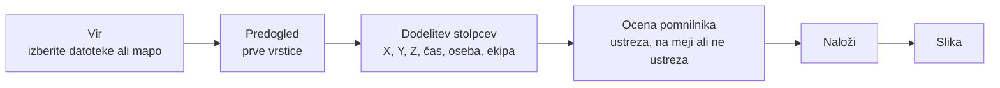

# Uvoz podatkov

Preden 3DHeat lahko kaj nariše, potrebuje tabelo: vsaka vrstica pove, kje je nekaj bilo in, če to imate, kdaj in kdo. Ta razdelek pokaže, kako datoteka postane slika. Še nimate podatkov? Preizkusite [demo podatke](demo-data.md).

**Naredite to zdaj:**

1. V stranski vrstici Toplotni zemljevid odprite **Vir** in pritisnite **Datoteke…** (ali spustite datoteko ali mapo na območje za spuščanje).
2. Oglejte si **Dodelitev stolpcev**: polja so običajno že izpolnjena.
3. Preverite, da **Ocena pomnilnika** pravi *ustreza*.
4. Pritisnite **Naloži**.

Vse, kar prikaže zavihek Toplotni zemljevid, prihaja iz enega **nabora podatkov**: tabele vrstic, vsaka s položajem in po izbiri s časom, osebo, skupino, sejo, smerjo pogleda in poljubnim številom dodatnih stolpcev, shranjenih za filtriranje. Ta razdelek razloži, kako nastane nabor podatkov.

## Pot od datotek do slike {#the-path-from-files-to-picture}

1. **Izberite datoteke** v plošči **Vir** - eno datoteko, več, drevo map ali s spuščanjem. Sprejete so datoteke Parquet, CSV, Tacview, GPS-sledi in še več; celoten seznam je v [Podatkovni formati](data-formats.md#files). Glejte [Nalaganje datotek](loading-files.md).
2. **Predogled.** Odpre se prva datoteka izbora: imena njenih stolpcev, prvih 50 vrstic, kateri stolpci so videti številski ter (Parquet) logični tip vsakega stolpca in navodila za branje, ki jih ima sama datoteka, vnos `heat3d` v nogi.
3. **Samodejna preslikava.** Stolpci se dodelijo vlogam - X, Y, Z, čas, oseba, seja, skupina, smer pogleda - nekaj pa se ohrani za filtriranje. Vsako ugibanje je prikazano v plošči **Dodelitev stolpcev** in ga lahko spremenite. Glejte [Preslikava stolpcev](column-mapping.md) in [Osi, enote in čas](axes-units-and-time.md).
4. **Štetje.** Število vrstic vsake datoteke se prebere (natančno iz nog datotek Parquet, ocenjeno za CSV), zato plošča lahko pove, še preden kaj naložite, koliko pomnilnika nalaganje potrebuje in ali ustreza. Če ne, predlaga nalaganje vsake *N*-te vrstice. Glejte [Pomnilnik in proračuni](memory-and-budgets.md).
5. **Naloži.** Delavec v ozadju razčleni le preslikane stolpce vsake datoteke - več datotek hkrati, do proračuna [niti razčlenjevalnika](memory-and-budgets.md#parser-threads) - in jih v vrstnem redu izbora združi v en nabor podatkov: en skupni slovar oseb, skupin in sej čez vse datoteke, en skupni časovni začetek, vse vrstice urejene po času. Glejte [Seje, osebe in skupine](sessions-persons-groups.md).
6. **Naloži na GPU.** Glavna nit za en okvir sporoči »Nalaganje N vrstic na GPU«, nato vrstice zapakira v pomnilnik GPU v okviru proračuna GPU. Glejte [Zadrževanje v pomnilniku GPU](gpu-memory.md).
7. **Prva slika.** Kamera uokviri podatke, polmer sprajta in nasičenje se nastavita iz obsega podatkov in števila vrstic, po 8 izrisanih okvirih pa se nasičenje izmeri iz same slike ([Barva in osvetlitev](colour-and-exposure.md)).

## Zahteve, preverjene pred nalaganjem {#requirements-checked-before-a-load}

| Potreba | Kaj se zgodi brez nje |
|---|---|
| **Vsaj dva od X / Y / Z** | Nalaganje je zavrnjeno. Če sta točno dva, je tretja os 0 in podatki so narisani kot ravna ploskev v 3D prizoru - kar želi toplotni zemljevid z zgornjim pogledom. |
| Stolpec s časom | Izbirno. Brez njega je časovnica onemogočena, pogled ostane v načinu **Vse**, stranska vrstica pa to pove. |
| Stolpec z osebo | Izbirno. Potreben za [prekrivanje figur](box-replay.md) (figura za vsako osebo), [črtno toploto](line-heat.md) (pot vsake osebe), interpolacijo, sledi in zgodovino **Življenjska doba**. |
| Stolpec s skupino | Izbirno. Potreben za [toploto ekip](team-heat.md) in način [razlike](difference.md) (vsaj dve skupini). |

Način, ki ga naloženi podatki ne podpirajo, je v vrstici načinov osivel; ko se nanj postavite, pove, zakaj.

## Brez lastnih podatkov {#without-your-own-data}

Plošča **Nabor podatkov** (pod **Vir**) ima [sintetični generator](synthetic-generator.md), ki naredi nabor podatkov v obliki battle royale poljubne velikosti; uporaben za preizkušanje pregledovalnika in za preverjanje, kaj zmore računalnik.

## Strani v tem razdelku {#pages-in-this-section}

- [Nalaganje datotek](loading-files.md) - izbirniki, mape, spuščanje, združevanje več datotek, pravilo datotek o gibanju, napredek in preklic
- [Preslikava stolpcev](column-mapping.md) - vsako polje plošče preslikave, kako samodejna preslikava ugiba, namigi `heat3d`
- [Osi, enote in čas](axes-units-and-time.md) - navpična os, obrati, merilo enot, časovne enote, smer pogleda
- [Seje, osebe in skupine](sessions-persons-groups.md) - kaj počne vsaka, omejitve, skupna imena, velikost entitet, plošča Nabor podatkov
- [Sintetični generator](synthetic-generator.md)
- [Pomnilnik in proračuni](memory-and-budgets.md) - model porabe, preverjanje ustreznosti, redčenje, meja razvrščanja, proračuni virov
