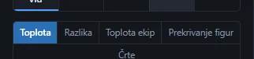

# Načini toplote

Vsaka pika doda malo sijaja, sijaji se nalagajo drug na drugega, kupček pa se pobarva z barvami. Načini so pet različnih načinov barvanja, vsak odgovori na eno vprašanje.

Vrstica načinov na vrhu stranske vrstice zavihka Toplotni zemljevid izbere, kako se [nabor podatkov](glossary.md) riše. Tipke 1-4 izberejo Toplota, Razlika, Toplota ekip in Črte. Prekrivanje figur nima tipke.

| Način | Vprašanje, na katero odgovori |
|---|---|
| **Toplota** | Kje se je zgodilo in koliko? |
| **Razlika** | Katera stran je tega naredila več? |
| **Toplota ekip** | Čigava je bila? |
| **Črte** | Po katerih poteh so šli ljudje? |
| **Prekrivanje figur** | Kdo je bil kje in kdaj? |

| Način (oznaka v vrstici) | Tipka | Kaj riše | Potrebuje |
|---|---|---|---|
| **Toplota** | 1 | Aditivna gostota: vsaka vidna vrstica doda radialni sprajt, obrnjen proti kameri. [Toplota](heat.md) | nabor podatkov |
| **Razlika** | 2 | Predznačena gostota: ena populacija prišteva, druga odšteva. [Razlika](difference.md) | dve strani: vsaj dve skupini ali delitev po ohranjenem stolpcu |
| **Toplota ekip** | 3 | Gostota, obarvana po skupini: odtenek za vsako skupino, zmešan tam, kjer se skupine prekrivajo. [Toplota ekip](team-heat.md) | stolpec skupine |
| **Prekrivanje figur** | - | Figura (ali škatla) za vsako osebo, ki se premika po časovnici: predvajanje. [Prekrivanje figur](box-replay.md), [Predvajanje tekme](match-replay.md) | stolpec osebe |
| **Črte** | 4 | Črtna toplota: črta od vsakega vzorca osebe do njenega naslednjega, toplota pa upada vstran. [Črtna toplota](line-heat.md) | stolpca osebe in časa |

Način, ki ga podatki ne podpirajo, je osivel, njegov nasvet pa pove razlog, na primer *Ni na voljo - način Razlika potrebuje dve skupini ali ohranjen stolpec za delitev; ti podatki imajo eno skupino.* Ko nov nabor podatkov ne podpira trenutnega načina, pogled preklopi na **Toplota**.

Tipke 1-4 se preverijo enako glede na podatke: tipka za osivel način ne naredi ničesar.

## Katere plošče kaže vsak način {#which-panels-each-mode-shows}

| Plošča | Toplota | Razlika | Toplota ekip | Prekrivanje figur | Črte |
|---|---|---|---|---|---|
| Trase ([črtna toplota](line-heat.md)) | | | | | da |
| Oblika toplote (z **Sledi pogledu** in **Enaka gostota pri vsaki povečavi**), Barve toplote, Omejitve pikslov sprajta, Globina, Izrezovanje razdalje | da | da | da | | da |
| Smer ([smerna toplota](directional-heat.md)), Vrednost ([utežitev vrednosti](value-weighting.md)) | da | da | da | | da |
| Pregledovalnik ekip ([prekrivanje figur](box-replay.md)) | | | | da | |
| Delitev razlike ([razlika](difference.md)) | | da | | | |
| [Ekipe](teams-list.md), [Entitete](entities.md), [Filtri](filters.md), Ozadje / nivo, [Rez](slice.md), [Merjenje](measure.md), Pot kamere in upodabljanje, Zmogljivost, Kamera in prizor | da | da | da | da | da |

## Kaj imajo skupnega vsi načini toplote {#what-every-heat-mode-shares}

Vsi štirje načini toplote (vse razen prekrivanja figur) so isti stroj z drugačnimi vhodi ([`engine.ts`](https://github.com/Holdi601/3DHeat/blob/main/src/render/engine.ts)):

1. **Katere vrstice.** Okno [časovnice](timeline.md) izbere zvezno območje po času urejenih vrstic; [filtri](filters.md), vidnost skupin, delitev razlike, [izrezovanje razdalje](depth-and-culling.md#distance-culling) in [rez](slice.md) v senčilniku oglišč odločijo za vsako vrstico, ali in kako močno prispeva.
2. **Razpršitev.** Vsaka prispevna vrstica se nariše kot sprajt (ali, v načinu Črte, kot odsek) v **toplotno tarčo** s plavajočo vejico in pri tem prišteje svojo vrednost profila. Kadar je vrstic več, kot jih okvir zmore, se nariše stratificiran vzorec vrstic, uteženih za izravnavo. Glejte [Vzorčenje in proračuni](sampling-and-budgets.md).
3. **Kopičenje.** Dokler se nič ne spreminja, se okviri združujejo, dokler vsaka vrstica ni prispevala natanko enkrat. Glejte [Kopičenje](accumulation.md).
4. **Sestavljanje.** Kopičena vrednost na vsaki točki zaslona se deli s **točko nasičenja**, oblikuje z **odzivom na gostoto**, dvigne za **najmanjšo toploto** in poišče v **barvni lestvici**, katere prosojnost jo zmeša s prizorom. Glejte [Barva in osvetlitev](colour-and-exposure.md).

Vse v koraku 4 se uporabi ob sestavljanju, zato vlečenje teh kontrol nikoli ne ponovno zažene kopičenja; vse v korakih 1-2 pa ga.

## Strani v tem razdelku {#pages-in-this-section}

- [Toplota](heat.md) - običajni način toplote in pregled njegovih plošč
  - [Oblika sprajta](sprite-shape.md) - polmer, jakosti, upadanje, urejevalnik krivulje, omejitve pikslov, ravnanje
  - [Barva in osvetlitev](colour-and-exposure.md) - urejevalnik lestvice, točka nasičenja, samodejna osvetlitev, najmanjša toplota, odziv na gostoto
  - [Globina in izrezovanje](depth-and-culling.md) - prekritje z ravnjo, skrivanje za terenom, izrezovanje razdalje
- [Razlika](difference.md) - delitev razlike
- [Toplota ekip](team-heat.md)
- [Črtna toplota](line-heat.md) - poti
- [Prekrivanje figur](box-replay.md) - način predvajanja (datoteka se še vedno imenuje box replay)
- [Smerna toplota](directional-heat.md)
- [Utežitev vrednosti](value-weighting.md)
