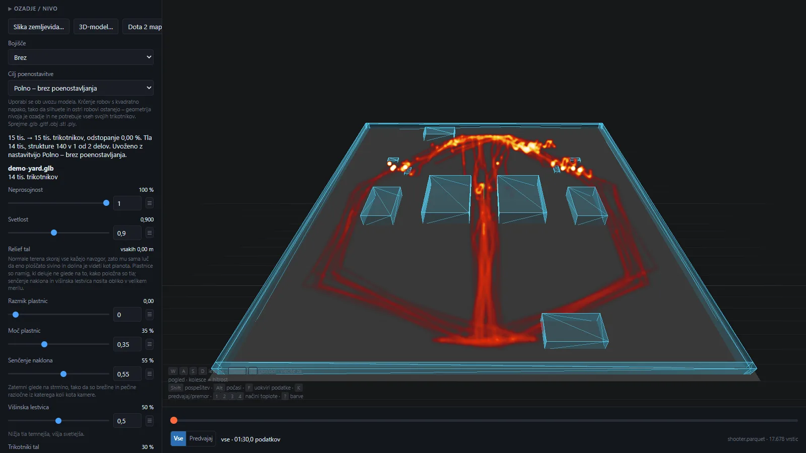
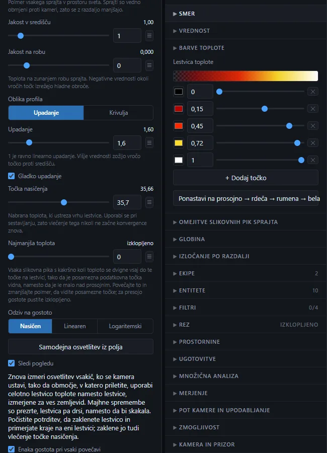

# Toplota

Toplota barva mesta, kjer se je zgodilo veliko stvari: rdeče, kjer se je zgodilo malo, belo-vroče, kjer se je zgodilo veliko. Odgovarja na vprašanje »kje se to dogaja in koliko«.

**Toplota** (tipka 1) je privzeti način. Vsaka vidna [vrstica](glossary.md) prispeva okrogel [sprajt](glossary.md), obrnjen proti kameri; prekrivajoči se sprajti se seštejejo v medpomnilniku s plavajočo vejico; vsota se preslika skozi barvno lestvico - privzeto prosojno → rdeče → rumeno → belo - in nariše čez prizor.

Slika prikazuje toploto kroga streljanja na ravni s stavbami: vroče točke so v sobah in na stopnicah, ne le na tleh.

## Kako uporabljati {#how-to-use-it}

1. Naložite podatke in pritisnite `1` (ali izberite **Toplota** v vrstici načinov).
2. Če je vse belo ali prazno, pritisnite **Samodejna osvetlitev iz polja** v razdelku **Oblika toplote**.
3. Spreminjajte **Polmer sprajta**, dokler se sosednje pike ne združijo v pasove: manjši prikaže posamezne točke, večji območja.
4. Odprite **Barve toplote**, če želite spremeniti barve, ali **Globina**, da hribi in zidovi skrijejo toploto za seboj.

Iste plošče oblikujejo [Razliko](difference.md), [Toploto ekip](team-heat.md) in [Črtno toploto](line-heat.md); razlikujejo se v tem, kaj se prišteva (predznačeno, obarvano ali vzdolž črt), ne v tem, kako.

## Plošče in njihove privzete vrednosti {#the-panels-and-their-defaults}

Vsaka kontrola spodaj ustreza parametru senčilnika, zato jo spremeniti ne stane nič razen ponovnega risanja. Drsniki imajo poleg sebe polje za vpis številke in ročico za vlečenje (majhen prijemalnik na desni: vlecite navzgor ali navzdol, dlje pomeni hitreje, Shift za fino nastavitev); kjer se drsna pot konča, preden doseže pravo mejo, ročica lahko sega dlje do tu navedene *zgornje meje vleka*. Vrednosti, označene *ob nalaganju*, se izračunajo za vsak nov nabor podatkov.

### Oblika toplote (odprto) {#heat-shape-open}

| Kontrola | Privzeto | Obseg (zgornja meja vleka) | Podrobnosti |
|---|---|---|---|
| **Polmer sprajta** | 6 m; ob nalaganju obseg / 120 | 0,05-2000 m, logaritemsko (50.000) | [Oblika sprajta](sprite-shape.md#sprite-radius) |
| **Jakost v središču** | 1 | 0-10 (1000) | [Oblika sprajta](sprite-shape.md#centre-and-edge-intensity) |
| **Jakost na robu** | 0 | -2-10 (1000) | [Oblika sprajta](sprite-shape.md#centre-and-edge-intensity) |
| **Oblika profila** | *Upadanje* | *Upadanje* / *Krivulja* | [Oblika sprajta](sprite-shape.md#ramp-shape-falloff-or-curve) |
| **Upadanje** (samo Upadanje) | 1,6 | 0,1-8 (64) | [Oblika sprajta](sprite-shape.md#falloff) |
| **Gladko upadanje** (samo Upadanje) | vklopljeno | | [Oblika sprajta](sprite-shape.md#falloff) |
| Urejevalnik krivulje (samo Krivulja) | predizbor *Gladko* | | [Oblika sprajta](sprite-shape.md#the-curve-editor) |
| **Točka nasičenja** | 24; ob nalaganju ocena, nato izmerjeno | 0,1-4000, logaritemsko (10.000.000) | [Barva in osvetlitev](colour-and-exposure.md#saturation-point) |
| **Najmanjša toplota** | izklopljeno (0) | 0-100 % | [Barva in osvetlitev](colour-and-exposure.md#minimum-heat) |
| **Odziv na gostoto** | *Nasičeno* | *Nasičeno* / *Linearno* / *Logaritemsko* | [Barva in osvetlitev](colour-and-exposure.md#density-response) |
| **Samodejna osvetlitev iz polja** | | gumb | [Barva in osvetlitev](colour-and-exposure.md#auto-exposure) |
| **Sledi pogledu** | vklopljeno | | Ob vsakem postanku kamere ponovno izmeri osvetlitev, zato področje, v katero prileteti, uporabi celotno barvno lestvico. Majhne spremembe se prezrejo, merilo pa se mehko premakne. Odkljukajte ali povlecite **Točka nasičenja**, da zaklenete merilo in primerjate kraje na enem merilu. [Barva in osvetlitev](colour-and-exposure.md#follow-the-view) |
| **Enaka gostota pri vsaki povečavi** | vklopljeno | | Barva pomeni enako število vrstic na površino tal, ne glede na to, kako blizu ste. Sprajt, ki ga omejitve pikslov povečajo (daleč) ali skrčijo (blizu), ohrani toploto, ki bi jo dodal pri svoji pravi velikosti, zato slika, osvetljena od daleč, ne zbledi, ko priletite vanjo. Izklopljeno sprajt z omejitvijo doda svojo polno težo pri omejeni velikosti. [Oblika sprajta](sprite-shape.md#pixel-clamps) |
| **Splošči na ravnino tal** | izklopljeno | | [Oblika sprajta](sprite-shape.md#flatten-onto-ground-plane) |

### Barve toplote (zaprto) {#heat-colours-closed}

| Kontrola | Privzeto | Podrobnosti |
|---|---|---|
| Vzorci skupin in **Ločevanje barv** (samo Toplota ekip) | 1,4 | [Toplota ekip](team-heat.md) |
| Urejevalnik **Lestvica toplote** (*Pozitivna (prištevajoče ekipe)* v Razliki, *Lestvica neprosojnosti* v Toploti ekip) | prosojno → rdeče → rumeno → belo | [Barva in osvetlitev](colour-and-exposure.md#the-ramp-editor) |
| **Ponastavi na prosojno → rdeča → rumena → bela** | | |
| **Negativna (odštevajoče ekipe)** lestvica (samo Razlika) | prosojno → zeleno → modro → vijolično | [Razlika](difference.md#colours) |

### Omejitve pikslov sprajta (zaprto) {#sprite-pixel-clamps-closed}

| Kontrola | Privzeto | Obseg (zgornja meja vleka) | Podrobnosti |
|---|---|---|---|
| **Najm. polmer v pikah** | 1 px | 0-16 (512) | [Oblika sprajta](sprite-shape.md#pixel-clamps) |
| **Najv. polmer v pikah** | 96 px | 2-1024, logaritemsko (8192) | [Oblika sprajta](sprite-shape.md#pixel-clamps) |

### Globina (odprto) {#depth-open}

| Kontrola | Privzeto | Podrobnosti |
|---|---|---|
| **Skrij za terenom** | vklopljeno | [Globina in izrezovanje](depth-and-culling.md#hide-behind-terrain) |
| **Skrito za geometrijo** | 0,8 (*za 80 % temnejše*) | [Globina in izrezovanje](depth-and-culling.md#hidden-behind-geometry) |

### Izrezovanje razdalje (zaprto) {#distance-culling-closed}

| Kontrola | Privzeto | Obseg (zgornja meja vleka) | Podrobnosti |
|---|---|---|---|
| **Blizu** | izklopljeno (0) | 0,5-5000 m, logaritemsko, spodnji konec poti = izklopljeno (200.000) | [Globina in izrezovanje](depth-and-culling.md#distance-culling) |
| **Daleč** | izklopljeno (0) | 1-200.000 m, logaritemsko, spodnji konec = izklopljeno (10.000.000) | [Globina in izrezovanje](depth-and-culling.md#distance-culling) |
| **Reži z ravnino** | vklopljeno | | [Globina in izrezovanje](depth-and-culling.md#distance-culling) |
| **Reži tudi nivo** | vklopljeno | | [Globina in izrezovanje](depth-and-culling.md#distance-culling) |

Tipki `[` in `]` premakneta zadnjo mejo navznoter in navzven, `\` pa jo vklopi ali izklopi ([Globina in izrezovanje](depth-and-culling.md#keyboard)).

### Smer in vrednost {#direction-and-value}

Pod razdelkom Oblika toplote sta še dva razdelka. **Smer** nariše vsako vrstico kot klin in doda puščice: glejte [Smerna toplota](directional-heat.md). **Vrednost** utežuje toploto s tem, kaj je vsaka vrstica stala ali prinesla: glejte [Utežitev vrednosti](value-weighting.md).

## Kaj se shrani {#what-is-saved}

Zgornje nastavitve toplote se med sejami ne shranijo: ponovno nalaganje strani povrne privzete vrednosti. V brskalniku se hranita dve stvari: zadnja hitrost predvajanja (`heat3d.speed`, glejte [Časovnica](timeline.md)) in nastavitve oddaljenih figur [prekrivanja figur](box-replay.md) (slog simbolov, velikost, oznake zadetkov in podobno). Enako velja za jezik, [obrnjene svetovne osi](camera.md#invert-world-axis), zapomnjena imena avtomobilov zavihka dirke in [knjižnico ravni](level-library.md). Celoten seznam je na [Shranjene nastavitve](ref-settings-storage.md).
