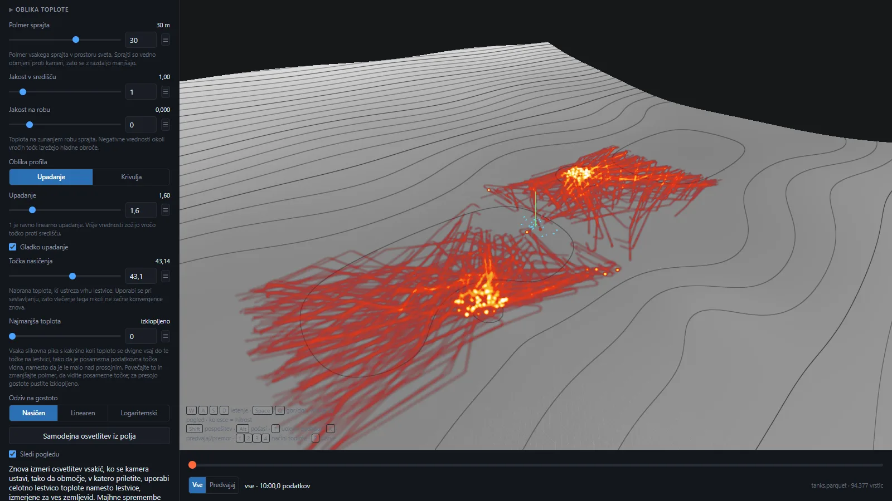
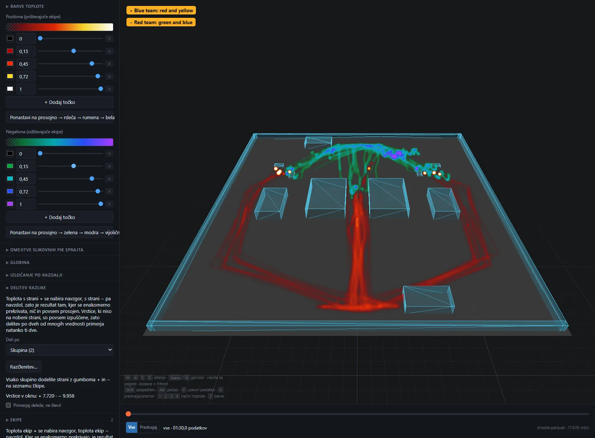
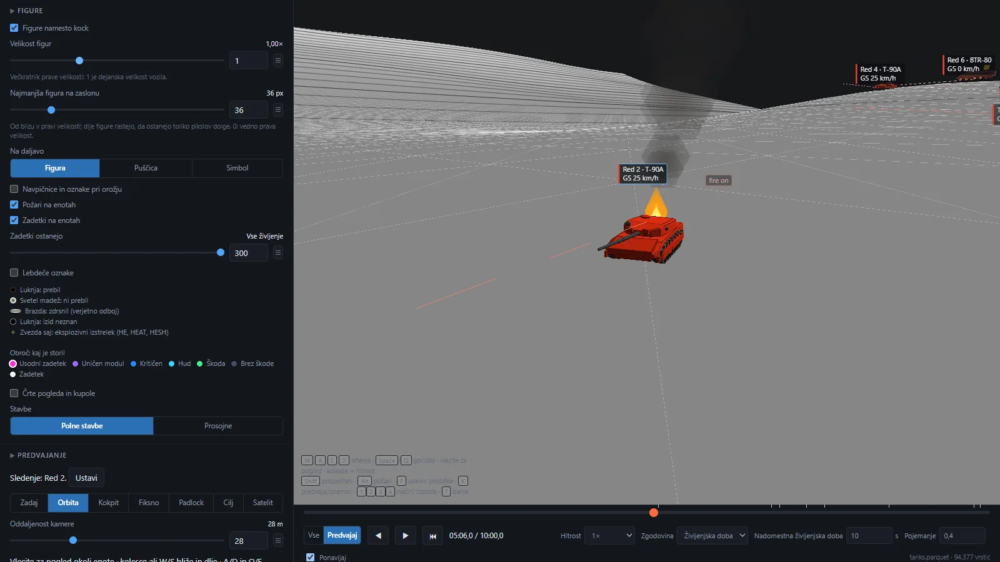
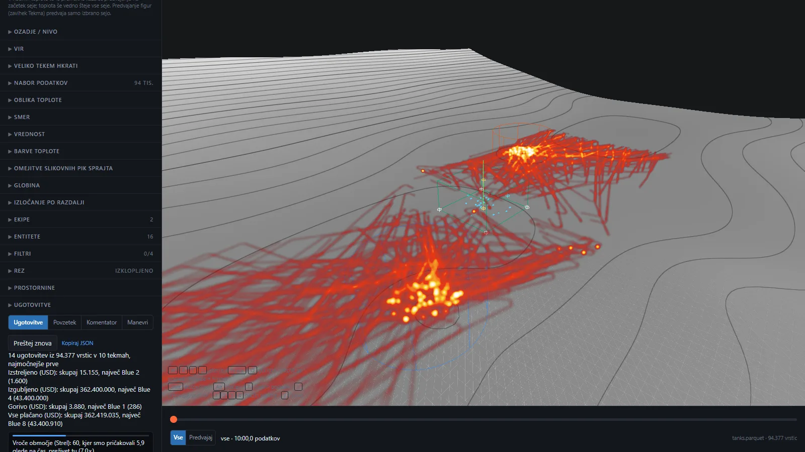
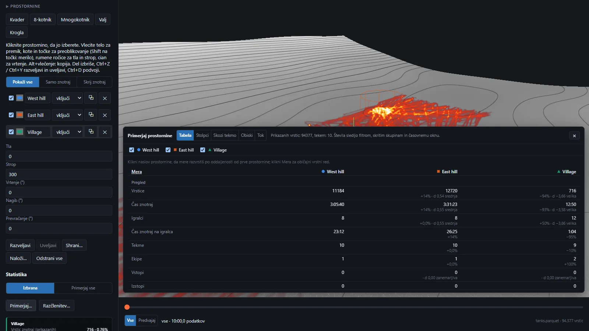
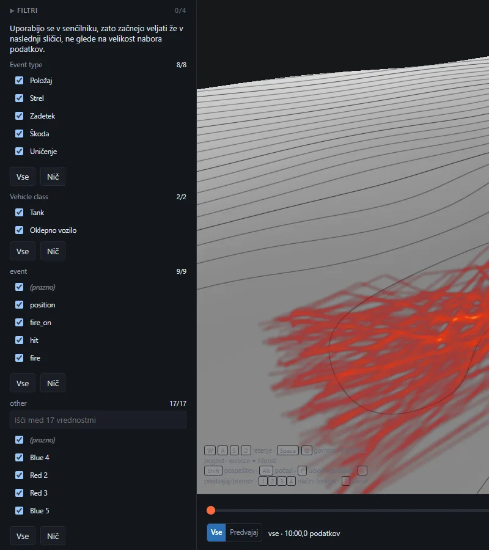
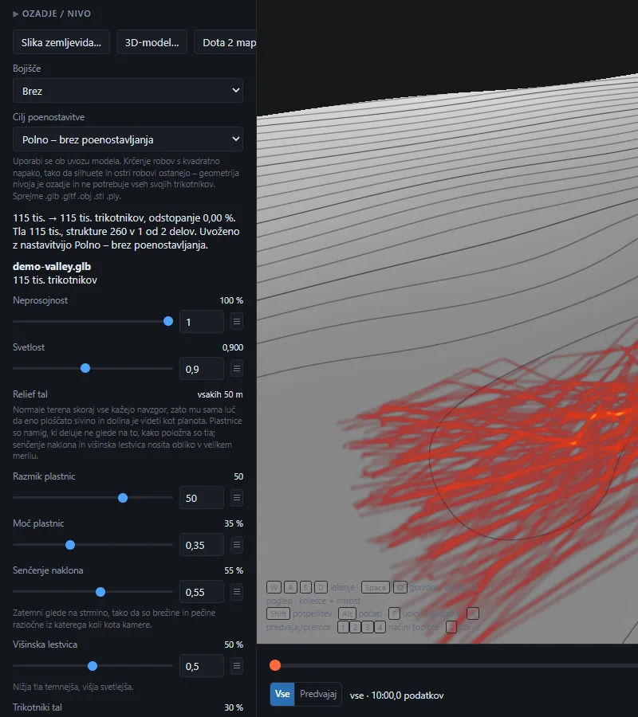

{: width="720" }

# 3DHeat

3DHeat pokaže, kje so se stvari dogajale v igri - kam so šli igralci, kje so se borili in kje so padli - kot svetleče barve, skozi katere lahko letite, ali kot majhne 3D figure, ki ponovijo tekmo.

Naložite pozicije - CSV, Parquet, posnetke Tacview, pretvorjene posnetke, eno datoteko, mapo ali na tisoče tekem - in jih vidite kot **toplotni zemljevid, skozi katerega lahko letite**, kot **figure, ki ponovijo tekmo**, kot črte vzdolž poti, po katerih so hodili ljudje, ali kot eno populacijo proti drugi. Sama poišče, kaj izstopa, in deluje povsem v vašem brskalniku: nič se ne naloži nikamor. 3DHeat in vsa njegova orodja so brezplačna in odprtokodna pod [licenco MIT](https://github.com/Holdi601/3DHeat/blob/main/LICENSE).



**Ste tukaj prvič?** Naredite [demo podatke](demo-data.md) in sledite njihovim sedmim korakom. Vsak posnetek na tej strani je bil narejen z njimi.

## Kaj zmore {#what-it-does}

| | |
|---|---|
|  | **[Načini toplote](heat-modes.md)** - toplota, [razlika](difference.md) (rdeča tam, kjer je bila ena stran bolj prisotna, zeleno-modra tam, kjer druga), [toplota ekip](team-heat.md), [črtna toplota](line-heat.md); [smerna toplota](directional-heat.md) z kloni, polji puščic in polarnimi grafi; toplota [utežena z vrednostjo](value-weighting.md): kaj stanejo orožje, vozila in gorivo. |
|  | **[Predvajanje tekme](match-replay.md)** - vsaka enota kot [figura](figures.md) tega, kar je, simboli NATO ali ruski simboli na daljavo, rakete in sledilni streli, oznake zadetkov, olupki, požari, kupole, cilji ter kamere v slogu Tacview in taktični prikaz; [veliko tekem hkrati](many-matches.md). |
|  | **[Ugotovitve](insights.md)** - močne pozicije, smrtonosna tla, pasti ob pojavitvi, ozka grla in izstopajoči igralci, najdeni in razvrščeni z dokazi; pisni povzetek, po želji z AI, ki ga izberete; komentator za eno tekmo; [leča znanja](knowledge.md). |
|  | **[Prostornine](volumes.md)** - rišite kvadre, prizme, valje in krogle, filtrirajte po njih, štejte, kaj se dogaja znotraj, izvozite in primerjajte kraje drug ob drugem; [razčlenitev](breakdown.md), kdo in kaj je najbolj uspešno na nekem mestu. |
|  | **[Filtri](filters.md)** - po vrsti dogodka, igralcu ali UI, razredu vozila, vrednosti, poljubnem stolpcu, na grafični kartici pri vsaki velikosti podatkov. |
|  | **[Ravni](levels.md)** - slike zemljevidov, 3D ravni, narejene z [orodji za podatke](#related-repositories), poenostavitev, [ozadje sveta](world-backdrop.md) z resničnim terenom za podatke o letenju. |

Še: zavihek [Analiza dirke](race-analysis.md) za kroge dirkalnih iger, zavihek [Tekma](match-analysis.md) za povzetke Counter-Strike 2, [Taktična tabla](tactics-board.md) za načrte na ravni, [analiza zadetkov](hit-analysis.md) po vozilu, [množinska analiza](mass-analysis.md) na tisočih tekmah, [poti kamere in video](camera-path-and-video.md), [40 jezikov](languages.md), [metrične ali imperialne enote](settings.md).

## Zavihki {#the-tabs}

Zavihki so na vrhu stranske vrstice, pod imenom, enotami in menijem za jezik.

| Zavihek | Za kaj je |
|---|---|
| **Toplotni zemljevid** | Katerakoli tabela pozicij: načini toplote, prekrivanje figur, filtri, prostornine, ugotovitve, ravni, merjenje in video. |
| **Analiza dirke** | Dva ali več krogov ene proge: kje se izgublja čas, zakaj in kaj spremeniti. |
| **Tekma** | Predvajanje figur tekme in povzetki tekem Counter-Strike 2. |
| **Taktika** | Načrti na ravni: figure, poti, vržen pripomoček, območja in opombe v korakih, ki se predvajajo. |
| **Vozila** | Kje je bila vsaka enota zadeta, kdo je zadel in s čim. |

## Namestitev in zagon {#install-and-run}

3DHeat je brezplačen za uporabo, spreminjanje in deljenje (licenca MIT), prav tako vsako orodje, navedeno pod [Sorodni repozitoriji](#related-repositories).

### Windows, na enostaven način {#windows-the-easy-way}

Korenska mapa repozitorija ima tri paketne datoteke.

| Datoteka | Kaj naredi |
|---|---|
| `start.bat` | Zažene pregledovalnik. Najde Node.js, tudi kadar ni v `PATH` (išče v `%ProgramFiles%\nodejs`, `%ProgramFiles(x86)%\nodejs` in `%LOCALAPPDATA%\Programs\nodejs`), in če Node.js manjka, ponudi namestitev izdaje LTS z `winget install -e --id OpenJS.NodeJS.LTS`. Ob prvem zagonu vpraša, preden prenese odvisnosti (okoli 300 MB v `node_modules\` znotraj mape, nič sistemsko). Ne zažene se, če nekaj že posluša na vratih 5273, in napoti na `restart.bat`. Kadar je mapa git kopija brez lokalnih sprememb in obstaja novejša različica, vpraša, ali naj posodobi (Y/N; brez odgovora v 60 s ohrani to različico; glejte [Posodobitve](updates.md)). Nato zažene razvojni strežnik na `http://127.0.0.1:5273/` in odpre brskalnik. **Okno je strežnik**: pustite ga odprtega, zaprite ga ali pritisnite Ctrl+C, da ustavite. |
| `restart.bat` | Zažene `stop.bat quiet`, nato `start.bat`. Potrebno le po spremembi `vite.config.ts`, dodajanju odvisnosti ali kadar se strežnik zatakne - spremembe izvorne kode se naložijo sproti. |
| `stop.bat` | Ustavi, kar posluša na vratih 5273, po ID-ju procesa, najdenem prek `netstat`, nikoli po imenu slike, tako da drugi procesi Node.js na računalniku ostanejo nedotaknjeni. Počaka približno dve sekundi, da se vtičnica sprosti. Z argumentom `quiet` ne počaka na koncu. |

### Ročno (katerikoli OS) {#by-hand-any-os}


```bash
git clone --recursive https://github.com/Holdi601/3DHeat.git
cd 3DHeat
npm install
npm run dev      # http://127.0.0.1:5273
```

Mapa `exporters/` vsebuje ločena orodja za podatke kot git podmodule, vsak je svoj repozitorij; po navadnem kloniranju zaženite `git submodule update --init`. Sam pregledovalnik jih za zagon ne potrebuje. `exporters/ext/` vsebuje izbirne pretvornike (War Thunder, World of Tanks, World of Warships, posnetke Squad; zemljevide DCS in IL-2), vsak kot samostojen projekt.

Nobenih podatkov iz iger ni priloženih: ravni, zemljevidi in posnetki nastanejo na vašem računalniku z orodji, iz iger, ki jih imate.

### Skripti npm {#npm-scripts}

| Skript | Kaj požene |
|---|---|
| `npm run dev` | Razvojni strežnik Vite na vratih 5273, vezan na `127.0.0.1`. |
| `npm run build` | Preverjanje tipov (`tsc --noEmit`) in produkcijski paket v `dist/`. |
| `npm run preview` | Postreže produkcijski paket. |
| `npm run typecheck` | Samo preverjanje tipov. |
| `npm test` / `npm run test:watch` | Enotski in integracijski testi (vitest). |
| `npm run smoke` | Upravlja pravo aplikacijo v brezglavem Chromiumu in preveri, ali ima platno piksle z barvami podatkov; posnetki zaslona gredo v `tools/.smoke/`. Pričakuje, da teče razvojni strežnik. |
| `npm run smoke:f16` | Isti sklop z `?heat=f16`, ki vsili pot kopičenja s polovično natančnostjo (glejte [Kopičenje s polovično natančnostjo](half-float-accumulation.md)). |
| `npm run bench` | Merilo uvoza, zapiše `tools/.smoke/ingest-bench.json`. |
| `npm run test:heavy` | Testi, ki potrebujejo velike prave datoteke s podatki; sami se preskočijo, če datotek ni. |
| `npm run inspect -- <file.parquet>` | Izpiše shemo datoteke Parquet in nekaj vrstic (`tools/inspect-parquet.mjs`). |

### Kaj doda razvojni strežnik {#what-the-dev-server-adds}

Pregledovalnik je statična spletna stran, vendar razvojni strežnik (glejte `vite.config.ts`) doda dve lokalni poti, ki jih statična objava `dist/` nima:

- `/__host/memory` poroča o nameščenem in prostem RAM-u računalnika ter, kjer lahko prebere, o pomnilniku grafične kartice (iz `nvidia-smi`, v sistemu Windows pa iz registrskega vnosa zaslonskega adapterja). Zaradi tega [proračuni pomnilnika](memory-and-budgets.md) uporabljajo prave vrednosti namesto omejenih ocen brskalnika.
- `/__heat3d/update` preveri, ali je kopija zaostala, in jo lahko premakne naprej ([Posodobitve](updates.md)).

Strežnik je vezan samo na `127.0.0.1`, zato do obeh poti ne pride iz omrežja. Odprite ga kot `http://127.0.0.1:5273`: `localhost` se lahko razreši v IPv6 zanko `::1`, kjer nič ne posluša. Ne pošilja glav za izolacijo med izvori (COOP/COEP): pregledovalnik ne uporablja `SharedArrayBuffer`, delavci pa podatke predajo s prenosom, ki tega ne potrebuje.

## Zahteve za brskalnik in GPU {#browser-and-gpu-requirements}

- **Brskalnik z WebGPU ali WebGL2.** WebGPU se preizkusi najprej (Chrome in Edge ga imata); brez njega se uporabi zaledje WebGL2. WebGL2 mora ponujati `EXT_color_buffer_float` (upodabljanje v teksture s plavajočo vejico), sicer pregledovalnik prikaže "Cannot initialise the renderer." Glejte [Dve izvedbi upodabljanja](backends.md). Pregledovalnik je razvit in preizkušen v Chromiumu; drugi brskalniki niso preverjeni.
- **Vklopljeno strojno pospeševanje.** Kadar brskalnik riše na CPE (SwiftShader, llvmpipe, Microsoft Basic Render Driver in podobno), rdeč trak na vrhu stranske vrstice to pove in pokaže, kako popraviti. Glejte [Zaznavanje programskega upodabljanja](software-rendering.md).
- **Namenska GPU pomaga, a ni nujna.** Obe izvedbi zahtevata adapter visoke zmogljivosti. Količina podatkov, ki jih je mogoče hraniti na GPU, je proračun, ki ga lahko vidite in spremenite ([Pomnilnik in proračuni](memory-and-budgets.md)).
- **Izbirne funkcije** uporabljajo dodatne API-je brskalnika: upodabljanje videa potrebuje WebCodecs `VideoEncoder` z VP9 ali VP8 ([Pot kamere in video](camera-path-and-video.md)); poenostavitev mrež ravni potrebuje WebAssembly; spuščanje map uporablja File and Directory Entries API; knjižnica ravni uporablja IndexedDB; igralni ploščki uporabljajo Gamepad API.

## Zemljevid dokumentacije {#documentation-map}

**Začetek**: [Demo podatki](demo-data.md) · [Uvoz podatkov](getting-data-in.md) ([nalaganje datotek](loading-files.md), [preslikava stolpcev](column-mapping.md), [osi, enote in čas](axes-units-and-time.md), [seje, osebe in skupine](sessions-persons-groups.md), [Tacview](tacview-acmi.md), [pretvorniki](converters.md), [.3dheat](container.md), [pomnilnik in proračuni](memory-and-budgets.md))

**Poglej**: [Načini toplote](heat-modes.md) ([toplota](heat.md), [oblika sprajta](sprite-shape.md), [barva in osvetlitev](colour-and-exposure.md), [globina in izrezovanje](depth-and-culling.md), [razlika](difference.md), [toplota ekip](team-heat.md), [črtna toplota](line-heat.md), [predvajanje škatel](box-replay.md), [smerna toplota](directional-heat.md), [utežitev vrednosti](value-weighting.md)) · [Časovnica](timeline.md) · [Ravni](levels.md) ([slike zemljevidov](map-images.md), [3D ravni](model-levels.md), [videz](level-appearance.md), [knjižnica](level-library.md), [ozadje sveta](world-backdrop.md), [njegovi viri](world-backdrop-sources.md)) · [Kamera](camera.md) ([igralni plošček](gamepad.md), [tipke](keyboard-reference.md)) · [Pot kamere in video](camera-path-and-video.md)

**Analiziraj**: [Filtri in orodja](filters-and-tools.md) ([filtri](filters.md), [ekipe](teams-list.md), [entitete](entities.md), [rez](slice.md), [merjenje](measure.md), [prostornine](volumes.md), [razčlenitev](breakdown.md)) · [Ugotovitve](insights.md) ([leča znanja](knowledge.md)) · [Množinska analiza](mass-analysis.md)

**Predvajanje**: [Predvajanje tekme](match-replay.md) · [Veliko tekem hkrati](many-matches.md) · [Figure](figures.md) ([v prekrivanju figur](figure-replay.md), [zasluge](figure-credits.md)) · [Enakovrednost s Tacview](tacview-parity.md) · [Analiza zadetkov](hit-analysis.md)

**Drugi zavihki**: [Analiza dirke](race-analysis.md) ([metoda](race-analytics.md), [druge igre](other-games.md)) · [Analiza tekme](match-analysis.md) · [Taktična tabla](tactics-board.md) ([hitrosti](tactics-speeds.md))

**Pregledovalnik**: [Slovar pojmov](glossary.md) · [Nastavitve, enote in tipke](settings.md) · [Jeziki](languages.md) · [Posodobitve](updates.md) · [Notranjosti upodabljanja](rendering-internals.md) ([zaledja](backends.md), [kopičenje](accumulation.md), [vzorčenje in proračuni](sampling-and-budgets.md), [polovična natančnost](half-float-accumulation.md), [pomnilnik GPU](gpu-memory.md), [programsko upodabljanje](software-rendering.md), [zmogljivost in statistika](performance-and-stats.md)) · [Podatkovni formati](data-formats.md) · [Priročnik](reference.md) · [Vzdrževanje dokumentacije](maintaining.md)

## Sorodni repozitoriji {#related-repositories}

Pregledovalnik bere podatke; ta orodja jih ustvarijo. Vsak je svoj javni repozitorij (MIT) z lastno dokumentacijo. Nobeno ne prinaša podatkov iz iger: ravni, zemljevidi in posnetki nastanejo na vašem računalniku iz iger, ki jih imate. Vsak bralnik igre je svoj majhen projekt z lastno licenčno datoteko, izdajami in sledilnikom težav, zato ga je mogoče namestiti, posodobiti, vzdrževati – ali na zahtevo imetnika pravic umakniti – posebej, brez vpliva na pregledovalnik in druga orodja.

| Repozitorij | Kaj naredi | Uporabno za | Dokumentacija |
|---|---|---|---|
| [3DHeat-GameFiles](https://github.com/Holdi601/3DHeat-GameFiles) | Iz arhivov, ki jih igre prinašajo (Forza Horizon, BeamNG, Assetto Corsa Rally; bralniki za Unreal, Unity, Frostbite in Source 2), prebere proge in ravni ter jih zapiše kot glTF | 3D raven pod vašo toploto ali predvajanjem | [spletišče](https://holdi601.github.io/3DHeat-GameFiles/) |
| [3DHeat-GameCapture](https://github.com/Holdi601/3DHeat-GameCapture) | Zapisuje telemetrijo krogov iz vmesnikov, ki jih dirkalne igre objavljajo, in obnovi ravni iz posnetkov igranja | krogi za Analizo dirke; raven, kjer datotek ni mogoče prebrati | [spletišče](https://holdi601.github.io/3DHeat-GameCapture/) |
| [3DHeat-UnrealExporter](https://github.com/Holdi601/3DHeat-UnrealExporter) | Vtičnik za Unreal Editor, ki izvozi raven kot eno datoteko glTF | ravni vaših lastnih projektov Unreal | [spletišče](https://holdi601.github.io/3DHeat-UnrealExporter/) |
| [3DHeat-CS2](https://github.com/Holdi601/3DHeat-CS2) | Demo posnetki Counter-Strike 2 v tabele toplotnih zemljevidov in povzetke tekem, zemljevidi CS2 v geometrijo | toplota CS2, predvajanja in zavihek Tekma | [spletišče](https://holdi601.github.io/3DHeat-CS2/) |
| [3DHeat-Watcher](https://github.com/Holdi601/3DHeat-Watcher) | V ozadju beleži vaše igranje iz tega, kar igre objavljajo: telemetrija, integracije stanja igre, dnevniki, posnetki | vaša lastna statistika brez ročnega dela | [spletišče](https://holdi601.github.io/3DHeat-Watcher/) |
| [3DHeat-Ext-WarThunder](https://github.com/Holdi601/3DHeat-Ext-WarThunder) | Posnetki War Thunder (`.wrpl`) v tabele: zračne in kopenske poti, streli, zadetki, uničenja, kupole, cilji | posnetki War Thunder, oznake zadetkov in ugotovitve | [spletišče](https://holdi601.github.io/3DHeat-Ext-WarThunder/) |
| [3DHeat-Ext-WoT](https://github.com/Holdi601/3DHeat-Ext-WoT) | Posnetki World of Tanks v tabele: položaj vsakega vozila, smrti in uničenja | toplota in posnetki World of Tanks | [spletišče](https://holdi601.github.io/3DHeat-Ext-WoT/) |
| [3DHeat-Ext-WoWs](https://github.com/Holdi601/3DHeat-Ext-WoWs) | Posnetki World of Warships v tabele: položaj vsake ladje in potopitve | toplota in posnetki World of Warships | [spletišče](https://holdi601.github.io/3DHeat-Ext-WoWs/) |
| [3DHeat-Ext-Squad](https://github.com/Holdi601/3DHeat-Ext-Squad) | Demo posnetki strežnikov Squad v tabele: položaj, ekipa in odred vsakega igralca | toplota in posnetki Squad | [spletišče](https://holdi601.github.io/3DHeat-Ext-Squad/) |
| [3DHeat-Ext-DCS](https://github.com/Holdi601/3DHeat-Ext-DCS) | Tereni DCS World iz vaše lastne namestitve v ravni: tla, ceste, mesta, letališča, polja, voda | DCS in posnetki Tacview na njihovem resničnem terenu | [spletišče](https://holdi601.github.io/3DHeat-Ext-DCS/) |
| [3DHeat-Ext-IL2](https://github.com/Holdi601/3DHeat-Ext-IL2) | Zemljevidi IL-2 Great Battles v ravni | posnetki IL-2 na njihovem zemljevidu | [spletišče](https://holdi601.github.io/3DHeat-Ext-IL2/) |

## Kratek pregled izvorne kode {#source-layout-briefly}

| Mapa | Vsebina |
|---|---|
| [`src/data/`](https://github.com/Holdi601/3DHeat/tree/main/src/data) | Izbira datotek, uvoz CSV in Parquet, samodejna preslikava, preverjanje, model pomnilnika, graditelj nabora podatkov, razčlenjevanje modelov, klasifikacija, poenostavitev, knjižnica ravni |
| [`src/render/`](https://github.com/Holdi601/3DHeat/tree/main/src/render) | Zanka sličic (`engine.ts`), vzorčenje, obe izvedbi, kamera, igralni ploščki, merjenje, pot kamere, snemanje videa |
| [`src/state/`](https://github.com/Holdi601/3DHeat/tree/main/src/state) | Stanje aplikacije (`store.ts`) z vsemi privzetimi vrednostmi, domenski tipi (`types.ts`), krivulja sprajta |
| [`src/ui/`](https://github.com/Holdi601/3DHeat/tree/main/src/ui) | Plošče stranske vrstice, časovnica, prekrivanja |
| [`src/race/`](https://github.com/Holdi601/3DHeat/tree/main/src/race), [`src/match/`](https://github.com/Holdi601/3DHeat/tree/main/src/match) | Zavihka Analiza dirke in Tekma |
| [`src/i18n/`](https://github.com/Holdi601/3DHeat/tree/main/src/i18n) | Prevodi |
| [`src/insights/`](https://github.com/Holdi601/3DHeat/tree/main/src/insights) | Ugotovitve: detektorji, povzetek, komentator, ponudniki UI, leča znanja |
| [`src/mass/`](https://github.com/Holdi601/3DHeat/tree/main/src/mass) | Množinska analiza na mnogo tekmah |
| [`src/volumes/`](https://github.com/Holdi601/3DHeat/tree/main/src/volumes) | Prostornine, njihova statistika, izvoz in primerjava |
| [`src/breakdown/`](https://github.com/Holdi601/3DHeat/tree/main/src/breakdown) | Razčlenitev in dejavniki |
| [`src/overlay/`](https://github.com/Holdi601/3DHeat/tree/main/src/overlay) | Prekrivanje za veliko tekem |
| [`src/figures/`](https://github.com/Holdi601/3DHeat/tree/main/src/figures) | Katalog figur in njegov graditelj |
| [`src/vehicle/`](https://github.com/Holdi601/3DHeat/tree/main/src/vehicle) | Analiza zadetkov (zavihek Vozila) |
| [`src/tactics/`](https://github.com/Holdi601/3DHeat/tree/main/src/tactics) | Taktična tabla |
| [`src/world/`](https://github.com/Holdi601/3DHeat/tree/main/src/world) | Ozadje sveta |
| [`src/units/`](https://github.com/Holdi601/3DHeat/tree/main/src/units) | Merske enote |
