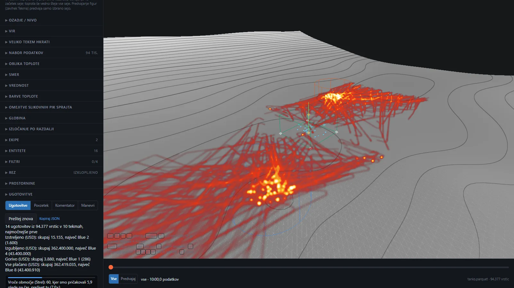
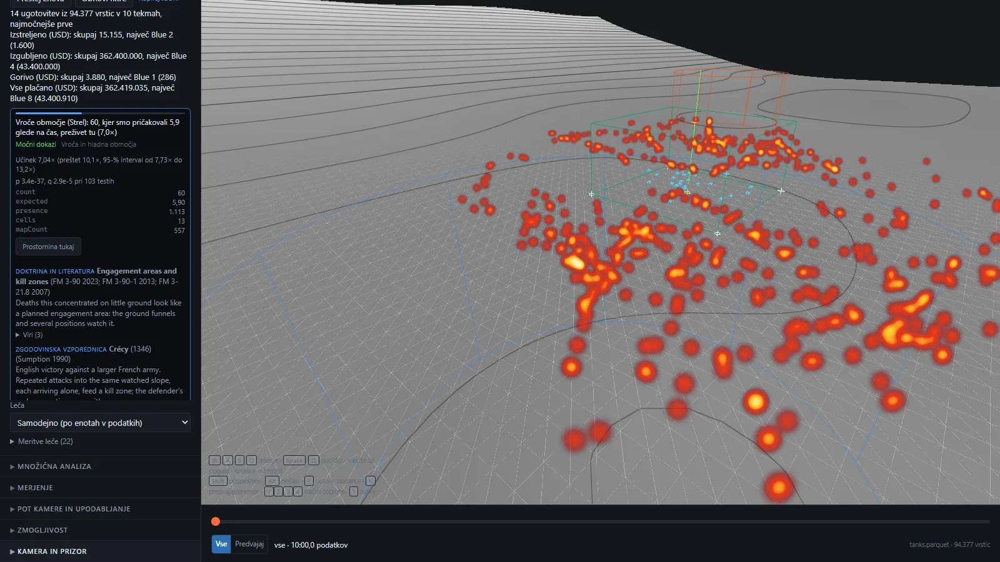
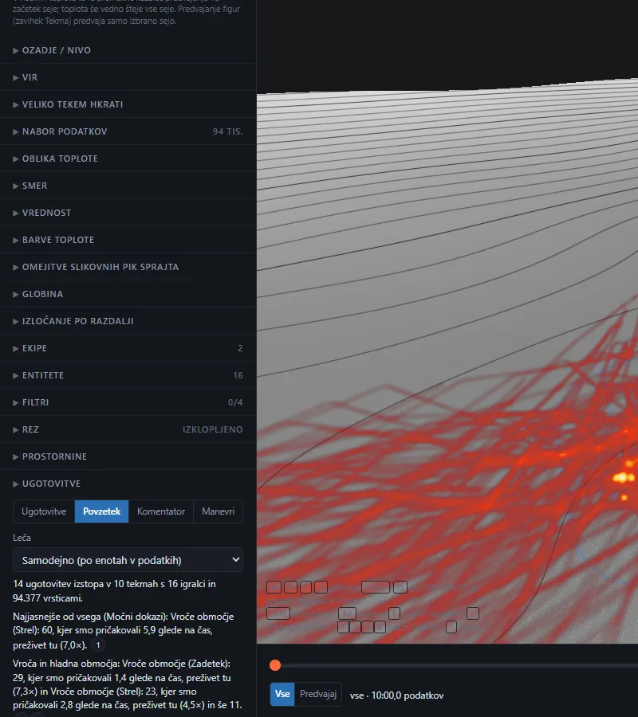
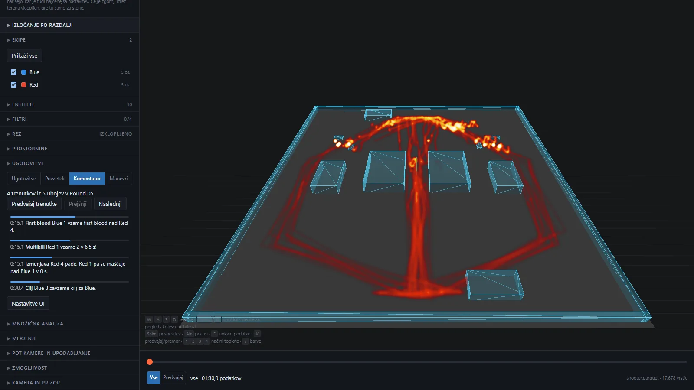

# Ugotovitve

**Ugotovitve** pregledajo naložene podatke za tem, kar izstopa - močne pozicije, smrtonosna tla, pasti ob pojavitvi, ozka grla, igralce daleč nad vrstniki - in vam jih povedo, najmočnejše najprej, z dokazi. Uporabite jih, če v minuti želite izvedeti, kje je bila tekma dobljena ali izgubljena. Nato lahko napišejo povzetek, v enem samem predvajanju pa lahko delujejo kot komentator, ki skoči na velike trenutke.

Vse se šteje v vašem brskalniku. Nič ne zapusti računalnika, dokler ne vklopite zunanjega UI (glejte [Zunanji UI](#external-ai)).

Razdelek **Ugotovitve** je v stranski vrstici zavihkov Toplotni zemljevid in Tekma. Ima tri zavihke: **Ugotovitve**, **Povzetek** in **Komentator**.

## Ugotovitve {#findings}

1. Naložite podatke in odprite **Ugotovitve**. Pritisnite **Poišči ugotovitve** (»Štejem … n %« kaže napredek).
2. Preberite seznam. Vsaka ugotovitev ima vrstico moči, stavek, kako dober je dokaz (*Močan dokaz*, *Dober dokaz* ali *Nekaj dokazov*), zaznavnik, ki jo je našel, in razred vozila, kjer je to pomembno.
3. **Kliknite ugotovitev**: pregledovalnik uporabi njene filtre, poleti s kamero na mesto in skoči na čas ter odpre podrobnosti: učinek z 95-odstotnim intervalom, vrednosti p in q, prešteti dokazi in **Prostornina tukaj**, ki nariše [prostornino](volumes.md) okoli mesta.
4. **Obnovi filtre** vrne vaše filtre. **Kopiraj JSON** kopira celotno poročilo.

Štetje uporablja trenutne filtre, skrite skupine in izbrano tekmo čez celoten časovni razpon. Če kasneje spremenite filtre, se to pokaže v opombi; pritisnite **Preštej znova**.

Vrstice na vrhu seznama (na primer skupni zneski denarja) povzamejo celotne podatke pred ugotovitvami.

### Zaznavniki {#the-detectors}

| Zaznavnik | Kaj najde | Potrebuje v podatkih |
|---|---|---|
| **Močne pozicije** | Mesta z veliko boljšimi možnostmi kill-proti-smrti kot ostali zemljevid in *varna tla*, kjer v času, ki ga preživi, malokdo umre | dogodke kill in smrti |
| **Vroča in hladna območja** | Mesta, kjer se vrsta dogodka (streli, zadetki, zajemi ...) zgodi precej pogosteje ali redkeje, kot bi napovedal čas, preživet tam | stolpec dogodkov |
| **Odprt teren in kritje** | Smrti na odprtem proti bližnji geometriji ravni in počasi proti hitremu gibanju | smrti; 3D raven za del z geometrijo |
| **Spawni** | Močni spawni, pasti ob pojavitvi, varni spawni, čas do prvega stika | čas in osebe |
| **Razred po kraju** | Razred vozila ali igralci proti UI, ki v nekem območju delujejo precej bolje ali slabše | ubitja in stolpec razreda vozila ali igralec/UI |
| **Igralci** | Igralci, ki ubijajo ali umirajo precej bolj ali manj kot drugi v istem razredu | osebe in ubitja |
| **Ozka grla in boki** | Ozka grla (precej več prehodov kot okoliška tla) in bočne poti (redko uporabljene, a vodijo do ubitja) | osebe |
| **Vrednost** | *Drago ozemlje* in *Donosno ozemlje* | [stolpci vrednosti](value-weighting.md) |
| **Kaj je odločilo kroge** | Kaj je ločilo dobljene kroge od izgubljenih in igralci, ki so dodali ali stali največ verjetnosti zmage (glejte [Kdo je zmagal](#who-won-what-decided-the-rounds)) | krogi, ubitja in smrti ter [stolpci izida](data-formats.md#outcome-columns) (`won`) |

Zaznavniki, ki na podatkih ne morejo delovati, so na dnu seznama z razlogom.

### Kako so ugotovitve razvrščene {#how-findings-are-ranked}

Vsako mesto ali skupina se preizkusi proti preostalemu zemljevidu (natančni binomski ali hitrostni testi). Stopnja lažnih odkritij je zadržana pri 5 % (Benjamini-Hochberg). Naključje lahko izgleda kot vzorec; to drži lažne alarme nizko: med prikazanimi ugotovitvami je pričakovano največ okoli ena od dvajsetih naključna. Učinki iz malo dogodkov so pred razvrščanjem potegnjeni proti »brez učinka«. Navedenih je največ 60 ugotovitev, vsak zaznavnik pa dobi nekaj mest blizu vrha.

### Kdo je zmagal: kaj je odločilo kroge {#who-won-what-decided-the-rounds}

Kjer podatki povedo, kdo je dobil vsak krog ([stolpec izida](data-formats.md#outcome-columns) `won`: CS2, Rainbow Six Siege, War Thunder ...), se Ugotovitve vrtijo okoli izida. Za vsako stran razdelijo kroge po tem, kaj se je v njih zgodilo, in primerjajo deleže zmag:

| Dejavnik | Krogi strani z njim | ... in brez njega |
|---|---|---|
| Uvodni dvoboj | stran je dosegla prvo ubitje | stran je umrla prva |
| Nakup | njen nakup je bil boljši od nakupa druge strani | slabši |
| Izmenjana prva smrt | njena prva smrt je bila izmenjana v 5 s | ni bila izmenjana |
| Postavitev | stran je postavila bombo | brez postavitve |
| Pripomočki | več granat kot v njenem običajnem krogu | manj |
| Zgodnji stik | prvi dvoboj je prišel pred mediano časa tekme | pozneje |
| Držano mesto | igralec je stal na mestu 5 s ali dlje | nihče |
| Zgodaj doseženo mesto | igralec je tja prišel v prvih 25 s (pot) | nihče |

Vsaka primerjava je razlika dveh deležev zmag z njenim 95 % intervalom (Newcombe), Fisherjevim natančnim p in q čez vse preizkušene dejavnike (Benjamini-Hochberg). Veja z manj kot 8 krogi je označena z *malo krogov*. Tiste pod 5 % stopnjo lažnih odkritij postanejo ugotovitve; najmočnejše se uvrstijo nad ugotovitve drugih zaznavnikov (ugotovitev o izidu tehta 1,35-krat več kot ugotovitev z enakim učinkom in dokazi).

Izmišljen primer iz 40 krogov:

> **T** je dobila 79 % od 19 krogov, v katerih je držala **Mid**, proti 24 % od 21 brez njega (55 točk, 95 % od 26 do 74) - q 0,004.

Spremlja tudi **verjetnost zmage** kroga - možnost, ki jo je imela vsaka stran v vsakem trenutku, glede na žive može, postavitev in uro: prilagojeno krogom, kadar jih je 30 ali več, sicer iz fiksnega apriornega modela (in besedilo pove, iz katerega). Iz nje izhajajo **prelomnice** (ubitja in postavitve, ki so možnost najbolj premaknile) in **dodana verjetnost zmage** vsakega igralca: ubitja in postavitve, ki jih je naredil, štejejo njemu v prid, njegove smrti proti njemu, v vrednosti krogov čez tekmo, v povprečju na krog z intervalom, preizkušeno proti ničli. Mesta dobijo enako bilanco: katera stran je največ pridobila v dvobojih, ki so se tam odvili.

Podatki potrebujejo kroge, ubitja in smrti z obema stranema ter stolpec `won`; poimenovana mesta (`place`) za držana mesta, stolpec `buy` za nakup.

## Povzetek {#debrief}

Zavihek **Povzetek** ugotovitve zapiše v kratko besedilo: uvod, najjasnejšo ugotovitev, eno za taktiko, eno za uravnoteženje, nato - kjer podatki povedo, kdo je zmagal - kaj je odločilo kroge, ostale razvrščene po zaznavniku in koliko jih temelji na šibkejših dokazih.

Kaj je odločilo kroge, je zapisano v štirih odstavkih: izid in od kod prihajajo verjetnosti zmage; najmočnejši dejavniki z njihovimi številkami, intervalom in q (ko noben ne prestane stopnje lažnih odkritij, besedilo reče *nič od tega še ni gotovo* in vseeno navede najmočnejše); tri največje prelomnice; ter igralci, ki so dodali in stali največ verjetnosti zmage, z mesti, ki so največ pridobila. Izmišljen primer:

> T je dobila 23 in CT 17 od 40 krogov z znanim izidom (T: 58 %, 95 % od 42 % do 72 %). Verjetnosti zmage izhajajo iz modela, prilagojenega tem krogom.
>
> Kaj je ločilo dobljene kroge od izgubljenih: T je dobila 79 % od 19 krogov, v katerih je držala Mid, proti 24 % od 21 brez njega (55 točk, 95 % od 26 do 74) (q 0,004), ...
>
> Prelomnice: krog 17 ob 48 s, ubitje strani CT na mestu B je premaknilo njeno možnost z 31 % na 58 % in krog je dobila, ...

Vsak odstavek ima oštevilčene gumbe, ki prikažejo njegove ugotovitve. **Kopiraj besedilo** ga kopira.

Vgrajeni pripovedovalec deluje brez povezave, v vašem jeziku. Izbirnik **Leča** nad njim (glejte [Leča znanja](knowledge.md)) določi, katero literaturo odstavki navedejo.

### Zunanji UI {#external-ai}

**Nastavitve UI** omogoča, da povzetek napiše model umetne inteligence po vaši izbiri:

| Nastavitev | Pomen |
|---|---|
| **Ponudnik** | Anthropic (Claude), OpenAI (ChatGPT), OpenRouter, Ollama (lokalno), LM Studio (lokalno), strežnik llama.cpp (lokalno) ali katera koli končna točka, združljiva z OpenAI |
| **Osnovni URL**, **Model** | Izpolni ponudnik; **Prikaži modele** vpraša strežnik |
| **Ključ API** | Pošlje se le na osnovni URL. Nikoli se ne beleži, nikoli se ne shrani v poglede, izvoze ali datoteke `.3dheat`. Večina lokalnih strežnikov ga ne potrebuje. |
| **Zapomni si ključ v tem brskalniku** | Privzeto izklopljeno: ključ se pozabi, ko se stran zapre |
| **Uporabi zunanji UI** | Privzeto izklopljeno |
| **Pošiljaj imena igralcev** | Privzeto izklopljeno: igralci se pošljejo kot P1, P2 ... |

Nato vpišite neobvezno vprašanje in pritisnite **Napiši z UI**. Pošljejo se le ugotovitve in njihove številke - nikoli vrstice vaših podatkov. Odgovor se pretaka, navedene ugotovitve pa postanejo gumbi. Kjer podatki povedo, kdo je zmagal, model dobi navodilo, naj začne s tem, kaj je odločilo kroge, z intervalom in q vsake številke, in naj pove, kadar dejavnik temelji na malo krogih ali kadar verjetnosti zmage izhajajo iz apriornega modela.

## Komentator {#caster}

Za **eno tekmo** (izberite eno, če je naloženih več), **Komentator** najde trenutke, vredne ogleda: prvo kri, večkratna ubitja, zamenjave, zadnje preživele, premike pri ciljih, preobrate, izstopajoče igralce, dolge strele in **prelomnice** - ubitja, ki so najbolj premaknila možnost strani, da dobi krog (glede na igralce, ki so ostali živi na vsaki strani, v krogih brez ponovnega oživljanja).

Kjer podatki povedo, kdo je dobil vsak krog, to pove vsak trenutek: *»Anna podre Bena: možnost strani T, da dobi krog, se spremeni z 38 % na 62 % - in krog dobijo.«* Trenutek strani, ki je nato zmagala, šteje več, ko komentator izbira, katere trenutke obdrži, preobrat pa se šteje v dobljenih krogih.

- Kliknite trenutek: pogled preklopi na predvajanje, skoči tik pred njega, poleti tja in sledi igralcu.
- **Predvajaj trenutke** predvaja vsakega do konca in gre naprej; **Prejšnji** / **Naslednji** se premikata med njimi.
- Ob vklopljenem zunanjem UI **Komentar UI** napiše komentar iz seznama trenutkov (vrste, časi, imena ali psevdonimi, ekipe, razredi, razdalje).

Potrebuje osebe in dogodke kill/smrt (ali zajem); stolpec `other`/`victim` omogoča zamenjave in dolge strele.

## Leča znanja {#knowledge-lens}

Ugotovitev lahko preberete skozi **lečo** uveljavljenega znanja: vojaški nauk, zračni in pomorski boj, urbane operacije, oblikovanje iger in e-šport (ali *Samodejno*, ki ga izberejo enote v podatkih). Odprta ugotovitev nato pokaže najbližji vnos **nauka in literature** ter **zgodovinsko vzporednico** z navedbami, **Meritve leče** pa iz te literature izračuna mere na podatkih (prileganja Lanchester, razmerja izmenjav, razmerja sil, polja ognja, ključni teren, zamenjave, pobuda). Povzetek in poziv UI jih vključujeta. Vse o tem: [Leča znanja](knowledge.md).

Meritve leče merijo tudi, kako se igralci vedejo kot množica in kot skupina - poravnavanje in kroženje, vodenje po poteh, pasovi in sledi, gneča, voditelji in sledilci, zaostanki, točka zloma pod izgubami, tveganje po izgubljenem življenju, nizi, dogovor o nakupih in odziv na prihajajoči ogenj - vsako proti svojemu ničelnemu modelu: [Skupinsko vedenje](collective-behaviour.md).

## Podatki, ki omogočajo ugotovitve {#data-that-makes-insights-work}

- položaji s **časom**, stolpcem **osebe** in stolpcem **ekipe**;
- stolpec **dogodkov** s kills in smrtmi (`kill`, `death`) ter drugimi (`hit`, `fire`, `capture` ...);
- stolpec **nasprotne strani** (`other`, `victim`) za zamenjave in smeri;
- stolpec **vozila** ali **tipa** za razrede; stolpec `ai` za igralce proti UI;
- stolpec **seje** / **tekme** / **kroga**, kadar je več tekem.

[Demo podatki](demo-data.md) imajo vse to.
