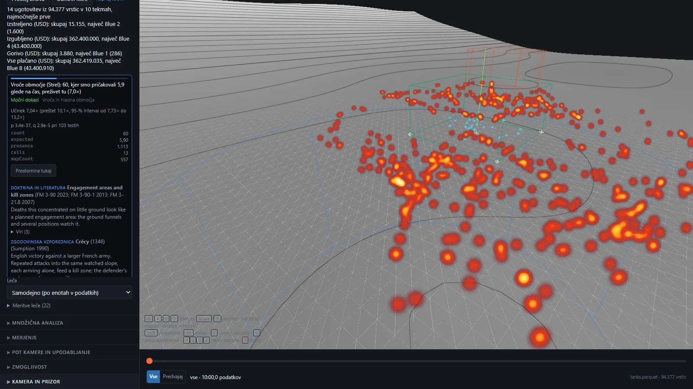

# Leča znanja

Ko [Ugotovitve](insights.md) kaj najdejo, ta del to razloži z idejami iz vojaške zgodovine, zasnove iger in analize športa ter navede knjigo ali članek, iz katerega izhajajo. Uporabite ga, da se naučite *zakaj* je vzorec pomemben, ne samo, da obstaja.

## Poskusite {#try-it}

1. Naložite podatke in odprite **Ugotovitve**, nato pritisnite **Poišči ugotovitve**.
2. Kliknite ugotovitev, da jo odprete.
3. Preberite **Doktrina in literatura** in **Zgodovinska vzporednica**; celotni sklici so zloženi pod njima.
4. Spremenite **Leča** (na primer na *Vojaška doktrina*), da isto ugotovitev preberete skozi drug del literature.

## Kako deluje {#how-it-works}

Plošča Ugotovitve svoje ugotovitve presoja tako, kot bi jih strokovni analitik: skozi vojaško doktrino in raziskave operacij, zgodovinske spopade ter literaturo o zasnovi iger, zasnovi ravni in analitiki. To počne brez povezave, iz kuriranega znanja v pregledovalniku, in isto gradivo preda zunanjemu modelu, kadar ta napiše povzetek.

## Kaj plošča prikazuje {#what-the-panel-shows}

- **Leča** izbere del literature, skozi katerega se berejo ugotovitve: *Samodejno* (izbrano glede na vrste enot v podatkih: letala, ladje, kopenska vozila, pehota), *Vojaška doktrina*, *Zračni boj*, *Pomorstvo*, *Urbani boj*, *Igralni dizajn in ravnovesje*, *E-šport*. Vnosi zunaj izbrane leče so izpuščeni.
- Vsaka odprta ugotovitev prikaže svoj najbližji vnos **doktrine in literature** ter svojo najbližjo **zgodovinsko vzporednico**, s celotnimi sklici zloženimi pod njima.
- **Meritve leče** našteje meritve raziskave operacij, izračunane nad istimi vrsticami (spodaj), vsako z njenim pomenom in literaturo.
- **Povzetek** doda vrstice za vodilne ugotovitve in meritve leče: „Doktrina in literatura: ...” in „Zgodovinska vzporednica: ...”, vsaka z navedbami avtor-leto in sklici zloženimi pod njo.
- **Napiši z AI** pošlje najbolj ustrezne vnose (povzetek, pouk, ugotovitve, na katere se nanašajo, celotne sklice) s poročilom in prosi model, naj jih navede po ID-ju - `{concept.lanchester-square}` - in naj ne uporablja drugih virov.

Oznake so prevedene; samo znanje je v angleščini.

## Meritve leče {#lens-metrics}

Izračunane v delavcu za ugotovitve, v istem prehodu čez vrstice kot detektorji (`src/insights/lensMetrics.ts`). Vsaka je izpuščena, kadar je podatki ne morejo nositi.

| Meritev | Kaj meri | Potrebuje |
|---|---|---|
| Prilagoditev Lanchesterja | Izgube vsake strani na 20 s, regresirane na žive moči obeh strani (Poissonove, kvazi-verjetnostne napake); eksponenti za sovražnikovo in lastno moč, preizkušeni proti kvadratnemu zakonu (ciljani ogenj) in linearnemu zakonu (ogenj po območju) | čas, ekipe, ubojev in smrti |
| Razmerje izmenjave | Ubojev na smrt po strani in po mestu; delež smrti na najsmrtonosnejšem terenu, ki zavzema 5 % časa, v primerjavi z deležem, ki ga samo naključje da pri toliko smrtih; Ginijev koeficient smrti glede na čas; Moranov I hitrosti smrti | ubojev in smrti |
| Lokalno razmerje sil | Prijateljske in sovražne enote žive znotraj dosega spopada vsakega kill-a (doseg nastavljen iz podatkov: dvakrat mediana razdalje do najbližjega sovražnika); delež ubojev s strani lokalno nadrejene strani in njen presežek nad tistim, kar napovedujejo same številke | čas, ekipe, osebe |
| Polja ognja | Vidna polja najbolj zasedenih mest ubojev na 2,5D površini ovir (geometrija nivoja do višine zidu ali prehojeno tlo) v primerjavi s povprečnim mestom, in rangovna korelacija med vidom in deležem ubojev; naložen nivo ga naredi ostrejšega; ne za zrak | položaji; naložen nivo naredi ostrejše; ne za zrak |
| Energijsko stanje | Specifična energija (višina plus višina, ki jo lahko kupi hitrost) zračnih ubijalcev in zračnih žrtev, primerjana z Mann-Whitneyjevo statistiko | razredi letal, čas, višina |
| Ključni teren | Kako pogosto je posamezno mesto med tremi najbolj zasedenimi mesti ubojev tekme | več tekem |
| Medsebojna podpora (menjave) | Smrti, na katere odgovori ubojev soigralca znotraj dosega spopada in 5 s | čas, ekipe |
| Prvi udarec | Spopadi - ubojev, zbrani po tekmi, po 20 s tišine in po treh dosegih spopada - ki jih dobi stran, ki je prva dosegla zadetek | čas, ekipe |
| Model salve | Hughesova enačba salve, prilegana 20-sekundnim obdobjem ladij v stiku: ladje, izločene iz boja na napadajočo ladjo, in rešene na branilno ladjo; Lanchesterjevo prilagajanje samo ladjam | razredi ladij, čas, ekipe |
| Bojna učinkovitost | Ubojev na enoto ure v akciji za vsako stran in razmerje obeh največjih (vrednost bojne učinkovitosti v Dupuyjevem smislu) z 95-odstotnim intervalom ter delež ubojev vsake strani pri enakih lokalnih številih | čas, ekipe |
| Razdalje spopadov | Razdalja do najbližjega sovražnika pri ubojih, ob izstrelitvah in pri prvem strelu vsakega življenja (zaznavanje do spopada), po vrsti enote | čas, ekipe; izstrelitve, kjer jih podatki imajo |
| Veriga ubojev | Sekunde od zadnje izstrelitve ubijalca do kill-a in od njegovega prvega strela v boju do kill-a | čas; izstrelitve ali dogodki streljanja |
| Koncentracija ali razpršitev | V vsakem 20-sekundnem obdobju razpon dveh največjih strani in delež ubojev, ki ga vzame tesnejša | čas, ekipe |
| Sorti | Na stran: sorti (vzleti ali pojavi letal), pristanki, izgubljena letala in ubojev z letali; stopnja izgub in ubojev na sorti | razredi letal; vzleti ali pojavi |

Podatki z rundami dodajo meritve boja od blizu in e-športa - verjetnost zmage v rundi, vrednost dejanj, uvodni dvoboji, menjave, igralec, ki pride v kot, proti igralcu, ki ga drži, ogenj iz dveh smeri, pomoč, prednost v številu, zaključni boji, postavitve, po postavitvi, usodni lijaki in vpliv igralca: glejte [Boj od blizu in rundi](close-quarters.md).

Ekipe in sledi dodajo meritve kolektivnega vedenja znanosti o množicah, kolektivnega gibanja, vedenjske ekonomije in vojaške psihologije - poravnava in kroženje, vodenje po poteh, pasovi in sledi, gneča, vodniki in sledilci, zaostali, prelomna točka, tveganje po izgubah, serije, dogovor o nakupu in zatiranje, vsaka proti svojemu ničelnemu modelu: glejte [Kolektivno vedenje](collective-behaviour.md).

Orožja, vabe in stavbe se ne štejejo kot enote. Kjer vrstice orožja navedejo svojo enoto izstrelitve (stolpec `Shooter` ali `Launcher`, kot ga imajo podatki, izpeljani iz Tacview), se izstrelitev pripiše tej enoti, ujemajoč se po imenu ali ID-ju predmeta.

## Kako se ugotovitve srečajo z literaturo {#how-findings-meet-the-literature}

Vnosi in ugotovitve se srečajo prek **taksonomije vzorcev** (`src/insights/knowledge/patterns.ts`): koncentracija, lokalna premoč, ciljani in območni ogenj, ozka grla, pasti, polja ognja, obrnjen naklon, bočni napad, medsebojna podpora, energijska prednost, pritisk ob pojavu, ravnovesje in tako naprej. Vsak tip detektorja in vsaka meritev leče pove, katere vzorce kažejo njene številke (`src/insights/lens.ts`); vsak vnos znanja pove, katere vzorce zadeva, z utežjo. Ustreznost vnosa za ugotovitev je utežen prekrivek, sorazmeren s tem, kako dobro se domena vnosa (kopno, zrak, morje, mesto) prilega podatkom, in z lastno močjo ugotovitve. Prikazano utemeljitev je ena poved o številkah ugotovitve, ji sledi pouk vnosa.

## Katalog {#catalogue}

Vsak vzorec, pojem, metoda, zgodovinski primer, načelo zasnove in študija z bibliografijo: glejte [Katalog znanja](knowledge-catalogue.md).

## Za razvijalce {#for-developers}

### Dodajanje vnosov {#adding-entries}

1. Izberite datoteko po vrsti: `concepts.ts` in `concepts-more.ts`, `methods.ts`, `cases.ts`, `cases-land.ts`, `cases-air-sea.ts`, `cases-esports.ts`, `design.ts` (načela zasnove) ali `studies.ts` v `src/insights/knowledge/`.
2. Dajte mu nov ID `<vrsta>.<slug>` (nikoli ne ponovno uporabite), njegove leče, domene in vzorce, ki jih zadeva, z utežmi 0..1. Dodajte vzorec v `patterns.ts` samo, kadar ga lahko pokaže ugotovitev, in ga preslikajte iz ugotovitve ali meritve v `lens.ts`.
3. Povzetek in pouk napišite **z lastnimi besedami**. Citati samo iz del v javni domeni (`pd: true` v sklicu), in kratki.
4. Navedite: vsako novo delo dodajte v `refs.ts` z avtorji, letom, naslovom in založnikom (revija z letnikom in stranmi); URL ali DOI, kjer obstaja javni zapis.
5. Zaženite `npx vitest run src/insights/lens.test.ts` (edinstveni ID-ji, znani vzorci, razrešljivi sklici, citati iz javne domene, primeri z datumom in izidom) in `node tools/knowledge-doc.mjs`, da osvežite [katalog](knowledge-catalogue.md).
