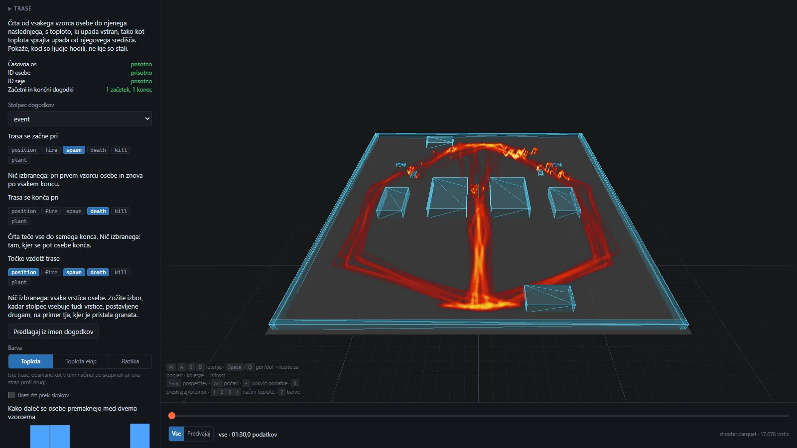

# Toplota črt

Toplota prikaže, kje so ljudje stali. Črte prikažejo poti, po katerih so hodili.

**Črte** (tipka 4) so toplota črt: črta od vsakega vzorca [osebe](glossary.md) do njenega naslednjega, razpršena z istim upadanjem kot [pika](glossary.md) - čez črto namesto okrog točke. Prikaže, kje so ljudje *šli*, ne kje so stali: hodnik, po katerem je nekdo šel enkrat, je tako viden kot soba, v kateri je nekdo taboril, redki vzorci hitrega igralca pa se združijo v neprekinjeno pot namesto v pikčasto sled. Potrebuje stolpec osebe in stolpec časa.

## Uporaba {#how-to-use-it}

1. Pritisnite `4` (ali izberite **Črte** v vrstici načinov).
2. Odprite **Trase** in preverite zeleni seznam: časovna os in ID osebe morata biti prisotna.
3. Pritisnite **Predlagaj iz imen dogodkov**, da se izpolni, kje se trase začnejo in končajo.
4. Preberite vrstico statistike: „N tras, M od njih doseže konec”.
5. Če črte skačejo čez zemljevid, prilagodite **Najdaljši korak** (glejte [Omejitev skokov](#the-jump-limit)).

Črta ima smisel samo med začetkom in koncem, zato plošča **Trase** pove, kaj omejuje traso. Vse od [Pravila trase](#the-rules-of-a-route) naprej so podrobnosti, ki jih lahko preskočite.

## Plošča Trase {#the-routes-panel}

Prikazana nad ploščami toplote v načinu Črte.

### Kaj podatki imajo {#what-the-data-has}

Seznam, zelen, ko je prisotno, oranžen, ko ni:

| Vrstica | Stanja |
|---|---|
| **Časovna os** | *prisotna* / *manjka - potrebno* |
| **ID osebe** | *prisotna* / *manjka - potrebno* |
| **ID seje** | *prisotna* / *ni - vse vrstice so ena seja* |
| **Začetni in končni dogodki** | *N začetkov, M koncev* / *nič izbrano - cele poti* (zeleno samo s stolpcem dogodkov in vsaj enim začetkom in enim koncem) |

### Kontrole {#controls}

| Kontrola | Pomen |
|---|---|
| **Stolpec dogodkov** | Stolpec kategorije, katerega vrednosti so dogodki (pojav, smrt, položaj ...). *Brez - cele poti*: pot vsake osebe v vsaki seji je ena trasa, prekinjena tam, kjer ima pot vrzel. Ponujeni so samo stolpci, ohranjeni za filtriranje ob nalaganju. |
| **Trasa se začne pri** | Vrednosti dogodkov, ki začnejo trasa (pojav, ponovni pojav, namestitev). Nič izbrano: trasa se začne pri prvem vzorcu osebe in spet po vsakem koncu. |
| **Trasa se konča pri** | Vrednosti dogodkov, ki končajo trasa (smrt, izvlečenje, teleportacija). Črta teče do same končne vrstice. Nič izbrano: trasa se konča tam, kjer se konča pot osebe. |
| **Točke vzdolž trase** | Vrednosti dogodkov, katerih vrstice ležijo vzdolž trase. Nič izbrano: vsaka vrstica osebe. Zožite, kadar stolpec hrani tudi vrstice, postavljene drugje, na primer kje je pristala granata. |
| **Predlagaj iz imen dogodkov** | Zapolni tri sezname iz imen vrednosti (spodaj). |
| **Barva** | *Toplota*, *Toplota ekip* ali *Razlika*. Enake trase v barvanju tega načina: vsaka skupina v svojem odtenku ali ena stran proti drugi, s seznamom skupin, delitvijo in lestvicami, ki delujejo kot v teh načinih. Privzeto *Toplota*. Toplota ekip in razlika potrebujeta stolpec skupine. |
| **Brez črt prek skokov** / **Najdaljši korak** | Naslednji vzorec osebe, ki je dlje od tega, je ponovni pojav, teleportacija ali padec, ne kraj, kamor je šla, zato se med njima ne povleče nobena črta. Ob nalaganju se izpolni, kadar podatki kažejo jasno vrzel (spodaj), in je izklopljeno, kadar je ni. Deluje z ali brez stolpca dogodkov. |
| Vrstica statistike | `N tras, M od njih doseže konec, K odsekov`, osveži se nekajkrat na sekundo. |

Vsak seznam je vrsta preklopnih čipov, en za vrednost, najpogostejša najprej; ob premiku miške nad čipom se prikaže število njegovih vrstic. Ponujenih je največ 120 vrednosti (*še N vrednosti ni prikazanih*).

Če izberete drug stolpec dogodkov, se predlog uporabi, kadar predlog izbere ta isti stolpec, sicer se začne s praznimi seznami.

### Predlog {#the-suggestion}

Ob vsakem nalaganju in ob **Predlagaj iz imen dogodkov** ([`suggestLineSettings`](https://github.com/Holdi601/3DHeat/blob/main/src/data/lines.ts)):

- **Stolpec dogodkov:** prvi ohranjeni stolpec kategorije z imenom `event`, `eventname` ali `eventtype`; sicer `kind`, `type` ali `action`; sicer kateri koli, ki vsebuje *event*, *kind*, *action* ali *type*.
- **Začetki:** vrednosti, ki vsebujejo *spawn, deploy, join, enter, start, begin, respawn, revive, land/landed/landing, drop* - razen če se ujemajo tudi z besedo za konec.
- **Konci:** vrednosti, ki vsebujejo *death, died, dead, kill/killed, eliminat…, extract, evac, teleport, leave, left, disconnect, quit, exit, end, finish, downed* - razen vrednosti `kill` in `kills` (ubijanje je nekaj, kar naredi ubijalec, ne konec njegove trase).
- **Točke:** vrednosti, ki so točno *position, location, player location, move, movement, tick, sample* ali *pos*; ko je katera najdena, se začetki in konci dodajo tudi točkam. Ko ni nobene, točke ostanejo prazne (vsaka vrstica).

### Omejitev skokov {#the-jump-limit}

Kjer ljudje skačejo, se dolžine korakov razdelijo v dve skupini z malo ali nič vmes: kar oseba prehodi med dvema vzorcema, in širina zemljevida. Ob nalaganju ([`suggestMaxJump`](https://github.com/Holdi601/3DHeat/blob/main/src/data/lines.ts)) se koraki štejejo po podvojitvah njihove kvadratne dolžine, do 16 milijonov, meja pa pade v sredino prvega razpona nad mediano, ki je širok vsaj eno podvojitev dolžine, ima pod 0,02 % korakov na predal in ima korake čez mejo. Če takega razpona ni, se nič ne prireže, saj ne bi bilo mogoče ločiti skoka od hitrega avtomobila; vklop meje ročno tedaj začne pri eni desetini diagonale podatkov.

Graf nad mejo pokaže, kako dolgi so koraki zares, z črto pri meji: stolpci desno od nje se ne narišejo. Obe osi sta logaritemski, ker so lahko skoki stotinka korakov in tisočkrat tako dolgi. Ob premiku miške nad stolpcem se prikažeta njegov razpon in delež; s klikom na graf postavite mejo tja. Pod njim je delež korakov nad mejo.

## Pravila trase {#the-rules-of-a-route}

Vrstice se pregledajo po času, za vsako osebo ([`buildLines`](https://github.com/Holdi601/3DHeat/blob/main/src/data/lines.ts)):

1. Vrstice [skupnega imena](sessions-persons-groups.md#names-worn-by-several-things-at-once) se popolnoma preskočijo.
2. Ko so izbrane točke, se vrstica, ki ni ne začetek ne konec ne točka, preskoči.
3. Vrstice se sledijo po osebi in seji, zato ima oseba, katere seje se v časovnem redu prepletajo, eno trasa v vsaki. Trasa se zapre, kadar prejšnja vrstica nima naslednice (njena [življenjska doba](sessions-persons-groups.md#person) je „nič”) - trasa nikoli ne prečka meje seje ali vrzeli, za katero je nalaganje odločilo, da nima naslednjega vzorca. Trasa, na kateri je vrstica, se izračuna enkrat in ohrani, 4 bajti na vrstico, zato sprememba najdaljšega koraka ne ponovi tega dela.
4. **Začetna** vrstica zapre vsako odprto trasa in tam odpre novo.
5. Ko so izbrani začetki, se vrstica zunaj trase ignorira. Brez začetkov vsaka vrstica, ki ni konec, zunaj trase odpre eno.
6. Vsaka druga vrstica znotraj trase doda **odsek** od prejšnje vrstice trase do te.
7. **Končna** vrstica, ki podaljša trasa, jo zapre za svojim odsekom; ta trasa se šteje kot *doseže konec*.
8. Korak, daljši od **Najdaljšega koraka**, zapre trasa tam, kjer je bila, nova trasa pa se začne na drugem koncu, razen če ta vrstica ni konec. Čez njega se ne povleče nobena črta, vrstica statistike pa ga šteje.

Vsak odsek je shranjen na svoji *končni* vrstici, zato odseki ostanejo v časovnem redu, [časovnica](timeline.md) okno, vzorčevalnik, [filtri](filters.md), vidnost skupin in predznak razlike pa delujejo nad njimi kot nad točkami. Filter se zato uporabi za vrstico, na kateri odsek konča.

## Predvajanje {#playback}

V načinu **Vse** je vsaka trasa narisana cela. V načinu **Predvajaj** je vsaka oseba točka, ki se premika med svojimi vzorci in za seboj riše svojo traso:

- odsek, ki se začne za glavo predvajanja, ni narisan;
- odsek, v katerem je oseba ravno, je narisan do njenega interpoliranega položaja, s končnim zaključkom na glavi;
- toplota zbledi čez **rep**: pri zgodovini *Kumulativno* je rep neomejen in vsa doslejšnja trasa ostane; pri *Okno* zbledi do nič čez *Razpon* (privzeto 30 s). Pri *Življenjska doba* je rep prav tako *Razpon*, v načinu Črte pa časovnica za to zgodovino prikaže polje *Razpon* (namesto *Rezervne življenjske dobe* in *Zbledi*, ki jih toplota črt ne uporablja).

Med predvajanjem se vsak okvir nariše celoten, ne nabran, ker se glave premikajo vsak okvir in bi drseče povprečje vsako razmazalo v črto.

## Za razvijalce {#for-developers}

### Pomnilnik {#memory}

Trase se zgradijo na glavni niti, ko vstopite v način Črte (ali se nastavitve trase spremenijo), in sprostijo, ko ga zapustite: 5 bajtov na vrstico v pomnilniku in 8 bajtov na vrstico na GPU (začetni položaj vsakega odseka, kvantiziran na 16 bitov na os znotraj omejevalnega okvirja podatkov, in njegove zastavice).

### Kako se črta riše {#how-a-line-is-drawn}

Oba zaledja narišeta vsak odsek iz njegove končne vrstice kot **18 oglišč** ([`lineHeatVs`](https://github.com/Holdi601/3DHeat/blob/main/src/render/webgl2/shaders.ts) in njegov dvojnik WGSL):

- Polovična širina na vsakem koncu je [polmer pike](sprite-shape.md#sprite-radius) pri razdalji tega konca, z uporabljenimi pikselskimi mejami. Črta, ožja od 2,5 px, je narisana 2,5 px široka, njena toplota pa je sorazmerno zmanjšana, zato tanke črte ne izginejo in se ne posvetlijo.
- Toplota upada **čez** črto z enako lestvico kot pika - upadanje ali krivulja, središčna in robna intenzivnost.
- Okrogli zaključki so narisani **samo** tam, kjer se trasa začne ali konča, zato se stiki med zaporednimi odseki ne razpadejo v niz biserov.
- Geometrija je zgrajena v zaslonskem prostoru in tam linearno interpolirana, zato upadanje ostane središčno na črti, ne glede na to, kako gre v globino. Odsek, ki prečka bližnjo ravnino, se tam odreže namesto da bi izpadel.

Toplota točk in toplota črt nanašata zelo različne količine toplote na vrstico, zato se nasičenost ponovno meri, ko preklapljate med njima ([Barva in izpostavitev](colour-and-exposure.md#auto-exposure)).
