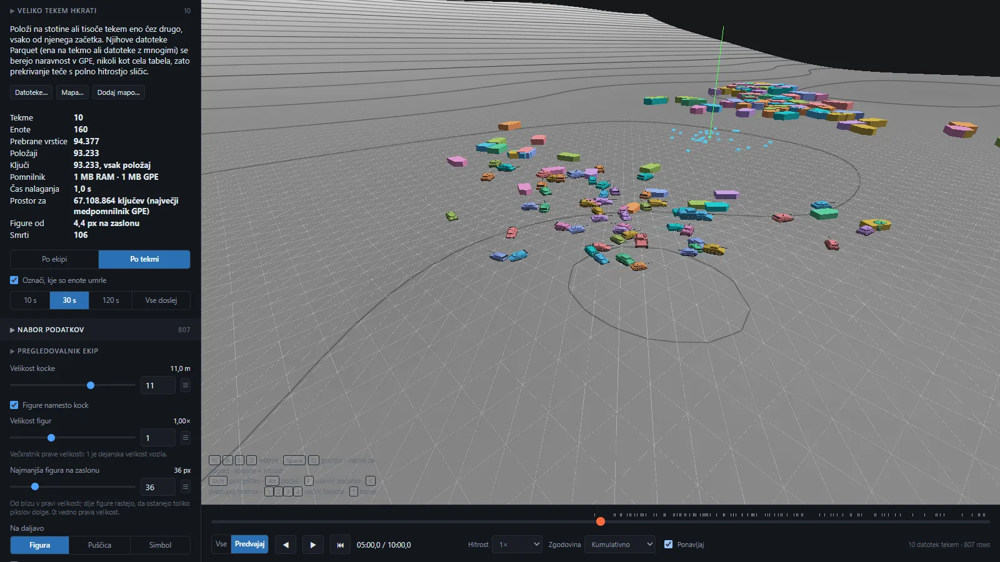

# Veliko tekem hkrati

**Veliko tekem hkrati** prikaže veliko tekem drugo na drugi, zato vidite, kam gredo igralci vsake tekme običajno. Uporabite jo, da primerjate sto ali tisoč tekem na eni sliki.

Vsaka tekma se začne na svojem začetku, njene enote pa se gibljejo kot figure. Datoteke gredo naravnost v grafično kartico in se ne gradi nobena polna tabela, zato se predvaja gladko tam, kjer bi navadno nalaganje zmanjkalo pomnilnika.

## Kako uporabiti {#how-to-use-it}

1. V stranski vrstici Toplotnega zemljevida odprite **Veliko tekem hkrati**.
2. Pritisnite **Datoteke…** (izberete veliko datotek), **Mapa…** (mapa in njene podmape) ali **Dodaj mapo…** (dodajte k naloženemu).
3. Pregledovalnik preklopi na prekrivanje figur in začne na začetku. Pritisnite **Predvajaj**.

Vsaka datoteka je ena tekma (ali jih vsebuje več). Delujejo datoteke Parquet in vsebniki [`.3dheat`](container.md). Datoteka potrebuje stolpec položaja, časa in enote; stolpci imena, vrste in strani se ohranijo. Druge datoteke in stranske datoteke pretvornikov (let, sporočila, dogodki, klepet, cilji) se preskočijo. Za navadno tabelo glejte [Uvoz podatkov](getting-data-in.md).

## Nastavitve {#settings}

| Nastavitev | Kaj naredi |
|---|---|
| **Po ekipi** / **Po tekmi** | Barva po strani ali barva na tekmo. |
| **Označi, kje so enote umrle** | Oznaka na mestu, kjer je vsaka enota umrla, za 10 s, 30 s, 120 s ali vse doslej. |

Plošča pokaže, koliko tekem, enot, vrstic in položajev je bilo prebranih, porabljen pomnilnik in čas nalaganja. *Prostor za* je, koliko položajev še lahko sprejme grafična kartica. *Figure od* je velikost na zaslonu, pod katero je enota narisana kot majhna puščica namesto svoje figure.

Videz figur uporablja iste kontrole kot [predvajanje tekme](match-replay.md#figures): **Velikost figur**, **Najmanjša figura na zaslonu** in **Na daljavo**.

## Namigi {#tips}

- Ko bi vse ne šlo v pomnilnik, se položaji redčijo (ohrani se samo položaj vsakih nekaj metrov) in plošča to pove.
- Načini toplote delujejo tudi na podatkih prekrivanja.
- Za statistiko čez tisoče tekem brez njihovega risanja glejte [Množinsko analizo](mass-analysis.md).
