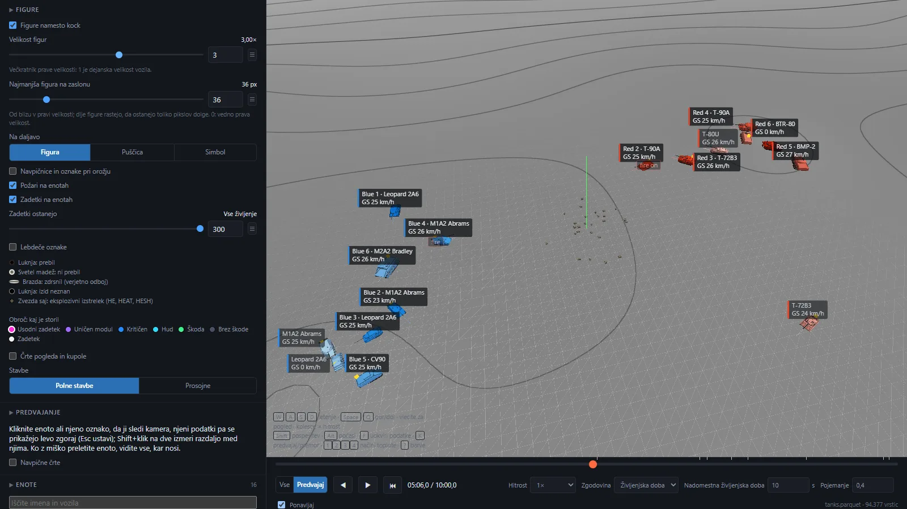
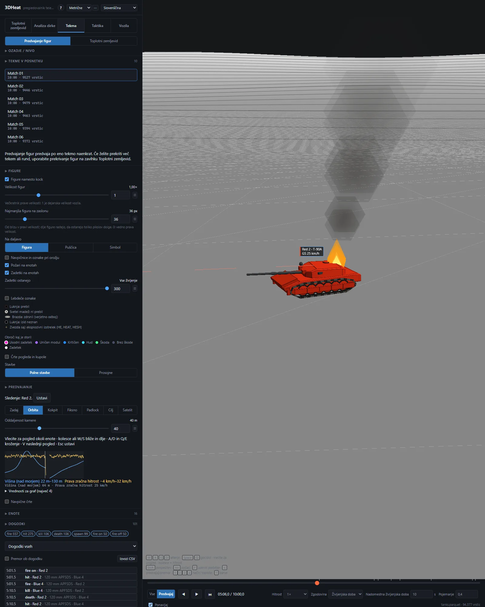
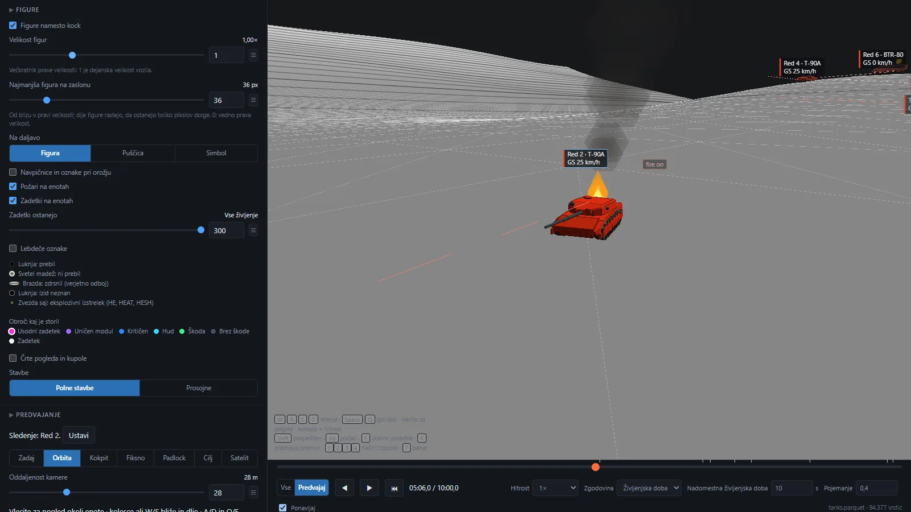
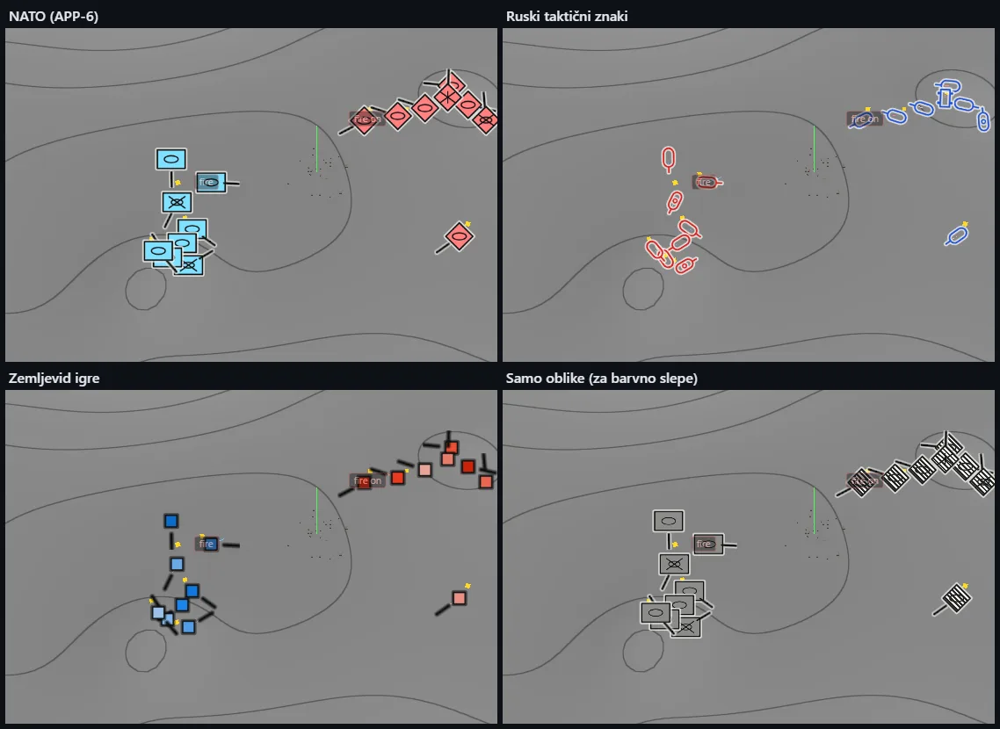
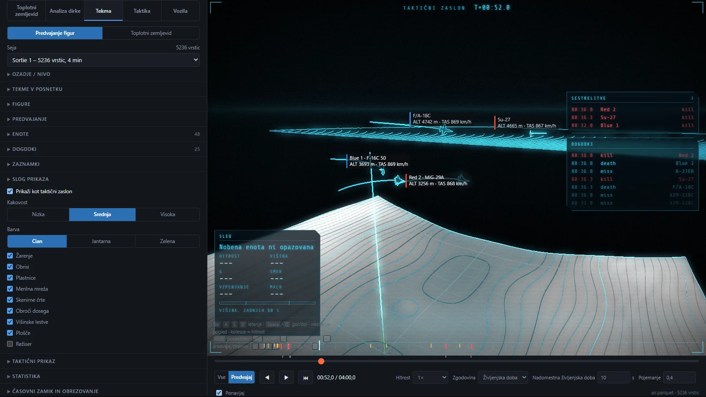
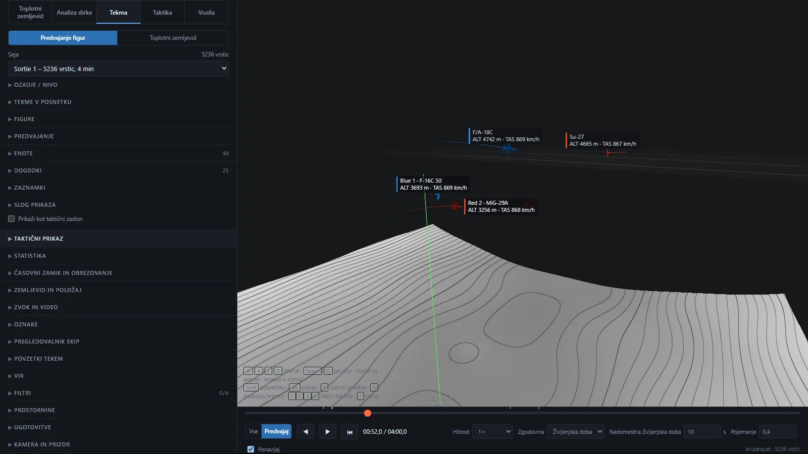

# Predvajanje tekme

Predvajanje je film tekme, v katerem je vsak igralec narisan kot tisto, kar je vozil. Uporabite ga, da ponovno pogledate boj, sledite eni enoti in vidite, kdo je koga zadel.

Streli, zadetki, požari in olupki so narisani na enotah in ciljih na ravni. Kamere, oznake in taktični prikaz vam pomagajo brati boj. Poznate Tacview? [Enakovrednost s Tacview](tacview-parity.md) pokaže, kje je vsako njegovo orodje.

## Zaženite predvajanje {#start-a-replay}

1. Naložite posnetek z **Vir → Datoteke…** ali s spuščanjem na ploščo Vir (katera koli tabela s stolpcem **osebe** in stolpcem **časa**, datoteka Tacview, pretvorjen posnetek, tekma [`.3dheat`](container.md)). Glejte [Uvoz podatkov](getting-data-in.md).
2. Odprite zavihek **Tekma** in izberite **Predvajanje figur** ali izberite **Prekrivanje figur** v vrstici načinov zavihka Toplotni zemljevid.
3. Pod **Tekme v posnetku** izberite eno tekmo, vse hkrati ali več.
4. Pritisnite **Predvajaj** na časovnici (ali `K`). Povlecite časovnico, da skočite.

Figure nadomestijo kocke za vsako enoto, katere ime ali tip je znan (glejte [Figure](figures.md)). Podatki brez stolpca imena ali tipa so narisani kot vojaki.

## Figure {#figures}

| Nastavitev (razdelek **Figure**) | Privzeto | Kaj naredi |
|---|---|---|
| **Figure namesto kock** | vklopljeno | Izklopljeno nariše preproste kocke. |
| **Velikost figur** (kratno pravi velikosti) | 1 | 1 je prava velikost; 0,25 do 20-kratnik (logaritemska lestvica). Večja pomaga od daleč. |
| **Najmanjša figura na zaslonu** | 36 px | Figure na daljavo rastejo, da ostanejo tako dolge, 0 do 200 px; 0 ohrani pravo velikost. |
| **Na daljavo**: Figura, Puščica, Simbol | Figura | Kaj postane enota na daljavi. |
| **Simboli** | NATO (APP-6) | NATO (APP-6), ruski taktični znaki, ikone **Zemljevid igre** ali **Samo oblike (za barvno slepe)**. |
| **Velikost simbola**, **Moja stran**, **Sovražna / Nevtralna**, **Oznake smeri** | 28 px (12 do 64), samodejno, sovražna, vklopljeno | Kako izgledajo simboli in katera stran je prijateljska. |
| **Navpične črte** | vklopljeno | Črta od vsake enote naravnost do tal, da se višine berejo v 3D. |
| **Navpičnice in oznake pri orožju** | izklopljeno | Črte do tal in oznake na raketah in bombah. |
| **Požari na enotah** | vklopljeno | Plameni od trenutka, ko enota zagori, do pogasitve. |
| **Zadetki na enotah** | vklopljeno | Oznake, kjer so streli zadeli (spodaj). **Zadetki ostanejo**: 1 do 300 sekund ali **Vse življenje**. **Lebdeče oznake**: oznake, narisane nad površino. |
| **Črte pogleda in kupole** | izklopljeno | Črtkano: kam igralec gleda; polno: kam kaže top. |
| **Stavbe** | polno | Polne ali prosojne stavbe, kadar jih raven prikaže. |

### Simboli na daljavo {#symbols-at-a-distance}

Kadar bi bila enota manjša od **Najmanjša figura na zaslonu**, lahko postane simbol, ki ostane berljiv. Oblika pove vrsto (na primer zaobljena škatla z oznako gosenice za oklepna vozila); barva pove stran. Odprite meni **Simboli**, da spremenite slog.

### Oznake zadetkov, olupki in požari {#hit-marks-wrecks-and-fires}

- **Oznake zadetkov** sedijo na površini, ki jo je zadel strel, v merilu figure. Njihov videz pove, kaj se je zgodilo: luknja (prebil), svetla brizga (ni prebil), brazda (odbil), zvezda saj (eksplozivni naboj). Barvni obroč pove, kaj je naredil: usodni strel, uničen modul, kritično, hudo, poškodba, brez poškodbe, zadetek. Ob postavitvi na oznako vidite ime naboja.
- Uničena enota je narisana **ožgana** kot olupek od smrti do ponovne pojavitve ali odstranitve; njen simbol je prečrtan.
- **Požari** gorijo na enoti od trenutka, ko zagori, do pogasitve.
- **Kupole** se obrnejo tja, kamor podatki kažejo, da kaže top (ali, brez tega, kamor gleda igralec).

### Orožje, vabe in sledilni streli {#weapons-decoys-and-tracers}

Ob vklopljenem **Orožje, streli in zadetki** (razdelek Pregledovalnik ekip): rakete, raketni streli, bombe in torpeda letijo kot lastne figure z dimno sledjo; naboji in granate so sledilni streli; zadetki in eksplozije utripnejo. Sledilni strel, narisan **črtkano**, je bil izračunan iz zadetka, ker podatki niso imeli strela. Bakle in pleve so narisane kot vabe; skrite so na seznamu enot, razen če je obkljukano *Vabe in granate*.

## Kamere {#cameras}

Kliknite enoto ali njeno oznako, da ji **sledite**; razdelek **Predvajanje** ponuja **Zadaj**, **Orbita**, **Kokpit** (s prikazom na čelnem steklu, `H`), **Fiksno**, **Padlock**, **Cilj** in **Satelit**. `V` kroži med njimi, **Oddaljenost kamere** nastavi, kako daleč. Esc ustavi.

- **Pogled na dve enoti**: izberite **Cilj** (ali Ctrl/Alt-klik na enoto), da jo gledate iz sledene; **Zamenjaj** ju zamenja.
- **Mera**: Shift-klik na dve enoti za smer, razdaljo in višinsko razliko med njima.
- **2D-karta** (`M`): kot v kotu ali čez cel zaslon, s sledmi in imeni.
- **Zaznamki** (`B`): shranijo trenutek in kamero; posnetkove lastne kills, smrti in oznake so prav tako našteti.
- **Dogodki**: vsak dogodek v časovnem vrstnem redu; klik tja skoči. `Page Up` / `Page Down` skočita med dogodki; **Premor ob dogodku** se ustavi pri vsakem.

## Taktični prikaz {#tactical-display}

Razdelek **Taktični prikaz** nariše za nobeno enoto, izbrane, vse ali eno vrsto (letala, kopno, ladje, orožje): vektorje hitrosti in pot naprej, črte nosa in dviga, stožce radarja, zaklepanja, podatkovne povezave, območja in črte angažiranja, črte vidnosti, kam igralci gledajo (stožci pogleda), nastavitev kupole in zabeleženo kamero.

### Slog prikaza {#display-style}

`T` (ali stikalo **Prikaži kot taktični zaslon**) preklopi videz v slog radarskega zaslona: sijaj, obrisi, višinske črte, mrežo za merjenje, skenirne črte, obroče dosega, lestvice višin, plošče s kills in dogodki ter **Režiserja**, ki kamero sam premakne k dogodkom.

## Cilji {#objectives}

Ko tekma pride s svojimi cilji, razdelek **Cilji** jih nariše na ravni: cone zajema (z lastnikom in napredkom zajema), spawne, letališča, območja in tarče bombardiranja, vsak sloj se lahko preklopi, z oznakami. Vidni so skozi tla. Ob več naloženih načinih igre **Način** filtrira tekme po načinu. Cilji pridejo iz datoteke tekme pretvornika poleg posnetka ali znotraj vsebnika [`.3dheat`](container.md).

## Oznake in statistika {#labels-and-statistics}

- **Oznake**: pravila za vsako vrsto (**Izbrane**, **Letala**, **Kopno**, **Ladje**, **Orožje**, **UI**): prikazana ali ne, katere vrednosti, in **Prednost** za to, kdo dobi prostor, kadar se oznake prekrivajo. **Razmakni oznake** premakne oznako ob njeni enoti, kadar bi prekrila drugo, in jo izpusti, kjer ni prostora. **Velikost oznak** je od 60 do 250 %. **Nazaj na ime, vozilo, višino in hitrost** ponastavi pravila.
  - Enote na kopnu začnejo z imenom, vozilom in hitrostjo.
  - Letala začnejo z imenom, vozilom, višino in hitrostjo.
  - Ladje začnejo z imenom, vozilom, hitrostjo in smerjo.
  - Ob postavitvi na enoto vidite vse njene vrednosti.
- **Statistika**: po ekipi in enoti: ubitja, smrti, streli, zadetki, razmerje zadetkov, vzleti, pristanki, čas v zraku, največja hitrost, višina in G, razdalja. Izvoz CSV.
- **Grafi**: vrednosti enote skozi čas, dve enoti primerjani ali ena vrednost proti drugi.

## Veliko tekem hkrati {#many-matches-at-once}

Da stisnete na stotine ali tisoče tekem čez drugo drugo, glejte [Veliko tekem hkrati](many-matches.md). Podrobnosti o figurah (dim, ogenj, drugi časovno omejeni učinki): [Figure v prekrivanju figur](figure-replay.md). Seznam zmožnosti Tacview: [Enakovrednost s Tacview](tacview-parity.md), podstran te strani.
