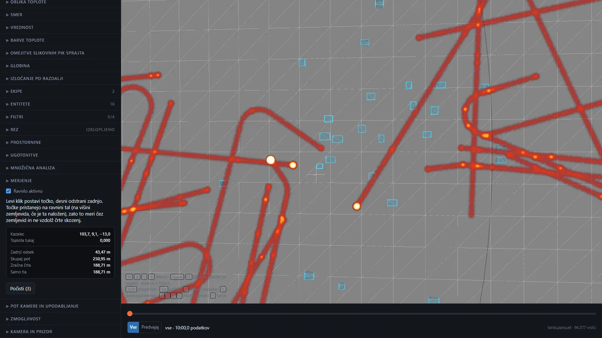

# Merjenje

**Mera** spremeni miško v ravnilo in pove, kako zaposlena je točka pod kazalcem. Uporabite jo, da izveste, kako daleč sta narazen dve mesti, ali koliko prometa ima ena točka.

## Preizkusite {#try-it}

1. V stranski vrstici odprite **Mera** in obkljukajte **Ravnilo aktivno**.
2. Levo kliknite na tri mesta na zemljevidu. Vsak klik postavi točko.
3. Preberite **Skupaj pot** (dolžina celotne poti) in **Zadnji odsek** (zadnji del).
4. Desno kliknite, da odstranite zadnjo točko, ali pritisnite **Počisti (3)**, da odstranite vse.

| Dejanje | Učinek |
|---|---|
| Levi klik | Postavi točko tam, kjer kazalec seka ravnino tal. Klik, ki je med pritiskom in spustitvijo premaknil več kot 4 slikovne pike, je vleka kamere, ne točka. |
| Desni klik | Odstrani zadnjo točko. |
| Premik | Položaj kazalca in toplota pod njim se sproti posodabljata. |

Kamera med vklopljenim ravnilom še vedno deluje: vleka še vedno gleda naokoli, tipke še vedno letijo. Ko je ravnilo vklopljeno, prevzame vsak klik, zato [izbira s klikom](camera.md#click-to-pick) počaka, da se izklopi.

**Ravnina tal** je višina [slike zemljevida](map-images.md), kadar je naložena slika zemljevida, sicer najnižja Y podatkovne množice (0, če slike ni). Točke pristanejo nanjo, zato ravnilo meri čez zemljevid, ne vzdolž črte skozi njega. Pri 3D ravni je ravnina še vedno najnižji Y podatkovne množice, ne površina ravni – za točko na pravi površini ravnilo izklopite in kliknite nanjo ([izbira s klikom](camera.md#click-to-pick)), ki prebere koordinate iz trikotnikov same ravni.

## Odčitki {#readouts}

| Vrstica | Pomen |
|---|---|
| **Kazalec** | Svetovni X, Y, Z točke pod kazalcem, na ravnini. |
| **Toplota tukaj** | Koliko toplote je na slikovni piki kazalca. Večje število pomeni več prometa na tej točki. To je vrednost, ki jo lestvica barv prejme, preden jo točka nasičenja deli, zato jo lahko primerjate s [Točko nasičenja](colour-and-exposure.md#saturation-point). |
| **Zadnji odsek** | Razdalja od zadnje točke do kazalca (ali med zadnjima dvema točkama). |
| **Skupaj pot** | Dolžina lomljene črte skozi vsako točko in kazalec. |
| **Zračna črta** | Tridimenzionalna razdalja od prve točke do kazalca (ali zadnje točke). |
| **Samo tla** | Enako, samo na X in Z. |
| **Počisti (N)** | Odstrani vse točke. |

Razdalje so prikazane v centimetrih pod 1 enoto, v metrih pod 1.000, v kilometrih nad tem – ob predpostavki, da je ena svetovna enota meter ([Osi, enote in čas](axes-units-and-time.md#unit-scale)). Koordinate so svetovne koordinate, tudi kadar je os [obrnjena za prikaz](camera.md#invert-world-axis).

Točke in črta med njimi se narišejo kot prekrivni sloj v pogledu, velikost pa je odvisna od razmika mreže. Točke ravnila se v pogledih ne shranijo; ostanejo, ko naložite druge podatke.

## Za razvijalce {#for-developers}

**Toplota tukaj** se iz GPU bere največ vsakih 120 ms, ker branje ene same slikovne pike ustavi cevovod. Uporablja isto pot kot `engine.readHeatProbe()`: deli z ojačenjem, s katerim je bila sličica zapisana, zato je na poti seštevanja v polovični plavajoči vejici (`?heat=f16`) v istih enotah kot na 32-bitnem cilju ([Seštevanje v polovični plavajoči vejici](half-float-accumulation.md)).
