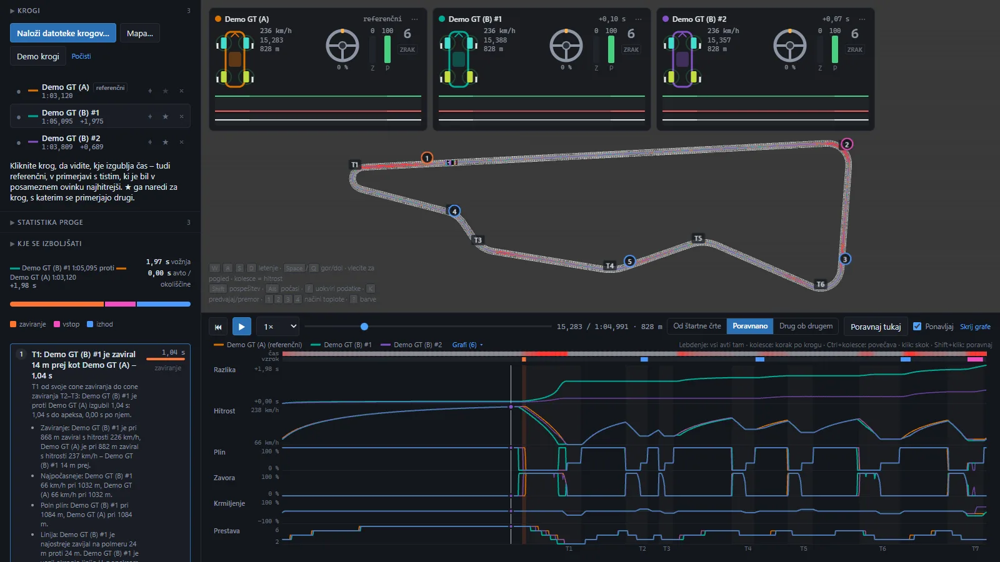

# Analiza dirke

Progo ste vozili dvakrat. Zavihek **Analiza dirke** predvaja obe vožnji skupaj v 3D, pokaže, kje je bil en krog počasnejši, in vam pove zakaj. Še nimate krogov? Pritisnite **Demo krogi**.

Zavihek primerja dva ali več krogov ene proge. Deli platno, kamero in naloženi model proge (**Ozadje / nivo**) s toplotnim zemljevidom; vse drugo je njegovo: lastna stranska vrstica in lastna vrstica pod pogledom. Izrazi, kot so *krog*, *referenca* in *apeks*, so v [slovarju pojmov](glossary.md).

Ta stran je zemljevid zavihka. Vsak del ima svojo stran:

| Stran | Kaj pokriva |
|---|---|
| [Nalaganje krogov](race-loading-laps.md) | vsak format datotek, mape in proge, imena avtomobilov, demo krogi, seznam krogov, referenca in fokus |
| [Predvajanje in 3D prizor](race-replay-and-scene.md) | vrstica za predvajanje, trije načini predvajanja, poravnava avtomobilov, kamera za zasledovanje, črte, zemljevidi, avtomobili, oznake, zrcaljeni svetovi |
| [Grafi in HUD](race-charts-and-hud.md) | grafi razdalje, izbirnik grafov, premik miške in povečava, kartice avtomobilov, tabela kanalov |
| [Dogodki obvladovanja avta](race-control-events.md) | blokade koles, zdrs koles, podkrmiljenje, zavijanje, trki, nesreče, ABS/TC, ročna zavora, zrak - kako je vsak zaznan, z vsakim pragom |
| [Analiza ovinek za ovinkom](race-corner-analysis.md) | poravnava po razdalji, ovinki in odseki, časovni račun ovinka, vsak vzrok in vrstni red, po katerem se preizkusijo, oblika linije in nasvet |
| [Profili avtomobilov in primerjava](race-car-profiles.md) | kaj zmore vsak avto, izmerjeno iz njegovih krogov; *Primerjava avtov*; kaj avto odloči v vsakem ovinku |
| [Statistika proge](race-course-statistics.md) | veliko krogov ene proge: napake po ovinku in vrsti, zemljevid napak, izvoz toplotnega zemljevida, omejitve zmogljivosti |
| [Analitika dirk: metoda](race-analytics.md) | raziskava za pravili, z viri |
| [Druge dirkaške igre](other-games.md) | kaj pregledovalnik naredi s krogi vsake igre: zdrs in drsenje, izračunana tam, kjer je igra ne pošlje, zrcaljeni svetovi, dodatni kanali |

## Zaslon {#the-screen}

**Stranska vrstica**, od zgoraj navzdol (razdelki se lahko zložijo):

1. **Krogi** - nalaganje, seznam, prikaz/skrivanje, referenca, fokus, zasledovanje.
   Glejte [Nalaganje krogov](race-loading-laps.md).
2. **Statistika proge** - prikaže se šele od treh naloženih krogov naprej.
   Glejte [Statistika proge](race-course-statistics.md).
3. **Kje se izboljšati** - ugotovitve osredotočenega kroga, ovinek za ovinkom.
   Glejte [Analiza ovinek za ovinkom](race-corner-analysis.md).
4. **Ovinek za ovinkom** (ali *Ovinek za ovinkom - razred X* pri več razredih) - najhitrejši krog skozi vsak ovinek in njegova linija. Prikaže se pri dveh ali več krogih.
5. **Obvladovanje avta** - blokade, zdrsi, podkrmiljenja in zadetki osredotočenega kroga.
   Glejte [Dogodki obvladovanja avta](race-control-events.md).
6. **Primerjava avtov** (ali **Avto** pri enem avtu) - glejte
   [Profili avtomobilov in primerjava](race-car-profiles.md).
7. **Pogled** - katera karta je naslikana na progo in kaj se riše.
   Glejte [Predvajanje in 3D prizor](race-replay-and-scene.md).
8. Skupni plošči **Nivo** in **Kamera in prizor** (model proge, obrat osi, kamera) - opisani z toplotnim zemljevidom in [Kamera](camera.md).

**Pogled** prikazuje progo, vožene linije, karto, avtomobile, oznake, pripete na progo, in do šest kartic avtomobilov zgoraj levo (glejte [Grafi in HUD](race-charts-and-hud.md)). Brez naloženih krogov piše: „Ni naloženih krogov - tu spustite dve ali več datotek krogov ali naložite demo krogi iz stranske vrstice.”

**Vrstica pod pogledom** vsebuje prenosnik predvajanja in, če ni skrita, grafe razdalje.

## Hiter začetek {#quick-start}

1. Odprite zavihek **Analiza dirke** (poleg **Toplotnega zemljevida** na vrhu stranske vrstice).
2. Pridobite kroge. Pritisnite **Demo krogi**, da vidite, kaj zavihek naredi s tremi izmišljenimi krogi. Za svoje kroge jih najprej posnemite ([formati datotek in snemalniki](race-loading-laps.md#file-formats)), nato pritisnite **Naloži datoteke krogov…** ali **Mapa…**, ali spustite datoteke ali mape na pogled.
3. Najhitrejši popolni krog postane referenca; najpočasnejši drugi krog je v fokusu. Kliknite kateri koli krog na seznamu, da ga osredotočite; ★ naredi krog referenco.
4. Preberite **Kje se izboljšati**. Kliknite ugotovitev: avtomobili se poravnajo 40 m pred njo, kamera jo uokviri, predvajanje teče skozi njo in se odprejo meritve.
5. Premaknite miško nad grafe, da premaknete vsak avto na ta meter; Shift+klik jih tam poravna.

## Tipkovnica {#keyboard}

Medtem ko je zavihek Dirka odprt:

| Tipka | Naredi |
|---|---|
| **K** | predvajanje / pavza |
| **Home** | nazaj na začetek predvajanja |
| številske tipke | nič (v toplotnem zemljevidu preklapljajo načine) |

Tipke, vtipkane v besedilno polje ali spustni seznam, se prezrejo. Tipke kamere delujejo kot v toplotnem zemljevidu (**W A S D**, **Presledek** gor, **Q** dol, **Shift** hitreje, **Alt** počasneje, miška za ogled; vse v [Kamera](camera.md)); **F** uokviri naložene kroge (kot to naredi nalaganje krogov).

## Veliko krogov {#many-laps}

- Vsi naloženi krogi se analizirajo in preštejejo; desetine trajajo sekundo ali dve.
- Nad **8** krogi (`SHOW_ALL_UP_TO`) se dodani krogi narišejo samo, kadar so referenca, osredotočen krog ali najboljši krog razreda osredotočenega kroga. Preklopi se z *Prikaži vse* / *Samo ogledovani*.
- Nad **10** vidnimi avtomobili (`PLAIN_PAST`) se krogi, ki jih ne gledate (niso fokus, zasledovani avto ali referenca), narišejo s črtami, zredčenimi na točko na vsakih 6 m namesto na 1,5 m, in z navadnimi avtomobili.
- Grafi narišejo največ **8** krogov; HUD prikaže največ **6** kartic.
- Statistika proge se prikaže od **3** krogov naprej.

Podrobnosti: [Statistika proge](race-course-statistics.md#performance-with-many-laps).

## Privzete nastavitve pogleda {#default-view-settings}

| Nastavitev | Privzeto |
|---|---|
| Karta | Časovni zemljevid |
| Vožene linije, Avtomobili, Pnevmatike in vzmetenje, Oznake, Proga iz krogov | vklopljeno |
| Vse vrednosti na karticah | izklopljeno |
| Velikost avtomobila | 1× |
| Grafi | prikazani |
| Način predvajanja | Od linije |
| Hitrost predvajanja | 1× |
| Zanka | vklopljeno |

Nobena od teh ni shranjena; ponovno nalaganje začne s privzetimi. V brskalniku se shrani: jezik in imena avtomobilov, naučena iz datotek krogov (glejte [Nalaganje krogov](race-loading-laps.md#car-names)).

## Za razvijalce {#for-developers}

### Kaj se zgodi, ko se kroge naložijo {#what-happens-when-laps-are-loaded}

Vsakič, ko se nabor krogov, referenca ali jezik spremeni, se celotna analiza ponovi (`analyse` v [`src/race/analysis.ts`](https://github.com/Holdi601/3DHeat/blob/main/src/race/analysis.ts)):

1. Izpeljani kanali se dodajo vsakemu krogu tam, kjer igra ne pošlje svojih: kot zdrsa, zdrs koles iz hitrosti koles, v zraku, rahlo tlo, hitrost vrtenja ([`derive.ts`](https://github.com/Holdi601/3DHeat/blob/main/src/race/derive.ts)).
2. Izbere se referenca in vsak krog se projicira na njeno pot ter ponovno vzorči na vsaka 2 m ([`align.ts`](https://github.com/Holdi601/3DHeat/blob/main/src/race/align.ts)).
3. Iz krogov se ugotovi, ali je svet igre zrcaljen ([`handedness.ts`](https://github.com/Holdi601/3DHeat/blob/main/src/race/handedness.ts)).
4. Ovinki se najdejo na referenci in združijo v odseke od ene zavorne cone do naslednje ([`segments.ts`](https://github.com/Holdi601/3DHeat/blob/main/src/race/segments.ts)).
5. Za vsak avto: njegova ovojnica (oprijem, zaviranje, vlečna sila glede na hitrost), njegov profil, krivulje njegovih pnevmatik ([`envelope.ts`](https://github.com/Holdi601/3DHeat/blob/main/src/race/envelope.ts), [`profile.ts`](https://github.com/Holdi601/3DHeat/blob/main/src/race/profile.ts), [`control.ts`](https://github.com/Holdi601/3DHeat/blob/main/src/race/control.ts)).
6. Za vsak krog in odsek: kaj je naredil (točka zaviranja, najpočasnejša točka, polni plin ...) in linija, ki jo je vozil ([`line.ts`](https://github.com/Holdi601/3DHeat/blob/main/src/race/line.ts)).
7. Za vsak krog: njegovi dogodki obvladovanja avta, vsak položen proti krogu, s katerim se tam primerja.
8. Za vsak krog in odsek: časovni račun v primerjavi s svojim primerjalnim krogom in ugotovitev z besedami.
9. Časovni zemljevid in zemljevid vzrokov za vsak krog.

Besedila nastanejo v trenutnem jeziku; ob zamenjavi jezika se analiza ponovi (in preimenujejo se demo krogi). Napaka v analizi se prikaže pod gumbi **Krogi** kot napaka, kroge pa ostanejo naloženi.

### Izvorne datoteke {#source-files}

| Datoteka | Vloga |
|---|---|
| `src/race/adapters.ts`, `ibt.ts` | branje datotek krogov |
| `src/race/lap.ts`, `carNames.ts`, `synthetic.ts` | tip kroga, imenovanje, demo krogi |
| `src/race/derive.ts`, `handedness.ts` | izpeljani kanali, zrcaljeni svetovi |
| `src/race/align.ts`, `segments.ts`, `line.ts` | os razdalje, ovinki, linije |
| `src/race/analysis.ts` | primerjani ovinki, vzroki, ugotovitve |
| `src/race/envelope.ts`, `profile.ts` | kaj zmore avto |
| `src/race/control.ts`, `impacts.ts` | obvladovanje avta, zadetki in trki |
| `src/race/stats.ts` | veliko krogov |
| `src/race/replay.ts`, `scene.ts`, `glyph.ts`, `geometry.ts` | predvajanje in risanje |
| `src/race/schema.ts`, `graphs.ts` | tabela kanalov, vrstice grafov |
| `src/ui/race/*` | stranska vrstica, grafi, HUD, oznake |
| `src/state/raceStore.ts` | stanje zavihka in ura predvajanja |
