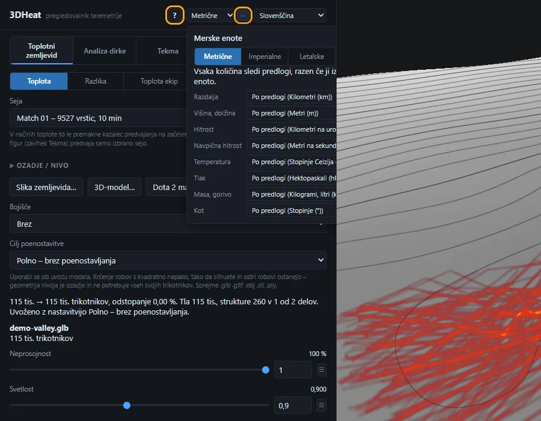
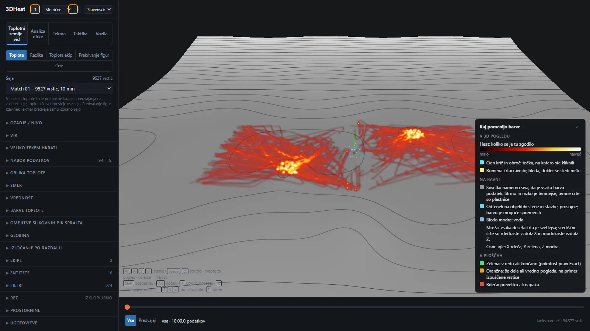
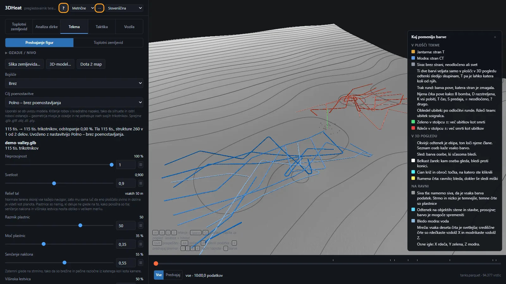

# Nastavitve, enote in tipke

Majhne kontrole na vrhu stranske vrstice spremenijo, kako pregledovalnik govori z vami: jezik, enote (metri ali čevlji, km/h ali vozli) in način pomoči, ki razlaga barve. Vaše izbire se shranijo v brskalniku.

## Glava {#the-header}

Na vrhu stranske vrstice:

| Kontrola | Kaj naredi |
|---|---|
| **?** | Način pomoči: kaj pomeni vsaka barva (tudi `?` ali `F1`) |
| Meni **Enote** | Metrično, Imperialno, Letalsko ali Pomorsko |
| Gumb **...** ob **Enote** | Odpre »Izberite enoto za vsako veličino«: en spustni meni za vsako veličino |
| Meni **Jezik** | Jezik pregledovalnika: [40 jezikov](languages.md) ali jezik brskalnika |

Številke, ki jih vtipkate v polje, lahko uporabljajo piko ali vejico (`0.35` ali `0,35`). Pregledovalnik bere obe in prikaže številke tako, kot jih piše jezik pregledovalnika.

## Enote {#units}

1. V meniju **Enote** izberite prednastavitev. Vse veličine se preklopijo skupaj.
2. Če želite spremeniti samo eno veličino, kliknite gumb **...** ob njej in izberite enoto zanjo. Meni nato pokaže `*` za prednastavitvijo.
3. Veličina, ki je niste nastavili, sledi prednastavitvi. Izberite »Kot prednastavitev«, da se vrnete.

| Veličina | Metrično (privzeto) | Imperialno | Letalsko | Pomorsko |
|---|---|---|---|---|
| Razdalja | km | mi | NM | NM |
| Višina, dolžina | m | ft | ft | m |
| Hitrost | km/h | mph | kt | kt |
| Vertikalna hitrost | m/s | ft/min | ft/min | m/s |
| Temperatura | °C | °F | °C | °C |
| Tlak | hPa | inHg | hPa | hPa |
| Masa, gorivo | kg, l | lb, gal | lb, gal | t, m³ |
| Kot | stopinje | stopinje | stopinje | stopinje |

Druge enote, ki jih lahko izberete za eno veličino: razdalja km, mi, NM; hitrost km/h, m/s, kt, mph; vertikalna hitrost m/s, ft/min, m/min; temperatura °C, °F, K; tlak hPa, inHg, mmHg, psi; masa kg, lb, t; kot stopinje ali NATO mili (6400 na krog). Enote so povsod v pregledovalniku enake: oznake, kartice, grafi, statistika.

## Način pomoči {#help-mode}

Pritisnite `?` ali `F1` ali kliknite gumb **?**. Prikaže *Kaj pomenijo barve*: legende za 3D pogled, lestvice toplote, barve ekip, barve ravni, barve stanja plošč, ploščo tekme in pogled dirke. Ostane, dokler ga ne izklopite. V zavihku Tekma razlaga tudi barve plošče tekme.

## Kaj brskalnik shrani {#what-the-browser-remembers}

Te nastavitve se hranijo v brskalniku med obiski (nič se ne pošlje nikamor):

- jezik, enote in način pomoči;
- nastavitve predvajanja figur, simbolov, oznak, kamere in taktičnega prikaza;
- hitrost predvajanja in zrcaljenje;
- zaznamki za posnetek, prostornine za nabor podatkov, sloji ciljev;
- nastavitve zunanjega UI (ključ samo, če obkljukate *Zapomni si*).

Nastavitve toplote, filtri in način se ob vsakem nalaganju začnejo znova. Celoten, samodejno ustvarjen seznam: [Shranjene nastavitve](ref-settings-storage.md).

## Tipke, ki jih pregledovalnik zadrži v brskalniku {#keys-the-viewer-keeps-from-the-browser}

Seja z velikimi podatki se dolgo nalaga, zato pregledovalnik brskalniku prepreči, da bi jo po nesreči zavrgel:

- `Ctrl`/`Cmd` + črke, ki bi tiskale, shranile, odprle, osvežile, zaprle ali odprle nova okna, zunaj besedilnih polj ne naredijo ničesar; `F1`, `F3`, `F5`, `F6` in `F7` ne naredijo ničesar.
- Zapiranje ali osveževanje zavihka z naloženimi podatki ali ravnjo najprej vpraša.
- V celozaslonskem načinu pregledovalnik zaklene tipke, ki jih uporablja (W, T, N, S, R, P, Q, Esc), da jih brskalnik ne prevzame.

Natančen seznam: [Tipke brskalnika](ref-browser-keys.md). Vse lastne tipke pregledovalnika: [Pregled tipkovnice in miške](keyboard-reference.md).
