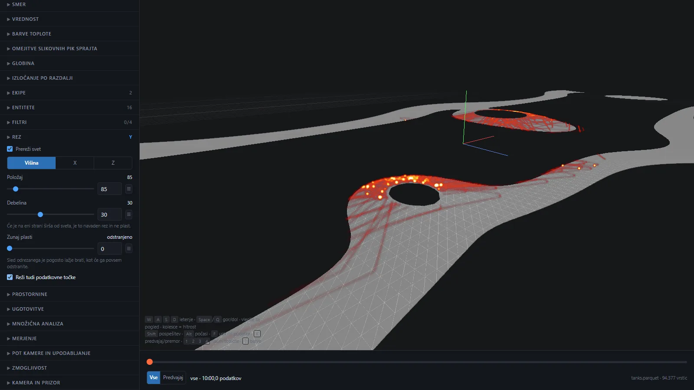

# Rez

**Rez** prereže svet kot kos torte, da lahko pogledate v notranjost stavb. Uporabite ga, kadar stene skrivajo zanimivo toploto, na primer da vidite eno nadstropje stavbe.

## Preizkusite {#try-it}

1. Naložite raven in nekaj podatkov ter odprite **Rez**.
2. Obkljukajte **Prereži svet**. Os je **Višina**.
3. Povlecite **Položaj** gor in dol: plošča se premika skozi raven.
4. Naredite **Debelino** tanko za tloris ali široko za »vse pod to točko«.
5. Pustite **Zunaj plošče** na 0, da odstranite preostalo, ali ga povečajte, da ohranite slab sled.



Plošča reže **geometrijo ravni in podatkovne točke skupaj** – če bi rezali samo raven, bi toplota ostala lebdeti tam, kjer je bila nekoč njena stavba. Je nasprotje [zakritja globine](depth-and-culling.md): ko raven pravilno skriva, kar je za njo, je skrit tudi notranji del stavbe. Plošča se prikaže, kadar je kaj za rezanje (podatkovna množica ali 3D raven); njena glava kaže os, ko je vklopljena, sicer *izklopljeno*.

```
pogled z strani   Položaj = kje je plošča
 ----------       Debelina = kako visoka je plošča
 | nadstr. 3 |
 |=========|  <--- plošča (ohranjena)
 | nadstr. 2 |  <--- zunaj: odstranjeno (ali slabo)
 | nadstr. 1 |
 ----------
```

## Kontrole {#controls}

| Kontrola | Privzeto | Pomen |
|---|---|---|
| **Prereži svet** | izklopljeno | Vklopi ploščo. Dokler je položaj na začetni vrednosti 0 in debelina na začetni vrednosti 500, ju vklop premakne na sredino osi in na 15 % njenega razpona. |
| Os | **Višina** | *Višina* (Y), *X* ali *Z*. Ob preklopu osi se plošča premakne na sredino nove osi. |
| **Položaj** | sredina | Središče plošče, v svetovnih enotah, čez razpon osi (500 korakov). |
| **Debelina** | 15 % razpona | Od 1/500 razpona do dvakratnega razpona, v logaritemskih korakih. Ko je široka kot razpon, kaže *čez svet*: ena stran tedaj seže čez svet in gre za navaden rez, ne za ploščo. |
| **Zunaj plošče** | 0, *odstranjeno* | Koliko tega, kar je zunaj, ostane vidno, 0–100 %. Slaba sled odrezanega je pogosto lažja za branje kot popolna odstranitev. |
| **Prereži tudi podatkovne točke** | vklopljeno | Izklop pusti toploto celo, zato se pokaže skozi rez – uporabno za videti, kaj je nad in pod ploščo. |

Razpon osi je razpon 3D ravni, kadar je naložena, sicer razpon podatkovne množice.

Rez je neodvisen od [izrezovanja po razdalji](depth-and-culling.md#distance-culling), ki reže v smeri pogleda, ne po svetovni osi; oba se združita. Vsaka sprememba nastavitve reza ponovno zažene seštevanje toplote.

## Za razvijalce {#for-developers}

Plošča se preizkusi na svetovnem položaju vsake vrstice v senčilniku oglišč: vrstica zunaj nje ima svoj prispevek pomnožen z vrednostjo *Zunaj*, zato je pri 0 zavrnjena, preden se nariše kakšen fragment. Senčilniki ravni uporabijo isti preizkus za vsak fragment tal, struktur in vode.
