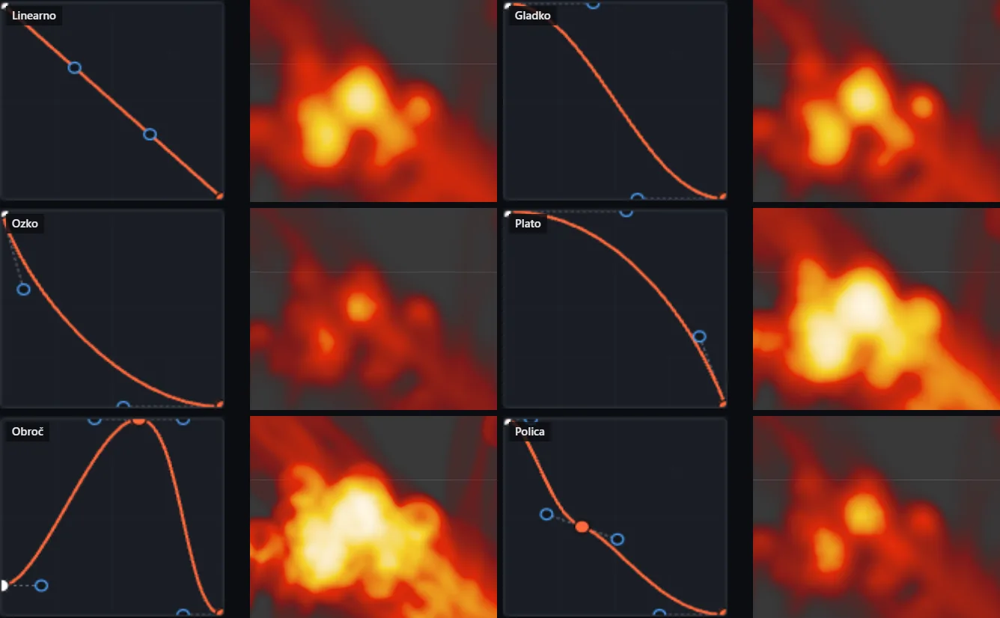

# Oblika sprajta

Vsaka vrstica je narisana kot okrogel sprajt, ki je vedno obrnjen proti kameri. Njegova velikost in profil od središča do roba – **profil** – odločata, ali je vroča točka videti kot ozka pika, mehak oblak, disk ali obroč. Te nastavitve so v razdelkih **Oblika toplote** in **Omejitve slikovnih pik sprajta** na stranski vrstici ter veljajo za [Toploto](heat.md), [Razliko](difference.md), [Toploto ekip](team-heat.md) in – kot polovični širina črte – za [Črtno toploto](line-heat.md).

Spreminjanje katere koli od njih ponovno zažene kopičenje (polje je treba narisati znova z novo obliko).

Vsako piko si predstavljajte kot mehak kepo svetlobe. Majhna kepa pokaže posamezne točke; velika kepa zlije sosede v oblak. Oblika določa, kako mehak je rob.



## Polmer sprajta {#sprite-radius}

Polmer sprajta v **enotah sveta** (označeno kot metri). Privzeto 6; vsakič ob nalaganju je vodoravni razpon podatkov / 120 – dovolj veliko, da se sosednji vzorci vzdolž poti zlijejo v pas in ne berejo kot tanka črta. Logaritemski drsnik sega od 0,05 do 2000, ročica pa do 50.000.


Stvari, ki so daleč, so videti manjše, zato se sprajt z razdaljo na zaslonu skrči. Pri vzporedni projekciji je povsod enak, kar je del razloga, zakaj je vzporedni pogled pravi za primerjavo vročih točk ([Kamera](camera.md#projection)).

## Omejitve slikovnih pik {#pixel-clamps}

**Omejitve slikovnih pik sprajta** (privzeto zaprto) omejijo polmer na zaslonu po zgornji pretvorbi.

| Nastavitev | Privzeto | Obseg (drsnik) | Zakaj |
|---|---|---|---|
| **Najm. polmer v pikah** | 1 px | 0–16 (512) | Oddaljeni podatki ne izginejo pod eno slikovno piko. |
| **Najv. polmer v pikah** | 96 px | 2–1024, logaritemsko (8192) | Zaščita pred prekrivanjem. Sprajt, ki pokriva N slikovnih pik, stane N operacij mešanja, zato je neomejen polmer blizu kamere tisto, kar hitri sličico spremeni v počasno. Nad višino vidnega polja ne omeji ničesar. |

**Enaka gostota pri vsaki povečavi** (v razdelku Oblika toplote, privzeto vklopljeno) deluje skupaj z omejitvami. Sprajt, ki ga omejitev naredi večjega (daleč) ali manjšega (od blizu), ohrani toploto, ki bi jo dodal pri svoji pravi velikosti; tako barva pomeni enako število vrstic na površino tal pri vsaki povečavi. Če je izklopljeno, omejen sprajt doda svojo polno težo pri omejeni velikosti, slika pa se spreminja, ko letite bliže.

## Jakost v središču in na robu {#centre-and-edge-intensity}

Toplota, ki jo sprajt doda na točnem središču (**Jakost v središču**, privzeto 1, 0–10, skok 1000), in na robu (**Jakost na robu**, privzeto 0, −2–10, skok 1000). Vrednost profila *t* (1 v središču, 0 na robu, oblikovana z upadanjem ali krivuljo spodaj) meša med njima (formula je pod [Za razvijalce](#for-developers)).

**Negativna jakost na robu** naredi, da rob odšteva, kar izreže hladno hajlo okoli vsake vroče točke in ostrejše loči skupine med seboj. Vidnost upošteva [zakrivanje](depth-and-culling.md) in [rezino](slice.md); zbledenje je [zbledenje življenjske dobe](timeline.md#history); predznak je ±1 pri [Razliki](difference.md).

## Oblika profila: Upadanje ali krivulja {#ramp-shape-falloff-or-curve}

**Oblika profila** preklaplja med dvema načinoma oblikovanja *t* čez sprajt. Naj bo *d* razdalja od središča (0) do roba (1):

### Upadanje {#falloff}

Prikazano, kadar je izbrano *Upadanje* (privzeto).

- **Upadanje** (privzeto 1,6, 0,1–8, skok 64): `t = (1 - d) ^ upadanje`. 1 je ravna linearna lestvica; višja vrednost potegne toploto proti središču in zoži vročo točko; pod 1 jo sploči v disk.
- **Gladko upadanje** (privzeto vklopljeno): na *t* uporabi krivuljo S (smoothstep), tako da sprajt na robu zbledi, namesto da se konča na vidnem robu.

### Urejevalnik krivulj {#the-curve-editor}

Prikazano, kadar je izbrana *Krivulja*. Dobesedni prerez sprajta: razdalja od središča čez (*središče* levo, *rob* desno), toplota navzgor. Krivulja je po delih kubični Bézier skozi nadzorne točke, vsaka z dvema ročicama.

| Dejanje | Učinek |
|---|---|
| Dvojni klik na graf | Doda točko na tej razdalji (ohranjeno med 0,02 in 0,98), na krivulji in z njenim naklonom tam, zato dodajanje ne spremeni ničesar, dokler je ne povlečete. |
| Povlek točke | Premakne jo. Višine ostanejo med 0 in 1. |
| Povlek majhnega kroga | Upogne odsek ob njem (premakne to ročico). |
| Alt-klik ali desni klik na točko | Odstrani jo. Krajišči ni mogoče odstraniti. |
| Gumb s predlogo | Zamenja krivuljo s predlogo. |

Krajišči sta fiksna v središču in na robu; njuno višino še vedno določite sami.

**Predloge** ([`curve.ts`](https://github.com/Holdi601/3DHeat/blob/main/src/state/curve.ts)):

| Predloga | Oblika | Uporaba |
|---|---|---|
| **Linearno** | Naravnost od 1 do 0 | Enako kot *Upadanje* 1 z izklopljenim *Gladkim upadanjem*. |
| **Gladko** | Krivulja S | Privzeta krivulja; to daje *Gladko upadanje* pri upadanju 1. |
| **Ozko** | Strm jedro, dolg moten rob | Redki podatki. |
| **Plato** | Ravno, nato hitro upadanje | Bere se kot disk, ne kot kepa. |
| **Obroč** | 0,15 v središču, 1 pri 62 % polmera, 0 na robu | Votel sprajt: pokaže, kje poti potekajo, ne kje se ustavijo. |
| **Polica** | Upadanje v dveh stopnjah, 0,45 pri 35 % | Ločuje gosto jedro od okolice. |

## Splošči na ravnino tal {#flatten-onto-ground-plane}

**Splošči na ravnino tal** (privzeto izklopljeno) prezre višino vsake vrstice in vso toploto nariše na eni višini – najnižji Y podatkov – klasična 2D toplotna karta zemljevida. Ko je vklopljeno, sta globinsko zakrivanje in *Skrij za terenom* izklopljena (vsaka točka bi ležala točno na površini, na kateri se preizkuša), razdelek Globina pa to tudi pove.

## Za razvijalce {#for-developers}

### Formule {#formulas}

Polmer na zaslonu v slikovnih pikah: `polmer × P[1][1] / w × višina vidnega polja / 2`, kjer je `P` matrika projekcije in `w` globina točke v pogledu.

Toplota, ki jo sprajt doda:

```
dodana toplota = mix(rob, središče, t) × utež vzorca × predznak × zbledenje × vidnost
```

### Krivulja {#the-curve}

Ročice so vodoravno omejene na svoj odsek, zato je krivulja vedno funkcija razdalje: če ročico povlečete daleč čez naslednjo točko, se sploši ob njej, namesto da bi krivulja zavila nazaj, kar bi naredilo rezultat odvisen od tega, kateri koren je reševalnik slučajno našel.

### Kako se krivulja riše {#how-the-curve-is-drawn}

Krivulja se ob vsaki spremembi vpeče v tabelo s 256 vnosi, naloži kot tekstura s plavajočo vejico 16 bitov in v vsakem fragmentu vzorči z linearnim filtriranjem ter polovičnim zamikom teksla, tako da ostaneta oba konca točna. Reševanje Béziera za x zahteva iteracijo, kar ne sodi v najbolj obremenjeni senčilnik programa, branje tabele pa je tudi cenejše od `pow()`, ki ga uporablja upadanje. 16 bitov namesto 8 zato, ker se 8 bitov pri tisočih sprajtih, ki se seštejejo, pokaže kot pasovi; 16-bitna polovična plavajoča vejica je filtrirljiva v osnovnem WebGL2, medtem ko 32-bitna potrebuje razširitev.
