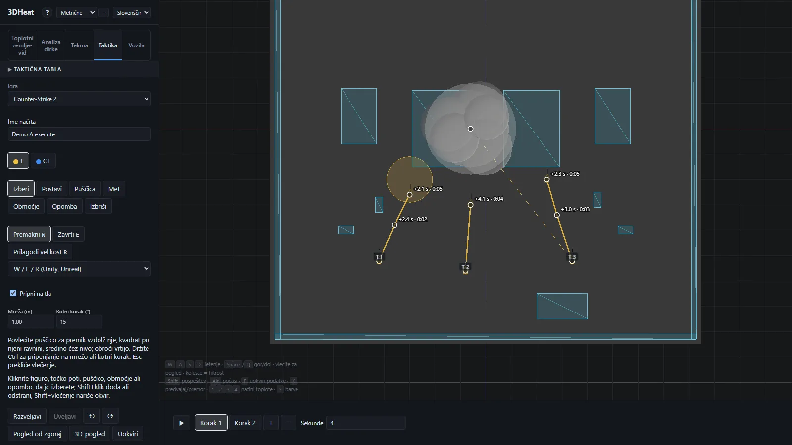

# Taktična tabla

Zavihek **Taktika** je tabla za risanje načrta ekipe: na zemljevid postavite majhne figure, narišete puščice, kamor gredo, in pritisnete predvajanje, da vidite, kako se to zgodi. Uporabite ga, da načrtujete krog ali napad, preden igrate. Deli platno, kamero in [nivo](levels.md) z drugimi zavihki in nič drugega; načrt ni podatek in ne riše toplote.

## Vaš prvi načrt {#your-first-plan}

1. Odprite zavihek **Taktika**. Izberite **Igro** (na primer Counter-Strike 2) in za Valorant pritisnite **Naloži zemljevide Valoranta** ter izberite **Zemljevid**. Lahko pa najprej naložite [nivo](levels.md).
2. Izberite **Stran** (določi barvo) in pritisnite **Pogled od zgoraj**.
3. Izberite **Mesto**, v **Figure** izberite figuro (s **Iskanje figur** jo najdete) in kliknite na zemljevid. Postavite dve ali tri.
4. Izberite **Puščica**, kliknite na figuro, kliknite vzdolž poti, po kateri naj gre, in pritisnite **Enter**, da končate puščico.
5. Pritisnite **+** pod pogledom, da dodate korak 2. Vsaka figura se začne tam, kjer je končala njena puščica. Tam narišite več puščic.
6. Pritisnite **▶** (ali `K`), da načrt predvajate od prikazanega koraka do konca.
7. V **Ime načrta** vpišite ime in pritisnite **Shrani**.

## Začetek načrta {#starting-a-plan}

| Kontrola | Kaj naredi |
|---|---|
| **Igra** | Izbere strani in figure, ki jih ponuja paleta: Counter-Strike 2 (T, CT; igralci in pomožna sredstva), Valorant (Napad, Obramba; igralci in splošne sposobnosti), Battlefield, Squad, Arma (pehota, kopenska vozila, letala, čolni), DCS / War Thunder / IL-2 (reaktivna letala, propelerska letala, helikopterji, protizračna obramba, tla, ladje, orožje) in Drugo. Načrt, ki že ima figure, obdrži svoje strani, ko se igra spremeni. |
| **Ime načrta** | Ime, pod katerim se načrt shrani. |
| **Zemljevid**, **Naloži zemljevide Valoranta** | Ko je izbran Valorant: **Naloži zemljevide Valoranta** pridobi seznam zemljevidov z [valorant-api.com](https://valorant-api.com); **Zemljevid** nato izbrani zemljevid minimapa postavi kot nivo, uokvirjen od zgoraj. Slika se prenese ob izbiri in se nikoli ne pošlje skupaj z aplikacijo. Obvestilo Riot je prikazano, dokler je na zaslonu (glejte spodaj). |
| **Stran** | Stran, ki ji pripada naslednja figura, puščica ali območje; prevzame barvo strani. |

Brez nivoja je tabla ravna tla. Naložite nivo pod **Nivo**, če želite načrtovati na pravem zemljevidu: zemljevid CS2, izvožen z orodjem za CS2, nivo iz knjižnice ali slika zemljevida.

## Orodja {#tools}

| Orodje | Klik | Opombe |
|---|---|---|
| **Izberi** | Figura, točka poti, puščica, območje ali opomba se izbere. | Shift+klik doda ali odstrani; Shift+vlečenje nariše okvir okoli tega, kar želite dodati. Izbrano dobi gizmo za preoblikovanje (glejte spodaj); `Delete` ali `Backspace` ga odstrani. `M` premakne izbrano figuro na naslednji klik. |
| **Mesto** | Postavi izbrano figuro. | Figura se izbere v paleti **Figure** (s **Iskanje figur**). Ko nič ni izbrano, `R` obrne naslednjo figuro za 15° preden se postavi (`Shift+R` v drugo smer). |
| **Puščica** | Vsak klik doda točko; Enter, dvojni klik ali desni klik jo konča, Esc jo zavrže. | **Premakni**, **Napad** (širša konica) ali **Opazovanje** (tanka črta na višini oči). Puščica, začeta na figuri, je pot te figure v tem koraku: pri predvajanju jo figura prehodi, naslednji korak pa se začne tam, kjer se je končala. |
| **Met** | Metalec, nato kam pade. | Prekinjen lok od enega do drugega in izbrano pomožno sredstvo (dim, bliskavica, molotov ...) se pojavi tam, kjer pade, in ostane od tega koraka naprej. |
| **Območje** | Središče, nato rob. | Krog v barvi strani. |
| **Opomba** | Kjer je opomba; vpraša za njeno besedilo. | Prikazana kot zatič, njeno besedilo nad njo. |
| **Izbriši** | Figura, puščica, območje ali opomba. | Odstrani jo od tega koraka naprej; na njenem prvem koraku jo odstrani. |

**Razveljavi** in **Uveljavi** (`Ctrl+Z`; `Ctrl+Y` ali `Ctrl+Shift+Z`) se premikata skozi vsako spremembo. Črta pod načrtom pokaže, koliko figur, puščic in korakov ima. **Pogled od zgoraj** gleda naravnost navzdol (ortografsko), **3D-pogled** se vrne v perspektivo, **Sličica** prilagodi načrt, ali nivo, kadar je načrt prazen.

**Velikost figur** spremeni vse figure na tabli; 1× je prava velikost, kar je od zgoraj za osebo nekaj pikslov.

## Premikanje, obračanje in spreminjanje velikosti {#moving-turning-and-scaling}

Vse na tabli se da premikati kot v 3D urejevalniku: figure, pomožna sredstva, oznake, posamezne točke poti in cele puščice, območja in opombe. Izbrano dobi gizmo na svoji sredini:

| Način | Tipke | Ročaji |
|---|---|---|
| **Premakni** | W (ali G) | Puščica za vsako os (X rdeča, Y zelena in navzgor, Z modra) se premika vzdolž nje; kvadrat se premika čez svojo ravnino; središče se premika po nivoju pod kazalcem. |
| **Zavrti** | E (ali R) | Obroč za vsako os se vrti okoli nje. Obroči ene figure so njen lasten zasuk, naklon in zvitek; skupina se vrti okoli osi sveta okoli svoje sredine. |
| **Prilagodi velikost** | R (ali S) | Razširi ali zbere izbrano od sredine vzdolž osi ali na vse strani; polmer območja raste z njim. |

**Tipke** preklapljajo med W / E / R (Unity, Unreal) in G / R / S (Blender); tipke izberejo način samo, ko je nekaj izbrano, sicer premikajo kamero. Tako `R` pomeni **Prilagodi velikost** pri tipkah W / E / R in **Zavrti** pri tipkah G / R / S, ko je nekaj izbrano, in obrne naslednjo figuro za postavitev, ko nič ni. Vse tipke table so navedene v [seznamu tipkovnice](keyboard-reference.md#tactics-board). Med vlečenjem držite **Ctrl**, da premik pripnete na **Mrežo** (metri) ali obračanje na **Korak kota**. **Pripni na tla** (privzeto vklopljeno) postavi premaknjene ljudi, vozila, oznake, točke poti in območja na površino nivoja; letala in helikopterji ohranijo svojo višino, vlečenje po puščici Y se nikoli ne pripne. Vlečenje ročaja nikoli ne premakne kamere. **Esc** prekine vlečenje, vsaka sprememba pa je en korak Razveljavi.

Točke poti so prikazane kot pike na puščicah prikazanega koraka: kliknite jo, da jo izberete, jo povlecite, da jo premaknete, Delete, da jo odstranite. Razdelek **Izbrane** prikaže mesto izbranega v metrih, zasuk, naklon in zvitek figure v stopinjah ter polmer območja, vse z možnostjo vpisa.

## Čas {#timing}

Pot figure je časovno določena: vsak odsek traja svojo dolžino po nivoju - vzorčeno po površini vsakih nekaj metrov, zato se šteje hrib ali stopnišče med dvema točkama - pri hitrosti njenega **načina** gibanja za to figuro v tej igri, plus morebiten **čakalni** čas pri točki poti. Pehota se plazi, počepne, hodi (tiho), teče ali sprinta; vozila in čolni se plazijo, gredo previdno, normalno ali hitro; letala in helikopterji letijo počasi, s potovalno hitrostjo, s hitrostjo v boju ali največjo. Način, ki ga igra nima (CS2 nima sprinta), vzame najbližjega, ki ga ima. Kako klanec upočasni, je odvisno od igre: v CS2 in Valorantu se šteje samo vodoravna razdalja, kot v igrah; vojaški simulatorji upočasnijo pehoto v klancu (Toblerjeva funkcija pohodništva) in vozila glede na naklon.

Hitrosti prihajajo iz tabel po igrah z viri (glejte [Hitrosti gibanja](tactics-speeds.md)): CS2 po orožju v rokah, iz definicij orožij igre; Valorant po orožju; Battlefield, Squad, Arma in zračne igre po tipu in razredu vozila. **Premika se kot** izbere profil figure (orožje, tip vozila); **Lastna (m/s)** prepiše kateri koli način za to figuro. Načini so poimenovani, kot jih prikaže tabla: *Plazenje*, *Počep*, *Hoja (tiho)*, *Tek*, *Sprint*; *Previdno*, *Normalno*, *Hitro*; *Počasi*, *Potovalno*, *Boj*, *Največ*.

Vsaka točka poti prikaže čas od zadnje in čas od začetka načrta („+3,9 s · 0:12”). Pot izbrane figure izpiše vsak odsek z njegovim načinom, dolžino in časom, čakanjem in prihodom. **Prihodi** pod **Čas** postavi vsako figuro s potjo na eno časovno os, prvi prihod na vrhu. Z **Predvajaj v realnem času** (privzeto vklopljeno) korak traja, dokler ne prispe njegova najpočasnejša pot, in vsaka figura se premika s svojo hitrostjo; **Sekunde** je potem najkrajša dolžina koraka. **Enot nivoja na meter** pove, kaj nivo je: 39,37 za zemljevide CS2 (enote igre), 1 za zemljevide v metrih.

## Primerjava s podatki tekem {#compare-with-match-data}

**Naloži datoteke tekem…** prebere tabele tekem CS2 za zemljevid (datoteke Parquet orodja CS2, kolikor jih želite; samo potrebni stolpci, v ozadju); **Uporabi naložene podatke** vzame podatke, naložene v pregledovalniku. Nato:

- **Najzgodnejši prihod na zemljevidu** pobarva zemljevid glede na čas od začetka runde, ko je igralec prvič prišel na vsako mesto - gumb **Najhitrejši** pokaže najhitrejšega čez vse runde, **Tipičen (mediana)** srednjo rundo - od zelene zgodaj do rdeče pozno, za eno stran ali obe. Pokaže, kaj je mogoče kdaj.
- Izbrana pot se primerja s tem, kar so igralci dosegli od njenega začetka (ali od začetka runde) do njenega konca, vsak konec je krog z nastavljenim polmerom: „Najhitrejše opaženo 14,2 s, p10 15,0 s, mediana 18,3 s v 41 tekih; vaš načrt 15,1 s”.
- Hitrosti, s katerimi so se igralci dejansko premikali - tek, hoja, počep, iz stolpcev hoje in počepa v tabelah - v m/s.

## Koraki {#steps}

Vrstica pod pogledom vsebuje korake. Načrt se začne z enim; **+** doda enega, in vsaka figura se v njem začne tam, kjer je končala pot v zadnjem koraku; **−** odstrani prikazanega. **Sekunde** so, koliko časa traja prikazani korak pri predvajanju. **▶** (K) predvaja od prikazanega koraka do konca: figure s potjo jo prehodijo, figure, premaknjene na novo mesto v naslednjem koraku, zdrsnejo tja, ostale stojijo. Ko je prikazan korak, je mesto vsake figure v naslednjem koraku narisano kot bled duh, puščice zadnjega koraka pa se bledo vidijo pod tem.

## Shranjevanje {#saving}

Razdelek **Datoteka** vsebuje **Shrani**, **Odpri** in **Počisti**. **Shrani** zapiše načrt kot `<ime>.h3dplan.json` (navaden JSON: strani, koraki, figure z mestom na korak, puščice, območja, opombe); **Odpri** ga prebere nazaj. Datoteka druge različice ali tista, ki ni načrt, je zavrnjena z razlogom. **Počisti** izprazni načrt; Razveljavi ga vrne.

## Figure {#figures}

Vsako figuro zgradi sam pregledovalnik: preproste oblike na objavljeno velikost tipa, z značilnostmi, ki jo ločijo od sosedov - tankovske gosenice in stolp, topovi, rakete in radarji protizračnega vozila, tloris kril letala, rep in motorji, rotorji in kratka krilca helikopterja. Nič ni vzeto iz igre. Zasnova, ki jo je izumila igra, je prikazana kot splošna figura svojega razreda. Glejte [Figure](figures.md#which-figure-a-unit-gets), kako podatki najdejo svojo figuro.

## Obvestilo Riot {#riots-notice}

Zemljevidi Valoranta so prikazani po politiki Riot Games „Legal Jibber Jabber”, ki dovoljuje brezplačnim skupnostnim projektom njihovo uporabo in zahteva to obvestilo, kjer se pojavijo: *3DHeat je bil ustvarjen po politiki Riot Games „Legal Jibber Jabber” z uporabo sredstev, ki jih ima Riot Games. Riot Games tega projekta ne podpira in ni njegov sponzor.* Sposobnosti na tabli so splošne oblike, ne umetnina Riot.
