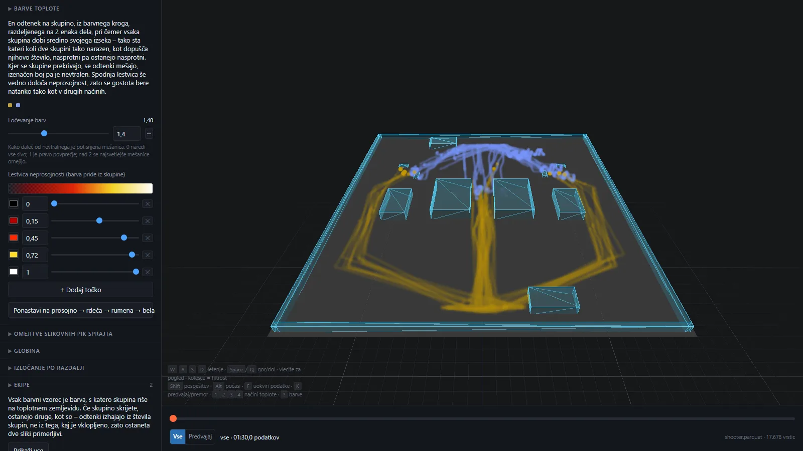

# Toplota ekip

Toplota ekip pokaže, kje je bila vsaka ekipa, vsaka ekipa v svoji barvi. Kjer se ekipe prekrivajo, se barve mešajo.

**Toplota ekip** (tipka 3) je polje gostote iz [Toplote](heat.md), pri čemer ima vsaka [skupina](glossary.md) svoj odtenek. Kjer se skupine prekrivajo, se njihovi odtenki mešajo; enakovreden spopad je nevtralen. Prosojnost še vedno nosi gostoto natanko kot v drugih načinih, zato slika hkrati odgovarja na *koliko* in *čigava*. Potrebuje stolpec skupine.

Ni [prekrivanje figur](box-replay.md): to nariše eno figuro na osebo; to je polje toplote, obarvano s istim stolpcem.

## Kako uporabljati {#how-to-use-it}

1. Pritisnite `3` (ali izberite **Toplota ekip** v vrstici načinov).
2. Odprite **Barve toplote**. Vzorci kažejo barvo vsake skupine; za ime ekipe se postavite na vzorec.
3. Če vse izgleda sivo, povečajte **Ločevanje barv**.
4. Odkljukajte skupino v [Seznamu ekip](teams-list.md), da jo odstranite; druge barve ostanejo tam, kjer so bile.

## Kontrole {#controls}

V razdelku **Barve toplote**:

| Kontrola | Privzeto | Pomen |
|---|---|---|
| Vzorci | | Barva vsake skupine, za prvih 12 skupin, nato *+N več*. Ob postavitvi se prikaže ime skupine in barva. |
| **Ločevanje barv** | 1,4 | Kako daleč je mešanica potisnjena od nevtralne, 0-4. 0 vse naredi sivo; 1 je pravo povprečje; nad približno 2 najsvetlejše mešanice zapustijo prikazljivo območje in se na kanal omejijo, kar premakne njihov odtenek. |
| **Lestvica neprosojnosti (barva pride iz skupine)** | privzeta lestvica toplote | Tu se uporabi le **alfa** lestvice: prosojno tam, kjer ni ničesar, neprosojno na vrhu. Njene barve se prezrejo. |

Vse druge kontrole toplote - oblika, nasičenje, odziv, najmanjša toplota, globina, izrezovanje - delujejo kot v [Toploti](heat.md).

[Ekipe](teams-list.md) v tem načinu pokaže barvo toplote ekipe kot njen vzorec. Skrivanje skupine pusti barve vseh drugih skupin tam, kjer so bile: odtenki prihajajo iz skupnega števila skupin, ne iz tega, kar je vklopljeno, zato ostanejo slike primerljive.

## Paleta {#the-palette}

Iz [`colors.ts`](https://github.com/Holdi601/3DHeat/blob/main/src/render/colors.ts):

- Barve žive na ravnini barvnega prostora **Oklab** pri fiksni svetlosti (0,7) in kromi (0,115), zato je vsaka skupina enako svetla in rdeča skupina ni videti bolj vroča kot modra.
- Pri *n* skupinah se barvni krog razdeli na *n* enakih delov, skupina *i* pa dobi **središče** svojega dela, `(i + 0,5) / n` obrata. Katerikoli dve skupini sta tako oddaljeni, kot dovoli število, in nasprotja ostanejo nasprotja ne glede na število.
- Uporabljenih je največ **16** različnih odtenkov. Pri več skupinah se ID-ji razporedijo s ponavljajočim se deljenjem (ID-ji z obrnjenimi biti: 0, ½, ¼, ¾, ⅛, …), da sosednji ID-ji ne delijo odtenka; skupine nad 16 nujno delijo.
- Skupina, katere oznaka pomeni »brez skupine« - `0`, prazno, `none`, `unknown`, `null` ali `-1`, ne glede na velikost črk - se nariše **nevtralno sivo** namesto da bi dobila kos kroga. Tako obravnavana je le prva taka oznaka v seznamu skupin.

Privzeta ločitev je 1,4 in ne 1, ker pri 1 je mešanica petih enakomerno razporejenih odtenkov *siva*: pravilno in nečitljivo. Malo nad 1 ohrani neodločene primere poštene, hkrati pa naredi delitev 60/40 vidno.

## Kako deluje {#how-it-works}

Tarča toplote ima v tem načinu štiri kanale. Vsak sprajt prišteje svojo gostoto *v* prvemu kanalu in *v* × koordinati Oklab *a* in *b* skupine drugemu in tretjemu. Ob sestavljanju je mešanica točke utežena povprečje gostote: *a* = G / R, *b* = B / R, pomnoženo z ločevanjem barv in pretvorjeno v sRGB pri svetlosti palete. Deljenje s kopičeno gostoto ohrani odtenek neodvisen od količine podatkov, zato vsaka kontrola gostote še vedno deluje le na prosojnost.

Štirikanalna tarča stane štirikrat toliko pomnilnika GPU kot enokanalna toplotna tarča pri isti ločljivosti.
