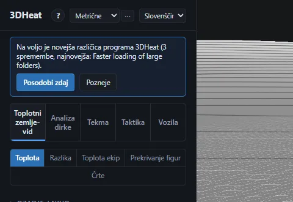

# Posodobitve

Pregledovalnik vam sporoči, kadar obstaja novejša različica, in se posodobi sam, samo če to potrdite. Na vašem računalniku se nič ne spremeni brez vašega odgovora.

## Posodobitev pregledovalnika {#update-the-viewer}

1. **Na strani.** Ko obstaja novejša različica, se pod imenom na vrhu stranske vrstice pojavi okvir: „Na voljo je novejša različica 3DHeat”. Kliknite **Posodobi zdaj**. Stran se ob koncu sama ponovno naloži. **Pozneje** skrije okvir, dokler stran ne naložite znova.
2. **Če piše, naj zaženete restart.bat**, zaprite okno strežnika (črno okno, ki ga je odprl `start.bat`) in dvakrat kliknite `restart.bat`.
3. **Ob zagonu pregledovalnika.** Preveri tudi `start.bat`. Če obstaja novejša različica, vpraša **Posodobim zdaj? [Y/N]**. Pritisnite `Y`, da posodobite. Pritisnite `N` ali pa 60 sekund ne odgovorite, da zaženete različico, ki jo imate.



Kopija s spremembami, ki ste jih naredili sami, se zanjo nikoli ne posodobi; okvir vam samo sporoči, da čaka posodobitev, in pove, naj potrdite ali shranite svoje spremembe in zaženete `git pull`. Kopija, ki ni bila nameščena z gitom (na primer datoteka zip), ne prikaže ničesar.

Kako preverjanje poteka, korak za korakom:

```
page ---(after 4 s, then every 6 h)---> dev server ---> git fetch
   behind?  no  -> nothing is shown
            yes -> your own changes or commits?  yes -> tell you only
                                                 no  -> [Update now] -> git pull
                                                        -> reload, or "run restart.bat"
```

## Varnostna pravila {#the-safety-rules}

- **Samo hitro naprej** (`git pull --ff-only`): posodobitev nikoli ne združi, ne prepiše in ne prepisuje ničesar.
- **Brez lokalnih sprememb**: kopija z nepotrjenimi spremembami na sledenih datotekah (`git status --porcelain --untracked-files=no` ni prazen) se nikoli ne posodobi samodejno - tuje delo ni nič, kar bi posodobitev smela prepisati. Obvesti se samo, da čaka posodobitev. Nesledene datoteke (podatki, izvozi) se ne štejejo kot spremembe.
- **Brez lokalnih potrditev**: kopija s potrditvami, ki jih nadrejeni vir nima (»divergirana«), se ne posodobi - hitro naprej je ne more dvigniti, združevanje pa je za `git pull` ročno. Stran in `start.bat` to povesta z enakimi besedami, `start.bat` pa zažene različico, ki je tam.
- **Samo iz same strani**: zahteva za posodobitev na razvojnem strežniku mora nositi posebno glavo in, kadar brskalnik pošlje `Origin`, prihajati z gostitelja strežnika (spodaj).
- Posodobi se samo kopija gita z nadrejeno vejo; vse drugo (kopija brez `.git`, git ni nameščen, statična gradnja) pusti pri miru in ne pove ničesar.

## Kaj počne start.bat {#what-startbat-does}

`start.bat` (dvakrat kliknite nanj; okno je strežnik) naredi po vrsti:

1. Poišče Node.js - v `PATH`, sicer v `%ProgramFiles%\nodejs`, `%ProgramFiles(x86)%\nodejs` ali `%LOCALAPPDATA%\Programs\nodejs` - in ponudi namestitev z `winget install -e --id OpenJS.NodeJS.LTS`, kadar manjka (vpraša, Y/N; potem je treba okno ponovno odpreti, da Windows prebere novi `PATH`).
2. **Posodobitve**, kadar je git nameščen in mapa vsebuje `.git`:
   - `git fetch --quiet` (brez omrežja ali nadrejene veje: tiho preskočeno);
   - prešteje `git rev-list --count HEAD..@{u}`; ni zaostanka: nič ne pove;
   - lokalne spremembe: „Na voljo je novejša različica 3DHeat (N sprememb), vendar ta kopija ima lokalne spremembe, zato se ne posodobi. Potrdite ali shranite jih, nato zaženite git pull.” - in zažene različico, ki je tam;
   - lastne potrditve (`git rev-list --count @{u}..HEAD` ni 0): „Na voljo je novejša različica 3DHeat (N sprememb), vendar ta kopija ima lastne potrditve, ki jih najnovejša različica nima, zato se ne posodobi. Posodobite jo z git pull.” - in zažene različico, ki je tam;
   - sicer „Na voljo je novejša različica 3DHeat (N sprememb).” in vprašanje **Posodobim zdaj? [Y/N]**. `N` ali brez odgovora 60 sekund izpiše „Ni posodobljeno; zaganjam različico, ki jo imate.” in zažene različico, ki je tam. Ob `Y`: „Posodabljam...”, pove, ali se spremenita `package.json` ali `package-lock.json`, zažene `git pull --ff-only` (če to še vedno ne uspe - na primer zaradi omrežja: „Posodobitev ni uspela; zaganjam različico, ki jo imate.”), nato `git submodule update --init` (pripeti orodji, glejte [Vzdrževanje dokumentacije](maintaining.md#the-tools-under-exporters)), nato `npm install`, kadar so se datoteke paketa spremenile in obstaja `node_modules`, ter „Posodobljeno.”
3. Zavrne zagon drugega strežnika: kadar nekaj že posluša na vratih **5273**, to pove in napoti na `restart.bat` / `stop.bat`.
4. Ob prvem zagonu (ni `node_modules`) vpraša, preden prenese odvisnosti (približno 300 MB v `node_modules\`, nič po sistemu).
5. Zažene razvojni strežnik na `127.0.0.1:5273` (`--strictPort`) in ko je pripravljen, odpre brskalnik.

`restart.bat` ustavi strežnik (po vratih) in znova zažene `start.bat`, zato zastavi isto vprašanje. `stop.bat` samo ustavi.


## Za razvijalce {#for-developers}

### Med delovanjem: pot za posodobitev {#while-it-runs-the-update-route}

Razvojni strežnik (vtičnik Vite `heat3d-self-update` v `vite.config.ts`) streže `/__heat3d/update`. Obstaja samo na razvojnem strežniku - ne v statični gradnji in ne v `vite preview`.

**`GET /__heat3d/update`** odgovori, ali je kopija zaostajala:

```json
{ "checkout": true, "upstream": "origin/main", "behind": 3, "ahead": 0, "dirty": false, "latest": "the newest commit's subject" }
```

- `checkout: false`, kadar mapa ni kopija gita;
- zažene `git fetch --quiet` **največ vsakih 30 minut** (vprašanja vmes odgovorijo iz zadnjega prenosa);
- `behind` / `ahead` iz `git rev-list --count HEAD..@{u}` / `@{u}..HEAD`, `dirty` iz `git status --porcelain --untracked-files=no`, `latest` predmet najnovejše potrditve nadrejene veje;
- brez nadrejene veje: `upstream: null` in `behind: 0`.

**`POST /__heat3d/update/apply`** posodobi kopijo:

1. Zavrnjeno z `403 { ok: false, reason: "forbidden" }`, razen če zahteva nosi glavo `X-Heat3d-Update: 1` in, kadar nosi `Origin`, je gostitelj tega izvora enak `Host` zahteve. Obrazec iz tuje strani ne more poslati posebne glave brez predhodne preverbe CORS, ki je ta strežnik nikoli ne dovoli.
2. Ni kaj narediti (ni kopija, ni nadrejene veje, ni zaostanka): `{ ok: true, updated: false }`.
3. Lokalne spremembe: `{ ok: false, reason: "dirty" }`; lokalne potrditve: `{ ok: false, reason: "diverged" }`.
4. Sicer: pove, katere datoteke se spremenijo (`git diff --name-only HEAD @{u}`), izvede `git pull --ff-only` (časovna omejitev 2 min), `git submodule update --init` (napaka se prezre), `npm install`, kadar se spremenita `package.json` ali `package-lock.json` (časovna omejitev 15 min), in odgovori `{ ok: true, updated: true, restart }` - `restart` pove, zakaj tekoči strežnik posodobitve ne more prevzeti: `"dependencies"`, kadar so bile odvisnosti znova nameščene, `"config"`, kadar se je spremenila samo datoteka `vite.config`, `false`, kadar ponovni zagon ni potreben.
5. Neuspešen ukaz git ali npm odgovori `{ ok: false, reason: "<napaka, največ 300 znakov>" }`.

Odgovori so JSON s `Cache-Control: no-store`. Strežnik posluša samo na `127.0.0.1`, zato pot ni dosegljiva iz omrežja.

### Obvestilo na strani {#the-notice-in-the-page}

`UpdateBanner`, pod imenom na vrhu stranske vrstice:

- Pot sprašuje **4 sekunde** po nalaganju strani (ne v prvih sekundah: stran mora naložiti nabor podatkov in zagnati GPU) in nato znova **vsakih 6 ur**, dokler je stran odprta.
- Ne prikaže **ničesar**, kadar poti ni (statična gradnja), mapa ni kopija gita ali ni ničesar novejšega - obvestilo ob vsakem zagonu bi se ga ljudje navadili ne upoštevati.
- Zaostaja, brez lokalnih sprememb: „Na voljo je novejša različica 3DHeat (N sprememb, najnovejša: <predmet>).” z gumboma **Posodobi zdaj** in **Pozneje** (*Pozneje* skrije okvir do ponovnega nalaganja strani).
- Zaostaja, z lokalnimi spremembami: isti stavek in „Ta kopija ima lokalne spremembe, zato se ne posodobi samodejno; potrdite ali shranite jih, nato zaženite git pull.” - brez gumba.
- **Posodobi zdaj** pošlje zahtevo na `/apply` („Posodabljam...”). Nato:
  - „Posodobljeno. Stran se ponovno naloži.” - in se ponovno naloži 1,5 s pozneje (strežnik že streže nove datoteke);
  - ko so bile odvisnosti znova nameščene: „Posodobljeno. Njene odvisnosti so se spremenile: zaprite okno strežnika in zaženite **restart.bat**, da dokončate.”;
  - ko so se spremenile samo nastavitve strežnika: „Posodobljeno. Nastavitve strežnika so se spremenile: zaprite okno strežnika in zaženite **restart.bat**, da dokončate.”;
  - na koncu ni ničesar za prenos (`updated: false` - kopijo je medtem posodobil na primer `start.bat`): „Ni česa posodobiti: ta kopija je že najnovejša različica.” - in brez ponovnega nalaganja;
  - zavrnjeno: stavek o *spremembah*, ali „Ta kopija ima lastne potrditve, ki jih najnovejša različica nima; posodobite jo z git pull.”, ali „Posodobitev ni uspela: <razlog>”.
