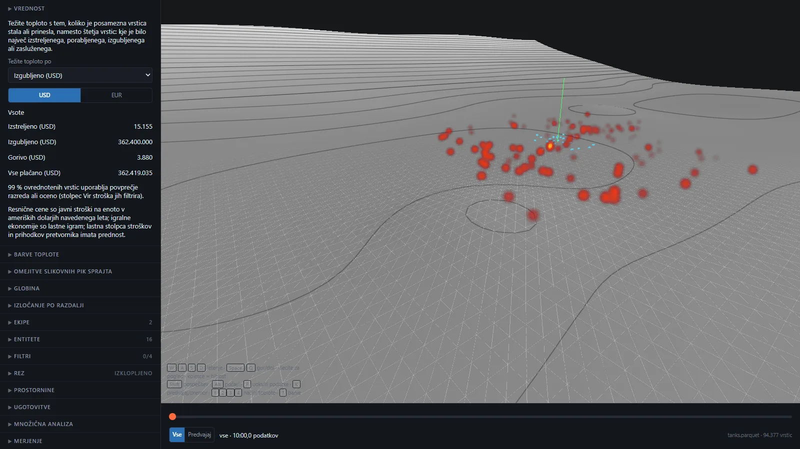

# Težitev vrednosti

Vsak strel, strelivo, izgubljeno vozilo in liter goriva ima ceno. Pregledovalnik izračuna, koliko je vsaka vrstica stala ali prinesla, in po tem lahko teži toploto, zato zemljevid pokaže **kam je šel denar**, namesto kje so vrstice.

## Kako uporabiti {#how-to-use-it}

1. Naložite podatke z dogodki (streli, zadetki, smrti) in imeni vozil ali orožij.
2. V stranski vrstici Toplote odprite **Vrednost**.
3. Izberite **Težite toploto po**, na primer *Izgubljeno (USD)*. Toplota zdaj prišteje ceno vsake vrstice namesto 1.
4. Preberite **Vsote**: vsota vsakega stolpca vrednosti za to, kar je prikazano (veljajo filtri in časovno okno).
5. Kjer so cene pravi denar, se prikaže preklop **USD / EUR**.

Izberite prazen prvi vnos v meniju, da ponovno štejete vrstice.

## Kaj se lahko tehta {#what-can-be-weighed}

Stolpci vrednosti se dodajo ob nalaganju, po enega za vsako vrsto in valuto:

| Vrsta | Vrstice, na katere pade | Kako se določi cena |
|---|---|---|
| **Izstreljeno** | streli in izstrelitve | orožje, sicer povprečje za vrsto streliva |
| **Porabljeno** | nakupi, pojavitve | denarni stolpci igre (na primer nakupni meni streljačine) |
| **Izgubljeno** | smrti, uničenja | lastno vozilo, sicer povprečje njegovega razreda |
| **Uničeno** | ubojstva | ciljno vozilo |
| **Povzročena škoda** | zadetki | delež vrednosti cilja |
| **Gorivo** | položaji | porabljeno gorivo, iz stolpca goriva ali ocenjeno iz razreda in časa |
| **Vse plačano** | | izstreljeno + porabljeno + izgubljeno + gorivo |
| **Zasluženo** | nagrade | lastni stolpci nagrad igre (`earn_…`) |
| **Neto** | | zasluženo minus plačano; riše se kot predznačena toplota (pozitivna lestvica, kjer je bilo zasluženo več, negativna, kjer je bilo plačano več) |

Imena stolpcev so `cost_<vrsta>_<valuta>`, `earn_<valuta>` in `net_<valuta>`. Pretvornik, ki pozna valuto same igre (na primer pretvornik posnetkov, ki zapisuje v kreditih igre), ima prednost pred vgrajenimi cenovniki.

## Cenovniki {#the-price-tables}

| Cenovnik | Valuta |
|---|---|
| Resnična vojska: rakete, bombe, streli, protiukrepi, letala, helikopterji, kopenska vozila, ladje, gorivo | USD (EUR = USD × 0,92, fiksni `EUR_PER_USD` v [`cost.ts`](https://github.com/Holdi601/3DHeat/blob/main/src/data/cost.ts); ni tečaj v živo) |
| Nakupni meniji streljačin in nagrade za ubojstva | krediti igre |
| Igre s tanki in ladjami | krediti igre |
| Strateške igre (več virov) | en stolpec na vir plus skupni stolpec |
| Vojne igre | točke |

Igra se prepozna po imenih v podatkih. Cene v resničnem denarju prihajajo iz javnih virov (proračunski dokumenti, enciklopedije) ali so označene kot ocene; niso prilagojene inflaciji. Samodejno ustvarjen seznam cenovnikov je na [Tabele vrednosti](ref-value-tables.md).

## Ocene {#estimates}

Dodatni kategorijski stolpec **Vir cene** pove, kako je bila vsaka vrstica ocenjena: `table`, `class average`, `estimate` ali `none`. Razdelek Vrednost pokaže, kateri delež ocenjenih vrstic je povprečje ali ocena. Če želite ohraniti samo natančno ocenjene vrstice, v **Vir cene** pod [Filtri](filters.md) odznačite *estimate* in *class average*.

## Kje drugje se vidi vrednost {#where-else-value-shows}

- [Vpogledi](insights.md): ugotovitve *Drago kopno* in *Zaslužno kopno*.
- [Razčlenitev](breakdown.md): zaslužen, izgubljen in neto denar po ekipi, igralcu ali orožju.
- [Volumni in primerjava](volumes.md): stolpci vrednosti v statistiki in primerjavi.
