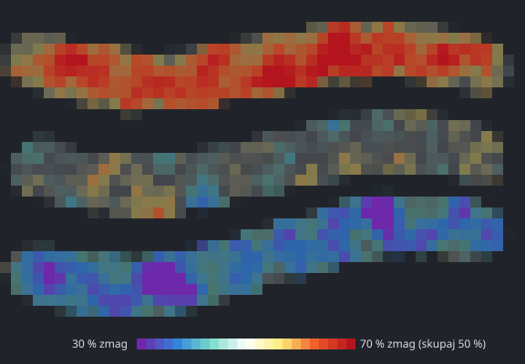

# Delež zmag: kako pogosto zmaga mesto, pot ali poteza

Kje igralec stoji, v katero smer gre, kam vrže granate in druge pripomočke - in kako pogosto njegova stran nato zmaga krog. **Zemljevid deleža zmag** obarva vsako mesto po deležu vrstic tam, ki spadajo h krogom, ki jih je stran vrstice zmagala, v primerjavi z deležem v vsem prikazanem: toplo, kjer je višji, hladno, kjer je nižji, nič, kjer je enak.

*Slika kaže izmišljene podatke: tri poti na prazni ravni, 68 %, 50 % in 33 % njihovih vrstic v zmaganih krogih.*

Potrebuje podatke, ki povedo, kdo je zmagal: [stolpce izida](data-formats.md#outcome-columns) (`won`, `matchWon`, `roundEndReason`). Pišejo jih pretvorniki za CS2 in War Thunder, pretvornik Tacview pa za kampanje strežnika DCS ([Strežniki DCS](tacview-acmi.md#dcs-servers-who-won-and-how-each-sortie-ended)); ima jih lahko katera koli datoteka.

## Preizkusite {#try-it}

1. Naložite tekme s stolpcem izida in pritisnite `2` (**Razlika**).
2. V **Delitev razlike** pritisnite **Delež zmag po krogih** (ali **Delež zmag po tekmah**). Zmagane kroge postavi na **+**, izgubljene na **−** in preklopi ploščo na **Delež +**.
3. Preberite barve. Plošča pove skupni delež: *Skupaj je 52,0 % od 1.200.000 vrstic na +.*
4. Zožite z [filtri](filters.md): ena stran (T ali CT), en tip dogodka (*Položaj* za to, kje so ljudje stali, *Strel* ali *Izstrelitev (raketa, izstrelek, bomba)* za to, od kod so streljali ali metali), en nakup, en zemljevid.

Mesto, ki je toplo z vrsticami *Položaj*, je mesto, katerega branilci so krog večinoma zmagali. Z vrsticami *Uničenje* je to mesto, kjer so uboji, ki so se tam zgodili, vodili do zmaganih krogov.

## Nastavitve {#the-settings}

| Nastavitev | Kaj naredi | Privzeto |
|---|---|---|
| **Razlika** / **Delež +** | sama razlika ali delež strani + med vrsticami obeh strani | Razlika |
| **Polna barva pri** | koliko nad ali pod skupnim deležem se mesto pokaže v polni barvi, v odstotnih točkah | ± 20 točk |
| **Najmanj vrstic za obarvanje mesta** | mesto z manj vrsticami ni obarvano; postopoma se pojavi od polovice te vrednosti | 12 |
| **Vleka k skupnemu deležu (vrstice)** | vsako mesto začne s toliko vrsticami na skupnem deležu, zato mesto s 3 vrsticami, vsemi zmaganimi, ni prikazano kot 100 % | 12 |

Vse tri delujejo na končano sliko: premikanje nikoli ne začne zbiranja znova.

Delež je lahko od katere koli delitve, ne le od zmag: *Delež +* z delitvijo po strani pokaže, kje so bili Ts večji del prisotnosti, z delitvijo po datotekah dveh zemljevidov pa, kje vrstice ene datoteke prevladajo nad vrsticami druge.

## Vrstice, ne krogi {#rows-not-rounds}

Zemljevid šteje vrstice. Igralec, ki dvajset sekund stoji na enem mestu, doda vrstico pri vsakem vzorcu, vse iz enega kroga, zato so dokaz na mestu vrstice blizu njega, ne krogi. Zato sta najmanjše število in vleka v vrsticah in zato sta večja od tega, kar da en krog.

Za same kroge:

- **[Razčlenitev](breakdown.md)** na mestu, pogledu ali prostornini: *Zmage %* šteje krog vsakega igralca enkrat, z enako vleko k skupnemu deležu mesta (4 krogi).
- Statistika **[Prostornin](volumes.md)**: *Delež zmag* - krogi z igralcem v prostornini, vsak enkrat, z vleko k deležu v vsem prikazanem, skupaj s števili.

## Filtri izida {#outcome-filters}

Plošča [Filtri](filters.md) navede stolpce izida takoj za lastnimi stolpci pregledovalnika: **Izid kroga** in **Izid tekme** (*Katerikoli*, *Zmaga*, *Poraz*) ter **Kako se je krog končal** (Izločitev, Bomba je eksplodirala, Bomba je razorožena, Čas je potekel, Predaja, Neodločeno, Cilj, Zadržane cone, Izgubljene vstopnice, Izgubljena vsa vozila), v jeziku pregledovalnika.

## Za razvijalce {#for-developers}

Prehod toplote zapiše tri vsote v štirikanalni cilj, ki ga uporablja toplota ekip: toploto `R = Σ|v|`, toploto strani + `P` in `S = Σ v²/w`, kjer je `w` utež prehoda (utež vzorčenja krat ojačitev sličice). Sestavljanje prebere delež `P/R` (povprečje, uteženo z jedrom) in število vrstic, na katerih sloni, `n = R²/S` (Kishova efektivna velikost vzorca), potegne delež k skupnemu, `p = (n·P/R + m·r0)/(n + m)`, in obarva `p - r0` čez razpon na rampah razlike.

`n` izloči vsak faktor, skupen vrsticam v slikovni točki - ojačitev sličice, utež vzorčenja, utež površine obrezanega sprita - zato je slika enaka pri vsaki povečavi in gostoti vzorčenja, sličice iz vsake k-te vrstice pa se združijo v celoto brez skokov barv. Skupni delež pride iz števil strani na CPU, na desetinko odstotka natančno; z GPU se nič ne bere nazaj. Računanje in njegova preverjanja: [`render/rateMap.ts`](https://github.com/Holdi601/3DHeat/blob/main/src/render/rateMap.ts) in njegov test.

Stane toliko kot toplota ekip: štirikanalni cilj početveri pasovno širino mešanja v prehodu toplote, le dokler je vklopljen *Delež +*.
