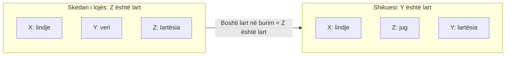

# Boshtet, njësitë dhe koha

Lojërat dhe hartat nuk pajtohen se nga ana është lart, sa e gjatë është një njësi, apo si shkruhet koha. Kjo faqe tregon tri cilësimet që e bëjnë të dhënat tuaja të qëndrojnë, të shkallëzohen dhe të luhen në mënyrën e duhur.

Nëse harta jote qëndron si mur në vend që të shtrihet si dysheme, ndërro **Boshti lart në burim**.

Me **Boshtin lart në burim** të gabuar harta qëndron si mur; me të saktin shtrihet si dysheme.

## Bota ku vizaton shikuesi {#the-world-the-viewer-draws-in}

Bota e shikuesit është **Y-lart**: X dhe Z janë rrafshi i tokës, Y është lartësia. Shumica e motorëve të lojërave janë **Z-lart**: për ta X dhe Y janë toka dhe Z është lartësia. Disa motorë janë edhe të pasqyruar (dorë e majtë). Hartëzimi tregon si të kthehen boshtet e skedarit në ato të shikuesit. (Teknikisht shikuesi është dorë e djathtë, konventa e three.js.)

### Boshti lart {#up-axis}

**Boshti lart në burim** te [Përcaktimi i kolonave](column-mapping.md):

| Cilësimi | Skedari (x, y, z) bëhet bota (X, Y, Z) |
|---|---|
| *Z është lart (shumica e motorëve të lojërave)* - parazgjedhja | (x, **z**, **y**): Z-ja e skedarit bëhet lartësi dhe Y-ja e skedarit bëhet Z-ja e botës |
| *Y është lart (konventa e grafikës)* | (x, y, z) pa ndryshim |

Për të dhënat Z-lart, tre vargjet riemërtohen në vend që të kopjohen ([`remapAxesInPlace`](https://github.com/Holdi601/3DHeat/blob/main/src/data/ingest.ts)), gjë që kursen qindra megabajt te ngarkimet e mëdha. Supozimi bëhet nga mostra: kolona Y ose Z që ka shpërndarjen më të vogël është lart.

### Kthesat {#flips}

**Kthe X**, **Kthe Y**, **Kthe Z** e kundërvënë boshtin e *skedarit* me atë emër, para riemërtimit — kështu që me Z-lart, *Kthe Y* e kundërvë atë që përfundon si Z e botës. Një kthesë e ndryshon të dhënën e ngarkuar: koordinatat që shfaq [vizorja](measure.md), prerja dhe pozicioni i kamerës janë ato të kthyera.

Për të vizatuar një botë të pasqyruar në drejtimin e duhur **pa e ndryshuar** të dhënën, përdor në vend të kësaj **Kamera & skena → Invert world axis** ([Kamera](camera.md#invert-world-axis)). Ky është zgjedhja më e mirë për lojërat me botë me dorë të majtë, sepse çdo koordinatë që shfaqin veglat mbetet e lojës vetë.

### Shkalla e njësive {#unit-scale}

**Shkalla e njësive** shumëzon çdo pozicion. *1 (m)* vendos 1, *0,01 (cm→m)* vendos 0,01 (njësitë e Unreal Engine janë centimetra, prandaj përdor 0,01; njësitë e motorit Source janë inç, prandaj përdor 0,0254; asnjëri nuk është metër), dhe kutia pranon çdo vlerë. Një 0 i shkruar ose një vlerë që nuk është numër zëvendësohet me 1.

Shikuesi i etikheton distancat në metra (rrezja e sprite-it, distancat e heqjes, vizorja, shpejtësia e fluturimit), gjë që është e vërtetë vetëm kur njësia e shkallëzuar e botës është metër. Asgjë nuk prishet kur nuk është; etiketat thjesht thonë "m" për çfarëdo qoftë njësia.

## Koha {#time}

### Njësitë e kohës {#time-units}

Rregulli i përafërt: vlera si 17000000000 (dhjetë shifra ose më shumë) janë një vulë kohore Unix; vlera si 0, 0,25, 0,5 janë sekonda nga fillimi.

| Njësia e kohës (etiketa e menusë) | Lexohet si | Shfaqet ora e murit |
|---|---|---|
| *Sekonda (relative)* | vlera × 1 s | jo |
| *Milisekonda (relative)* | vlera × 0,001 s | jo |
| *Mikrosekonda (relative)* | vlera × 10^-6 s | jo |
| *Nanosekonda (relative)* | vlera × 10^-9 s | jo |
| *Vulë kohore Unix (s)* | sekonda që nga 1970-01-01 UTC | po |
| *Vulë kohore Unix (ms)* | milisekonda që nga 1970-01-01 UTC | po |
| *Varg date ISO-8601* | tekst si `2026-03-14T18:02:11.250Z`, i analizuar me `Date.parse` të shfletuesit | po |

Me një njësi absolute (tre të fundit), grupi i të dhënave mban çastin e orës së murit të rreshtit të parë, dhe vija kohore shfaq orën aktuale UTC (`HH:MM:SSZ`) pranë treguesit të luajtjes.

**Kolonat `TIMESTAMP` dhe `DATE` të Parquet-it** dekodohen në çaste reale, prandaj cilësimi i njësisë injorohet dhe paneli e thotë këtë. Një kolonë `DATE` është një ditë e plotë: çdo rresht i një dite ka të njëjtin çast, dhe riprodhimi kërcen nga dita në ditë, gjë për të cilën paneli paralajmëron.

**Vargjet ISO-8601 punojnë njëlloj në CSV dhe në Parquet.** Një kolonë kohe tekst me njësinë ISO analizohet një herë për çdo varg të veçantë; nëse asnjëri nuk analizohet, ngarkimi dështon me *Nuk u gjetën vula kohore ISO-8601 që mund të analizohen në kolonën e kohës së hartëzuar.* — dhe hartëzimi tashmë refuzon të nisë kur asnjë nga vlerat e mostrës nuk analizohet. Një kolonë `TIMESTAMP` e Parquet-it lexohet si vulë kohore çfarëdo që të jetë njësia, dhe një kolonë numerike e Parquet-it me njësinë ISO lexohet si milisekonda Unix. Një kolonë kohe tekst me njësi numerike refuzohet përpara ngarkimit: çdo vlerë do të lexohej si NaN.

### Si ruhet koha {#how-time-is-stored}

Ndërsa skedarët bashkohen, kohët janë sekonda 64-bit, kështu që një epokë absolute mban detajin nën sekondë. Kur janë të gjithë brenda, koha më e hershme e tërë përzgjedhjes bëhet 0 dhe çdo rresht ruan sekonda 32-bit nga ajo. Një numër lundrues 32-bit ka 24 bit mantisë: deri rreth një ditë e gjysmë shtrirje zgjidhet më mirë se 1/100 s, shtrirje gjysmë viti deri rreth një sekondë. Një rresht kohe i munguar ose që nuk është numër vendoset në 0, fillimin.

Rreshtat pastaj renditen sipas kohës, gjë që e bën vijën kohore të lirë: një dritare kohe gjendet me dy kërkime binare (shih [Mostrimi dhe buxhetet](sampling-and-budgets.md)).

### Koha e kaluar kundrejt orës së murit {#elapsed-time-versus-wall-clock}

Një kolonë kohe si `match_time` ose `round_time` numëron nga fillimi i secilës ndeshje. Zgjedhja e saj vendos çdo ndeshje në një bosht të përbashkët — e mirë për krahasimin e asaj që ndodh në minutën 3 të çdo ndeshjeje — dhe paneli e tregon këtë. Një kolonë e orës së murit i shfaq ndeshjet sipas renditjes që ndodhën me të vërtetë, duke u mbivendosur aty ku u mbivendosën.

## Drejtimi i shikimit {#look-direction}

Drejtimi i shikimit përdoret vetëm nga [riluajtja e kutive](box-replay.md) (rrezet nga çdo kuti). Ruhet si dy kënde, drejtimi (yaw) dhe pjerrësia (pitch), në radianë.

- **Kolonat e drejtimit / pjerrësisë** lexohen ashtu si janë, të konvertuara nga shkallët kur zgjidhet *Shkallë*. Nuk rregullohen për boshtin lart apo për kthesat.
- **Kolonat e vektorit të drejtimit** kalojnë të njëjtin riemërtim dhe kthesa si pozicionet, pastaj bëhen drejtimi = atan2(x, -z) dhe pjerrësia = atan2(y, √(x² + z²)) në boshtet e botës, kështu që rrezja tregon ku kutia shikon edhe në një botë burimi të pasqyruar.

Nëse kolonat e drejtimit / pjerrësisë dalin me kah të gabuar pas një kthese, një vektori drejtimi apo kënde të rregulluara, zgjidhja është kjo.
