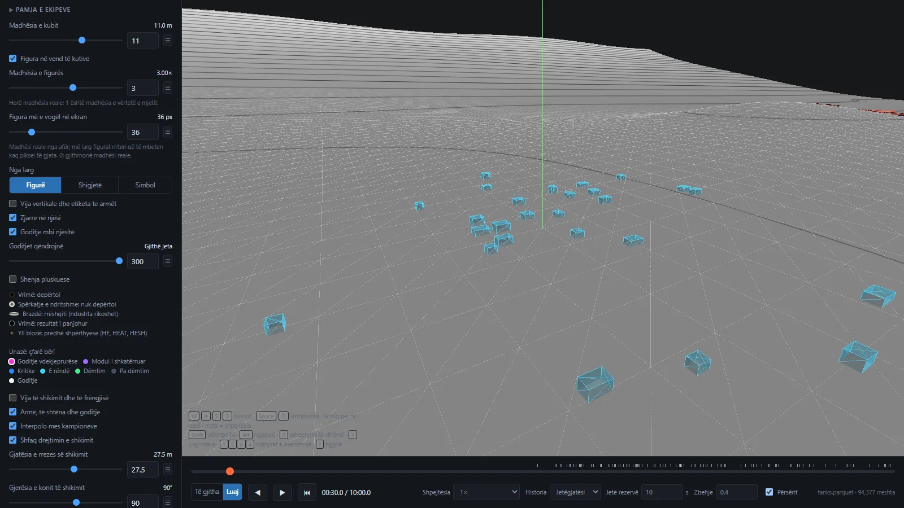

# Mbivendosje figurash (riluajtje me kuti)

Një film i vogël: një figurë për çdo person, që lëviz ndërsa koha ecën, me një gjurmë pas saj.

Modaliteti quhet **Mbivendosje figurash** te shiriti i modaliteteve. Kjo faqe dikur quhej "riluajtje me kuti", sepse para figurave çdo person ishte një kuti; "riluajtja me figura" dhe "riluajtja me kuti" kanë të njëjtin kuptim. **Mbivendosja e figurave** nuk ka tast numri: zgjidhe te shiriti i modaliteteve. Ajo vizaton një figurë (ose kuti) për çdo [person](glossary.md), që lëviz përgjatë [kronologjisë](timeline.md), me rrezet opsionale të shikimit dhe gjurmë. Është riluajtje, jo dendësi: *kush ishte ku, kur*. Kërkon një kolonë personi; pa kolonë kohe, çdo kampion vizatohet menjëherë.

## Si përdoret {#how-to-use-it}

1. Ngarko të dhëna me një kolonë personi dhe një kolonë kohe.
2. Zgjidh **Mbivendosje figurash** te shiriti i modaliteteve.
3. Kalo kronologjinë në **Luaj** dhe shtyp luajtjen (`K`).
4. Hap **Pamja e ekipeve** për të ndryshuar **Gjatësinë e shtegut**, madhësinë e figurës ose rrezet e shikimit.

Në këtë modalitet nuk vizatohet nxehtësi, dhe buxheti adaptiv i sprite-ve është joaktiv.

Si parazgjedhje çdo person vizatohet si figura e asaj që është, jo si kuti — shih [Figurat](figures.md) për figurën që merr një njësi, dhe [Riluajtja e ndeshjes](match-replay.md) për etiketat, kamerën ndjekëse, matjen midis dy njësive dhe listën e ngjarjeve.

## Paneli Pamja e ekipeve {#the-team-viewer-panel}

Shfaqet në vend të paneleve të nxehtësisë në këtë modalitet.

| Kontrolli | Parazgjedhja | Diapazoni (rrëshqitja) | Kuptimi |
|---|---|---|---|
| **Figura në vend të kutive** | i ndezur | | Çdo person si figura e asaj që është: një ushtar në këmbë, tanku ose avioni që emëron të dhënat. Ajo për të cilën të dhënat nuk thonë asgjë mbetet kuti. |
| **Madhësia e figurës** | 1× | | 1× është madhësia reale. |
| **Figura më e vogël në ekran** | 36 px | 0 = gjithmonë madhësia reale | Madhësia reale nga afër; figurat më larg rriten për të mbetur këtyre pikseleve të gjata. |
| **Armë, të shtëna dhe goditje** | i ndezur | | Armët në fluturim me tym, gjurmë të ndritshme, goditje, të shtëna dhe vrasje. Gjurmët e nxjerra nga një goditje janë me viza. |
| **Madhësia e kubit** | madhësia e entitetit, ose shtrirja / 500, në ngarkim | 0,05-200 m, logaritmik (5000) | Gjatësia e skajit të çdo kutie. Shih [madhësinë e entitetit](sessions-persons-groups.md#entity-size). |
| **Interpolo mes kampioneve** | i ndezur | | Midis dy kampioneve të të njëjtit person në të njëjtën seancë, kutia vendoset proporcionalisht midis tyre. Asnjëherë përtej kufirit të një seance. |
| **Shfaq drejtimin e shikimit** | i ndezur | | Një rreze nga çdo kuti sipas drejtimit të shikimit të personit (kërkon [kolonat e shikimit](axes-units-and-time.md#look-direction)). |
| **Gjatësia e rrezes së shikimit** | madhësia e entitetit × 4, ose shtrirja / 200, në ngarkim | 0,5-500 m, logaritmik (20 000) | Shfaqet kur drejtimi i shikimit është i ndezur. |
| **Gjatësia e shtegut** | 8 s | 0-300 s (86 400); 0 = i fikur | Sekonda historie të vizatuara pas çdo personi. |
| **Vizato çdo kampion të papërpunuar** | i fikur | | Një kuti për çdo kampion të ruajtur në dritare, në vend të një kutie të interpoluar për person. Nënmostrohet që të mbetet interaktive. |

Këshillat në panel shpjegojnë se interpolimi dhe gjurmët lidhin kampionet vetëm brenda një seance, dhe, kur ngarkimi ka [emra të përbashkët](sessions-persons-groups.md#names-worn-by-several-things-at-once), sa emra vizatohen si kampione të vetme.

## Seanca që luhet {#the-session-being-played}

Me një kolonë seance, zgjedhësi **Seanca** në krye të anështyllës ([Seancat](sessions-persons-groups.md#the-session-picker)) vendos cila ndeshje riluhet. Më e zëna zgjidhet në ngarkim. Vetëm rreshtat e asaj seance bëhen kuti dhe gjurmë, dhe timeline-i punon mbi intervalin e asaj seance në vend të gjithë grupit të të dhënave. *Të gjitha seancat* luan çdo seancë njëherësh, dhe prapë nuk bashkon kurrë kampione midis seancave.

## Çfarë vizatohet kur {#what-is-drawn-when}

Nga [`TrackCursor`](https://github.com/Holdi601/3DHeat/blob/main/src/data/tracks.ts):

**Kutitë e drejtpërdrejta** (modaliteti Luaj, kampionet e papërpunuar të fikura). Për çdo person të dukshëm, kampioni i tij i fundit në ose para treguesit të luajtjes:

- Nëse personi ka kampion të radhës, ai është në të njëjtën seancë, dhe emri nuk është i përbashkët, kutia vendoset midis dy kampioneve në përpjesëtim me kohën, me drejtimin (yaw) të interpoluar nga rruga më e shkurtër dhe pjerrësinë në mënyrë lineare (kur *Interpolo* është i ndezur).
- Përndryshe kutia qëndron te kampioni i fundit për **Jetën rezervë** të kronologjisë (parazgjedhur 10 s) dhe pastaj hiqet, që lojtarët e eliminuar të mos mbeten.

**Modaliteti Të gjitha** e shpërfill treguesin e luajtjes dhe vizaton çdo kampion në interval si kuti.

**Kampionet e papërpunuar** vizatojnë një kuti për çdo kampion të ruajtur në dritare: *Hapësira* me historinë *Dritare*, ndryshe gjithçka deri te treguesi i luajtjes. Më së shumti 65 536 kuti; me më shumë kampione, çdo *k*-ta vizatohet.

**Gjurmët** (kur gjatësia e shtegut është mbi 0 dhe kampionet e papërpunuar nuk vizatohen): një vijë midis çdo çifti kampionesh radhazi të një personi brenda *gjatësisë së shtegut* sekonda deri te treguesi i luajtjes, që zbehet nga 80% opacitet në transparente me kalimin e kohës. Një gjurmë ndalon te një ndryshim seance dhe nuk vizatohet për emrat e përbashkët. Më së shumti 131 072 kulme; me më shumë, rreshtat kapërcehen në mënyrë të barabartë.

**Kush është i dukshëm:** një person fshihet kur grupi i tij është i çaktivizuar te [Lista e skuadrave](teams-list.md) (grupi i tij është ai i rreshtit të parë), kur një filtër grupi e përjashton, ose kur paneli [Entitetet](entities.md) ka një përzgjedhje që nuk e përfshin. [Filtrat](filters.md) e kolonave nuk zbatohen te kutitë.

## Ngjyrat {#colours}

Një familje nuancash për çdo grup dhe një ton për çdo anëtar, kështu që një vështrim të tregon në cilën palë është dikush ([`teamMemberColor`](https://github.com/Holdi601/3DHeat/blob/main/src/render/colors.ts)). Nuancat e grupeve rrotullohen mes një liste të fiksuar prej dhjetë — blu, e kuqe, e gjelbër, qelibar, vjollcë, cian, magjentë, limon, portokalli, indigo — dhe anëtarët e një grupi shpërndahen mes ndriçimit 42-76% dhe ngopjes 90-65%.

## Shënime {#notes}

- Mbivendosja e figurave i rindërton figurat vetëm kur ndryshon diçka; një kuadër joaktiv rivizaton të fundit.
- Rreshti *Kubet* i [shtresës së statistikave](performance-and-stats.md) numëron kutitë në ekran.
- Mbivendosja e figurave vizaton në të njëjtën skenë me nivelin, kështu që [thellësia e fushës](camera.md#depth-of-field) i turbullon kutitë, por kurrë nxehtësinë.
