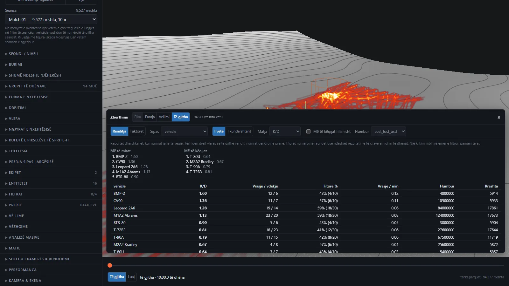
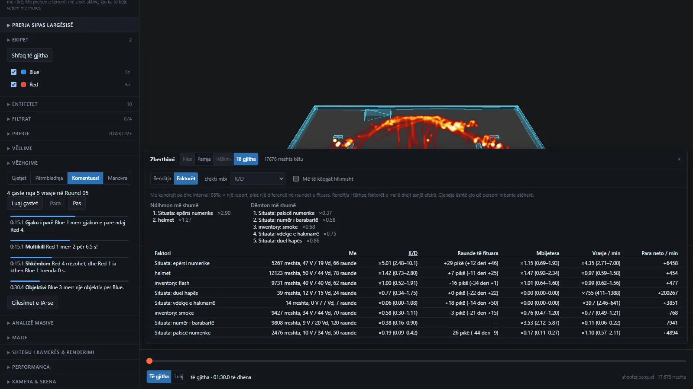

# Zbërthimi: kush dhe çfarë del më mirë, dhe ku

**Zbërthimi** përgjigjet një pyetjeje: në këtë vend, cili mjet, lojtar apo armë del më mirë? Përdore për të gjetur tankun që fiton te ura, ose për të parë nëse vërtet ndihmon të veshësh një helmetë.

Rendit atë që ndodh në një vend (një pikë e zgjedhur, pamja, një vëllim ose gjithçka e shfaqur) sipas çdo kategorie, dhe mat çdo faktor gjendjeje me pa-kundër-me-pa.

## Provoje {#try-it}

1. Ngarko një ndeshje me vrasje dhe vdekje, dhe hap **Vëllimet**.
2. Vizato një vëllim rreth vendit që të intereson dhe zgjedhe.
3. Shtyp **Zbërthimi...** nën Statistikat.
4. Te **Sipas**, zgjidh *Mjeti*, dhe zgjidh masën *K/D* (vrasje për vdekje).
5. Lexo listën, më e mira e para. Shtyp **Më të këqijat fillimisht** për ta kthyer. Kliko një emër për ta filtruar pamjen sipas tij; kliko përsëri për ta lëshuar.

## Hape {#open-it}

| Nga | Zona me të cilën nis |
| --- | --- |
| **Zbërthimi...** te [Vëllimet](volumes.md) (Statistikat) | vëllimi i zgjedhur |
| **Zbërthimi këtu** te karta e zgjedhjes, pasi kliko një pikë | një sferë rreth asaj pike (**Rrezja**, parazgjedhur 3% e madhësisë së të dhënave) |
| paneli i ndarjes **Diferencë** | pamja |

Titulli ndërron zonën: **Pika**, **Pamja** (çfarë pa kamera te numërimi i fundit; **Numëro përsëri** pasi lëviz), **Vëllimi** (zgjidh një) ose **Të gjitha**. Numëron në sfond; rreshti i gjendjes thotë sa rreshta ka në zonë.

## Renditja {#ranking}

Zgjidh me çfarë të renditësh dhe një masë:

| Masa | Çfarë është |
| --- | --- |
| A, B | rreshtat në secilën anë të hartës së diferencës, të ndarë ashtu si i ndan nxehtësia |
| A / B, A - B, A / (A + B) | dy shtresat kundrejt njëra-tjetrës |
| K/D | vrasjet kundrejt vdekjeve |
| Fitore % | raundet (ose ndeshjet) të fituara, aty ku të dhënat thonë kush fitoi |
| Vrasje / min | vrasje për minutë të pranishme (boshllëqet e kampioneve të lëvizjes) |
| Fituar, Humbur, Para neto | shuma të kolonave `earn_*` dhe `cost_*`; një zgjedhës zgjedh monedhën |

Vrasjet, vdekjet, prania, fitoret dhe paratë numërojnë çdo rresht që pamja shfaq në vend, në secilën anë të ndarjes ose asnjërën.

Raportet dhe normat tërhiqen drejt vlerës së gjithë vendit kur numrat janë të vegjël, kështu që 2 vrasje në 1 jetë nuk e çojnë në krye të listës. Numrat tregohen pranë tyre.

Mund të renditësh sipas grupeve, lojtarëve dhe ndeshjeve, çdo kolone kategorie (një mjet, një armë, një palë, një lloj blerjeje, një agjent apo një kit), çdo kolone numerike në intervale (armatura, vlera e një pajisjeje), **klasës** së një kolone armësh (pushkë, snajper, SMG, pistoletë...) dhe sa copë **mjete ndihmëse** ka një kolonë liste si `inventory`.

**Pronë** rendit sipas vlerës së vetë rreshtit. **I kundërshtarit** rendit sipas vlerës së palës tjetër: armës së viktimës te një vrasje, asaj të vrasësit te një vdekje (kërkon një kolonë `other` / `victim` që i emëron).

## Gjendja në atë kohë {#state-at-the-time}

Vlera e një rreshti është e vetja, përveç kur rreshti nuk regjistron asnjë (një rresht ngjarjeje pa pajisje) ose është një vdekje (kolona e armës së së cilës mund të emërojë armën e vrasësit); atëherë është ajo që e kishte më parë, në ndeshje, e njëjta person.

## Faktorët: me kundër me pa {#factors-with-against-without}

Kalo nga **Renditja** në **Faktorët**, zgjidh **Efekti mbi**, dhe lexo *Ndihmon më së shumti* dhe *Dëmton më së shumti*:

Efekti i secilit faktor mbi K/D, raundet e fituara, mbijetesën (minuta për vdekje), vrasjet në minutë dhe paranë neto në minutë, me një interval 95%: raportet si x, raundet e fituara si ndryshim pikësh. Renditja tërheq çdo vlerësim drejt mos-efektit sipas pasigurisë së vet, kështu që një faktor i rrallë ka nevojë për efekt të qartë për të dalë lart; intervali i treguar është ai i pa-tërhequr.

Të dhënat me raunde shtojnë **situatat** e distancës së afërt ([Distanca e afërt dhe raundet](close-quarters.md)), të llogaritura një herë për grup: *të verbuar* (kolona `state_flashed` e rreshtit, ose një dritë armiku brenda 15 m në 3 s të fundit), *vdekja e shkëmbyer*, *duel i hapjes*, dhe *njeri më shumë*, *numra të barabartë* ose *njeri më pak* (lojtarët gjallë në palën e rreshtit kundrejt armikut). Një vdekje numërohet në situatën ku ishte viktima pak para saj.

Më së shumti 256 faktorë maten në një kalim.

## Për zhvilluesit {#for-developers}

### Marrja e mostrave të vogla {#pulling-small-samples}

Vlera e renditjes është `(n + m*r0) / (d + m)`: `n` dhe `d` janë numërimet, `r0` raporti i gjithë vendit dhe `m` pesha e asaj parapërcaktimi.

### Për autorët e konvertuesve: emërtimi i kolonave të faktorëve {#for-converter-authors-naming-factor-columns}

Një konvertues shton një faktor duke emërtuar kolonën e vet:

| Kolona | Faktori |
| --- | --- |
| `state_<name>` numër | aktiv kur nuk është zero (`state_scoped`, `state_suppressor`) |
| `state_<name>` kategori | një faktor për vlerë (`state_ammo` = AP, HE...) |
| `active_<name>` | e njëjta, për diçka të ndezur ose të përdorur së fundmi: një aftësi, një ultimate, një pajisje, një përforcim (`active_ult`, `active_stim`) |
| kolonë liste (`inventory`, `loadout`, `perks`, `abilities`, `attachments`, `modules`, `buffs`, `debuffs`, `upgrades`, ose një emër `state_`/`active_` që mbaron me `s`) | një faktor për çdo element të një vlere `a\|b\|c` |
| flamuj pajisjesh që janë të zakonshëm (`helmet`, `defuser`, `armor`, `scoped`, `airborne`, `duck`, `flashed`...) | aktiv kur nuk është zero |
| `ammoType`, `shellType`, `ammoName` | predha e fundit e qëlluar |

Rezultatet: një kolonë `won` 0/1 (pala e rreshtit fitoi raundin ose ndeshjen) dhe një kolonë `round`. Paratë: `earn_<currency>` dhe `cost_<kind>_<currency>`; një e ardhur sipas llojit vetëm (`earn_round_cs2`, shpërblimet e sakta të raundit të një konvertuesi) zëvendëson vetëm të ardhurat e modelit të kostos për atë lloj (`round` mbulon edhe plantimet dhe çmontimet), dhe modeli çmon pjesën tjetër.

Hartëzimi i ngarkon vetë këto kolona, pranë listës së skedarit: çdo kolonë `state_*`, `active_*`, `won`, `round` dhe listë, me përjashtim të atyre që statistikat e një skedari Parquet tregojnë se mbajnë një vlerë gjatë gjithë kohës (çdo kolonë e ngarkuar zë 4 bajt për rresht).
