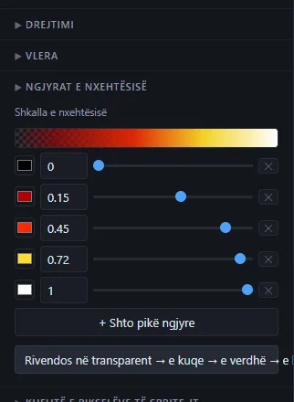

# Ngjyra dhe ekspozimi

Këto kontrolle vendosin çfarë sasie nxehtësie merr çfarë ngjyre. **Pika e ngopjes** tregon sa nxehtësi llogaritet si e bardhë e nxehtë.

## Rregullime të shpejta {#quick-fixes}

- Gjithçka është e bardhë: rrit **Pikën e ngopjes**, ose shtyp **Ekspozim automatik nga fusha**.
- Asgjë nuk duket: ul **Pikën e ngopjes**, ose shtyp **Ekspozim automatik nga fusha**.
- Shfaqen vetëm disa pika të vetme: ngri **Nxehtësinë minimale**.

Çdo kontroll në këtë faqe vepron kur nxehtësia kthehet në ngjyrë. Kështu, kur tërheq ndonjërin prej tyre, imazhi rivizatohet menjëherë dhe **grumbullimi nuk rinisët kurrë**.

## Pika e ngopjes {#saturation-point}

**Pika e ngopjes** (seksioni Forma e nxehtësisë): nxehtësia e grumbulluar që i përgjigjet majës së shkallës së ngjyrave (me përgjigjen *Lineare*; shih më poshtë për të tjerat). Rrëshqitësi është logaritmik, 0,1-4000, dhe doreza mund të tërhiqet deri në 10 000 000, sepse nxehtësia e grumbulluar rritet me numrin e rreshtave. Parazgjedhja është 24. Në çdo ngarkim, së pari bëhet një **vlerësim analitik**, pastaj një **matje** nga imazhi.

Ta gabosh këtë është dallimi midis një harte nxehtësie dhe një ekrani bosh (ose të bardhë). Nuk mund të nxirret me besueshmëri: telemetria grumbullohet aq fort — një lindje, një derë, një pikë kalimi — sa raporti i dendësisë maksimale me mesataren ndryshon me një renditje madhësie midis grupeve të të dhënave dhe midis këndeve të kamerës.

## Ekspozimi automatik {#auto-exposure}

**Ekspozim automatik nga fusha** mat fushën që shader-i prodhoi realisht. Injoron pikselët bosh, merr përqindjen e 98-të të pikselëve të ndriçuar dhe e vendos në 85% të rrugës drejt pikës së ngopjes. Kështu maja e shkallës mbahet për pikat e vërteta maksimale.

Paneli lexon atëherë *matur X% të kuadrit; përqindja e 98-të R vendoset afër majës së shkallës*. Me përgjigjen *Me ngopje*, një vlerë në 85% të pikës së ngopjes arrin rreth 69% të shkallës, jo 85%.

Ai punon edhe **automatikisht**:

- 8 kuadre pasi ngarkohet një grup të dhënash;
- 8 kuadre pasi ndryshojnë [filtrat](filters.md). Filtrimi i çdo pozicioni deri në njëqind ngjarje e ndryshon dendësinë me rend madhësie;
- 8 kuadre pasi kalohet midis nxehtësisë me pika dhe [nxehtësisë me vija](line-heat.md), ose pasi ndryshohen rrugët që vizaton nxehtësia me vija. Një vijë lë shumë më pak nxehtësi për çdo kampion se një sprite.

Kur asgjë nuk është e ndriçuar, ekzekutimi automatik e lë ngopjen ashtu si është. Butoni kthehet te vlerësimi analitik dhe shfaq *asgjë e ndriçuar për matje - u përdor vlerësimi analitik*.

### Ndiq pamjen {#follow-the-view}

**Ndiq pamjen** (seksioni Forma e nxehtësisë, i ndezur si parazgjedhje) mat përsëri sa herë që kamera ndalon. Kështu, një zonë ku fluturon përdor gjithë shkallën e ngjyrave, në vend të shkallës së matur për gjithë hartën. Ndryshimet e vogla injorohen, dhe shkalla rrëshqet në vend që të kërcejë. Ky funksion punon në katër mënyrat e nxehtësisë, por jo te mbivendosja e figurave.

Fikeje për ta kyçur shkallën dhe për të krahasuar vende në një shkallë të vetme. Tërheqja e **Pikës së ngopjes** me dorë e kyç gjithashtu.

## Përgjigja ndaj dendësisë {#density-response}

**Përgjigja ndaj dendësisë** — si *k* (nxehtësia / pika e ngopjes) hartëzohet në shkallë:

| Përgjigja | Formula | Përdorimi |
|---|---|---|
| **Me ngopje** (parazgjedhur) | t = 1 - e^(-k) | I afrohet majës së shkallës asimptotikisht, ashtu si sprite-et tejdukshëm të grumbulluar. Asgjë nuk shkon kurrë në të bardhë të sheshtë, prandaj është parazgjedhja e sigurt për të dhëna të panjohura. |
| **Lineare** | t = k | Është hartëzimi i vetëm ku ngjyra e barabartë do të thotë numër i barabartë. Përdoreni për të krahasuar dy grupe të dhënash ose dy dritare kohore. |
| **Log** | t = log₂(1 + 7k) / 3 | Ngjesh një bisht të gjatë, kështu që një pikë e vetme ekstreme nuk e shtyp më gjithçka tjetër në fund të shkallës. Ngre zonat e rralla. |

## Nxehtësia minimale {#minimum-heat}

**Nxehtësia minimale** (parazgjedhur i fikur, 0-100%): çdo pikselë që ka çfarëdo nxehtësie ngrihet të paktën në këtë pikë të shkallës. Ktheje lart dhe ul rrezen e sprite-it, për të parë *ku ka ndodhur ndonjëherë diçka*. Pikat e vetme të të dhënave bëhen qartë të dukshme, në vend që të rrinë pak mbi tejdukshmërinë. Lëre të fikur kur gjykon dendësinë, sepse e shtyp fundin e shkallës me qëllim. Pragu (k > 0,0001) i mban bosh pikselët që janë vërtet bosh.

## Redaktori i shkallës {#the-ramp-editor}

Në seksionin **Ngjyrat e nxehtësisë**. Etiketa e tij thotë për çfarë përdoret shkalla: *Shkalla e nxehtësisë* te Nxehtësia dhe Vijat, *Pozitive (ekipe të mbledhura)* te Diferenca, *Shkalla e opacitetit (ngjyra vjen nga grupi)* te [Nxehtësia e ekipit](team-heat.md), ku përdoret vetëm alfa e saj.



Shiriti lart shfaq parapamjen e shkallës. Më poshtë ka një rresht për çdo pikë:

| Pjesa | Kuptimi |
|---|---|
| Mostra e ngjyrës | Ngjyra e pikës (zgjedhësi i ngjyrave i shfletuesit). |
| Numri | Pozicioni i pikës përgjatë shkallës, nga 0 në 1 (0 = pa nxehtësi). |
| Rrëshqitësi | Opaciteti i pikës, 0-100%. |
| ✕ | Heq pikën. Joaktive kur mbeten vetëm dy. |

**+ Shto pikë ngjyre** shton një pikë në mes të dy pikave të fundit, me ngjyrën dhe opacitetin e pikës së fundit. **Rivendos në transparent → e kuqe → e verdhë → e bardhë** rikthen parazgjedhjen.

Pikat mund të jepen në çdo renditje. Renditen kur ndërtohet shkalla. **Alfa** është ajo që përzien nxehtësinë mbi skenë. Për këtë skaji zero i shkallës së parazgjedhur është plotësisht transparent.

### Shkallët e parazgjedhura {#the-default-ramps}

| Pozicioni | Pozitive (Nxehtësi, Vija, Diferencë +) | Negative (Diferencë −) |
|---|---|---|
| 0.00 | e zezë, alfa 0 | e zezë, alfa 0 |
| 0.15 | rgb(180, 0, 0), alfa 0.55 | rgb(0, 170, 60), alfa 0.55 |
| 0.45 | rgb(255, 40, 0), alfa 0.85 | rgb(0, 190, 200), alfa 0.85 |
| 0.72 | rgb(255, 220, 40), alfa 0.95 | rgb(40, 80, 255), alfa 0.95 |
| 1.00 | e bardhë, alfa 1 | rgb(170, 60, 255), alfa 1 |

## Ndërsa kamera lëviz {#while-the-camera-moves}

Kur kamera lëviz, grumbullimi rinisët çdo kuadër. Me **Vizato çdo rresht në çdo kuadër** të ndezur (parazgjedhje), çdo kuadër në lëvizje është ende i saktë. Kur është i fikur, një kuadër në lëvizje tregon një vlerësim të marrë me kampionim: grumbuj më të ndritshëm, me peshë. Ky vlerësim i bashkohet imazhit të vërtetë, më të butë, kur ndalon. Kjo është e pritshme; shih [Grumbullimin](accumulation.md).

## Për zhvilluesit {#for-developers}

### Kalimi i përbërjes {#the-composite-pass}

Pasi nxehtësia është grumbulluar, vlera e çdo pikseli kthehet në ngjyrë në një kalim të vetëm përbërjeje ([`COMPOSITE_FS`](https://github.com/Holdi601/3DHeat/blob/main/src/render/webgl2/shaders.ts)). Hapat janë:

```
k = |heat| / saturation point
t = response(k)                         clamped to 0..1
if minimum heat > 0 and k > 0.0001:  t = minimum + (1 - minimum) × t
colour, alpha = ramp(t)                  (the negative ramp when heat < 0, Difference only)
pixel = mix(scene, colour, alpha)
```

### Vlerësimi analitik {#the-analytic-estimate}

**Vlerësimi analitik** ([`estimateSaturation`](https://github.com/Holdi601/3DHeat/blob/main/src/data/calibrate.ts)) supozon që rreshtat shpërndahen mbi gjurmën X-Z të të dhënave: nxehtësia mesatare = rreshta × (π r² / sipërfaqja e gjurmës) × 1/3 × intensiteti i qendrës (1/3 është mesatarja e diskut të një shkalle lineare), shumëzuar me një raport maksimum-mesatare të supozuar prej 25, kufizuar në 0,1-1 000 000. Duhet vetëm të jetë brenda një renditje madhësie të saktë.

### Matja {#metering}

[`exposure.ts`](https://github.com/Holdi601/3DHeat/blob/main/src/render/exposure.ts):

1. objektivi i nxehtësisë lexohet përsëri nga GPU, me nënkampionim deri në 40 000 vlera;
2. pikselët bosh (nxehtësia ≤ 0,0001) hidhen. Pjesa më e madhe e një fushe nxehtësie është bosh, dhe nëse i mesim, gjithçka do të nënekspozohej, ashtu si një matës drite i drejtuar kah një sfond i zi;
3. përqindja e 98-të e pikselëve të ndriçuar është referenca;
4. pika e ngopjes bëhet referenca / 0,85. Kështu referenca vendoset në 85% të rrugës drejt pikës së ngopjes, dhe maja e shkallës mbahet për pikat e vërteta maksimale.

### Tabela e ngjyrave {#the-colour-table}

Shkalla pjekët në një tabelë RGBA 256 × 2 (shkalla pozitive në rreshtin e parë, ajo negative në të dytin) ([`buildColorLut`](https://github.com/Holdi601/3DHeat/blob/main/src/render/colors.ts)). Ngjyrat interpolohen në dritë lineare dhe ruhen si sRGB. Opaciteti interpolohet në mënyrë lineare.
