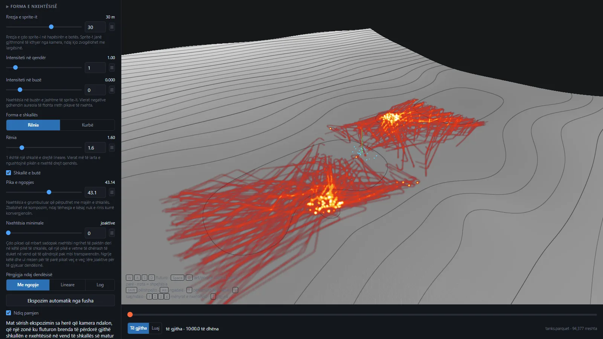
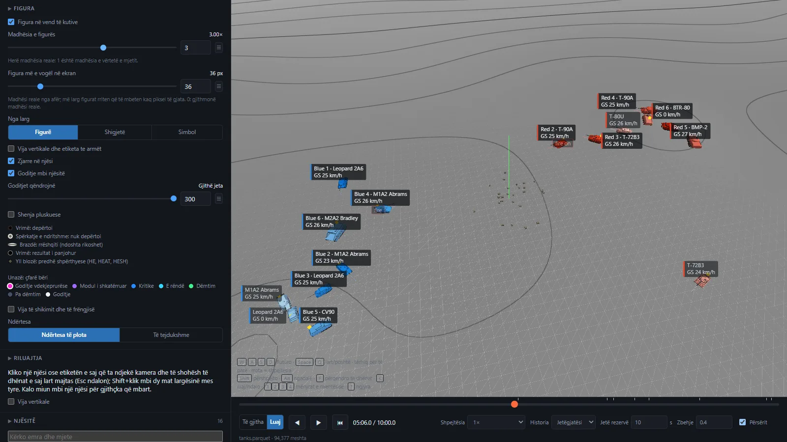

# Të dhënat demo: provo shikuesin për pesë minuta



Ende nuk ke të dhëna të tuat? Depoja krijon disa. Gjithçka në to është e shpikur: një luginë, një oborr, dhe ndeshje me tre stile lojërash të shpikura, me lojtarë të quajtur *Blue 1* ose *Red 3*. Fotot në këtë faqe u bënë të gjitha me to.

## Krijoje {#make-it}

```bash
node tools/demo-data.mjs
```

Kjo shkruan në `tools/.shots/demo/`:

| Skedari | Çfarë është |
|---|---|
| `demo-valley.glb` | një luginë 12 km me dy kodra dhe një fshat, si nivel 3D |
| `demo-yard.glb` | një oborr 160 m i rrethuar me mur, me ndërtesa, si nivel 3D |
| `tanks.parquet` | 10 ndeshje me tanke, 8 kundër 8: lëvizja, të shtënat, goditjet me vendin në trup, zjarret, vrasjet, mbetjet, shënjestra e kullës, fituesit |
| `tanks/match-NN.parquet` | të njëjtat ndeshje, një skedar secila, për [shumë ndeshje njëherësh](many-matches.md) |
| `air.parquet` | një luftë ajrore 4 kundër 4 me raketa, flare, vrasje dhe humbje |
| `shooter.parquet` | 12 raunde 5 kundër 5 në këmbë: të shtëna, vrasje, një vendosje bombe, kredite të fituara dhe të shpenzuara, helmeta dhe pajisje ndihmëse |
| `mass/` | një dosje me ndeshje të vogla `.3dheat`, për [analizën masive](mass-analysis.md) |
| një grup xhirosh | dy xhiro të një makine në një pistë të shpikur, për [Analizën e garës](race-analysis.md) |

Çdo tabelë i emërton kolonat e veta në fundin e saj, kështu që ngarkohet pa asnjë përcaktim.

## Provoje {#try-it}

1. Nis shikuesin (`start.bat` në Windows, ose `npm install` një herë dhe pastaj `npm run dev` në çdo sistem) dhe hap `http://127.0.0.1:5273/`.
2. **Sfondi / niveli → Model 3D…** dhe zgjidh `demo-valley.glb`.
3. **Burimi → Skedarë…** dhe zgjidh `tanks.parquet`.
4. Shtyp `F` për t'i përshtatur kornizës të dhënat. Sheh [nxehtësinë](heat.md) e dhjetë ndeshjeve.
5. Provo shiritin e modeve: **Diferencë** (Blue kundër Red), **Nxehtësi ekipi**, **Vija**.
6. Hap **Vëzhgime** (në shiritin anësor të Harta e nxehtësisë): gjen vendet ku u shtuan shumë më tepër, u goditën dhe u shkatërruan sesa gjetkë - rreth dy kodrave.
7. Hap skedën **Ndeshja**; nën **Ndeshjet në riluajtje** zgjidh *Match 01*; shtyp **Luaj** në kronologji: [riluajtja](match-replay.md).



Për lojën shooter, ngarko `demo-yard.glb` dhe `shooter.parquet`; për luftën ajrore, `air.parquet` (figurat shihen më lehtë me **Madhësia e figurës** 4, një rrëshqitës në panelin **Pamja e ekipeve** të shiritit anësor të Harta e nxehtësisë).

## Fotot e faqeve {#the-screenshots}

Fotot e faqeve të këtij sajti bëhen nga këto të dhëna me një skript, në çdo gjuhë të shikuesit:

```bash
node tools/demo-data.mjs
HEAT3D_FIGURE_PACK=none npx vite --port 5321 --strictPort --host 127.0.0.1   # PowerShell: $env:HEAT3D_FIGURE_PACK="none"; npx vite ...
node tools/docs-shots.mjs --lang en
```

Serveri i fotografimit punon pa paketë lokale figurash, kështu që shfaqet vetëm katalogu publik i figurave. Fotot shkojnë në `docs/assets/img/<lang>/`. Shih [Mirëmbajtja e dokumentacionit](maintaining.md).
