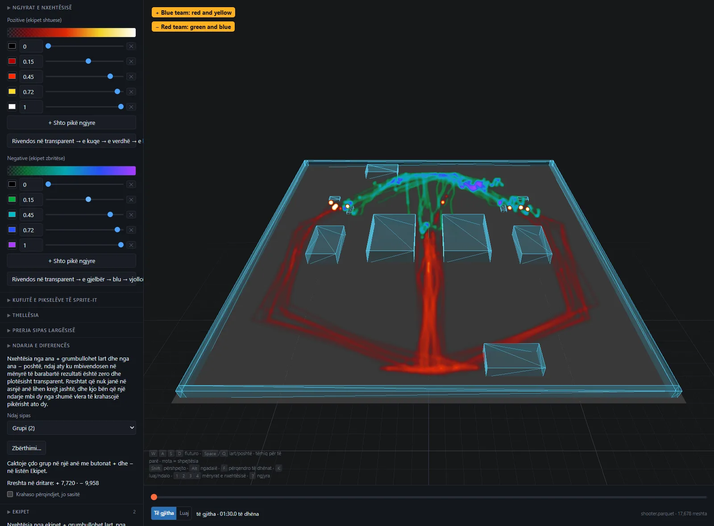

# Diferencë

E kuqe kur ekipi A ishte më shumë, e gjelbër-blu kur ishte ekipi B, asgjë kur ishin të barabartë.

**Diferenca** (tasti 2) është nxehtësi me shenjë. Rreshtat e një popullate shtojnë nxehtësi; rreshtat e një tjetre e zbresin atë. Aty ku të dyja mbivendosen në mënyrë të barabartë, rezultati është zero dhe plotësisht transparent; aty ku njëra mbizotëron, shfaqet në ngjyrat e asaj ane - si parazgjedhje të ngrohta (transparente → e kuqe → e verdhë → e bardhë) për anën **+** dhe të ftohta (transparente → jeshile → blu → vjollcë) për anën **−**.

## Si përdoret {#how-to-use-it}

1. Shtypni `2` (ose zgjidhni **Diferencë** te shiriti i mënyrave).
2. Hapni **Ndarja e diferencës** në shiritin anësor.
3. Zgjidhni çfarë të **Ndajë sipas**: zakonisht *Grupet*.
4. Vendosni një grup (ose vlerë) te **+** dhe një tjetër te **−**.
5. Lexoni ngjyrat: e ngrohtë do të thotë ana +, e ftohtë do të thotë ana −. Paneli paralajmëron nëse një anë nuk ka rreshta (shih [Mesazhet që mund të shihni](#messages-you-may-see)).

*Cilat* dy popullata janë e tërë pyetja, kështu që ndarja mund të jetë çdo kolonë e mbajtur, jo vetëm grupe. Rreshtat që bien **në asnjërën** anë **lihen jashtë**, nuk numërohen si zero: pikërisht kjo bën që një ndarje mbi dy nga shumë vlera të krahasojë saktë ato dy, dhe ajo kombinohet me [filtrat](filters.md) - filtroni deri në një hartë, pastaj ndajeni atë sipas versionit.

Mënyra kërkon dy anë: një kolonë grupi me të paktën dy grupe, ose një ndarje mbi një kolonë të mbajtur për filtrim. Te të dhënat me më pak se dy grupe, një ngarkim fillon me një ndarje kolone - kolona *Source file* e një ngarkimi me disa skedarë së pari, përndryshe kolona e parë kategorie me dy vlera, përndryshe kolona e parë numerike me shtrirje - kështu që *krahaso dy ngarkime* funksionon edhe te të dhënat pa asnjë grup. Vetëm të dhënat pa asnjë nga këto e bëjnë mënyrën të padisponueshme; po ashtu, një ndarje kolone që mbetet pa asgjë në njërën anë.

## Paneli Ndarja e diferencës {#the-difference-split-panel}

Shfaqet në mënyrën Diferencë, nën panelet e nxehtësisë.

**Ndaj sipas** ofron:

| Opsioni | Shfaqet si | Rregulli i ndarjes |
|---|---|---|
| Grupet | *Grupi (N)* (kur ka kolonë grupi) | Çdo grup te +, − ose asnjëra, i caktuar te [Lista e ekipeve](teams-list.md) |
| Një kolonë kategorie | *kolona (N vlera)* | Vlerat te +, − ose asnjëra |
| Një kolonë numerike | *kolona (numerike)* | Një diapazon vlerash për secilën anë |
| Skedari burimor | *Source file - krahaso dy ngarkime* (kur janë ngarkuar disa skedarë) | Skedarët te +, − ose asnjëra |

Ofrohen vetëm kolonat e mbajtura nën *Mbaj për filtrim* gjatë ngarkimit.

### Krahaso përqindjet, jo sasitë {#compare-shares-not-counts}

**Krahaso përqindjet, jo sasitë** (parazgjedhur i fikur) i peshon çdo anë me një të pjesëtuar me numrin e vet të rreshtave, kështu që një anë me pesë herë më shumë rreshta nuk fiton vetëm me numra. Ngjyra tregon atëherë ku secila anë është proporcionalisht më e shpeshtë se tjetra. Përdoreni kur dy anët kanë sasi shumë të ndryshme të dhënash, për shembull dy seanca me gjatësi të ndryshme.

### Mesazhet që mund të shihni {#messages-you-may-see}

Paneli paralajmëron kur figura nuk është një diferencë e vërtetë:

| Mesazhi | Kuptimi |
|---|---|
| *N + / M −* (ose *N + / M − / K të pa përdorura*) | Sa vlera janë në çdo anë (dhe në asnjërën). |
| Asnjë rresht në dritare nuk është në anën **+** | Vizatohet vetëm ana **−**. Lëvizni dritaren e kohëvizatës ose ndryshoni ndarjen. |
| Asnjë rresht në dritare nuk është në anën **−** | Vizatohet vetëm ana **+**. |
| Asnjë vlerë nuk është në asnjërën anë | Diferenca nuk vizaton asgjë. Vendosni të paktën një vlerë te **+** ose **−**. |
| *kolona* nuk mund të ndahet kësisoj | Kolona e zgjedhur nuk përshtatet me ndarjen. Zgjidhni përsëri kolonën. |
| Kolona e ndarjes nuk u përshtat në memorinë e GPU për N nga M pjesë | Ato rreshta nuk vizatohen. Rritni buxhetin e GPU te Performanca → Buxhetet e burimeve, ose ngarkoni më pak rreshta. |

## Sipas grupit {#by-group}

Paneli vetëm të drejton te [Lista e ekipeve](teams-list.md), ku çdo grup ka një buton **+** dhe një **−**. Në çdo ngarkim gjysma e parë e grupeve (e rrumbullakosur lart) vendoset te +, pjesa tjetër te −; **Ndaj në mënyrë të barabartë** te Lista e ekipeve e bën të njëjtën gjë sërish. Një grup në asnjërën anë, ose i fshehur me kutinë e vet, nuk kontribuon asgjë.

## Sipas vlerave të kategorisë {#by-category-values}

| Pjesa | Kuptimi |
|---|---|
| `a + / b − / c të pa përdorura` | Sa vlera janë në secilën anë dhe në asnjërën. |
| **Pastro** | Vendos çdo vlerë në asnjërën anë. |
| Lista e vlerave | Çdo vlerë me një buton **+** dhe një **−** (klikoni përsëri atë aktiv për ta hequr nga ajo anë). Një vlerë bosh listohet si *(mungon)*. |
| Shënimi i kufirit | Listohen vetëm 200 vlerat e para: *Duke shfaqur 200 vlerat e para nga N. Një kolonë kaq e gjerë është më mirë të ngushtohet fillimisht me një filtër, ose të ndahet sipas diapazonit nëse vlerat e saj janë të renditura.* |

Zgjedhja e kolonës e vendos vlerën e saj të parë te + dhe të dytën te −. Kur asnjëra anë nuk ka asnjë vlerë, ndarja kthehet te grupet në vend që të shfaqë një kornizë bosh. *Source file* funksionon në të njëjtën mënyrë, një vlerë për skedar - kështu krahasohen dy eksporte, dy seri provash ose dy versione.

## Sipas diapazonit {#by-range}

| Pjesa | Kuptimi |
|---|---|
| Sugjerimi | Minimumi dhe maksimumi i kolonës. |
| **Diapazoni pozitiv (+)**, **nga** / **deri** | Rreshtat me një vlerë në këtë diapazon, të përfshirë në të dy skajet, shtojnë. |
| **Diapazoni negativ (−)**, **nga** / **deri** | Rreshtat në këtë diapazon zbresin. |
| **Ndaj në pikën e mesit** | Vendos + te [minimumi, mesi] dhe − te [mesi, maksimumi] - gjithashtu atë që bën zgjedhja e kolonës. |

Një vlerë në të dy diapazonet numërohet si +. Diapazonet nuk duhet të mbulojnë kolonën; vlerat në asnjërin nuk lihen jashtë. *Dy minutat e para kundrejt dy minutave të fundit* është një ndarje diapazoni mbi një kolonë si koha.

## Pjesa e +: harta e shkallës së fitoreve {#share-of--the-win-rate-map}

**Diferencë** / **Pjesa e +** në krye të panelit zgjedh çfarë vizatohet. *Pjesa e +* ngjyros çdo vend sipas pjesës së palës + nga rreshtat e të dy palëve atje, krahasuar me atë pjesë në gjithçka që shfaqet: e ngrohtë mbi të, e ftohtë nën të, asgjë ku është njësoj, dhe asgjë ku një vend ka shumë pak rreshta. Me raundet e fituara te + dhe të humburat te − është një hartë e shkallës së fitoreve; **Shkalla e fitoreve për raund** dhe **Shkalla e fitoreve për ndeshje** e rregullojnë këtë me një shtypje ku të dhënat kanë [kolona rezultati](data-formats.md#outcome-columns). Shihni [Shkalla e fitoreve](win-rate.md).

## Ngjyrat {#colours}

Seksioni **Ngjyrat e nxehtësisë** shfaq në këtë mënyrë dy redaktorë shkallësh: **Pozitive (ekipet shtuese)** dhe **Negative (ekipet zbritëse)**, secili me butonin e vet të rivendosjes (*Rivendos te transparent → e kuqe → e verdhë → e bardhë*, *Rivendos te transparent → jeshile → blu → vjollcë*). Kompozita merr vlerën absolute të nxehtësisë neto përmes [pikës së ngopjes dhe përgjigjes](colour-and-exposure.md), dhe zgjedh shkallën negative aty ku neto është nën zero. Shih [Ngjyra dhe ekspozimi](colour-and-exposure.md#the-ramp-editor).

Përdorni përgjigjen e dendësisë *Lineare* kur madhësia e diferencës ka rëndësi: është e vetmja përgjigje ku ngjyra e barabartë do të thotë numër i barabartë.

## Për zhvilluesit {#for-developers}

Çdo rresht merr një shenjë +1, -1 ose 0 te hija e kulmimeve ([`POINT_HEAT_VS`](https://github.com/Holdi601/3DHeat/blob/main/src/render/webgl2/shaders.ts)); një 0 e refuzon rreshtin para se të vizatohet ndonjë fragment.

- Sipas grupit, shenja vjen nga një tabelë grupesh me 4,096 hyrje e indeksuar me id-në e grupit të rreshtit (id-ja e grupit udhëton në kanalin e katërt të teksel-it të pozicionit të rreshtit).
- Sipas kategorisë, shenja vjen nga një tabelë e dytë me 4,096 hyrje, e mbushur për çdo vlerë kategorie, dhe vlera e rreshtit lexohet nga tekstura e filtrit të kolonës; një vlerë përtej fundit të tabelës refuzohet në të dy motorët.
- Sipas diapazonit, vlera e rreshtit krahasohet me dy diapazonet.

Ndryshimi i ndarjes e rinis grumbullimin.

**Grupet e fshehura mbeten të fshehura me çdo ndarje.** Nën një ndarje sipas një kolone tabela e grupeve nuk mban më shenja; mban 1 për një grup të shfaqur dhe 0 për një të fshehur ([`frameSignTables`](https://github.com/Holdi601/3DHeat/blob/main/src/render/filterTables.ts)), dhe të dyja tabelat arrijnë te hija së bashku - dy rreshta të një teksture shenjash në WebGL2, dy gjysma të një buffer-i ruajtjeje në WebGPU. Një rresht vizatohet vetëm kur grupi i tij është i shfaqur *dhe* vlera e kolonës së tij është në një anë. Pra një grup i çaktivizuar te [Lista e ekipeve](teams-list.md), ose i lënë jashtë nga fokusi i anës te skeda Ndeshja, nuk kontribuon asgjë, çfarëdo mënyre të ndahet diferenca.
