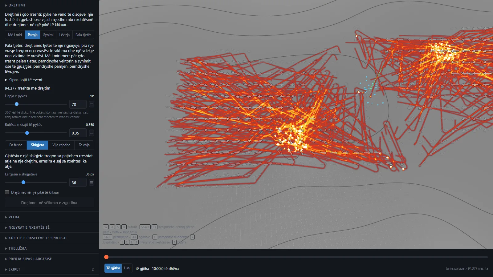

# Nxehtësia me drejtim

Nxehtësia e thjeshtë thotë **ku** ndodhin gjërat. Nxehtësia me drejtim thotë edhe **për cilën anë**: nga cila anë po shikonin njerëzit, ku po synonin, ku po lëviznin, ose ku ishte pala tjetër e një përleshjeje.

Një sprite i zakonshëm është një disk i plotë (360 gradë). Me një **Hapje pyke** prej 70 gradësh, i njëjti sprite bëhet një pykë e ngushtë që tregon anën ku ishte kthyer rreshti, dhe shton të njëjtën nxehtësi totale.

## Si përdoret {#how-to-use-it}

1. Ngarko të dhëna që kanë një drejtim (shih [Çfarë i jep një rreshti drejtim](#what-gives-a-row-a-direction)).
2. Zgjidh **Nxehtësi**, **Diferencë** ose **Nxehtësi ekipi** te shiriti i modaliteteve.
3. Hap seksionin **Drejtimi** në anështyllë.
4. Zgjidh një **burim** (cilin drejtim të përdorësh), pastaj ndiz vizatimin:
   - ul **Hapjen e pykës** nën 360° për të vizatuar çdo rresht si pykë që tregon anën e vet në vend të diskut;
   - zgjidh një **Fushë** për të vizatuar shigjeta ose vija rrjedhe mbi nxehtësi;
   - shëno **Drejtimet në një pikë të klikuar** dhe kliko nxehtësinë për të marrë një grafik polar të asaj pike.

Rreshti i gjendjes thotë sa rreshta kanë drejtim nga burimi i zgjedhur.

## Cilësimet {#settings}

| Cilësimi | Parazgjedhja | Çfarë bën |
|---|---|---|
| Burimi: **Më të mirat**, **Pamja**, **Synimi**, **Lëvizja**, **Pala tjetër** | Më të mirat | Cilin drejtim merr çdo rresht. *Më të mirat* merr, për çdo rresht, palën tjetër, përndryshe synimin, përndryshe pamjen, përndryshe lëvizjen. |
| **Për llojin e ngjarjes** | sipas sipër | Një burim tjetër për çdo lloj ngjarjeje, për shembull *Pala tjetër* për vrasjet dhe *Pamja* për pozicionet. Shfaqet kur të dhënat kanë një kolonë ngjarjeje me më së shumti 40 vlera. |
| **Hapja e pykës** | 360° | 360° është disku i zakonshëm (i fikur). Më e vogël është pyka më e ngushtë. Një pykë shton aq nxehtësi sa disku i saj, kështu që totalet dhe diferencat mbeten të krahasueshme. |
| **Butësia e skajit të pykës** | 0,35 | 0 është një pykë me skaj të mprehtë, 1 një ventilator i butë. |
| **Fusha**: Pa fushë, Shigjeta, Vija rrjedhe, Të dyja | Pa fushë | Shigjetat: gjatësia e shigjetës është sa pajtohen rreshtat aty për një drejtim, opaciteti i saj sa nxehtësi ka aty. Shigjetat shfaqen vetëm aty ku ka nxehtësi. |
| **Largësia e shigjetave** | 28 px | Distanca midis shigjetave në ekran. |
| **Animo vijat e rrjedhës** | i ndezur | Vijat e rrjedhës lëvizin kur është i ndezur. |
| **Drejtimet në një pikë të klikuar** | i fikur | Kliko nxehtësinë për të parë drejtimet aty (më poshtë). |
| **Drejtimet në vëllimin e zgjedhur** | | I njëjti grafik për gjithçka brenda [vëllimit](volumes.md) të zgjedhur. |

## Grafiku polar në një pikë {#the-polar-chart-at-a-spot}

Me **Drejtimet në një pikë të klikuar** të ndezur, kliko nxehtësinë. Rreshtat afër asaj pike (brenda 1,5 rrezeve të sprite-it) mblidhen në një rozetë prej 24 feta të 15°:

- petale **portokalli**: drejtimet dalëse (ku tregojnë rreshtat);
- petale **blu**: drejtimet hyrëse (nga ku erdhën);
- **sipërfaqja** e një petali rritet me numërimin e tij; një shigjetë tregon drejtimin kryesor;
- vijat nën grafik japin drejtimin kryesor, sa fort pajtohen rreshtat (R, 0 deri 1), shpërndarjen në gradë, dhe numrin e rreshtave.

0° është lart në grafik, që është -Z e botës (veriu për regjistrimet Tacview). Pika shënohet edhe në pamjen 3D me një shigjetë dhe një unazë.

## Çfarë i jep një rreshti drejtim {#what-gives-a-row-a-direction}

| Burimi | Duhet në të dhëna |
|---|---|
| Pamja | një kolonë yaw (hartëzuar si drejtimi i shikimit): `yaw`, `heading`, `azimuth`, `view_yaw`, `rot_z` |
| Synimi | çifte numrash si `aim_x`/`aim_y`, `shot_x`/`shot_y`, `fire_x`/`fire_y`, `hit_dir_x`/`hit_dir_y` (një `…_z` opsionale) |
| Lëvizja | asgjë tjetër: hapi nga kampioni i mëparshëm i të njëjtit person (më së shumti 10 s më parë, e njëjta seancë) |
| Pala tjetër | një kolonë që emëron palën tjetër të një ngjarjeje (`other`, `victim`, `target`, `killer`, `attacker`, `shooter`, `other_player` ...) me vlera emrash personash; një vrasje tregon nga vrasësi te viktima, një vdekje nga viktima te vrasësi |

## Këshilla {#tips}

- Pykat kanë nevojë për një madhësi të caktuar në ekran; nën disa piksele vizatohen përsëri si disqe.
- Përdor *Pala tjetër* te rreshtat e vrasjeve për të parë **nga ku** u fituan përleshjet, dhe *Pamja* te rreshtat e pozicionit për të parë **ku shikojnë njerëzit**.
- Me **Diferencë**, pykat e dy paleve tregojnë drejtimin e tyre, kështu që vijat e zjarrit të kontestuara dalin në pah.
