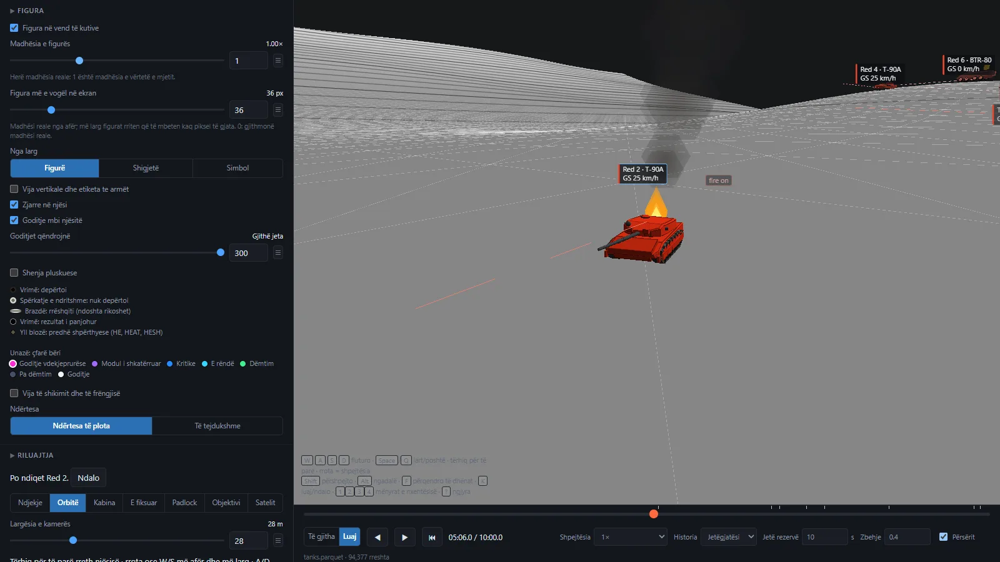

# Figurat

Një **figurë** është një model i vogël 3D i asaj që është në të vërtetë një njësi: një tank, një avion reaktiv, një anije, një ushtar. [Riprodhimi](match-replay.md) vizaton çdo njësi si figurën e vet në madhësinë e vërtetë, në vend të një kutie të thjeshtë.

Ka rreth 2.000 mjete, avionë, anije, armë dhe ushtarë të emërtuar, të gjitha të ndërtuara nga vetë shikuesi.

## Çfarë ka në katalog {#what-is-in-the-catalogue}

| Fushë | Shembuj |
|---|---|
| Njerëz | ushtar në këmbë, i ulur, shtrirë; snajper, kundër-tanku, mjek, ekuipazh |
| Tokë | tanke, automjete luftarake këmbësorie, mbrojtje ajrore, artileri, kamiona dhe makina, trena dhe tramvaje |
| Ajër | avionë luftarakë, avionë sulmi, bombardues, transportues, helikopterë, nga avionët me dy krahë deri te reaktivët modernë |
| Det | anije luftarake sipas klasës, aeroplanmbajtëse, nëndetëse, varka, anije tregtare |
| Armë | raketa, roketa, bomba, torpedo, flares dhe chaff |
| Shenja | granata tymi, shkëndije dhe zjarri, bomba të vendosura, flamuj, pika të shfaqjes, pika udhëtimi |

## Si bëhen figurat {#how-the-figures-are-made}

- **Ndërtuar nga dimensionet e publikuara.** Shumica e figurave bëhen nga ndërtuesi i figurave të vetë shikuesit nga numra publikë: gjatësia, gjerësia, lartësia, rrotat e rrugës, kulla dhe topi, krahët dhe bishti. Forma e tyre pastaj rregullohet sipas fotografive publike, vizatimeve dhe dimensioneve të publikuara. Nuk përdoren modele të asnjë loje.
- **Modele të lira.** Disa figura përdorin modele 3D të lira (CC0 ose CC BY) aty ku janë më besnike, ndonjëherë të kombinuara me trupin e ndërtuar. Autorët e veprave CC BY janë të përmendur te [Kreditet e figurave](figure-credits.md); veprat CC0 nuk kanë nevojë për kredi dhe nuk listohen atje.
- Çdo figurë ka një version të plotë, një të trashë dhe një të largët (nivele detaji, LOD), kështu që mijëra mund të vizatohen njëherësh.

## Cilën figurë merr një njësi {#which-figure-a-unit-gets}

Shikuesi shikon kolonat e vetë të dhënave:

1. **Emrat** - kolonat e quajtura *Name*, *Vehicle*, *Unit*, *Unit type*, *Model*, *Aircraft*, *Plane*, *Tank*, *Ship*, *Craft*, *Loadout*, *Kit* ose *Figure* - krahasohen me katalogun: saktësisht, përmes rreth 4.000 pseudonimeve (ID-të e njësive të disa lojërave), sipas fillimit më të gjatë të njohur (`F-16C_50` është F-16C), ose sipas emrit më të shkurtër të figurës që fillon me të.
2. Një emër figura e të cilit nuk përshtatet me **llojin** e njësisë nuk përdoret (një kamion me emrin *Typhoon* nuk është avioni luftarak).
3. **Llojet** - kolonat e quajtura *Type*, *Class*, *Kind*, *Category*, *Icon*, *Role* ose *Domain* - japin një figurë klase: etiketat e Tacview (`Air+FixedWing`, `Ground+Heavy+Armor+Vehicle+Tank`, `Sea+Watercraft+Warship`, `Weapon+Missile`), ikonat e hartës, ose fjalë të thjeshta (tank, helicopter, infantry).
4. Të dhënat pa asnjërën janë të dhëna njerëzish: të gjithë janë ushtarë.

Kështu, mënyra më e lehtë për të marrë figurat e duhura është një kolonë `vehicle` me emrat e vërtetë, ose një kolonë `type` me etiketa Tacview.

**Njësia ime shfaqet si kuti ose ushtar.** Shto një kolonë `vehicle` me emrin e vërtetë, ose një kolonë `type` me një etiketë Tacview. Kalo miun mbi njësinë për të parë cili emër u përput. Të dhënat që kanë kolona të tilla, por nuk thonë asgjë për një njësi, e lënë atë kuti; të dhënat pa asnjërën vizatohen si ushtarë.

## Cilësimet {#settings}

Seksioni **Figurat** i shiritit anësor të riprodhimit cakton madhësinë, madhësinë më të vogël në ekran, çfarë bëhen njësitë e largëta (figurë, shigjetë, simbol), dhe efektet që vizatohen mbi to. Shih [Riprodhimi i ndeshjes](match-replay.md#figures). Tymi, zjarri dhe efektet e tjera me kohë: [Figurat te mbivendosja e figurave](figure-replay.md).

## Një paketë figurash lokale opsionale {#an-optional-local-figure-pack}

Mund të mbash në makinën tënde një paketë opsionale figurash të tua. Figurat e saj zënë vendin e figurave të katalogut me të njëjtët emra. Ajo nuk është kurrë pjesë e depos ose e një ndërtimi të publikuar; pa të, asgjë nuk ndryshon.
