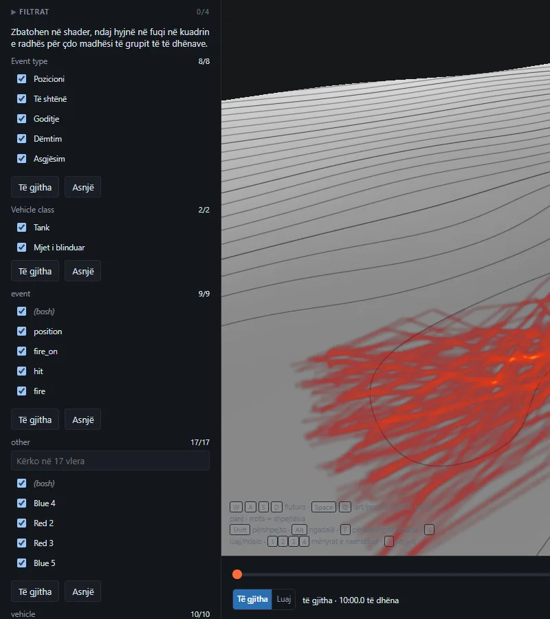
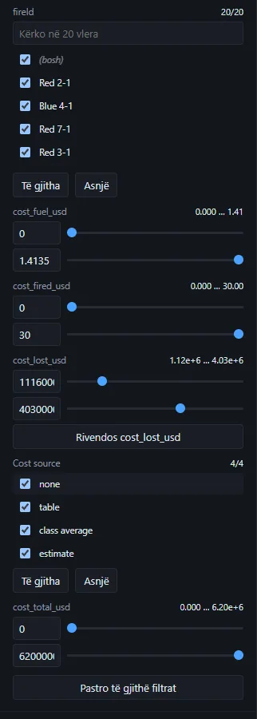

# Filtrat

**Filtrat** fshehin rreshtat që nuk të interesojnë, si një klasë mjeti ose një lloj ngjarjeje, dhe figura përditësohet menjëherë. Paneli liston kolonat e mbajtura gjatë ngarkimit nën *Mbaje për filtrim* ([Përcaktimi i kolonave](column-mapping.md)), plus *Skedari burim* kur janë ngarkuar disa skedarë.

## Provoje {#try-it}

1. Ngarko një grup të dhënash dhe hap **Filtrat** në shiritin anësor.
2. Te **Klasa e mjetit**, hiq shenjën e *Tank*. Figura ndryshon menjëherë.
3. Shtyp **Pastro të gjithë filtrat** për ta zhbërë.

Rreshtat e parë janë kolonat e vetë shikuesit (më poshtë). Rreshtat pas tyre vijnë nga skedari yt.

## Kolonat që shton shikuesi {#columns-the-viewer-adds}

Gjatë ngarkimit shikuesi nxjerr katër kolona të veta dhe i liston **të parat**, me emra dhe vlera në gjuhën tënde, kështu që i njëjti filtër funksionon për çdo lojë dhe burim të dhënash:

| Kolona | Vlerat | Nxjerrë nga |
|---|---|---|
| **Lloji i ngjarjes** | 23 lloje: Pozicion, Të shtënë, Lëshim (raketë, roketë, bombë), Goditje, Humbje (armë që mbaroi pranë asnjë objektivi), Shpërthim, Dëmtim, Vrasje, Vdekje, Shkatërrim, Rrëzim, Nxjerrje / shpëtim me parashutë, Lindje, Zhdukje, Ngritje, Ulje, Kontakt me tokën, Ndalim në tokë, Rimbushje / karburant, Kapje / objektiv, Karficë, Mesazh, Tjetër | një kolonë me emrin `event`, `events`, `event_type` ose `event_name`; fjalët e çdo lojë (`shot`, `burst`, `fired`, `struck`, `flare`, `plant` ...) hartohen në këto lloje. Tabela e plotë: [Llojet dhe klasat e ngjarjeve](ref-event-types.md). |
| **Lojtar ose IA** | Lojtar, IA | një kolonë `ai`, `is_ai`, `bot` ose `actor`; përndryshe `is_player` / `human`; përndryshe një id llogarie (`user_id`, `steam_id`; bosh ose 0 është IA); për regjistrimet Tacview, nëse objekti ka pilot |
| **Klasa e mjetit** | 17 klasa: Aeroplan luftarak, Avion sulmi, Bombardues, Avion tjetër, Helikopter, Tank, Mjet i blinduar, Mbrojtje ajrore, Artileri, Kamion / makinë, Anije, Nëndetëse, Këmbësori, Armë, Karficë, Strukturë, Tjetër | emri i mjetit ose njësisë (krahasuar me [katalogun e figurave](figures.md)) dhe kolonat e tipit |
| **Klasa e objektivit** | të njëjtat klasa | mjeti i palës tjetër (`other_vehicle`, `target_vehicle`, `victim_type` ...) |

Menjëherë pas tyre vijnë [kolonat e rezultatit](data-formats.md#outcome-columns), ku të dhënat i kanë: **Rezultati i raundit** dhe **Rezultati i ndeshjes** (*Çdo*, *Fituar*, *Humbur*) dhe **Si mbaroi raundi**, me vlerat në gjuhën tuaj. Filtroni sipas tyre, ose ndajeni nxehtësinë sipas tyre si një [hartë e shkallës së fitoreve](win-rate.md).

Listohen vetëm llojet që ndodhin. Kolonat e vlerave (`cost_*`, `earn_*`, `net_*` dhe *Burimi i kostos*, shih [Peshimi i vlerave](value-weighting.md)) filtrohen si çdo kolonë numerike: për shembull, hiq shenjën te *estimate* te *Burimi i kostos* për të mbajtur vetëm rreshtat me çmim.

Një listë kategorish me më shumë se 12 vlera merr një kuti kërkimi (*Kërko n vlera*) dhe një buton **Vetëm këto**, që lejon saktësisht vlerat që përputhen.

Cilat kolona mund të filtrohen vendoset gjatë ngarkimit, sepse duhet të lexohen atëherë. Pa asnjë kolonë të mbajtur, paneli e thotë këtë dhe të drejton te *Mbaje për filtrim*.

## Kolonat numerike (interval) {#numeric-columns-range}

| Pjesa | Kuptimi |
|---|---|
| Emri, dhe `min ... max` | Kolona, dhe intervali aktual (intervali i plotë i kolonës për sa kohë nuk ka filtër). |
| Rreshti i parë: kutia e numrit dhe rrëshqitësi | Kufiri i poshtëm. Tërheqja e rrëshqitësit mbi kufirin e sipërm e shtyn edhe atë. |
| Rreshti i dytë: kutia e numrit dhe rrëshqitësi | Kufiri i sipërm. Tërheqja nën kufirin e poshtëm e shtyn edhe atë. |
| **Rivendos *kolonën*** | Heq këtë filtër. |

Rrëshqitësit mbulojnë minimumin deri te maksimumi i kolonës në 1,000 hapa; kutitë e numrave pranojnë çdo vlerë. Një rresht kalon kur vlera e tij është brenda intervalit, të dy skajet të përfshira. Vlerat e mëdha shfaqen në formë eksponenti (`1.23e6`).

## Kolonat kategorike {#category-columns}

| Pjesa | Kuptimi |
|---|---|
| Emri, dhe `lejuara/gjithsej` | Kolona, dhe sa nga vlerat e saj janë të lejuara. |
| Lista e vlerave | Një kuti kontrolli për vlerë; një vlerë bosh shfaqet si *(bosh)*. |
| **Të gjitha** / **Asnjë** | Lejo çdo vlerë / asnjë vlerë. |

Lejimi i çdo vlere heq filtrin.

## Rregullat {#rules}

- **Katër filtra njëherësh.** Kreu tregon `aktive/4`. Një filtër i pestë nuk zbatohet, dhe paneli e thotë këtë. Një zgjedhje te [Entitetet](entities.md) (ose fokusi i lojtarit të skedës Ndeshja) përdor edhe ajo një nga të katërtat. Një filtër që mbulon gjithë kolonën nuk përdor asnjë.
- **Një kolonë kategorike ka më së shumti 4,096 vlera**; një më e gjerë nuk mbahet gjatë ngarkimit.
- **Filtrat kombinohen me AND**, dhe me dukshmërinë e skuadrave, ndarjen e diferencës, dritaren kohore, heqjen sipas largësisë dhe [prerjen](slice.md).
- **Ndryshimi i një filtri e rinis grumbullimin dhe rimat ekspozimin disa kornizë më vonë**, sepse filtrimi mund ta ndryshojë shumë dendësinë ([Ngjyra dhe ekspozimi](colour-and-exposure.md#auto-exposure)).
- **Pastro të gjithë filtrat** heq çdo filtër kolone. Dukshmëria e ekipeve dhe zgjedhjet e lojtarëve të bëra gjetkë ruhen.
- Filtrat e kolonave ndryshojnë modalitetet e nxehtësisë. Nuk ndryshojnë figurat e [riluajtjes me figura](box-replay.md), që ndjekin dukshmërinë e ekipeve dhe zgjedhjen te Entitetet. Zgjedhja te Entitetet ndryshon të dyja.
- Te [nxehtësia e vijave](line-heat.md) një filtër testohet mbi rreshtin ku mbaron çdo segment.
- Në çdo grup të ri të dhënash, të gjitha filtrat pastrohen.

## Për zhvilluesit {#for-developers}

**Vendet.** Çdo filtër aktiv zë një nga katër vendet e GPU ([`MAX_FILTER_SLOTS`](https://github.com/Holdi601/3DHeat/blob/main/src/render/types.ts)), një teksturë me 4 bajt për rresht. Vendet u jepen filtrave sipas renditjes së ndryshimit të fundit ([`filterSlots`](https://github.com/Holdi601/3DHeat/blob/main/src/render/filterTables.ts), i përbashkët për shader-in dhe të dy panelet). Pas katërt, një gabim thotë *Zbatohen vetëm 4 filtrat e parë. Pastro një - të tjerët nuk zbatohen, nuk kombinohen në heshtje*, dhe emrat e filtrave shtesë lexohen *kolona (nuk zbatohet)*. Filtrat ekzekutohen për rresht në vertex shader, kështu që ndryshimi i një pragu nuk kërkon ri-analizim as ri-ngarkim.

**Filtra që paneli nuk i shfaq.** Ekzistojnë edhe dy lloje të tjera në gjendjen e aplikacionit ([`FilterSpec`](https://github.com/Holdi601/3DHeat/blob/main/src/state/types.ts)):

- një filtër **grupesh**, i vendosur nga skeda Ndeshja kur fokusohet një anë. Fsheh grupet e tjera në çdo modalitet, përfshirë një ndarje [diference](difference.md) sipas kolonës.
- një filtër **personash**, i vendosur nga paneli [Entitetet](entities.md) dhe nga skeda Ndeshja kur fokusohet një lojtar. Kufizon riluajtjen me figura dhe modalitetet e nxehtësisë. Në nxehtësi është një filtër kategorie mbi id-të e personave dhe zë një nga katër vendet. Maska e tij mban 65,536 id ([`FILTER_MASK_CAPACITY`](https://github.com/Holdi601/3DHeat/blob/main/src/render/types.ts)); një person mbi atë numër nuk vizatohet në nxehtësi ndërsa filtri është aktiv, edhe kur është i zgjedhur. Riluajtja me figura ende i shfaq.
