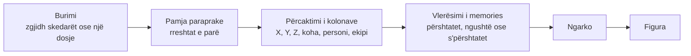

# Si të futni të dhënat

Para se 3DHeat të mund të vizatojë diçka, i duhet një tabelë: çdo rresht thotë ku ndodhi diçka dhe, nëse e ke, kur dhe kush. Ky seksion tregon si një skedar bëhet figurë. Ende pa të dhëna? Provo [të dhënat demo](demo-data.md).

**Bëje këtë tani:**

1. Në shiritin anësor të Harta e nxehtësisë hap **Burimi** dhe shtyp **Skedarë…** (ose lësho një skedar ose dosje mbi zonën e lëshimit).
2. Shiko **Përcaktimi i kolonave**: kutitë zakonisht janë plotësuar tashmë.
3. Kontrollo që **Vlerësimi i memories** thotë *përshtatet*.
4. Shtyp **Ngarko**.

Gjithçka që shfaq skeda Harta e nxehtësisë vjen nga një **grup të dhënash** të vetëm: një tabelë rreshtash, secili me një pozicion dhe, opsionalisht, një kohë, një person, një grup, një seancë, një drejtim shikimi dhe çdo numër kolonash shtesë të mbajtura për filtrim. Ky seksion shpjegon si krijohet një grup të dhënash.

## Rruga nga skedarët te figura {#the-path-from-files-to-picture}

1. **Zgjidh skedarët** në panelin **Burimi** - një skedar, disa, një pemë dosjesh, ose duke i lëshuar. Pranohen Parquet, CSV, Tacview, gjurmë GPS dhe të tjera; lista e plotë e vetme është te [Formatet e të dhënave](data-formats.md#files). Shih [Ngarkimi i skedarëve](loading-files.md).
2. **Pamja paraprake.** Hapet skedari i parë i zgjedhjes: emrat e kolonave, 50 rreshtat e parë, cilat kolona duken numerike, dhe (për Parquet) tipi logjik i çdo kolone dhe udhëzimet e vetë skedarit për lexim, hyrja `heat3d` në fund.
3. **Përcaktimi automatik.** Kolonat caktohen në role - X, Y, Z, koha, personi, seanca, grupi, drejtimi i shikimit - dhe disa mbahen për filtrim. Çdo supozim shfaqet në panelin **Përcaktimi i kolonave** dhe mund të ndryshohet. Shih [Përcaktimi i kolonave](column-mapping.md) dhe [Boshtet, njësitë dhe koha](axes-units-and-time.md).
4. **Numërimi.** Numri i rreshtave të çdo skedari lexohet (saktë nga fundet e Parquet, vlerësuar për CSV), kështu që paneli mund të thotë para ngarkimit sa kujtesë i duhet ngarkimit dhe nëse përshtatet. Nëse jo, propozon ngarkimin e çdo *N*-të rreshti. Shih [Kujtesa dhe buxhetet](memory-and-budgets.md).
5. **Ngarko.** Një punëtor në sfond analizon vetëm kolonat e përcaktuara të çdo skedari - disa skedarë njëherësh, deri te buxheti i [fijeve analizuese](memory-and-budgets.md#parser-threads) - dhe i bashkon, sipas renditjes së zgjedhjes, në një grup të vetëm: një fjalor të përbashkët personash, grupesh dhe seancash për të gjithë skedarët, një origjinë kohe të përbashkët, të gjitha rreshtat të renditur sipas kohës. Shih [Seancat, personat dhe grupet](sessions-persons-groups.md).
6. **Ngarkimi në GPU.** Fija kryesore njofton "Po ngarkohen N rreshta në GPU" për një kornizë, pastaj i paketon rreshtat në kujtesën e GPU brenda buxhetit të GPU. Shih [Qëndrimi i kujtesës së GPU](gpu-memory.md).
7. **Figura e parë.** Kamera e përshtat kornizën me të dhënat, rrezja e sprite-it dhe ngopja caktohen nga shtrirja e të dhënave dhe numri i rreshtave, dhe pas 8 kornizave të vizatuara ngopja matet nga vetë figura ([Ngjyra dhe ekspozimi](colour-and-exposure.md)).

## Kërkesat, të kontrolluara para ngarkimit {#requirements-checked-before-a-load}

| Nevoja | Çfarë ndodh pa të |
|---|---|
| **Të paktën dy nga X / Y / Z** | Ngarkimi refuzohet. Me vetëm dy, boshti i tretë është 0 dhe të dhënat vizatohen si një rrafsh i sheshtë në skenën 3D - çfarë do një hartë nxehtësie nga lart. |
| Një kolonë kohe | Opsionale. Pa të kronologjia çaktivizohet, pamja mbetet në modalitetin **Të gjitha**, dhe shiriti anësor e thotë këtë. |
| Një kolonë personi | Opsionale. Nevojitet për [mbivendosjen e figurave](box-replay.md) (një figurë për çdo person), [nxehtësinë e vijave](line-heat.md) (rruga që ndoqi çdo person), interpolim, gjurmë dhe historinë **Jetëgjatësi**. |
| Një kolonë grupi | Opsionale. Nevojitet për [nxehtësinë e ekipit](team-heat.md) dhe për modalitetin [diferencë](difference.md) (të paktën dy grupe). |

Një modalitet që të dhënat e ngarkuara nuk e mbajnë është i zbehur në shiritin e modeve; kur kalon mbi të, thuhet arsyeja.

## Pa të dhënat e tua {#without-your-own-data}

Paneli **Grupi i të dhënave** (poshtë **Burimi**) ka një [gjenerator sintetik](synthetic-generator.md) që prodhon një grup të dhënash me formë battle-royale, me çfarëdo madhësie, i dobishëm për të provuar shikuesin dhe për të testuar çfarë mund të mbajë një kompjuter.

## Faqet e këtij seksioni {#pages-in-this-section}

- [Ngarkimi i skedarëve](loading-files.md) - zgjedhësit, dosjet, lëshimi dhe bashkimi i shumë skedarëve, rregulli i skedarit të lëvizjes, progresi dhe anulimi
- [Përcaktimi i kolonave](column-mapping.md) - çdo fushë e panelit të përcaktimit, si e supozon përshtatja automatike, sugjerimet `heat3d`
- [Boshtet, njësitë dhe koha](axes-units-and-time.md) - boshti lart, përmbysjet, shkalla e njësisë, njësitë e kohës, drejtimi i shikimit
- [Seancat, personat dhe grupet](sessions-persons-groups.md) - çfarë bën secili, kufijtë, emrat e përbashkët, madhësia e entitetit, paneli Grupi i të dhënave
- [Gjeneratori sintetik](synthetic-generator.md)
- [Kujtesa dhe buxhetet](memory-and-budgets.md) - modeli i gjurmës, kontrolli i përshtatjes, zvogëlimi, tavani i renditjes, buxhetet e burimeve
