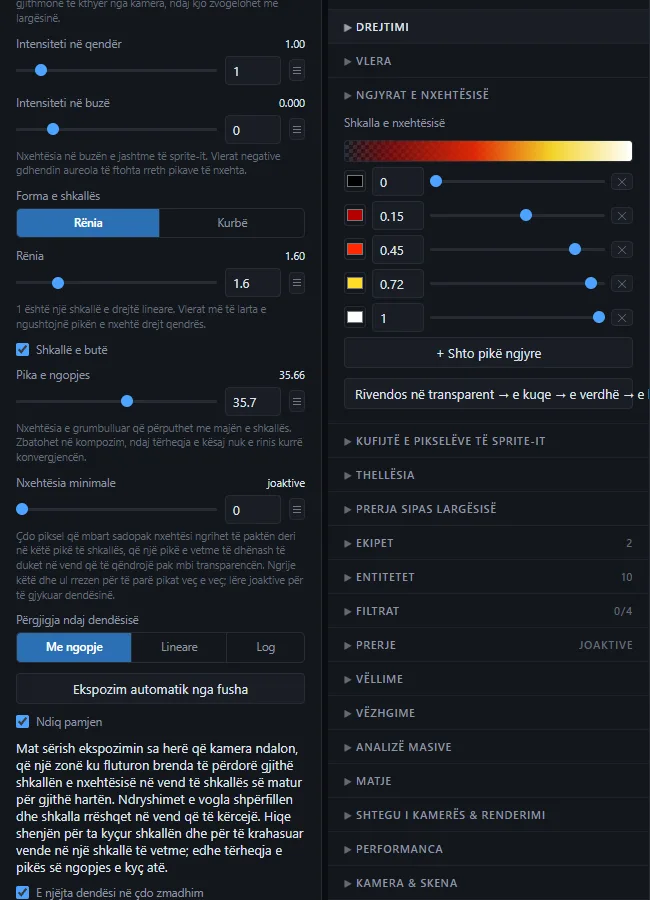

# Nxehtësi

Nxehtësia i vizaton vendet ku ndodhin shumë gjëra: e kuqe ku ndodh pak, e bardhë e nxehtë ku ndodh shumë. Ajo përgjigjet: "ku ndodh kjo, dhe sa".

**Nxehtësia** (tasti 1) është modaliteti parazgjedhur. Çdo [rresht](glossary.md) i dukshëm kontribuon me një [sprite](glossary.md) të rrumbullët që përballet me kamerën; sprite-et që mbivendosen mblidhen në një buffer me pikë lundruese; shuma përkthehet përmes një shkalle ngjyrash — si parazgjedhje transparente → e kuqe → e verdhë → e bardhë — dhe vizatohet mbi skenë.

Figura tregon nxehtësinë e një raundi të qitësit mbi një nivel me ndërtesa: vendet e nxehta janë në dhomat dhe te shkallët, jo vetëm në tokë.

## Si përdoret {#how-to-use-it}

1. Ngarko të dhëna dhe shtyp `1` (ose zgjidh **Nxehtësi** te shiriti i modaliteteve).
2. Nëse gjithçka është e bardhë ose bosh, shtyp **Ekspozim automatik nga fusha** te seksioni **Forma e nxehtësisë**.
3. Ndrysho **Rrezen e sprite-it** derisa pikat fqinje të bashkohen në brez: një vlerë e vogël tregon pika të vetme, një vlerë e madhe tregon zona.
4. Hap **Ngjyrat e nxehtësisë** për të ndryshuar ngjyrat, ose **Thellësinë** për t'i lënë kodrat dhe muret të fshehin nxehtësinë prapa tyre.

Të njëjtët panele formësojnë [Diferencën](difference.md), [Nxehtësinë e ekipit](team-heat.md) dhe [Nxehtësinë me vija](line-heat.md); ndryshojnë në atë që shtohet (me shenjë, me ngjyrë, ose përgjatë vijave), jo në mënyrën si.

## Panelet dhe parazgjedhjet e tyre {#the-panels-and-their-defaults}

Çdo kontroll shpjegohet në faqen e vet; kolona Detajet lidhet me të. Rrëshqitësit kanë një kuti të shkruar pranë tyre dhe një dorezë tërheqjeje (kapësja e vogël në të djathtë: tërhiq lart ose poshtë; më larg është më shpejt; Shift për rregullim të imët). Aty ku shiriti i një rrëshqitësi mbaron para një kufiri real, dorezë mund të kalojë përtej deri te *tavani i rrëshqitjes* që jepet këtu. Vlerat e shënuara *në ngarkim* rillogariten për çdo grup të ri të dhënash.

### Forma e nxehtësisë (e hapur) {#heat-shape-open}

| Kontrolli | Parazgjedhja | Diapazoni (tavani i rrëshqitjes) | Detajet |
|---|---|---|---|
| **Rrezja e sprite-it** | 6 m; në ngarkim shtrirja / 120 | 0,05-2000 m, logaritmik (50 000) | [Forma e sprite-it](sprite-shape.md#sprite-radius) |
| **Intensiteti në qendër** | 1 | 0-10 (1000) | [Forma e sprite-it](sprite-shape.md#centre-and-edge-intensity) |
| **Intensiteti në buzë** | 0 | -2-10 (1000) | [Forma e sprite-it](sprite-shape.md#centre-and-edge-intensity) |
| **Forma e shkallës** | *Rënia* | *Rënia* / *Kurba* | [Forma e sprite-it](sprite-shape.md#ramp-shape-falloff-or-curve) |
| **Rënia** (vetëm për Rënien) | 1,6 | 0,1-8 (64) | [Forma e sprite-it](sprite-shape.md#falloff) |
| **Shkallë e butë** (vetëm për Rënien) | i ndezur | | [Forma e sprite-it](sprite-shape.md#falloff) |
| Redaktori i kurbës (vetëm për Kurbën) | paracaktimi *E butë* | | [Forma e sprite-it](sprite-shape.md#the-curve-editor) |
| **Pika e ngopjes** | 24; në ngarkim një vlerësim, pastaj e matur | 0,1-4000, logaritmik (10 000 000) | [Ngjyra dhe ekspozimi](colour-and-exposure.md#saturation-point) |
| **Nxehtësia minimale** | i fikur (0) | 0-100% | [Ngjyra dhe ekspozimi](colour-and-exposure.md#minimum-heat) |
| **Përgjigja ndaj dendësisë** | *Me ngopje* | *Me ngopje* / *Lineare* / *Log* | [Ngjyra dhe ekspozimi](colour-and-exposure.md#density-response) |
| **Ekspozim automatik nga fusha** | | buton | [Ngjyra dhe ekspozimi](colour-and-exposure.md#auto-exposure) |
| **Ndiq pamjen** | i ndezur | | Mat ekspozimin përsëri sa herë që kamera ndalon, kështu që një zonë ku fluturon përdor gjithë shkallën e ngjyrave. Ndryshimet e vogla injorohen, dhe shkalla rrëshqet. Hiqe, ose tërhiq **Pikën e ngopjes**, për ta kyçur shkallën dhe për të krahasuar vende në një shkallë të vetme. [Ngjyra dhe ekspozimi](colour-and-exposure.md#follow-the-view) |
| **E njëjta dendësi në çdo zmadhim** | i ndezur | | Një ngjyrë do të thotë të njëjtin numër rreshtash për njësi sipërfaqe toke, sa afër të jesh. Një sprite që kufijtë e pikselëve e zmadhojnë (larg) ose e zvogëlojnë (afër) e mban nxehtësinë që do të shtonte madhësia e vet reale, kështu që një pamje e ekspozuar nga larg nuk zbehet kur fluturon brenda. Kur është e fikur, një sprite i kufizuar shton peshën e plotë me madhësinë e kufizuar. [Forma e sprite-it](sprite-shape.md#pixel-clamps) |
| **Rrafsho mbi rrafshin e tokës** | i fikur | | [Forma e sprite-it](sprite-shape.md#flatten-onto-ground-plane) |

### Ngjyrat e nxehtësisë (e mbyllur) {#heat-colours-closed}

| Kontrolli | Parazgjedhja | Detajet |
|---|---|---|
| Mostrat e grupeve dhe **Ndarja e ngjyrave** (vetëm Nxehtësi ekipi) | 1,4 | [Nxehtësi ekipi](team-heat.md) |
| Redaktori i **Shkallës së nxehtësisë** (*Pozitive (ekipe të mbledhura)* te Diferenca, *Shkalla e opacitetit* te Nxehtësia e ekipit) | transparente → e kuqe → e verdhë → e bardhë | [Ngjyra dhe ekspozimi](colour-and-exposure.md#the-ramp-editor) |
| **Rivendos në transparent → e kuqe → e verdhë → e bardhë** | | |
| Shkalla **Negative (ekipe zbritëse)** (vetëm Diferenca) | transparente → jeshile → blu → vjollcë | [Diferenca](difference.md#colours) |

### Kufijtë e pikselëve të sprite-it (e mbyllur) {#sprite-pixel-clamps-closed}

| Kontrolli | Parazgjedhja | Diapazoni (tavani i rrëshqitjes) | Detajet |
|---|---|---|---|
| **Rrezja min. në piksele** | 1 px | 0-16 (512) | [Forma e sprite-it](sprite-shape.md#pixel-clamps) |
| **Rrezja maks. në piksele** | 96 px | 2-1024, logaritmik (8192) | [Forma e sprite-it](sprite-shape.md#pixel-clamps) |

### Thellësia (e hapur) {#depth-open}

| Kontrolli | Parazgjedhja | Detajet |
|---|---|---|
| **Fshih pas terrenit** | i ndezur | [Thellësia dhe heqja e pjesëve të padukshme](depth-and-culling.md#hide-behind-terrain) |
| **E fshehur pas gjeometrisë** | 0,8 (*80% më e errët*) | [Thellësia dhe heqja e pjesëve të padukshme](depth-and-culling.md#hidden-behind-geometry) |

### Heqja sipas largësisë (e mbyllur) {#distance-culling-closed}

| Kontrolli | Parazgjedhja | Diapazoni (tavani i rrëshqitjes) | Detajet |
|---|---|---|---|
| **Afër** | i fikur (0) | 0,5-5000 m, logaritmik, fundi i shiritit = i fikur (200 000) | [Thellësia dhe heqja e pjesëve të padukshme](depth-and-culling.md#distance-culling) |
| **Larg** | i fikur (0) | 1-200 000 m, logaritmik, fundi = i fikur (10 000 000) | [Thellësia dhe heqja e pjesëve të padukshme](depth-and-culling.md#distance-culling) |
| **Prit në një rrafsh** | i ndezur | | [Thellësia dhe heqja e pjesëve të padukshme](depth-and-culling.md#distance-culling) |
| **Prit edhe nivelin** | i ndezur | | [Thellësia dhe heqja e pjesëve të padukshme](depth-and-culling.md#distance-culling) |

Tastet: `[` dhe `]` e shtyjnë kufirin e largët brenda dhe jashtë, `\` e ndërron ([Thellësia dhe heqja e pjesëve të padukshme](depth-and-culling.md#keyboard)).

### Drejtimi dhe Vlera {#direction-and-value}

Dy seksione të tjera ndodhen poshtë Formës së nxehtësisë. **Drejtimi** vizaton çdo rresht si pykë dhe shton shigjeta: shih [Nxehtësinë sipas drejtimit](directional-heat.md). **Vlera** e peshon nxehtësinë sipas asaj që kushtoi ose fitoi çdo rresht: shih [Peshimin e vlerave](value-weighting.md).

## Çfarë ruhet {#what-is-saved}

Cilësimet e nxehtësisë së lartpërmendur nuk ruhen midis seancave: rifreskimi i faqes rikthen parazgjedhjet. Dy gjëra mbahen në shfletues: shpejtësia e fundit e luajtjes (`heat3d.speed`, shih [Kronologjinë](timeline.md)) dhe cilësimet e figurave të largëta të [mbivendosjes së figurave](box-replay.md) (stili i simbolit, madhësia, shenjat e goditjeve, e kështu me radhë). Po ashtu gjuha, [boshtet e botës të përmbysura](camera.md#invert-world-axis), emrat e makinave të mbajtur nga skeda e analizës së garës dhe [biblioteka e niveleve](level-library.md). Lista e plotë është te [Cilësimet e ruajtura](ref-settings-storage.md).
