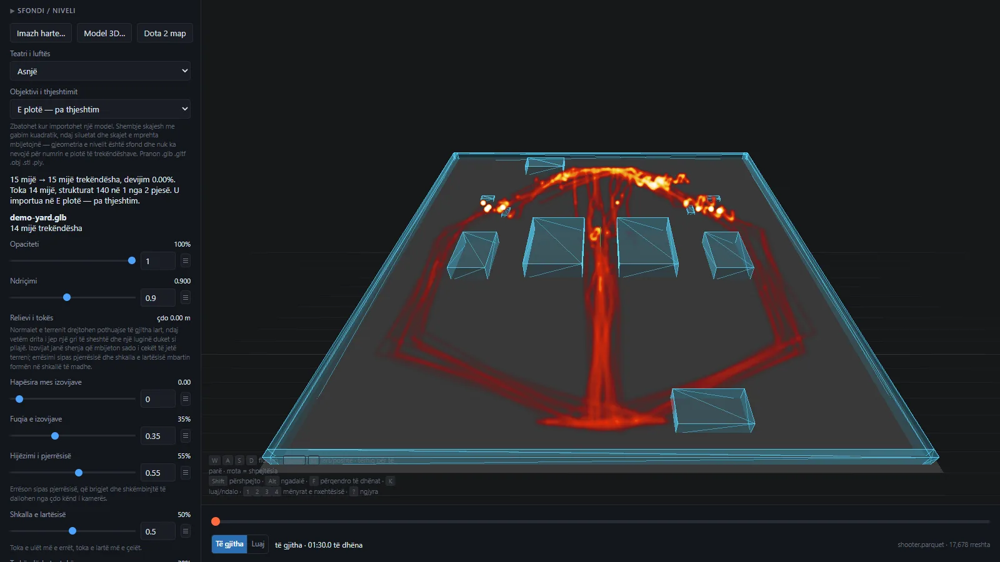

# Nxehtësi

Nxehtësia lyen vendet ku ndodhën shumë gjëra: të kuqe aty ku ndodhi pak, e bardhë e nxehtë aty ku ndodhi shumë. Përgjigjet pyetjes "ku ndodh kjo, dhe sa".

**Nxehtësi** (tasti 1) është modaliteti parazgjedhur. Çdo [rresht](glossary.md) i dukshëm shton një [sprite](glossary.md) të rrumbullt që i shikon kamerës; sprite-et që mbivendosen mblidhen në një buffer me pikë lundruese; shuma kalon nëpër një shkallë ngjyrash - si parazgjedhje transparent → e kuqe → e verdhë → e bardhë - dhe vizatohet mbi skenë.

Figura tregon nxehtësinë e një raundi shooter në një nivel me ndërtesa: pikat e nxehta ndodhen në dhoma dhe në shkallë, jo vetëm në tokë.

## Si ta përdorësh {#how-to-use-it}

1. Ngarko të dhënat dhe shtyp `1` (ose zgjidh **Nxehtësi** në shiritin e modeve).
2. Nëse gjithçka është e bardhë ose bosh, shtyp **Ekspozim automatik nga fusha** në seksionin **Forma e nxehtësisë**.
3. Ndrysho **Rrezja e sprite-it** derisa pikat fqinje të bashkohen në brez: më e vogël shfaq pika të vetme, më e madhe shfaq zona.
4. Hap **Ngjyrat e nxehtësisë** për të ndryshuar ngjyrat, ose **Thellësia** për ta lënë kodrat dhe muret të fshehin nxehtësinë pas tyre.

Të njëjtat panele formojnë [Diferencën](difference.md), [Nxehtësinë e ekipit](team-heat.md) dhe [Nxehtësinë e vijave](line-heat.md); ndryshojnë në atë që shtohet (me shenjë, me ngjyra, ose përgjatë vijave), jo në mënyrën si.

## Panelet dhe parazgjedhjet e tyre {#the-panels-and-their-defaults}

Çdo kontroll më poshtë lidhet me një parametër të shader-it, kështu që ndryshimi nuk kushton asgjë përveç një rivizatimi. Rrëshqitësat kanë një kuti të shkruar pranë tyre dhe një dorezë tërheqjeje (kapësja e vogël në të djathtë: tërhiq lart ose poshtë, më larg është më shpejt, Shift për saktësi të imët); aty ku pista e rrëshqitësit mbaron para një kufiri real, dorezën mund ta shtysh deri te *kufiri i rrotullimit* të dhënë këtu. Vlerat e shënuara *në ngarkim* rillogariten për çdo grup të ri të dhënash.

### Forma e nxehtësisë (e hapur) {#heat-shape-open}

| Kontrolli | Parazgjedhja | Intervali (kufiri i rrotullimit) | Detaje |
|---|---|---|---|
| **Rrezja e sprite-it** | 6 m; në ngarkim shtrirja / 120 | 0.05-2000 m, logaritmike (50,000) | [Forma e sprite-it](sprite-shape.md#sprite-radius) |
| **Intensiteti në qendër** | 1 | 0-10 (1000) | [Forma e sprite-it](sprite-shape.md#centre-and-edge-intensity) |
| **Intensiteti në buzë** | 0 | -2-10 (1000) | [Forma e sprite-it](sprite-shape.md#centre-and-edge-intensity) |
| **Forma e shkallës** | *Rënia* | *Rënia* / *Kurba* | [Forma e sprite-it](sprite-shape.md#ramp-shape-falloff-or-curve) |
| **Rënia** (vetëm te Rënia) | 1.6 | 0.1-8 (64) | [Forma e sprite-it](sprite-shape.md#falloff) |
| **Shkallë e butë** (vetëm te Rënia) | po | | [Forma e sprite-it](sprite-shape.md#falloff) |
| Redaktuesi i kurbës (vetëm te Kurba) | parazgjedhja *Me butësi* | | [Forma e sprite-it](sprite-shape.md#the-curve-editor) |
| **Pika e ngopjes** | 24; në ngarkim një vlerësim, pastaj matet | 0.1-4000, logaritmike (10,000,000) | [Ngjyra dhe ekspozimi](colour-and-exposure.md#saturation-point) |
| **Nxehtësia minimale** | jashtë (0) | 0-100% | [Ngjyra dhe ekspozimi](colour-and-exposure.md#minimum-heat) |
| **Përgjigja ndaj dendësisë** | *Ngopje* | *Ngopje* / *Lineare* / *Logaritmike* | [Ngjyra dhe ekspozimi](colour-and-exposure.md#density-response) |
| **Ekspozim automatik nga fusha** | | buton | [Ngjyra dhe ekspozimi](colour-and-exposure.md#auto-exposure) |
| **Ndiq pamjen** | po | | Matet përsëri ekspozimi sa herë që kamera ndalon, kështu që një zonë në të cilën fluturon përdor gjithë shkallën e ngjyrave. Ndryshimet e vogla injorohen dhe shkalla rrëshqet. Hiqe shenjën, ose tërhiq **Pika e ngopjes**, për ta kyçur shkallën dhe për të krahasuar vende në një shkallë të vetme. [Ngjyra dhe ekspozimi](colour-and-exposure.md#follow-the-view) |
| **E njëjta dendësi në çdo zmadhim** | po | | Një ngjyrë do të thotë të njëjtin numër rreshtash për njësi toke, sado afër që je. Një sprite që kufijtë e pikselëve e zmadhojnë (larg) ose e zvogëlojnë (afër) mban nxehtësinë që do të shtonte madhësia e vet reale, kështu që një foto e ekspozuar nga larg nuk zbehet kur fluturon brenda saj. Me të fikur, një sprite i kufizuar shton peshën e plotë me madhësinë e kufizuar. [Forma e sprite-it](sprite-shape.md#pixel-clamps) |
| **Rrafsho mbi rrafshin e tokës** | jashtë | | [Forma e sprite-it](sprite-shape.md#flatten-onto-ground-plane) |

### Ngjyrat e nxehtësisë (e mbyllur) {#heat-colours-closed}

| Kontrolli | Parazgjedhja | Detaje |
|---|---|---|
| Mostrat e grupeve dhe **Ndarja e ngjyrave** (vetëm Nxehtësi ekipi) | 1.4 | [Nxehtësi ekipi](team-heat.md) |
| Redaktuesi i **Shkalla e nxehtësisë** (*Pozitive (ekipet shtuese)* te Diferenca, *Shkalla e opacitetit* te Nxehtësi ekipi) | transparent → e kuqe → e verdhë → e bardhë | [Ngjyra dhe ekspozimi](colour-and-exposure.md#the-ramp-editor) |
| **Rivendos në transparent → e kuqe → e verdhë → e bardhë** | | |
| Shkalla **Negative (ekipet zbritëse)** (vetëm te Diferenca) | transparent → jeshile → blu → vjollcë | [Diferenca](difference.md#colours) |

### Kufijtë e sprite-it në piksele (e mbyllur) {#sprite-pixel-clamps-closed}

| Kontrolli | Parazgjedhja | Intervali (kufiri i rrotullimit) | Detaje |
|---|---|---|---|
| **Rrezja min. në piksele** | 1 px | 0-16 (512) | [Forma e sprite-it](sprite-shape.md#pixel-clamps) |
| **Rrezja maks. në piksele** | 96 px | 2-1024, logaritmike (8192) | [Forma e sprite-it](sprite-shape.md#pixel-clamps) |

### Thellësia (e hapur) {#depth-open}

| Kontrolli | Parazgjedhja | Detaje |
|---|---|---|
| **Fshih pas terrenit** | po | [Thellësia dhe heqja e pjesëve të padukshme](depth-and-culling.md#hide-behind-terrain) |
| **E fshehur pas gjeometrisë** | 0.8 (*80% më e errët*) | [Thellësia dhe heqja e pjesëve të padukshme](depth-and-culling.md#hidden-behind-geometry) |

### Heqja sipas largësisë (e mbyllur) {#distance-culling-closed}

| Kontrolli | Parazgjedhja | Intervali (kufiri i rrotullimit) | Detaje |
|---|---|---|---|
| **Afër** | jashtë (0) | 0.5-5000 m, logaritmike, fundi i pistës = jashtë (200,000) | [Thellësia dhe heqja e pjesëve të padukshme](depth-and-culling.md#distance-culling) |
| **Larg** | jashtë (0) | 1-200,000 m, logaritmike, fundi = jashtë (10,000,000) | [Thellësia dhe heqja e pjesëve të padukshme](depth-and-culling.md#distance-culling) |
| **Prit në një rrafsh** | po | | [Thellësia dhe heqja e pjesëve të padukshme](depth-and-culling.md#distance-culling) |
| **Prit edhe nivelin** | po | | [Thellësia dhe heqja e pjesëve të padukshme](depth-and-culling.md#distance-culling) |

Tastet: `[` dhe `]` e shtyjnë kufirin e largët brenda dhe jashtë, `\` e ndërron ([Thellësia dhe heqja e pjesëve të padukshme](depth-and-culling.md#keyboard)).

### Drejtimi dhe Vlera {#direction-and-value}

Dy seksione të tjera ndodhen poshtë Forma e nxehtësisë. **Drejtimi** vizaton çdo rresht si një sektor dhe shton shigjeta: shih [Nxehtësi sipas drejtimit](directional-heat.md). **Vlera** peshon nxehtësinë sipas asaj që kushtoi ose fitoi çdo rresht: shih [Peshimi i vlerave](value-weighting.md).

## Çfarë ruhet {#what-is-saved}

Cilësimet e nxehtësisë më lart nuk ruhen ndërmjet seancave: rifreskimi i faqes rikthen parazgjedhjet. Dy gjëra mbahen në shfletues: shpejtësia e fundit e riluajtjes (`heat3d.speed`, shih [Kronologjia](timeline.md)) dhe cilësimet e largëta të figurave të [mbivendosjes së figurave](box-replay.md) (stili i simbolit, madhësia, shenjat e goditjeve etj.). Po ashtu mbahen gjuha, [boshtet botërorë të kthyer](camera.md#invert-world-axis), emrat e makinave të kujtuar të skedës së garës dhe [biblioteka e niveleve](level-library.md). Lista e plotë është te [Cilësimet e ruajtura](ref-settings-storage.md).
