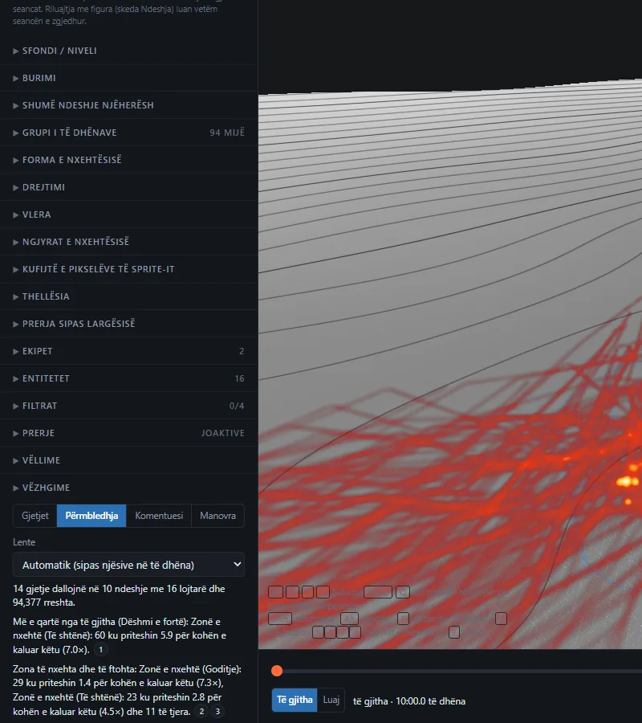
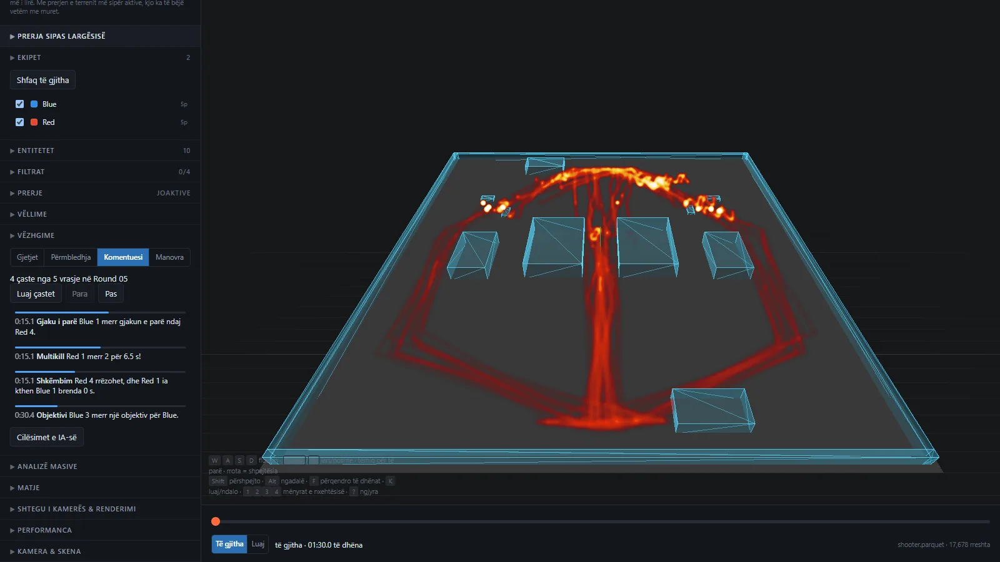

# Vëzhgime

**Vëzhgimet** kërkojnë në të dhënat e ngarkuara çfarë del në pah - pozicione të forta, tokë vdekjeprurëse, kurthe lindjeje, pika grykëzimi, lojtarë shumë mbi bashkëlojtarët e tyre - dhe të tregon, më të fortën e para, me provat. Përdore për të mësuar në një minutë ku u fitua ose u humb një ndeshje. Mund pastaj të shkruajë një përmbledhje, dhe në një riluajtje të vetme mund të veprojë si komentues që kërcen te momentet e mëdha.

Gjithçka numërohet në shfletuesin tënd. Asgjë nuk del nga kompjuteri yt, përveç nëse ndez një IA të jashtme (shih [IA e jashtme](#external-ai)).

Seksioni **Vëzhgime** ndodhet në shiritin anësor të skedave Harta e nxehtësisë dhe Ndeshja. Ka tre skeda: **Gjetjet**, **Përmbledhja** dhe **Komentuesi**.

## Gjetjet {#findings}

1. Ngarko të dhënat dhe hap **Vëzhgime**. Shtyp **Gjej vëzhgime** ("Po numërohet… n%" tregon progresin).
2. Lexo listën. Çdo gjetje ka një shirit force, një fjali, sa e fortë është provë (*Provë e fortë*, *Provë e mirë* ose *Pak provë*), cili detektor e gjeti, dhe klasën e mjetit ku ka rëndësi.
3. **Kliko një gjetje**: shikuesi aplikon filtrat e saj, fluturon kamerën te vendi dhe kërcen te koha, dhe hap detajet: efektin me intervalin 95%, vlerat p dhe q, provat e numëruara, dhe **Vëllim këtu**, që vizaton një [vëllim](volumes.md) rreth vendit.
4. **Rikthe filtrat** i kthen filtrat e tua. **Kopjo JSON** kopjon gjithë raportin.

Numërimi përdor filtrat aktualë, grupet e fshehura dhe ndeshjen e zgjedhur për gjithë intervalin kohor. Kur ndryshon filtrat më pas, një shënim e thotë këtë; shtyp **Numëro përsëri**.

Rreshtat në krye të listës (për shembull totalet e parasë) përmbledhin gjithë të dhënat përpara gjetjeve.

### Detektorët {#the-detectors}

| Detektori | Çfarë gjen | Nevojitet në të dhëna |
|---|---|---|
| **Pozicione force** | Vende me shanse shumë më të mira vrasje-për-vdekje sesa pjesa tjetër e hartës, dhe *tokë e sigurt* ku vdesin pak njerëz për kohën e kaluar | ngjarje vrasjeje dhe vdekjeje |
| **Zona të nxehta dhe të ftohta** | Vende ku një lloj ngjarjeje (të shtëna, goditje, kapje ...) ndodh shumë më shpesh ose më rrallë se sa parashikon koha e kaluar atje | një kolonë ngjarjesh |
| **Terren i hapur dhe mbulesë** | Vdekje në terren të hapur kundrejt gjeometrisë së nivelit pranë, dhe ngadalë kundrejt lëvizjes së shpejtë | vdekje; një nivel 3D për pjesën e gjeometrisë |
| **Spawn-et** | Spawn-e të forta, kurthe spawn-i, spawn-e të sigurta, koha deri në kontaktin e parë | kohë dhe persona |
| **Klasa sipas vendit** | Një klasë mjeti, ose lojtarët kundrejt IA-së, që bëjnë shumë më mirë ose më keq në një zonë | vrasje plus një kolonë klase mjeti ose lojtar/IA |
| **Lojtarët** | Lojtarë që vrasin ose vdesin shumë më tepër ose më pak se të tjerët në të njëjtën klasë | persona dhe vrasje |
| **Grykat dhe krahët** | Pika grykëzimi (shumë më tepër kalime sesa toka përreth) dhe rrugë krahu (përdoren rrallë, por çojnë në vrasje) | persona |
| **Vlera** | *Tokë e kushtueshme* dhe *Tokë fituese* | [kolonat e vlerave](value-weighting.md) |
| **Çfarë vendosi raundet** | Çfarë i dalloi raundet e fituara nga ato të humbura, dhe lojtarët që shtuan ose kushtuan më shumë probabilitet fitoreje (shih [Kush fitoi](#who-won-what-decided-the-rounds)) | raunde, vrasje dhe vdekje, dhe [kolonat e rezultatit](data-formats.md#outcome-columns) (`won`) |

Detektorët që nuk mund të punojnë mbi të dhënat listohen në fund, me arsyen.

### Si renditen gjetjet {#how-findings-are-ranked}

Çdo vend ose grup testohet kundrejt pjesës tjetër të hartës (teste binomiale ose normash të sakta). Shkalla e zbulimit të rremë mbahet në 5% (Benjamini-Hochberg). Rastësia mund të duket si model; kjo i mban alarmet e rreme të ulëta: mes gjetjeve të shfaqura, pritet të jetë rastësi më së shumti rreth një në njëzet. Efektet nga pak ngjarje tërhiqen drejt "pa efekt" para renditjes. Listohen më së shumti 60 gjetje, dhe çdo detektor merr disa vende afër majës.

### Kush fitoi: çfarë vendosi raundet {#who-won-what-decided-the-rounds}

Kur të dhënat thonë kush fitoi çdo raund ([kolona e rezultatit](data-formats.md#outcome-columns) `won`: CS2, Rainbow Six Siege, War Thunder ...), rezultati është ajo për të cilën flasin Vëzhgimet. Për çdo palë, i ndan raundet sipas asaj që ndodhi në to dhe krahason përqindjet e fitoreve:

| Faktori | Raundet e palës me të | ... dhe pa të |
|---|---|---|
| Dueli hapës | bëri vrasjen e parë | vdiq e para |
| Blerja | blerja e saj ishte më e mirë se e palës tjetër | më e keqe |
| Vdekja e parë e shkëmbyer | vdekja e saj e parë u shkëmbye brenda 5 s | nuk u shkëmbye |
| Vendosja | e vendosi bombën | pa vendosje |
| Pajisjet | më shumë granata se në raundin e saj të zakonshëm | më pak |
| Kontakt i hershëm | dueli i parë erdhi para kohës mediane të ndeshjes | më vonë |
| Një vend i mbajtur | një lojtar qëndroi në vend 5 s ose më shumë | askush |
| Një vend i arritur herët | një lojtar arriti atje në 25 s e para (rruga) | askush |

Çdo krahasim është një diferencë e dy përqindjeve të fitoreve me intervalin e saj 95% (Newcombe), p-në e saktë të Fisher-it dhe një q mbi të gjithë faktorët e provuar (Benjamini-Hochberg). Një degë me më pak se 8 raunde shënohet *pak raunde*. Ato nën shkallën 5% të zbulimit të rremë bëhen gjetje; më të fortat renditen mbi gjetjet e detektorëve të tjerë (një gjetje rezultati peshon 1,35 herë sa një me të njëjtin efekt dhe të njëjtat prova).

Një shembull i sajuar me 40 raunde:

> **T** fitoi 79% të 19 raundeve kur mbajti **Mid**, kundrejt 24% të 21 pa të (55 pikë, 95% nga 26 deri në 74) - q 0,004.

Ndjek edhe **probabilitetin e fitores** të raundit - shansin që kishte çdo palë në çdo çast, nga njerëzit gjallë, vendosja dhe ora: i përshtatur me raundet kur janë 30 ose më shumë, përndryshe nga një model paraprak i fiksuar (dhe teksti thotë cili). Prej tij dalin **pikat e kthesës** (vrasjet dhe vendosjet që e lëvizën më shumë shansin) dhe **probabiliteti i shtuar i fitores** i çdo lojtari: vrasjet dhe vendosjet e tij numërohen për të, vdekjet kundër tij, në vlerë raundesh gjatë ndeshjes, mesatarisht për raund me intervalin e vet, testuar kundrejt zeros. Vendet marrin të njëjtin bilanc: cila palë fitoi më shumë në duelet e zhvilluara atje.

Të dhënave u duhen raunde, vrasje dhe vdekje me të dyja palët, dhe kolona `won`; vende me emër (`place`) për vendet e mbajtura, një kolonë `buy` për blerjen.

## Përmbledhja {#debrief}

Skeda **Përmbledhja** i shkruan gjetjet në një tekst të shkurtër: një hyrje, gjetja më e qartë, një për taktikat, një për balancimin, pastaj - kur të dhënat thonë kush fitoi - çfarë vendosi raundet, pjesa tjetër e grupuar sipas detektorit, dhe sa prej tyre mbështeten në prova më të dobëta.

Çfarë vendosi raundet vjen në katër paragrafë: rezultati dhe nga vijnë probabilitetet e fitores; faktorët më të fortë me numrat, intervalin dhe q-në e tyre (kur asnjë nuk e kalon shkallën e zbulimit të rremë, teksti thotë *asgjë e sigurt ende* dhe prapë e përmend më të fortin); tri pikat më të mëdha të kthesës; dhe lojtarët që shtuan dhe kushtuan më shumë probabilitet fitoreje, me vendet që fituan më shumë. Një shembull i sajuar:

> T fitoi 23 dhe CT fitoi 17 nga 40 raunde me rezultat të njohur (T: 58%, 95% nga 42% deri në 72%). Probabilitetet e fitores vijnë nga një model i përshtatur me këto raunde.
>
> Çfarë i dalloi raundet e fituara nga ato të humbura: T fitoi 79% të 19 raundeve kur mbajti Mid, kundrejt 24% të 21 pa të (55 pikë, 95% nga 26 deri në 74) (q 0,004), ...
>
> Pikat e kthesës: raundi 17 në 48 s, një vrasje nga CT në B site ia çoi shansin nga 31% në 58%, dhe e mori raundin, ...

Çdo paragraf ka butona të numëruar që shfaqin gjetjet e tij. **Kopjo tekstin** e kopjon.

Narratori i integruar punon pa internet, në gjuhën tënde. Përzgjedhësi **Lente** mbi të (shih [Lente e njohurive](knowledge.md)) përcakton cilën literaturë citojnë paragrafët.

### IA e jashtme {#external-ai}

**Cilësimet e IA-së** lejon një model IA sipas zgjedhjes sate të shkruajë përmbledhjen në vend të tij:

| Cilësimi | Kuptimi |
|---|---|
| **Ofruesi** | Anthropic (Claude), OpenAI (ChatGPT), OpenRouter, Ollama (lokal), LM Studio (lokal), server llama.cpp (lokal), ose çdo pikë përfundimi e pajtueshme me OpenAI |
| **URL bazë**, **Modeli** | Plotësohen nga ofruesi; **Listo modelet** i kërkon serverit |
| **Çelësi API** | Dërgohet vetëm te URL-ja bazë. Kurrë nuk regjistrohet, kurrë nuk ruhet në pamje, eksportime apo skedarë `.3dheat`. Shumica e serverëve lokalë nuk kanë nevojë për të. |
| **Mbaje mend çelësin në këtë shfletues** | Joaktiv si parazgjedhje: çelësi harrohet kur mbyllet faqja |
| **Përdor një IA të jashtme** | Joaktiv si parazgjedhje |
| **Dërgo emrat e lojtarëve** | Joaktiv si parazgjedhje: lojtarët dërgohen si P1, P2 ... |

Pastaj shkruaj një pyetje opsionale dhe shtyp **Shkruaj me IA**. Dërgohen vetëm gjetjet dhe numrat e tyre - kurrë rreshtat e të dhënave të tua. Përgjigja rrjedh gradualisht, dhe gjetjet e cituara bëhen butona. Kur të dhënat thonë kush fitoi, modelit i kërkohet të nisë me atë që vendosi raundet, me intervalin dhe q-në e çdo numri, dhe të thotë kur një faktor mbështetet në pak raunde ose kur probabilitetet e fitores vijnë nga modeli paraprak.

## Komentuesi {#caster}

Për **një ndeshje** (zgjidh një nëse janë ngarkuar disa), **Komentuesi** gjen momentet që vlen të shihen: gjakun e parë, shumëvrasjet, shkëmbimet, kthimet në fund, luhatjet e objektivave, rikthimet, lojtarët që dallohen, të shtënat nga larg, dhe **pikat e kthesës** - vrasjet që e lëvizën më shumë shansin e një pale për të fituar raundin (sipas lojtarëve që mbetën gjallë në çdo palë, në raunde pa rishfaqje).

Kur të dhënat thonë kush fitoi çdo raund, çdo moment e thotë: *"Anna rrëzon Ben-in: shansi i T për të fituar raundin shkon nga 38% në 62% - dhe e marrin raundin."* Një moment i palës që fitoi më pas vlen më shumë kur komentuesi zgjedh cilat të mbajë, dhe një rikthim numërohet në raunde të fituara.

- Kliko një moment: pamja kalon te riluajtja, kërcen pak përpara tij, fluturon atje dhe ndjek lojtarin.
- **Luaj çastet** e luan çdo moment deri në fund dhe kalon më tej; **Para** / **Pas** lëviz mes tyre.
- Me një IA të jashtme aktive, **Komentim nga IA** shkruan një koment nga lista e momenteve (llojet, kohët, emrat ose pseudonimet, ekipet, klasat, distancat).

Kërkon persona dhe ngjarje vrasje/vdekje (ose kapje); një kolonë `other`/`victim` e bën të mundur shkëmbimet dhe të shtënat nga larg.

## Lente e njohurive {#knowledge-lens}

Një gjetje mund të lexohet përmes një **lente** njohurish të vendosura: doktrinë ushtarake, luftim ajror dhe detar, operacione urbane, dizajn lojërash dhe esports (ose *Auto*, e zgjedhur nga njësitë në të dhëna). Një gjetje e hapur atëherë shfaq hyrjen më të afërt të **doktrinës dhe literaturës** dhe një **paralele historike**, me referenca, dhe **Matjet e lentes** llogarit masa nga ajo literaturë mbi të dhënat (përshtatje Lanchester, raporte shkëmbimi, raporte forcash, fusha zjarri, terren kyç, shkëmbime, iniciativë). Përmbledhja dhe kërkesa për IA-në i përfshijnë ato. Gjithçka për të: [Lente e njohurive](knowledge.md).

Matjet e lentes masin edhe si sillen lojtarët si turmë dhe si grup - rreshtimi dhe rrotullimi, drejtimi i rrugëve, korsitë dhe gjurmët, mbushja, udhëheqësit dhe ndjekësit, të vonuarit, pika e thyerjes nën humbje, rreziku pas një jete të humbur, seritë, marrëveshja e blerjeve dhe përgjigja ndaj zjarrit hyrës - secila kundrejt modelit të vet të zerosë: [Sjellja kolektive](collective-behaviour.md).

## Të dhënat që bëjnë vëzhgimet të punojnë {#data-that-makes-insights-work}

- pozicione me **kohë**, një kolonë **personi** dhe një kolonë **ekipi**;
- një kolonë **ngjarjesh** me vrasje dhe vdekje (`kill`, `death`), dhe të tjera (`hit`, `fire`, `capture` ...);
- një kolonë **palës tjetër** (`other`, `victim`) për shkëmbime dhe drejtime;
- një kolonë **mjeti** ose **tipi** për klasat; një kolonë `ai` për lojtarët kundrejt IA-së;
- një kolonë **seance** / **ndeshjeje** / **raundi** kur ka disa ndeshje.

[Të dhënat demo](demo-data.md) i kanë të gjitha.
