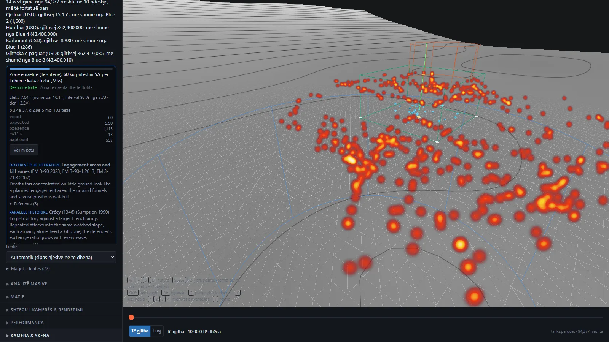

# Lente e njohurive

Kur [Vëzhgimet](insights.md) gjejnë diçka, kjo pjesë e shpjegon me ide nga historia ushtarake, dizajni i lojërave dhe analiza e sporteve, dhe emëron librin ose punimin nga vjen. Përdoreni për të mësuar *pse* ka rëndësi një model, jo vetëm që ekziston.

## Provojeni {#try-it}

1. Ngarkoni të dhëna dhe hapni **Vëzhgime**, pastaj shtypni **Gjej vëzhgime**.
2. Klikoni një gjetje për ta hapur.
3. Lexoni **Doktrinë dhe literaturë** dhe **Paralele historike**; referencat e plota janë të palosura poshtë.
4. Ndryshoni **Lenten** (për shembull në *Doktrinë ushtarake*) për ta lexuar të njëjtën gjetje përmes një tjetër trupi literature.

## Si funksionon {#how-it-works}

Paneli i Vëzhgimeve i vlerëson gjetjet e veta ashtu si do ta bënte një analist profesionist: përmes doktrinës ushtarake dhe kërkimit të operacioneve, përplasjeve historike, dhe literaturës së dizajnit të lojërave, dizajnit të niveleve dhe analitikës. Bën këtë jashtë linje, nga një bazë njohurish e kuruar në shikues, dhe i jep të njëjtin material një modeli të jashtëm kur një i tillë shkruan përmbledhjen.

## Çfarë shfaq paneli {#what-the-panel-shows}

- **Lente** zgjedh trupin e literaturës sipas të cilit lexohen gjetjet: *Automatik* (zgjedhur nga llojet e njësive në të dhëna: avionë, anije, mjete tokësore, këmbësorë), *Doktrinë ushtarake*, *Luftë ajrore*, *Detare*, *Urbane*, *Dizajni dhe balanca e lojës*, *Esports*. Hyrjet jashtë lentes së zgjedhur lihen jashtë.
- Çdo gjetje e hapur tregon hyrjen më të afërt të **doktrinës dhe literaturës** dhe **parallelen historike** më të afërt, me referencat e plota të palosura poshtë.
- **Matjet e lentes** listojnë matjet e analizës operacionale të llogaritura mbi të njëjtat rreshta (më poshtë), secila me kuptimin e vet dhe literaturën e saj.
- **Përmbledhja** shton rreshta për gjetjet kryesore dhe matjet e lentes: "Doktrinë dhe literaturë: ..." dhe "Paralele historike: ...", secila me citime autor-vit dhe referencat të palosura nën të.
- **Shkruaj me IA** dërgon hyrjet më të përshtatshme (përmbledhja, mësimi, gjetjet që lidhen me to, referencat e plota) bashkë me raportin, dhe i kërkon modelit t'i citojë me id - `{concept.lanchester-square}` - dhe të mos përdorë asnjë burim tjetër.

Etiketat janë përkthyer; vetë njohuria është në anglisht.

## Matjet e lentes {#lens-metrics}

Llogariten te punëtori i Vëzhgimeve, në të njëjtin kalim mbi rreshtat si zbuluesit (`src/insights/lensMetrics.ts`). Secila lihet jashtë kur të dhënat nuk mund ta mbajnë.

| Matja | Çfarë mat | Ka nevojë për |
|---|---|---|
| Përshtatja e Lanchester | Humbjet e secilës palë për 20 s, të regresuara mbi forcat e gjallë të të dyjave (Poisson, gabime quasi-likelihood); eksponentët mbi forcën e armikut dhe të vetes, të testuar kundrejt ligjit katror (zjarr i synuar) dhe ligjit linear (zjarr zone) | kohë, ekipe, vrasje dhe vdekje |
| Raporti i shkëmbimit | Vrasjet për vdekje sipas palës dhe vendit; pjesa e vdekjeve në tokën më vdekjeprurëse që mban 5% të kohës së shpenzuar, kundrejt pjesës që jep vetëm rastësia me aq vdekje; Gini i vdekjeve mbi kohën; I i Moran mbi normat e vdekjes | vrasje dhe vdekje |
| Raporti lokal i forcës | Njësitë miqësore dhe armike të gjalla brenda rrezes së angazhimit të çdo vrasjeje (rreze e vendosur nga të dhënat: dy herë distanca mediane me armikun më të afërt); pjesa e vrasjeve nga pala lokalisht superiore, dhe teprica e saj mbi atë që parashikojnë vetëm numrat | kohë, ekipe, lojtarë |
| Fushat e zjarrit | Pamjet e vendeve më të zëna të vrasjeve mbi një sipërfaqe pengesash 2.5D (gjeometria e nivelit deri në lartësinë e murit, ose toka e ecur) kundrejt vendit mesatar, dhe korrelacioni i rangut të pamjes me pjesën e vrasjeve | pozicione; një nivel i ngarkuar e bën më të mprehtë; jo për ajrin |
| Gjendja e energjisë | Energjia specifike (lartësia plus lartësia që mund ta blinte shpejtësia) e vrasësve ajrorë dhe viktimave ajrore, të krahasuara me statistikën Mann-Whitney | klasat e avionëve, kohë, lartësi |
| Terreni kyç | Sa shpesh një vend është mes tre vendeve më të zëna të vrasjeve të një ndeshjeje | disa ndeshje |
| Mbështetja e ndërsjellë (shkëmbimet) | Vdekjet e kthyera nga një vrasje e një shoku brenda rrezes së angazhimit dhe 5 s | kohë, ekipe |
| Goditja e parë | Angazhimet - vrasjet e grupuara sipas ndeshjes, sipas 20 s qetësie dhe sipas tre rrezeve të angazhimit në distancë - të fituara nga pala që shënoi e para | kohë, ekipe |
| Modeli i salvos | Ekuacioni i salvos i Hughes-it i përshtatur me periudha 20 s të anijeve në kontakt: anije të nxjerra jashtë veprimit për çdo anije sulmuese, dhe të shpëtuara për çdo anije mbrojtëse; një përshtatje Lanchester vetëm mbi anijet | klasat e anijeve, kohë, ekipe |
| Efektiviteti i luftimit | Vrasjet për orë-njësi në veprim të secilës palë dhe raporti i dy më të mëdhenjve (një vlerë efektiviteti luftimi në kuptimin e Dupuy-t) me intervalin 95%, dhe pjesa e vrasjeve të secilës palë me numra të barabartë lokalë | kohë, ekipe |
| Rrezet e angazhimit | Distanca nga armiku më i afërt te vrasjet, te lëshimet dhe te goditja e parë e çdo jete (zbulimi deri te angazhimi), sipas llojit të njësisë | kohë, ekipe; lëshimet aty ku të dhënat i kanë |
| Zinxhiri i vrasjes | Sekonda nga lëshimi i fundit i vrasësit deri te vrasja, dhe nga goditja e tij e parë e luftimit deri te vrasja | kohë; lëshime ose ngjarje zjarri |
| Përqendrim ose shpërndarje | Në çdo periudhë 20 s, shpërndarja e dy palëve më të mëdha dhe pjesa e vrasjeve që merr ajo më e ngushta | kohë, ekipe |
| Fluturimet | Për palë: fluturimet (ngritjet ose lindjet e avionëve), uljet, avionët e humbur dhe vrasjet nga avionët; norma e humbjes dhe vrasjet për fluturim | klasat e avionëve; ngritje ose lindje |

Të dhënat me raunde shtojnë matjet e luftimit nga afër dhe të esports-it - probabiliteti i fitimit të raundit, vlera e veprimeve, duelet e hapjes, shkëmbimet, sulmuesi kundrejt mbajtësit, synimi, shpërndarja, avantazhi i njeriut, mbylljet, rregullimet, pas vendosjes, kanalet vdekjeprurëse dhe ndikimi i lojtarit: shih [Luftimi nga afër dhe raundet](close-quarters.md).

Gjurmët dhe ekipet shtojnë matjet e sjelljes kolektive të shkencës së turmave, lëvizjes kolektive, ekonomisë së sjelljes dhe psikologjisë ushtarake - përputhja dhe rrotullimi, kopësimi i rrugës, korsitë dhe gjurmët, mbingarkesa, udhëheqësit dhe ndjekësit, të vonuarit, pika e thyerjes, rreziku pas humbjeve, seritë, marrëveshja për blerjen dhe shtypja, secila kundrejt modelit të vet null: shih [Sjellja kolektive](collective-behaviour.md).

Armët, mashtruesit dhe ndërtesat nuk numërohen si njësi. Aty ku rreshtat e armëve emërojnë njësinë që i lëshoi (një kolonë `Shooter` ose `Launcher`, siç kanë të dhënat e nxjerra nga Tacview), lëshimi i atribuohet asaj njësie, e përputhur me emrin ose id-në e saj të objektit.

## Si takohen gjetjet me literaturën {#how-findings-meet-the-literature}

Hyrjet dhe gjetjet takohen përmes një **taksonomie modelesh** (`src/insights/knowledge/patterns.ts`): përqendrimi, superioriteti lokal, zjarri i synuar dhe zjarri i zonës, pikat e ngushta, zonat e vrasjes, fushat e zjarrit, shpati i kundërt, sulmi anësor, mbështetja e ndërsjellë, avantazhi i energjisë, presioni i lindjes, balanca e kështu me radhë. Secili lloj zbulues dhe secila matje e lentes thotë cilat modele shfaqin numrat e tij (`src/insights/lens.ts`); çdo hyrje njohurie thotë cilave modele i drejtohet, me një peshë. Rëndësia e një hyrjeje për një gjetje është mbivendosja e peshuar, e shkallëzuar sipas sa përshtatet domeni i hyrjes (toka, ajri, deti, urbani) me të dhënat dhe sipas forcës së vetë gjetjes. Arsyetimi që shfaqet është numri i gjetjes në një fjali, e ndjekur nga mësimi i hyrjes.

## Katalogu {#catalogue}

Çdo model, koncept, metodë, rast historik, parim dizajni dhe studim, me bibliografinë: shih [Katalogun e njohurive](knowledge-catalogue.md).

## Për zhvilluesit {#for-developers}

### Shtimi i hyrjeve {#adding-entries}

1. Zgjidhni skedarin sipas llojit: `concepts.ts` dhe `concepts-more.ts`, `methods.ts`, `cases.ts`, `cases-land.ts`, `cases-air-sea.ts`, `cases-esports.ts`, `design.ts` (parimet e dizajnit) ose `studies.ts` në `src/insights/knowledge/`.
2. Jepini një id të re `<type>.<slug>` (kurrë mos ripërdorni një), lentet e saj, domenet, dhe modelet me të cilët merret, me peshat 0..1. Shtoni një model te `patterns.ts` vetëm kur një gjetje mund ta shfaqë, dhe hartëzojeni nga një gjetje ose matje te `lens.ts`.
3. Shkruani përmbledhjen dhe mësimin **me fjalët tuaja**. Citate vetëm nga veprat në domen publik (`pd: true` te referenca), dhe të shkurtra.
4. Citoni: shtoni çdo vepër të re te `refs.ts` me autorët, vitin, titullin dhe botuesin (revista me vëllimin dhe faqet); një URL ose DOI aty ku ka një regjistër publik.
5. Ekzekutoni `npx vitest run src/insights/lens.test.ts` (id unike, modele të njohura, referenca që zgjidhen, citate në domen publik, raste me datë dhe rezultat) dhe `node tools/knowledge-doc.mjs` për ta rifreskuar [katalogun](knowledge-catalogue.md).
