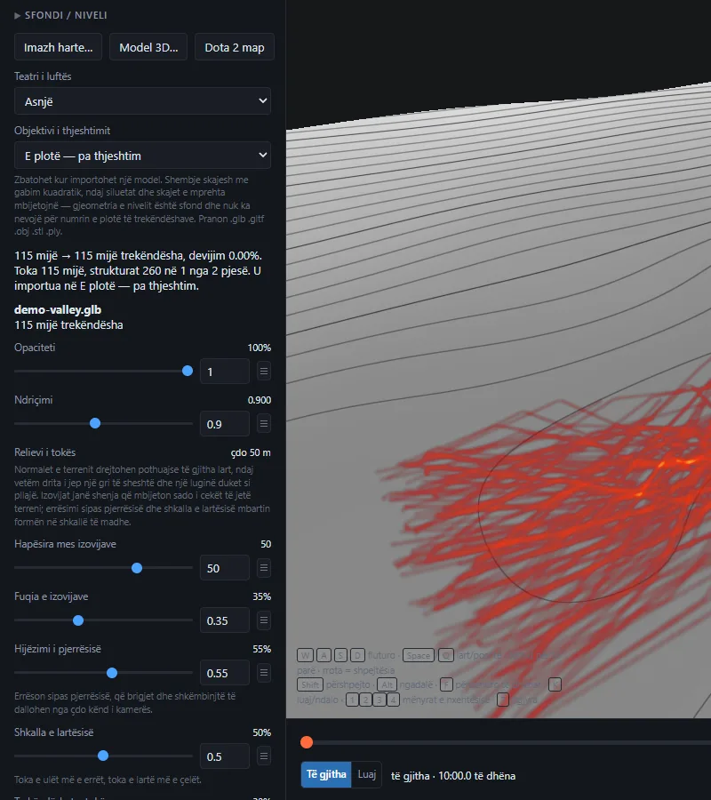

# Nivelet dhe gjeometria e sfondit

Një nivel është vendi 3D ku ndodhi loja: një hartë, një qytet, një pistë. Vendose prapa të dhënave të tua dhe mund të shohësh *ku* është nxehtësia. Paneli **Sfondi / niveli** (shih [Fjalorin](glossary.md) për "nivel") të jep tri lloje konteksti:

- një **imazh harte**, i gjeoreferencuar me dy angkyra — shih [Imazhet e hartave](map-images.md);
- një **nivel 3D** — `.glb`, `.gltf`, `.obj`, `.stl` ose `.ply` — i ndarë në tokë, struktura dhe ujë, dhe i thjeshtuar gjatë importit — shih [Nivelet 3D](model-levels.md) dhe [Pamja e nivelit](level-appearance.md);
- një **sfond botëror** — për një regjistrim që tregon ku ndodhet në tokë (një skedar Tacview ACMI), terrenin real, rrugët, ujin, aeroportet dhe ndërtesat, të shkarkuara nga të dhëna të hapura — shih [Sfondi botëror](world-backdrop.md).

Kur nuk ngarkohet asgjë, skena është e errët me një rrjetë dhe boshte me ngjyra (**Rrjeta** dhe **Boshtet** te [Kamera dhe kontrollet](camera.md)), dhe paneli thotë *Asgjë nuk është ngarkuar — skena shfaq një rrjetë dhe boshte. Shto një imazh harte ose një rrjetë niveli për t'i dhënë kontekst nxehtësisë.*

Niveli ndahet nga të tre skedat: një rrugë e ngarkuar te skeda Analiza e garës është i njëjti nivel që tregon harta e nxehtësisë.

## Vendose një nivel prapa të dhënave {#put-a-level-behind-your-data}

1. Ngarko së pari të dhënat e tua ([Si të futni të dhënat](getting-data-in.md)), që niveli të përshtatet me to.
2. Hap **Sfondi / niveli** në anështyllë.
3. Shtyp **Imazh harte…** për një figurë ose **Model 3D…** për një nivel 3D, dhe zgjidh skedarin. Për një regjistrim të botës reale, përdor **Sfondi botëror** ose **Teatri i luftës**.
4. Prit derisa të mbarojë rreshti i progresit. Një model i madh thjeshtohet së pari (shih **Objektivin e thjeshtimit** më poshtë).
5. Shtyp **F** te pamja për të përfshirë gjithçka në kuadër. Përdor **Opacitetin** dhe **Ndriçimin** derisa nxehtësia të dallohet nga niveli.
6. Shtyp **Ruaj në bibliotekë** nëse do ta përdorësh përsëri nivelin ([Biblioteka e niveleve](level-library.md)).

## Çfarë bën një nivel për nxehtësinë {#what-a-level-does-for-the-heat}

- **Errëson**: pikat e të dhënave prapa tij zbehen sipas sipërfaqes, dhe pikat e të dhënave prapa terrenit fshihen ([Thellësia dhe heqja e pjesëve të padukshme](depth-and-culling.md)). Pa nivel, nuk ka errësim.
- **Priten** nga [Prerja](slice.md) dhe, me *Prit edhe nivelin*, nga [heqja sipas largësisë](depth-and-culling.md#distance-culling), së bashku me nxehtësinë.
- Është e vetmja gjë që e turbullon [thellësia e fushës](camera.md#depth-of-field), përveç rrjetës dhe kutive.
- Një nivel 3D **e zgjeron planin e largët të kamerës** kur është më i madh se të dhënat: pozicionet e afërt dhe të largët kalibrohen nga grupi i të dhënave, dhe një hartë e eksportuar me disa kilometra gjerësi do të qëndronte krejt pas planit të largët dhe do të linte një pamje bosh. Plani i largët bëhet 3 × shtrirja horizontale e nivelit kur ajo është më e madhe, plani i afërt lëviz me të (të paktën larg / 100 000) për të ruajtur saktësinë e thellësisë nga varet errësimi, dhe shpejtësia e fluturimit ngrihet të paktën në shtrirje / 12. Ajo vetëm zgjerohet, kurrë nuk ngushtohet.

## Paneli, nga lart poshtë {#the-panel-top-to-bottom}

| Pjesa | Detajet |
|---|---|
| **Imazh harte…**, **Model 3D…** | Ngarko një; zëvendëson nivelin aktual. |
| **Sfondi botëror**, **Harro pllakat e hartës** | Vetëm për një grup të dhënash me referencë gjeografike: ndërton vendin real nën të si nivel, ose fshin pllakat e shkarkuara. [Sfondi botëror](world-backdrop.md) |
| **Objektivi i thjeshtimit** | Buxheti i trekëndëshave për importin tjetër të modelit: *I plotë - pa thjeshtim* (parazgjedhje), *I lartë - 8M*, *Mesatar - 3M*, *I ulët - 800k*, *Silueta - 100k*. [Nivelet 3D](model-levels.md#simplification) |
| Progresi dhe **Anulo** | Gjatë dekodimit ose importit. |
| Shënimi i importit | Trekëndëshat para dhe pas, ndarja tokë / struktura / ujë, niveli i detajit i përdorur. |
| Emri dhe madhësia | `gjerësi×lartësi px · x × z m/px` për një imazh, `N trekëndësha (nga M)` për një model. |
| **Opaciteti**, **Ndriçimi** | Të dy llojet. |
| Kontrollet e imazhit | **Heqja e ngjyrave**, **Përmbys veri/jug**, **Vendosja** (dy angkyra), **Përshtat me kufijtë e të dhënave**, **Lartësia**. [Imazhet e hartave](map-images.md) |
| Kontrollet e modelit | Relievi i tokës, uji, trekëndëshat e tokës, kornizat e telit, tekstura, ngjyra e kapur, strukturat, klasifikimi i pjesëve. [Pamja e nivelit](level-appearance.md) |
| **Ruaj në bibliotekë**, **Hiq** | [Biblioteka e niveleve](level-library.md); Hiq e shkarkon nivelin. |
| **Biblioteka** | Nivelet e ruajtura në këtë shfletues. [Biblioteka e niveleve](level-library.md) |

## Faqet e kësaj seksioni {#pages-in-this-section}

- [Imazhet e hartave](map-images.md)
- [Nivelet 3D](model-levels.md) — formatet, pjesët, klasifikimi, thjeshtimi, teksturat
- [Pamja e nivelit](level-appearance.md) — çdo kontroll për një nivel 3D
- [Biblioteka e niveleve](level-library.md)
- [Sfondi botëror](world-backdrop.md) — bota reale nën një regjistrim, nga të dhëna të hapura

Si të nxirren nivelet nga lojërat dhe motorët është punë e veglave të veçanta eksportuese (shih [README](https://github.com/Holdi601/3DHeat/blob/main/README.md) e depos); kontrata ku ato shkruajnë përmblidhet te [Nivelet 3D](model-levels.md#the-exporter-contract).
